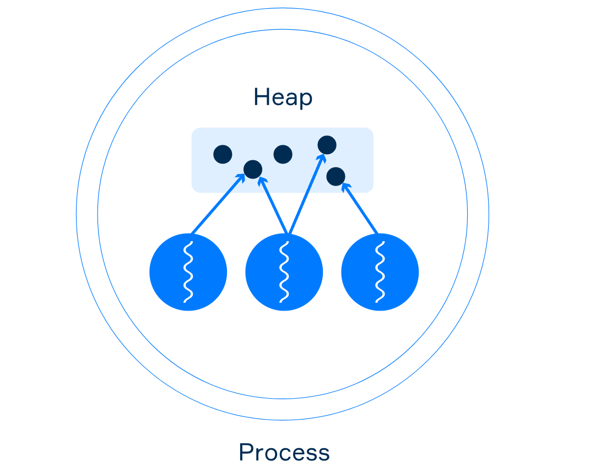

# Shared data

As you know, any program works with data stored in a special memory area. Each process has its own memory, but if we use multithreading in this process, threads have access to that specific area in order to interact with each other.

## Sharing data between threads

**Threads that belong to the same process share common memory (it is called heap)**. They may communicate by using shared data in memory. To be able to access the same data from multiple threads, each thread must have a reference to this data (by an object). The picture below demonstrates the idea:



**Multiple threads of a single process have references to objects in the Heap**


Let's consider an example. Here's a class named `Counter`:

```kotlin
class Counter {
    var value = 0

    fun increment() {
        value++
    }
}
```

The class has one function: `increment`. Each invocation of `increment` adds 1 to the field `value`.

And here's a class that extends `Thread`:

```kotlin
class MyThread(val
counter: Counter) : Thread() {
    override fun run() {
        counter.increment()
    }
}
```

Let's now create an instance of `Counter` and two instances of `MyThread`. Both instances of `MyThread` have the same reference to the `counter` object.

```kotlin
val counter: Counter =
Counter()

val thread1: MyThread = MyThread(counter)
val thread2: MyThread = MyThread(counter)
```

Now, let's see what happens when we start both threads one by one and print out the result of `counter.value`.

```kotlin
thread1.start() //start the first thread
thread1.join()  // wait for the first thread

thread2.start() // start the second thread
thread2.join()  // wait for the second thread

println(counter.value) // it prints 2
```
The result is exactly what we would've expected.

When you write your code in different threads that work with the same data concurrently, it is important to understand a few things:

- some operations are non-atomic

- changes of a variable performed by one thread may be invisible to other threads
- if changes are visible, their order might be not


## Thread interference

A **non-atomic** operation is an operation that consists of multiple steps. A thread may operate on an intermediate value of a non-atomic operation performed by another thread. 

This leads to a problem called **thread interference** – the sequences of steps of non-atomic operations performed by several threads may overlap.

The reading and writing fields of double and long types (64-bits) may not be atomic on some platforms.

To make such operations atomic, fields should be declared using the `Volatile` keyword. You'll find out what that means in the next section!

```kotlin
class MyClass {
    @Volatile
     var longVal: Long = 0 // reading and writing are atomic now

    @Volatile
     var doubleVal: Double = 0.0 // reading and writing are atomic now
}
```


Meanwhile, the operations of reading from and writing to the fields of certain types (`Boolean`, `Byte`, `Short`, `Int`, `Char`, and `Float`) are guaranteed to be atomic.

In large applications, thread interference bugs can be difficult to detect.

## Visibility between threads

Sometimes, when a thread changes shared data, another thread may not notice these changes or obtain them in a different order. It means that different threads may have inconsistent views of the same data.

The reason is that the compiler, runtime, or processor may apply all sorts of optimizations to speed up program execution. Even though these optimizations are often really useful, sometimes they can cause critical issues.

Caching and reordering are common optimizations that can cause unexpected behavior in concurrent programs. To manage these issues, Kotlin and the JVM offer several tools to control memory access order, with the most commonly used being the `@Volatile` annotation.

Example:

```kotlin
var number = 0
var ready = false

class Reader : Thread() {
    override fun run() {
        while (!ready) {
             yield() // thread does not need resources right now but wants to request them soon
        }
        println(number)
    }
}

fun main() {
    Reader().start()
    number = 42
    ready = true
}
```

As you might expect, the result will be 42. However, the program can also print zero. The reasons for such anomalies are **weak visibility** and **memory reordering**.

Let's see why that may happen:

**Most modern processors do not write to memory immediately after receiving a request. These requests are added to a queue in a separately allocated write buffer. After some time, all requests from the queue are immediately executed and the data is written to the main memory**.

Thus, when the main thread changes the values of the number and ready variables, there is no guarantee that the reading thread will see it. That is, the reading thread might see the updated value either immediately, or with some delay, or never at all!

The `@Volatile` annotation allows us to provide visibility to data changes. Thus, this annotation becomes very useful when you have multithreading in a program and access a block of code in parallel with multiple threads.

Example:

```kotlin
class Counter {
    @Volatile
    var count = 0
}

fun main() {
    val counter = Counter()

    // Thread tăng count
    Thread {
        repeat(10) {
            counter.count++
            println("Tăng: ${counter.count}")
            Thread.sleep(100)
        }
    }.start()

    // Main thread in giá trị count mỗi 100ms
    repeat(10) {
        Thread.sleep(100)
        println("Đọc: ${counter.count}")
    }
}
```

## Other cases of visibility

Sometimes we don't need to use the `@Volatile` annotation. The following procedures will also guarantee visibility:

- changes of variables performed by a thread **before starting** a new thread are always visible to the new thread;

- changes of variables inside a thread are always visible to any other threads after it successfully returns from `join` (we used this at the beginning of this article).

