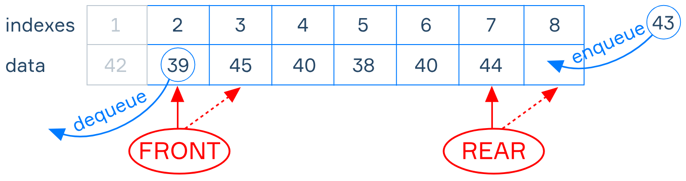
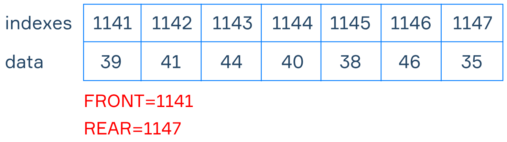
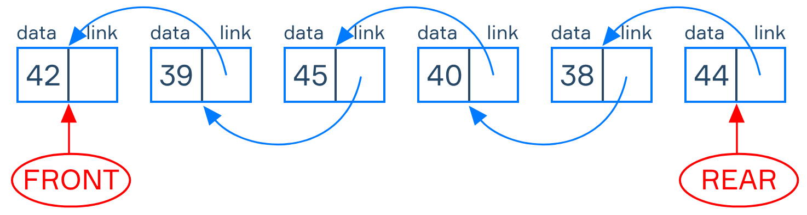

# Queue

it is an illustration of the programming principle called **FIFO** (First In, First Out), and the data structure that works this way is called a **queue**.

## Structure

The elements in the queue stand consecutively, with FRONT pointing at the first element and REAR pointing at the last element.

## Queue operations

there are only two events in the queue:

- The operation when you insert an element into the queue is called **enqueue**, and the element is added by the REAR pointer.
-  If you remove an element, this operation is called **dequeue**, and the element that was pointed at by FRONT comes out of the queue. 

Of course, after any of these operations, the corresponding pointer moves.

## Implementation of queue

### Array

`FRONT` and `REAR` can simply be numeric variables that store the indices of the corresponding elements.

Then you can access both the first element and the last one in a constant time: **the enqueue and dequeue** operations will take `O(1)`.

However, there is a problem with this implementation: adding and removing elements, you move through the array, which means you need an array of an infinite length.

### Linked list

`FRONT` and `REAR` are then pointers to the first and last nodes in the list, which again allows you to do insertion and deletion of elements in `O(1)`.

But storing a link to the next item in each item means wasting a lot more memory than the data requires.

### Implementation in practice

In most projects, you don't need to implement a queue: it already exists in your programming language. So how does it work? Well, it depends on the specific language, but most often it is implemented on an array with some upgrades. It is safe to say that both enqueue and dequeue operations have the `O(1)` time complexity.

