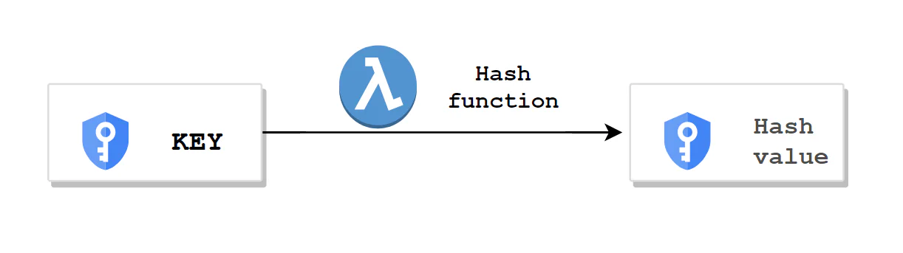
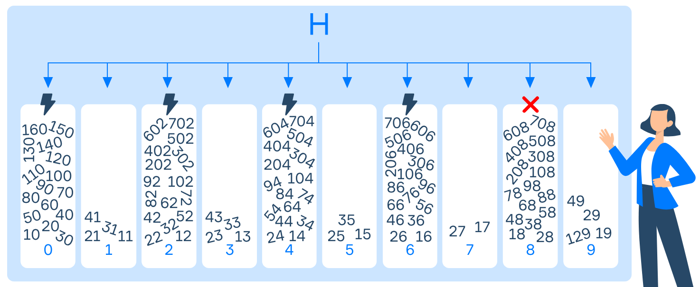

# Hash function

## Identifying a good hash function

Before we get started, let's refresh our understanding of **hash functions**. Basically, they operate like standard functions: you feed in some data, and they return a different output.

To be more specific, they utilize mathematical transformations to convert variable-sized input data into a fixed-size output called **the hash value or hash code**. So, what distinguishes a good hash function from an average one? 

- **Efficiency**: An efficient hash function should perform data processing quickly, optimizing computational resources for actual applications.

- **Determinism** means the function will result in the same output for a particular input no matter when and how often it's applied.

- **Uniformity**: The hash values should be uniformly distributed, meaning the inputs should map evenly among possible hash values.

## Efficiency

Efficiency is the lifeblood of practical hash functions, enabling fast data processing for applications like storage with rapid searching. Let's break this down:

Imagine you're working with a database system, like a vast library, that holds millions of books (records). Each book has a unique code (unique identifier). Now, consider a hash function as a super-efficient librarian who can instantly tell you exactly where a book is located when given its unique code. This librarian (hash function) quickly transforms this code into a location (hash value), enabling you to find your book swiftly. This is the beauty of an efficient hash function — it allows for rapid data retrieval and searching.

As we will learn in the following topics, the speed at which a hash function can compute hash values is typically constant, denoted as `O(1)`. This speed is vital for efficient searching, and most hash tables meet this criterion.

However, as everywhere, there's are some exceptions. Some hash functions, like the well-known SHA1, might take a linear amount of time `O(n)` to compute hash values. This is not necessarily a downside: in fact, it's perfectly acceptable for certain tasks, such as creating checksums and hashing passwords. The point is, the desired 'speed' of a hash function can vary depending on the specific use case it's applied to.

## Determinism

The concept of determinism in hash functions is a vital aspect to understand in computer science, not only in hash functions. To simplify it, if you have two identical inputs, they should generate the same hash value.

Now, why is determinism important? It guarantees consistent results for a given set of inputs. This is particularly crucial for password storage. 

This hash value is then used for comparison during the authentication process. Without deterministic hash functions, the process of password authentication would turn chaotic, making it nearly impossible to verify user identities.

## Uniformity

Uniformity is means that the hash function should spread out its output (hash values) as evenly as possible.  

Let's consider it like this — if we categorize all possible outputs from a hash function, we'd like each category or group to be roughly the same size. This helps to avoid a bottleneck or slow-down caused by too many outputs (collisions) clustering around one or a few values, known as peak keys.

For instance, imagine a data storage system using a hash function that generates hash values based on the last digit of a user's ID. If the majority of these IDs end in even digits, the hash values will tend to pile up in certain 'buckets' or groups, creating uneven distribution. This clustering leads to a higher risk of collisions, which can hinder the system's overall performance and raise the likelihood of data errors and retrieval problems.

