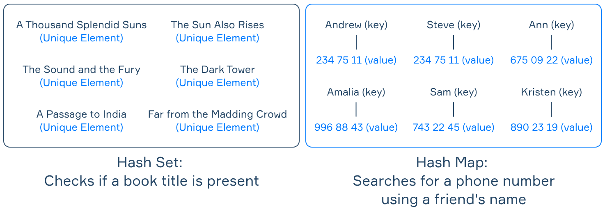

# Hash Table

Let's imagine the following scenario: you have a lot of friends and a big shelf full of books. Some of your friends want to borrow your books, some want to return them, and some want to know if you have a certain book. So, you want to write a program that lets you add books, remove books, and check if a book is available. For this scenario, what would be the best data structure to use?

**Hash tables** are structures that allow us to insert and remove values, and check if a value is present in time `O(1)` for each of those operations. Hash tables alone cannot guarantee this time. However, paired with a good hash function, everything works well, making it one of the best data structures for this purpose.

## Hash table

Hash tables are arrays where each entry is a **bucket**. Buckets can hold 0 or more values of a type. They are identified by their index in the array. If we want to insert a value in the hash table, we compute its hash value and insert it in the bucket at an index equal to the hash value (modulo the size of the array). You can do the same to remove an object or search for it.

> [!WARNING]
> If the hash value is greater than the maximum index of buckets, we use modulo division! So, if the hash table has 5 buckets (the max index shall be 4 since counting starts from 0), and the hash value of our element is, say, 12, we take the remainder of this value with the size of the array. In this case, 12%5=2, hence the element with a hash value equal to 12 will be stored in the bucket with index 2.

## Example of a hash table

Let's look at an example now. Say we have a hash table with 5 buckets, and we are inserting integers {1, 3, 5, 6} with the identity hash function. The table looks like this:

| **Index**  | 0   | 1      | 2   | 3   | 4   |
|------------|-----|--------|-----|-----|-----|
| **Values** | {5} | {1, 6} | {}  | {3} | {}  |

Now let's figure out how it works. Since we're using the identity function, the hash value is equal to the value itself. Because of this, you can see that 1 and 3 are in buckets at indexes 1 and 3 respectively. Now, 5 and 6 have hash values 5 and 6, but there are too few buckets! To find a bucket for them, we take the modulo of the hash value by the total number of buckets, in this case, 5. So, 5 modulo 5 is 0, and 6 modulo 5 is 1, and you can see in the table that the values are placed in the correct buckets.

## Hash set vs hash map

**There are two types of hash tables**. The one above is called a **hash set**. We can use it in scenarios where we only need to check if a value is present: for example, the book scenario in the introduction.

Standard Java's `HashSet` wraps `HashMap` and utilizes its keys, leaving values unused. So, `HashSet` just reuses the existing code without reinventing anything but wastes some memory.

We can still add or remove elements to a hash set, but in most cases we are not interested in getting a value out of a hash set. This happens because we already have an equal value that we need in order to search a hash table. Implementations of hash sets are `unordered_set` in C++ and `HashSet` in Java.

Another type of **hash table** is a hash map. Imagine you want to keep a phone book of names and numbers of friends, and want to search for phone numbers using a friend's name. If you kept a hash set of the name-number pairs, you would need to know the number to be able to search. Here, hash maps can help you.

It stores an array of `Node` also known as **buckets**, and every node contains a key hash, a reference to the key, and to the value.
Nodes are positioned inside a bucket array according to their hashes.
Hash collisions are solved by linking nodes to each other, which forms a list inside one bucket.
Search operation (`Map.get`, `Map.containsKey`) determines a bucket by key hash and checks for key equality.
In case of collision, a list of nodes is traversed until a node with an equal key is reached.
This is called a **hash table with closed addressing** because key-value pairs are "closed" (locked) to a certain position.

They are very similar to hash sets, but they store pairs. The first entry in the pair is called the key, and the second is the value. Only the hash of the key is used, and, when searching, we look for the value associated with a key. In the example above, the keys would be the names, and the values would be the phone numbers. Implementations of hash maps are `unordered_map` in C++ and `HashMap` in Java.
