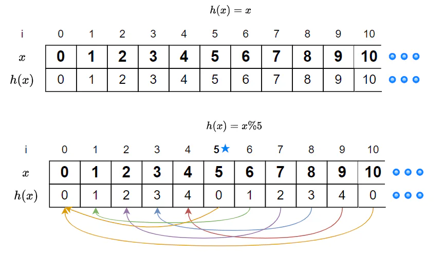
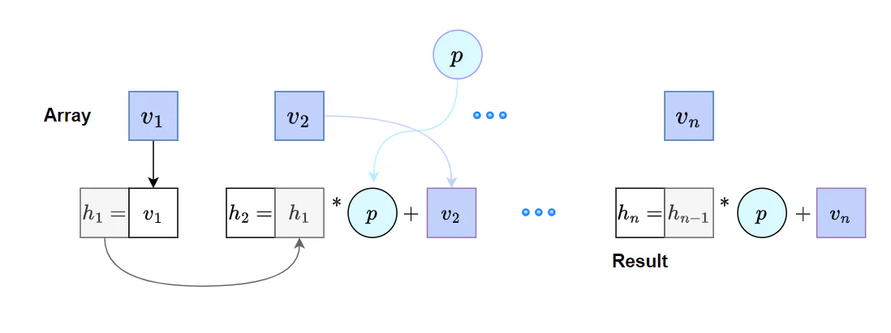
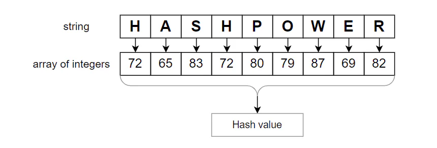

# Simplistic hash functions

To employ hash functions, we need to understand the notation first. Typically, hash functions are denoted by `h` The hash value for a specific item `x` is denoted by `h(x)`

Let's look at some of the simplest ways to build hash functions for standard data types!

## Integers

How can we hash integers? One approach is to use the identity function, in other words `h(x) = x` or the modulo operation `h(x) = x % p`, for some number `p`.
The modulo operation `x%p` gives the remainder when diving x by p.
The first function seems to be flawless. maximum speed, as we don't calculate anything;
obviously deterministic and uniform with no collisions.
However, its disadvantage is the wide range of hash values,
and this is where the modulo variation can help.
In the case of modulo, the only possible hash values will be `0,1,...,p-1`

## Integer arrays

What about arrays? Suppose we have the array `[v1,v2,...,vn]` and you want to calculate its hash value.
The answer is simple: pick a number `p` and use the formula

`hn = v1 * p^n-1 + v2 * p^n-2 + ... + vn`

> [!NOTE]
> The formula originates from the way we represent numbers in the decimal system.
> For example, the number 1234 in the decimal system can be written as:
> 1234 = 1 * 10^3 + 2 * 10^2 + 3 * 10^1 + 4 * 10^0

Directly calculating it this way would result in a relatively large time complexity.

Analyzing the General Formula to get the new formula, let's consider some small cases:
 
For `n = 1`: `h1 = v1`
For `n = 2`: `h2 = v1 * p + v2`
For `n = 3`: `h3 = v1 * p^2 + v2 * p + v3`

Observing the pattern, we notice that if we already have the value `hn-1` from the previous step,
we can compute hn using the new formula:

`hn = hn-1 * p + vn`

Once again, to avoid wide sets of hash values, we can take the values modulo `q`
for some number `q`. That is, we can apply the formula:
`hn = (hn-1 * p + vn) mod q`

In conclusion, If we only sum the elements, we cannot distinguish arrays that contain the same elements but in a different order.
The hash formula using powers of `p` ensures that the order of elements also affects the hash value, allowing us to differentiate between different arrays.

This is a "trick" that helps generate a better hash and prevents collisions when the element order changes.

## Strings

Is it true that only integers are hashable? The answer is no! In terms of strings or string arrays, everything remains equivalent, except we first convert the strings to integers.

This can be attained in several ways:
using the Unicode table, other coding systems, or even hash functions that accept strings and output integers. 
For example, let's hash the string "Hash" using ASCII code.

1. Firstly, we need to convert characters to integers.
2. Notice that now we don't have to hash a string anymore, but a sequence of integers
3. The rest is clear, we hash this array of integers as explained in the previous section using.

