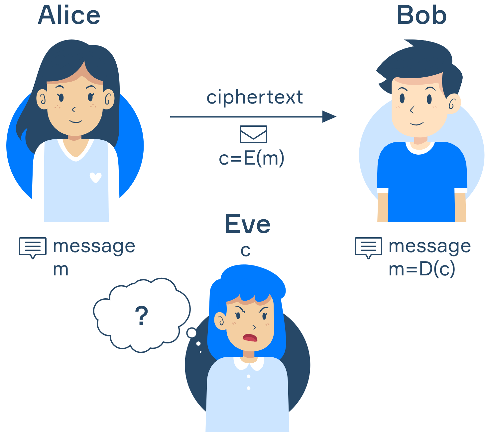

# The basic ideas of cryptography

A dramatic change in this field has happened – it was the creation of public-key cryptography. Public-key cryptosystems play an enormous role in the modern computer world.

## Symmetric and asymmetric cryptosystems:

In a public-key cryptosystem, every person (for example, Bob) has two keys, a public encryption key e and a private (secret) decryption key d. Bob publishes his public key openly so that anybody can send him an encrypted message. But only Bob, knowing his private key, is able to decrypt these messages.

Nevertheless, symmetric cryptosystems have not disappeared.
Indeed, they are more important than ever, since they tend to be significantly more efficient (i.e, fast) than asymmetric ones.
Thus in practice, if Alice wants to send Bob a long message,
she first uses an asymmetric cryptosystem to send the key for a symmetric cryptosystem, and then she uses the symmetric cryptosystem to encrypt her message.

> [!NOTE]
> Symmetric cryptosystems involve two people who both possess the same key to encrypt and decrypt their messages.

## Formalization

In every technical area, especially the one with a strong mathematical background, some formal notation will be useful.
So let's think about what the processes of encryption and decryption are from a mathematical point of view

Encryption transforms the message from some readable form (known also as plaintext) to some unreadable form (ciphertext).

to the set of possible ciphertexts and we may write `E(m) = c`.
where `m` stands for the message, `c` for the ciphertext, and `E` for the encryption function.

What is decryption, then? This is another function `D`, which we apply to the ciphertext and obtain some readable message: `D(c) = m`.

So, two functions `E` and `D` are inverses of each other: `D(E(m)) = m` for every message `m`. In other words, `D` must be an inverse function of `E`

