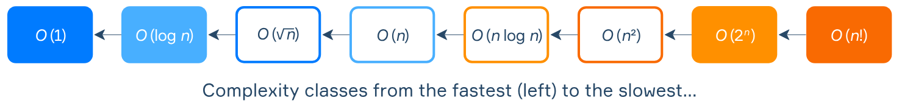
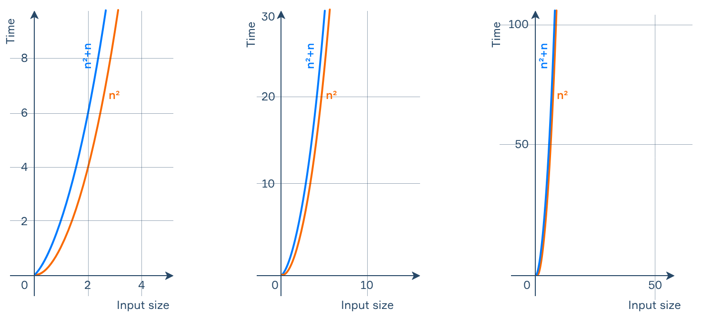

# Big O notation

Suppose you need to choose one of several algorithms to solve a problem. 
How can you pick the best one? To do it, you need to measure the algorithm efficiency somehow.


## Input size

the running time of an algorithm depends on the input data.
If we can estimate how the number of operations depends on the input size, we will have a machine-independent measure of algorithm complexity. 

## Understanding complexity from code

**Big O notation** is like a shorthand for talking about how fast an algorithm grows as the input size increases.


Let's explore this concept through pseudocode examples:

**Linear complexity** occurs when an algorithm's execution time grows linearly with the input size `n`.

Each iteration of the loop performs constant-time operations, and as the input size increases, the execution time increases proportionally:


```
for i = 1 to n:
    // Constant-time operations
    // ...
```

Nested loops, as in the example below, lead to a quadratic time complexity **O(n)^2**, because for each iteration of the outer loop, the inner loop iterates through the entire range of `n`, resulting in `n^2` total interaction

```
for i = 1 to n:
    for j = 1 to n:
        // Constant-time operations
        // ...
```

## Common growth rates

Below are, from best to worst, some common values of the Big O function for the time complexity, also known as complexity classes.

- **O(1) (constant time)**. The algorithm performs a constant number of operation.
What is important is that it doesn't depend on the input size.
- **O(log n) (logarithmic time)**. By definition, log a x = y equal a^y = x. so log 2 n equal to the number of times `n` must be dicvided by 2 to get 1. That being said, it should not be difficult to guess that such algorithms divide the input size into halves at each step

- **O(n) (linear time)**. The time is proportional to the input size, i.e., the time grows linearly as the input size increases. 
Often, such algorithms are iterated only once. 
They occur quite frequently because it is usually necessary to go through every input element before calculating the final answer. 

- **O(n^2) (quadratic time)**. Normally, such algorithms go through all pairs of input elements
Why? Well, mathematics is generous, it constantly provides us with important results: 
in this case, basic math confirms that the number of unordered pairs in a set of
`n` element is equal to `n(n-1)/2`, which, as we will learn in the following topic, is `O(n^2)`.

- **O(2^n) (exponential time)**. Just in case, let's mention that `2^n` is the same as multiplying `2` by itself `n` times. Again, math states that the number of subsets of a set of `n`. elements is equal to `2^n`, therefore, it is reasonable to expect that such algorithms scan all the subsets of the input elements. It is worth noting that this class is extremely inefficient in practice; even for small input sizes, the time taken by the algorithm will be remarkably high.




Now let's gather all the classes together and sort them from the best to the worst so that you remember which ones are the most effective, and which ones you should stay away from.

It's essential to understand that lower time complexity values translate to faster performance. 
However, it's not always feasible to reduce an algorithm's complexity, as some problems inherently require certain levels of complexity.

## Calculating complexity: constants

To be able to calculate complexities by yourself, it is essential for you to get familiar with the basic properties of the Big O:

- **Ignore the constants**. We focus solely on the behavior of our algorithm with large input sizes.  Formally, we write `c*O(n) = O (n)`.

- **Applying a procedure**. What if you need to go over `n` element `n` times. It is not a constant anymore, as it depends on the input size. 
In this case, the time complexity becomes `O(n^2)` Because `n * O(n) = O(n^2)`.

- **Smaller terms do not matter**. For instance, you traverse `n` elements `n` times and then traverse `n` elements again. In this case, the complexity is still O(n^2) Because `O(n) + O(n^2) = O(n^2)`. All in all, always keep the largest term in Big O and forget about all others. Naturally, a question arises: why is it correct to ignore the smaller terms? Let's illustrate the example above:



## reference:
- https://hyperskill.org/learn/step/35900
- https://hyperskill.org/learn/step/35901

