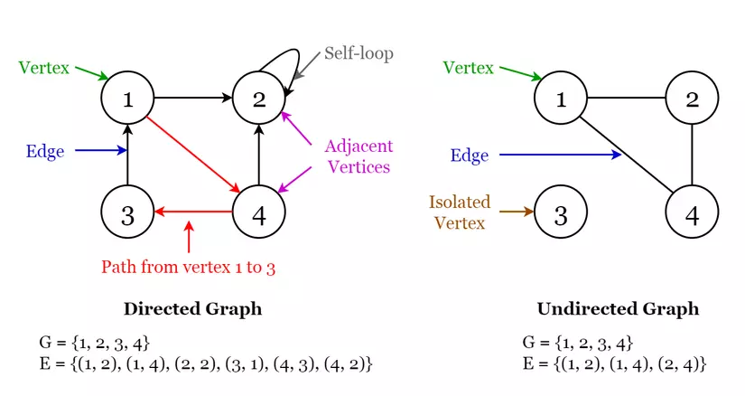

# Graph

Một graph - đồ thị là một tập hợp hữu hạn các đỉnh (nút) và đường đi giữa các đỉnh này. Kích thước của một đồ thị được tính bằng số lượng, bậc của đồ thị được tính bằng số đỉnh của nó. Hai đỉnh được gọi là liền kề nếu chúng được nối với nhau bởi cùng một đường.

## Directed graph

Một đồ thị gọi là đồ thị có hướng nếu tất cả đường đi trên nó đều được đánh dấu chiều giữa điểm đầu và điểm cuối. Ký hiệu (u,v) là đường đi từ đỉnh u tới đỉnh v. Sefl-loop: việc một đỉnh có đường đi tới chính nó.

## Undirected graph

Một đồ thị gọi là đồ thị vô hướng nếu tất cả đường đi trên nó đều không quy định chiều. Nếu một đỉnh trong đồ thị không được kết nối tới bất kỳ đỉnh nào, ta nói nó bị cô lập.

## Graph Operations
The most common graph operations are:

* Kiểm tra xem phần tử có trong biểu đồ không
* Duyệt đồ thị
* Thêm phần tử (đỉnh, cạnh) vào đồ thị
* Tìm đường đi từ đỉnh này đến đỉnh khác

### Complexity

* Kiểm tra phần tử có tồn tại trong đồ thị: Độ phức tạp O(n), với n là số lượng đỉnh trong đồ thị. Việc kiểm tra có thể đòi hỏi duyệt qua tất cả các đỉnh trong đồ thị để kiểm tra xem phần tử có tồn tại hay không.

* Duyệt đồ thị (Graph Traversal):
1. Duyệt theo chiều rộng (BFS - Breadth-First Search): Độ phức tạp O(n + E), với n là số lượng đỉnh và E là số lượng cạnh trong đồ thị. Đi ngang qua tất cả các đỉnh và cạnh của đồ thị.

2. Duyệt theo chiều sâu (DFS - Depth-First Search): Độ phức tạp O(n + E), với n là số lượng đỉnh và E là số lượng cạnh trong đồ thị. Đi ngang qua tất cả các đỉnh và cạnh của đồ thị.

* Thêm phần tử (đỉnh, cạnh) vào đồ thị: Độ phức tạp O(1). Thêm một đỉnh vào đồ thị chỉ đòi hỏi một thao tác cơ bản để cập nhật danh sách đỉnh. Thêm một cạnh giữa hai đỉnh cũng chỉ đòi hỏi một thao tác cơ bản để cập nhật danh sách cạnh.

* Tìm đường đi từ một đỉnh này đến một đỉnh khác: Độ phức tạp phụ thuộc vào thuật toán cụ thể được sử dụng để tìm đường đi trong đồ thị. Một số thuật toán phổ biến như thuật toán Dijkstra (sử dụng trong đồ thị không âm), thuật toán Bellman-Ford, thuật toán A* có độ phức tạp trung bình là O(n + E log n), trong đó n là số lượng đỉnh và E là số lượng cạnh trong đồ thị.