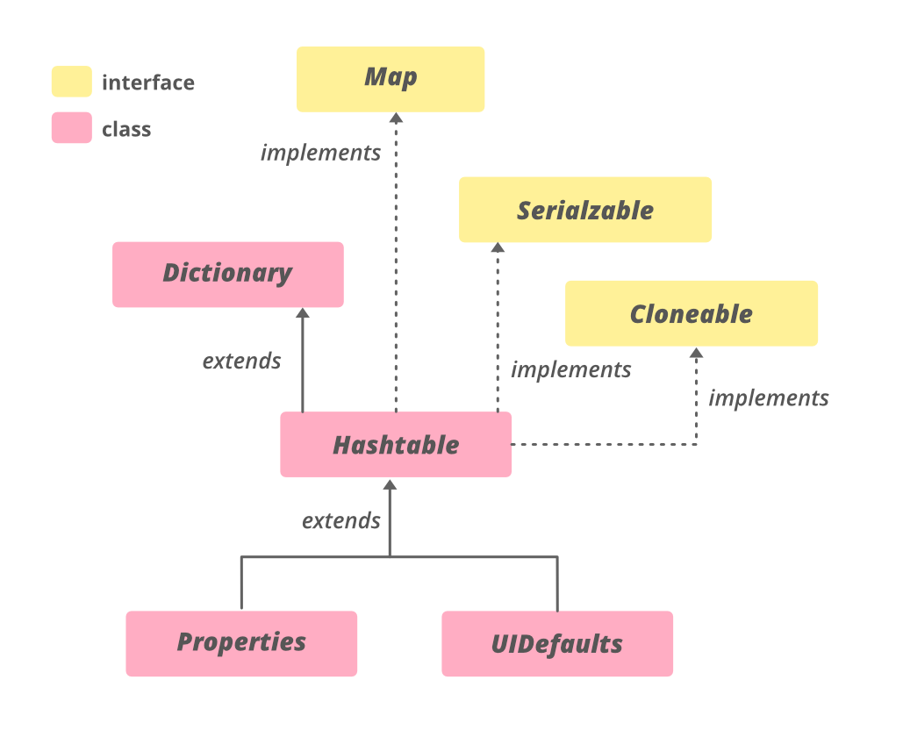

# HashTable
HashTable là một lớp cung cấp sự triển khai của giao diện Map trong Java. Nó sử dụng một cơ chế băm (hashing) để lưu trữ các cặp key-value và cho phép truy xuất nhanh chóng vào giá trị dựa trên key. HashTable có tính năng đồng bộ (synchronized), nghĩa là nó an toàn khi sử dụng trong môi trường đa luồng, nhưng hiệu suất có thể bị ảnh hưởng trong một số tình huống

Bất kỳ đối tượng không null nào cũng có thể được sử dụng làm khóa hoặc giá trị. Để lưu trữ và truy xuất thành công các đối tượng từ một bảng băm, các đối tượng được sử dụng làm khóa phải triển khai phương thức hashCode và phương thức bằng.

Tuy nhiên, lớp Hashtable đã bị coi là lỗi thời và việc sử dụng nó thường không được khuyến khích. Điều này là do nó được thiết kế trước khi giới thiệu Collection framework và không implementation, điều này khiến nó khó sử dụng cùng với các phần khác của framework. Ngoài ra, lớp Hashtable được đồng bộ hóa, điều này có thể dẫn đến hiệu suất chậm hơn so với implementation khác của Map interface.


## Hash function

Sử dụng hàm băm, chúng ta sẽ tính toán index của slot mà value được lưu trữ. Giá trị được tính toán bằng hàm băm của một key được gọi là hash value, cho biết index của slot mà giá trị được ánh xạ tới.

```
	h(k) = k % m
```
* h: hàm băm
* k: key của hash value cần xác định
* m: size của hash table

## Applications of hash tables
* Sử dụng để cài đặt việc đánh index trong database.
* Sử dụng để cài đặt các mảng liên kết.
* Sử dụng để cài đặt kiểu cấu trúc dữ liệu Set.

## Complexity

1. Thêm phần tử (Insertion): Độ phức tạp O(1) trong trường hợp tốt nhất và trung bình. Tuy nhiên, trong trường hợp xảy ra va chạm (collision), độ phức tạp có thể là O(n), với n là số lượng phần tử có cùng vị trí băm (hash).

2. Tìm kiếm phần tử (Lookup): Độ phức tạp O(1) trong trường hợp tốt nhất và trung bình. Tuy nhiên, trong trường hợp xảy ra va chạm, độ phức tạp có thể là O(n), với n là số lượng phần tử có cùng vị trí băm.


3. Xóa phần tử (Deletion): Độ phức tạp O(1) trong trường hợp tốt nhất và trung bình. Tuy nhiên, trong trường hợp xảy ra va chạm, độ phức tạp có thể là O(n), với n là số lượng phần tử có cùng vị trí băm.

### example for confict error when write to HashTable:
#### issue
Giả sử chúng ta có một Hash Table với kích thước là 5 (5 vị trí băm) và chúng ta muốn lưu trữ hai phần tử có các khóa là "apple" và "banana".

Chúng ta áp dụng hàm băm (hash function) cho cả hai khóa để xác định vị trí lưu trữ trong bảng băm. Ví dụ, hàm băm có thể trả về 2 cho cả "apple" và "banana".

Khi chèn "apple" vào vị trí băm 2, không có va chạm xảy ra.

Khi chèn "banana" vào vị trí băm 2, xảy ra va chạm vì "banana" cũng được ánh xạ vào vị trí băm 2.

#### solution
Khi xảy ra va chạm, Hash Table hoặc HashMap phải xử lý việc lưu trữ các phần tử có cùng vị trí băm một cách hiệu quả. Có một số phương pháp để giải quyết va chạm, bao gồm:

* Separate Chaining (Rope Technique): Mỗi vị trí băm trong bảng băm được giữ một danh sách liên kết, trong đó các phần tử có cùng vị trí băm được lưu trữ trong danh sách này.

* Open Addressing: Các phần tử có cùng vị trí băm được lưu trữ trực tiếp trong bảng băm. Khi xảy ra va chạm, các phần tử được chèn vào các vị trí băm trống tiếp theo trong bảng.

Trong trường hợp này, chúng ta cần sử dụng phương pháp giải quyết va chạm, ví dụ như
Separate Chaining, để lưu trữ cả hai phần tử "apple" và "banana" trong cùng một vị trí băm. Điều này có thể thực hiện bằng cách tạo một danh sách liên kết tại vị trí băm 2 và lưu trữ cả hai phần tử trong danh sách này.

## The Hierachy of Hashtable


# Dictionary

Dictionary là một cấu trúc dữ liệu trừu tượng trong nhiều ngôn ngữ lập trình. Nó cung cấp một bộ từ điển gồm các cặp key-value. Key là duy nhất và không thay đổi, và được sử dụng để truy xuất giá trị tương ứng. Dictionary không phải là một tên cụ thể của một cấu trúc dữ liệu trong một ngôn ngữ cụ thể, mà chỉ là một khái niệm chung.

# Map

Map là một interfae trong Java và một cấu trúc dữ liệu trong nhiều ngôn ngữ khác. Nó mô tả một tập hợp các cặp key-value, trong đó mỗi key là duy nhất và không thay đổi. Map cung cấp các phương thức để thêm, xóa, truy xuất và xử lý các cặp key-value. **HashMap và HashTable là hai lớp cụ thể trong Java implement Map interface.**

# HashMap

HashMap là một lớp cung cấp sự triển khai của giao diện Map trong Java. Nó cũng sử dụng cơ chế băm để lưu trữ các cặp key-value, nhưng không có tính năng đồng bộ như HashTable. Do đó, HashMap có thể cung cấp hiệu suất tốt hơn trong các tình huống không yêu cầu tính an toàn đồng thời.


## Summary
HashTable và HashMap là hai cách triển khai cụ thể của cấu trúc dữ liệu Map trong Java.

Dictionary là một khái niệm chung để chỉ một cấu trúc dữ liệu lưu trữ các cặp key-value. Map là một giao diện định nghĩa các phương thức và tính chất chung cho các cấu trúc dữ liệu Map.

Sự khác nhau của HashMap và HashTable là:

| HashMap      | Hashtable   |
| -----------  | ------------|
| HashMap cho phép một key là null và nhiều giá trị null.      | Hashtable không cho phép bất kỳ key hoặc giá trị null.       |
| HashMap không đồng bộ.   | Hashtable là đồng bộ.        |


