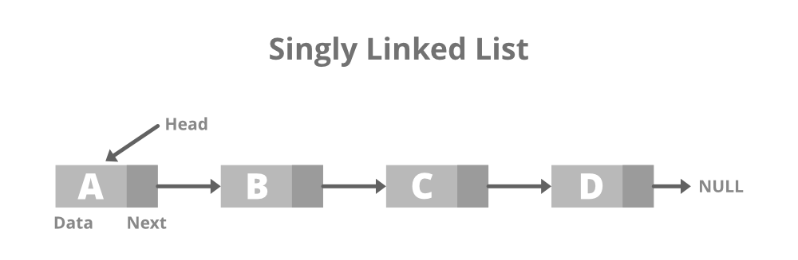
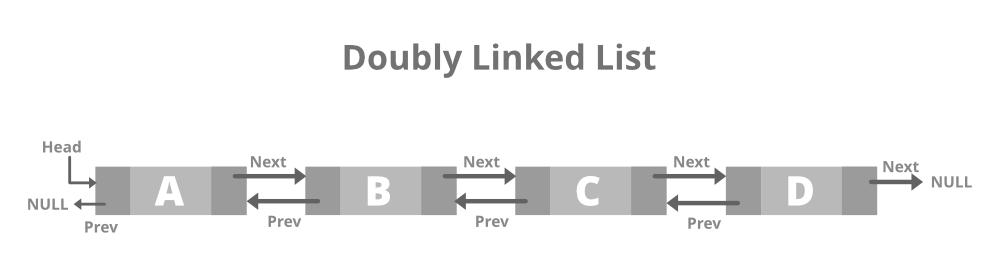
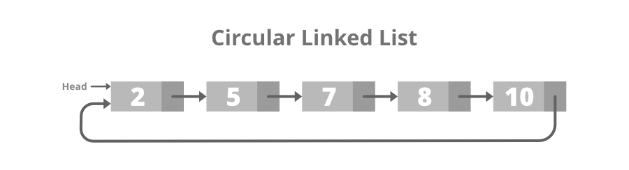
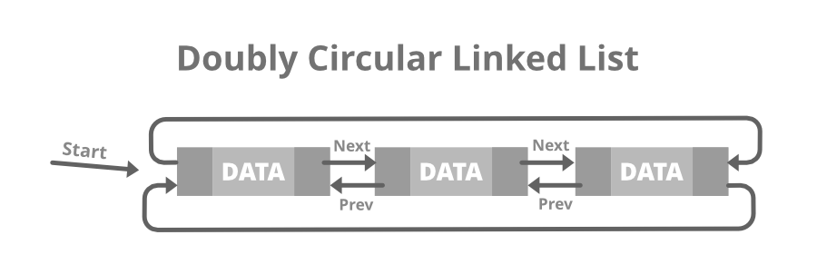

# Linked List
Danh sách được liên kết là một cấu trúc dữ liệu tuyến tính, trong đó các phần tử không được lưu trữ tại các vị trí bộ nhớ liền kề. Các phần tử trong danh sách liên kết được liên kết bằng con trỏ. Nói một cách đơn giản, một danh sách được liên kết bao gồm các nút trong đó mỗi nút chứa một trường dữ liệu và một tham chiếu (liên kết) đến nút tiếp theo trong danh sách.
Các thành phần và định nghĩa:

* Các phần tử trong linked list được gọi là các node.
* Mỗi node sẽ chưa một key và một con trỏ trỏ tới node kế tiếp của nó, được gọi là next
* Thuộc tính tên là head trỏ tới phần tử đầu tiên của linked list.
* Phần tử cuối cùng của linked list có tên là tail
* Singly linked list: Duyệt qua các phẩn tử chỉ có thể thực hiện theo chiều hướng về phía trước.
* Doubly linked list: Duyệt qua các phẩn tử có thể thực hiện theo cả chiều tiến và lùi. Các node sẽ bao gồm thêm một con trỏ được gọi là pre, trỏ tới node trước đó.
* Circular linked list: Là một doubly linked list đặc biệt, khi mà con trỏ prev của head trỏ tới tail và con trỏ next của tail trỏ tới head.

# Các phép toán trên linked list
* Tìm kiếm: Tìm phần tử đầu tiên với key là k trong một linked list được cho trước được thực hiện đơn giản bằng một quá trình duyệt tuần tự và trả về con trỏ trỏ tới phần tử đó.
* Thêm: Để thêm một key vào một linked list có sẵn, ta có thể thực hiện theo 3 cách: thêm vào đầu list, thêm vào giữa list hoặc thêm vào cuối của list.
* Xoá: Xoá một phần tử x khỏi một linked list cho trước. Ta không thể xoá một node với chỉ một bước. Việc xoá một node có thể thực hiện theo 3 cách: xoá từ đầu danh sách, xoá từ giữa danh sách hoặc xoá từ cuối danh sách.

## 1 Singly Linked List
Đây là kiểu danh sách liên kết đơn giản nhất trong đó mỗi nút chứa một số dữ liệu và một con trỏ tới nút tiếp theo có cùng kiểu dữ liệu.

## 2 Doubly Linked List
Danh sách liên kết đôi hoặc danh sách liên kết hai chiều là một loại danh sách liên kết phức tạp hơn có chứa một con trỏ tới nút tiếp theo cũng như nút trước đó theo thứ tự.

## 3 Cicular Linked List
Danh sách liên kết vòng là trong đó nút cuối cùng chứa con trỏ tới nút đầu tiên của danh sách.

## 4 Doubly Circular Linked List

Danh sách liên kết vòng tròn đôi hoặc danh sách liên kết hai chiều vòng tròn là một loại danh sách liên kết phức tạp hơn có chứa một con trỏ tới nút tiếp theo cũng như nút trước đó trong chuỗi.

Sự khác nhau giữa danh sách kép liên kết kép và danh sách kép vòng cũng giống như sự khác biệt giữa danh sách liên kết đơn và danh sách liên kết vòng.

Danh sách liên kết kép vòng không chứa null trong trường trước đó của nút đầu tiên. Dưới đây là hình ảnh cho cùng:

