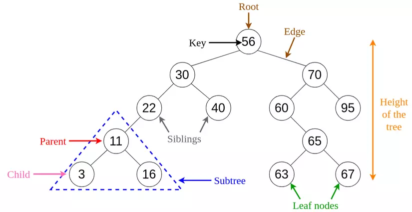
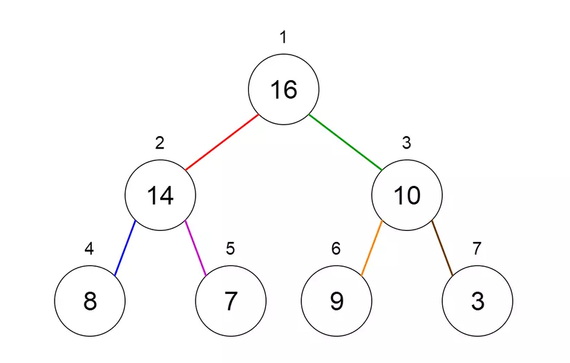
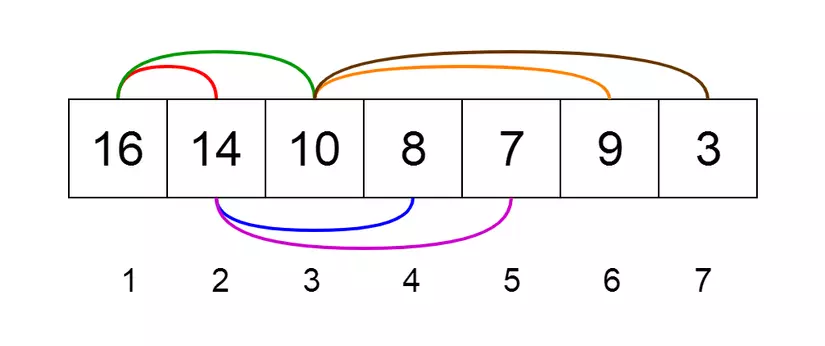
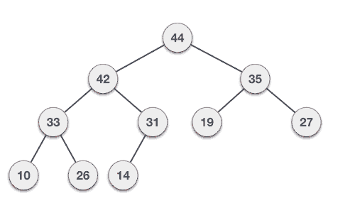

# Tree
Tree - cây là một cấu trúc dữ liệu có phân cấp, trong đó dữ liệu được tổ chức theo thứ bậc và được liên kết với nhau khi lưu trữ. Có nhiều kiểu tree đã được phát triển trong nhiều thập kỷ qua, để phù hợp với các ứng dụng khác nhau hay khắc phục những hạn chế nhất định. Một số ví dụ có thể kể tới bao gồm: cây tìm kiếm nhị phân, B-tree, treap, red-black tree, splay tree

## Binary Search Tree

Một binary search tree (BST) - cây tìm kiếm nhị phân, như tên nó đã gợi ý, là một cấu trúc dữ liệu lưu trữ dữ liệu theo dạng cấu trúc thứ bậc. Cấu trúc dữ liệu này lưu trữ giá trị theo thứ tự sắp xếp. Mỗi node trong một BST bao gồm các thuộc tính sau:

key: giá trị được lưu trữ trong node.
left: con trỏ tới con bên trái.
right: con trỏ tới con bên phải.
p: con trỏ tới node cha. Hãy xét một node x trong cây tìm kiếm nhị phân.

* Nếu y là node con bên trái của x, thì y.key <= x.key
* Nếu y là node con bên phải của x, thì y.key => x.key

### application of binary tree
* Binary Trees: Sử dụng để cài đặt parse và tính toán biểu thức.
* Binary Search Tree: Được sử dụng trong rất nhiều ứng dụng tìm kiếm, nơi mà dữ liệu vào ra liên tục.
* Heaps: Được sử dụng trong JVM để lưu trữ các đối tượng.
* Treaps: Sử dụng trong mạng không dây.

### Heaps

Heap là một trường hợp đặc biệt của cây nhị phân, khi mà node cha sẽ so sánh giá trị của nó với các node con của nó để sắp xếp lại cho phù hợp. Ta hãy cũng xem xét cách biểu diễn heap. Heap có thể được biểu diễn bằng cách sử dụng tree hoặc array. Hai hình vẽ dưới dây cho ta cách biểu diễn một hear bằng cách sử dụng cây nhị phân hoặc mảng.

Có 2 kiểu heap:

* Min Heap - giá trị của node cha sẽ nhỏ hơn hoặc bằng các con của nó. Node ở root sẽ có giá trị nhỏ nhất trong heap.
* Max Heap - giá trị của node cha sẽ lớn hơn hoặc bằng các con của nó. Node ở root sẽ có giá trị lớn nhất trong heap.

### Step to build Max Heap: 

Bước 1: Tạo một nút mới tại vị trí cuối cùng của Heap.
Bước 2: Gán giá trị mới cho nút này.
Bước 3: So sánh giá trị của nút con với giá trị cha.
Bước 4: Nếu giá trị của cha là nhỏ hơn con thì tráo đổi chúng.
Bước 5: Lặp lại bước 3 và 4 cho tới khi vẫn duy trì thuộc tính của Heap.

### Step to remove root node in Max Heap:

Bước 1: Xóa nút gốc.
Bước 2: Di chuyển phần tử cuối cùng có bậc thấp nhất lên nút gốc.
Bước 3: So sánh giá trị của nút con này với giá trị của cha.
Bước 4: Nếu giá trị của cha là nhỏ hơn của con thì tráo đổi chúng.
Bước 5: Lặp lại bước 3 và 4 cho tới khi vẫn duy trì thuộc tính của Heap.