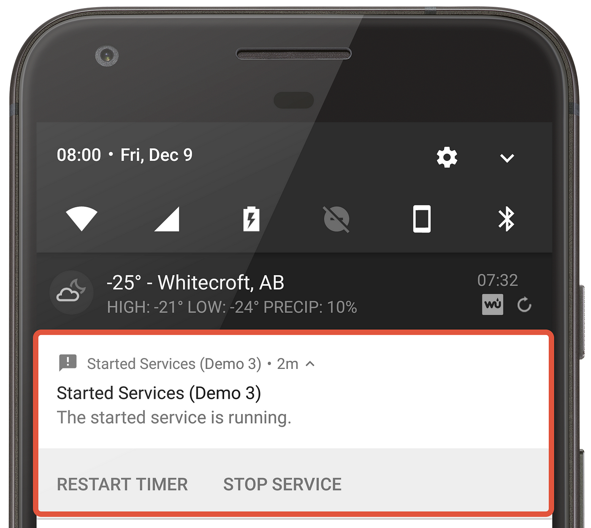

# Foreground Service

A **foreground service** performs some operation that is noticeable to the user.

Examples of apps that use foreground services include the following:

- A music player app that plays music in a foreground service. The notification might show the current song being played.
- A fitness app that records a user's run in a foreground service, after receiving permission from the user. The notification might show the distance that the user has traveled during the current fitness session.

       When you use a **foreground service**, you must display a notification so that users are actively aware that the service is running. This notification cannot be dismissed unless the service is either stopped or removed from the foreground.



#### User can dismiss notification by default

Starting in Android 13 (API level 33), users can dismiss the notification associated with a foreground service by default. To do so, users perform a swipe gesture on the notification. Traditionally, the notification isn't dismissed unless the foreground service is either stopped or removed from the foreground.

If you want the notification non-dismissable by the user, pass `true` into the `setOngoing()` method when you create your notification using `Notification.Builder`.


#### Services that show a notification immediately

If a foreground service has at least one of the following characteristics, the system shows the associated notification immediately after the service starts, even on devices that run **Android 12 or higher**:

- The service is associated with a notification that includes action buttons.
- The service has a foregroundServiceType of mediaPlayback, mediaProjection, or phoneCall.
- The service provides a use case related to phone calls, navigation, or media playback, as defined in the notification's category attribute.
- The service has opted out of the behavior change by passing `FOREGROUND_SERVICE_IMMEDIATE` into `setForegroundServiceBehavior()` when setting up the notification.
> [!NOTE]
> On Android 13 (API level 33) or higher, if the user denies the notification permission, they still see notices related to foreground services in the [Task Manager](https://developer.android.com/develop/background-work/services/foreground-services#handle-user-initiated-stop) **but don't see them in the notification drawer.**

#### Declare foreground services in your manifest

In your app's manifest, declare each of your app's foreground services with a `<service>` element. For each service, use an `android:foregroundServiceType` attribute to declare what kind of work the service does.

> [!CAUTION]
> Important: All foreground service declarations must comply with the requirements in the [Google Play Device and Network Abuse policy.](https://support.google.com/googleplay/android-developer/answer/9888379)


For example, if your app creates a foreground service that plays music, you might declare the service like this:

```xml
<manifest xmlns:android="http://schemas.android.com/apk/res/android" ...>
  <application ...>

    <service
        android:name=".MyMediaPlaybackService"
        android:foregroundServiceType="mediaPlayback"
        android:exported="false">
    </service>
  </application>
</manifest>
```

If your multiple types apply to your service, separate them with the | operator. For example, a service that uses the camera and microphone would declare it like this:

```xml
android:foregroundServiceType="mediaPlayback|camera|microphone"
```

Depending on what API level your app targets, you may be required to declare foreground services in the app manifest:
- **API level 29 or higher**: You must declare all foreground services that use location information, using the location service type.
- **API level 30 or higher**: You must declare all foreground services that use the camera or microphone, using the camera or 
microphone service type, respectively.
- **API level 34 or higher**: You must declare all foreground services with their service types.
If you try to create a foreground service and its type isn't declared in the manifest, the system throws a 
`MissingForegroundServiceTypeException` upon calling `startForeground()`.
Even when it isn't required, it's a best practice to declare all your foreground services and provide their service types.

#### Request the foreground service permissions

Apps that target Android 9 (API level 28) or higher and use foreground services need to request the `FOREGROUND_SERVICE` in the app manifest, as shown in the following code snippet. **This is a normal permission, so the system automatically grants it to the requesting app.**

In addition, if the app targets API level 34 or higher, **it must request the appropriate permission type for the kind of work the foreground service will be doing**. Each foreground service type has a corresponding permission type. 

For example, if an app launches a foreground service that uses the camera, you must request both the `FOREGROUND_SERVICE` and `FOREGROUND_SERVICE_CAMERA` permissions. These are all normal permissions, so the system grants them automatically if they're listed in the manifest.

```xml
<manifest xmlns:android="http://schemas.android.com/apk/res/android" ...>

    <uses-permission android:name="android.permission.FOREGROUND_SERVICE"/>
    <uses-permission android:name="android.permission.FOREGROUND_SERVICE_CAMERA"/>

    <application ...>
        ...
    </application>
</manifest>
```

#### Foreground service prerequisites
If an app that targets API level 28 or higher attempts to create a foreground service without requesting the `FOREGROUND_SERVICE` permission, the system throws a `SecurityException`. Similarly, if an app targets API level 34 or higher and doesn't request the appropriate specific permission, the system throws `SecurityException`.

For this reason, you must confirm that the required prerequisites are met before you start a foreground service. The foreground service type documentation lists the required prerequisites for each foreground service type.

#### Start a foreground service

Before you request the system to run a service as a foreground service, start the service itself:

```kotlin
val foregroundServiceIntent = Intent(context, PlaybackService::class.java)
context.startForegroundService(foregroundServiceIntent)
```

Inside the service, usually in `onStartCommand()`, you can request that your service run in the foreground. To do so, call `ServiceCompat.startForeground(service, notification, foregroundServiceType)` (available in androidx-core 1.12 and higher). This method takes the following parameters:

- The service
- A positive integer that uniquely identifies the notification in the status bar
- The Notification object itself
- The [foreground service types](https://developer.android.com/develop/background-work/services/fg-service-types) identifying the work done by the service
These types might be a subset of the types declared in the manifest, depending on the specific use case. Then, if you need to add more service types, you can call `startForeground()` again.

Full code block demo create **Foreground Service**:

```kotlin
class MyCameraService: Service() {
  val notification = createNotification()
  private fun startForeground() {
    // Before starting the service as foreground check that the app has the
    // appropriate runtime permissions. In this case, verify that the user has
    // granted the CAMERA permission.
    val cameraPermission =
            PermissionChecker.checkSelfPermission(this, Manifest.permission.CAMERA)
    if (cameraPermission != PermissionChecker.PERMISSION_GRANTED) {
        // Without camera permissions the service cannot run in the foreground
        // Consider informing user or updating your app UI if visible.
        stopSelf()
        return
    }

    try {
        val notification = NotificationCompat.Builder(this, "CHANNEL_ID")
            // Create the notification to display while the service is running
            .build()
        ServiceCompat.startForeground(
            /* service = */ this,
            /* id = */ 100, // Cannot be 0
            /* notification = */ notification,
            /* foregroundServiceType = */
            if (Build.VERSION.SDK_INT >= Build.VERSION_CODES.R) {
                ServiceInfo.FOREGROUND_SERVICE_TYPE_CAMERA
            } else {
                0
            },
        )
    } catch (e: Exception) {
        if (Build.VERSION.SDK_INT >= Build.VERSION_CODES.S
                && e is ForegroundServiceStartNotAllowedException) {
            // App not in a valid state to start foreground service
            // (e.g. started from bg)
        }
        // ...
    }
  }

    private fun createNotification(
        context: Context,
        mediaSession: MediaSessionCompat,
    ): Notification {
        return NotificationCompat.Builder(context, context.getString(R.string.app_name))
            .setPriority(NotificationCompat.PRIORITY_HIGH)
            .setForegroundServiceBehavior(NotificationCompat.FOREGROUND_SERVICE_IMMEDIATE)
            .setSmallIcon(R.drawable.logo_splash)
            .setContentTitle("notification title")
            .setContentText("notification content")
            .setContentIntent(
                PendingIntent.getActivity(
                    context,
                    0,
                    Intent(context, MainActivity::class.java).apply {
                        putExtra(IS_FROM_NOTIFICATION, true)
                    },
                    PendingIntent.FLAG_UPDATE_CURRENT or PendingIntent.FLAG_IMMUTABLE
                )
            )
            .setStyle(
                androidx.media.app.NotificationCompat.MediaStyle()
                    .setMediaSession(mediaSession.sessionToken)
            )
            //Show controls on lock screen even when user hides sensitive content.
            .setVisibility(NotificationCompat.VISIBILITY_PUBLIC)
            .setSound(null)
            .setAutoCancel(false)
            .setOngoing(true)
            .setOnlyAlertOnce(true)
            .build()
    }
}
```

#### Remove a service from the foreground

To remove the service from the foreground, call `stopForeground()`. This method takes a boolean, which indicates whether to remove the status bar notification as well. Note that the service continues to run.

If you stop the service while it runs in the foreground, its notification is removed.

#### Handle user-initiated stopping of apps running foreground services

Starting in Android 13 (API level 33), users can complete a workflow from the notification drawer to stop an app that has an ongoing foreground services, regardless of that app's target SDK version. This affordance, called the **Task Manager**, shows a list of apps that are currently running a foreground service.

This list is labeled Active apps. Next to each app is a Stop button. **Figure below** illustrates the **Task Manager** workflow on a device that runs Android 13.


When the user presses the Stop button next to your app in the Task Manager, then the following actions occur:

- The system removes your app from memory. Therefore, your entire app stops, not just the running foreground service.
- The system removes your app's activity back stack.
- Any media playback stops.
- The notification associated with the foreground service is removed.
- Your app remains in history.
- Scheduled jobs execute at their scheduled time.
- Alarms go off at their scheduled time or time window.

The **Task Manager** has some Exemptions, take a look [here](https://developer.android.com/develop/background-work/services/foreground-services#exemptions).

#### Use purpose-built APIs instead of foreground services

For many use cases, there are platform or Jetpack APIs you can use to do work you might otherwise use a foreground service for. If there is a suitable purpose-built API, you should almost always use it instead of using a foreground service. Purpose-built APIs often provide additional use-case specific capabilities that you would otherwise have to build on your own.

For example, the `Bubbles API` handles the complex UI logic for messaging apps that need to implement chat-bubble features.

The documentation for the [foreground service types](https://developer.android.com/develop/background-work/services/fg-service-types) lists good alternatives to use instead of foreground services.


#### Restrictions on starting a foreground service from the background

Apps that target Android 12 or higher **can't start foreground services while the app is running in the background**,
except for a few special cases :
- Your app transitions from a user-visible state, such as an activity.
- Your app can start an activity from the background, except for the case where the app has an activity in the back stack of an existing task.
- Your app receives a high priority message using Firebase Cloud Messaging.
- The user performs an action on a UI element related to your app. For example, they might interact with a [bubble](https://developer.android.com/guide/topics/ui/bubbles), [notification](https://developer.android.com/develop/ui/views/notifications), [widget](https://developer.android.com/guide/topics/appwidgets/overview), or activity.
- Your app invokes an [exact alarm](https://developer.android.com/training/scheduling/alarms#exact) to complete an action that the user requests.
- Your app is the device's current [input method](https://developer.android.com/guide/topics/text/creating-input-method).
- Your app receives an event that's related to geofencing or activity recognition transition.
- After the device reboots and receives the `ACTION_BOOT_COMPLETED`, `ACTION_LOCKED_BOOT_COMPLETED`, or `ACTION_MY_PACKAGE_REPLACED` intent action in a broadcast receiver.
- Your app receives the `ACTION_TIMEZONE_CHANGED`, `ACTION_TIME_CHANGED`, or `ACTION_LOCALE_CHANGED` intent action in a broadcast receiver.
- Your app receives the `ACTION_TRANSACTION_DETECTED` event from `NfcService`.
- Apps with certain system roles or permission, such as device owners and profile owners.
- Your app uses the Companion Device Manager and declares the `REQUEST_COMPANION_START_FOREGROUND_SERVICES_FROM_BACKGROUND` permission or the `REQUEST_COMPANION_RUN_IN_BACKGROUND` permission. Whenever possible, use `REQUEST_COMPANION_START_FOREGROUND_SERVICES_FROM_BACKGROUND`.
- Your app holds the `SYSTEM_ALERT_WINDOW` permission.
- The user turns off battery optimizations for your app.


> [!NOTE]
> If an app tries to start a foreground service while the app runs in the background, and the foreground service doesn't satisfy one of the exceptional cases, the system throws a ForegroundServiceStartNotAllowedException.

#### Restrictions on starting foreground services that need while-in-use permissions

If your app targets Android 14 or higher, the operating system checks when you create a foreground service to make sure your app has all the appropriate permissions for that service type. For example, when you create a foreground service of type microphone, the operating system verifies that your app currently has the `RECORD_AUDIO` permission. If you don't have that permission, the system throws a `SecurityException`.

> [!NOTE]
> On versions of Android lower than Android 14, if you tried to create a foreground service that needed while-in-use permissions while your app was in the background, the system would let you create the service, but the service wouldn't have access to the needed resources, and if it tried to use them, you'd get an exception. On Android 14 or higher, your app gets the exception as soon as it tries to create the foreground service.

For this reason, if your foreground service needs a while-in-use permission, you must call Context.startForegroundService() or Context.bindService() while your app has a visible activity, unless the service falls into one of the defined exemptions.

#### Exemptions from restrictions on while-in-use permissions

In some situations, even if a foreground service is started while the app runs in the background, it can still access location, camera, and microphone information while the app runs in the foreground ("while-in-use").

In these same situations, if the service declares a foreground service type of `location` and is started by an app that has the `ACCESS_BACKGROUND_LOCATION` permission, **this service can access location information all the time, even when the app runs in the background.**

The following list contains these situations:

- A system component starts the service.
- The service starts by interacting with app widgets.
- The service starts by interacting with a notification.
- The service starts as a PendingIntent that is sent from a different, visible app.
- The service starts by an app that is a device policy controller that runs in device owner mode.
- The service starts by an app which provides the `VoiceInteractionService`.
- The service starts by an app that has the `START_ACTIVITIES_FROM_BACKGROUND` privileged permission.