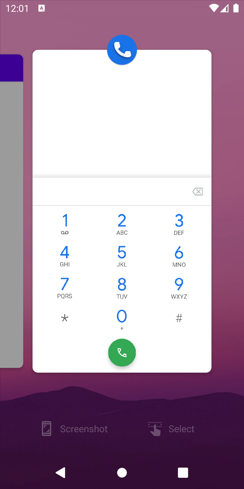
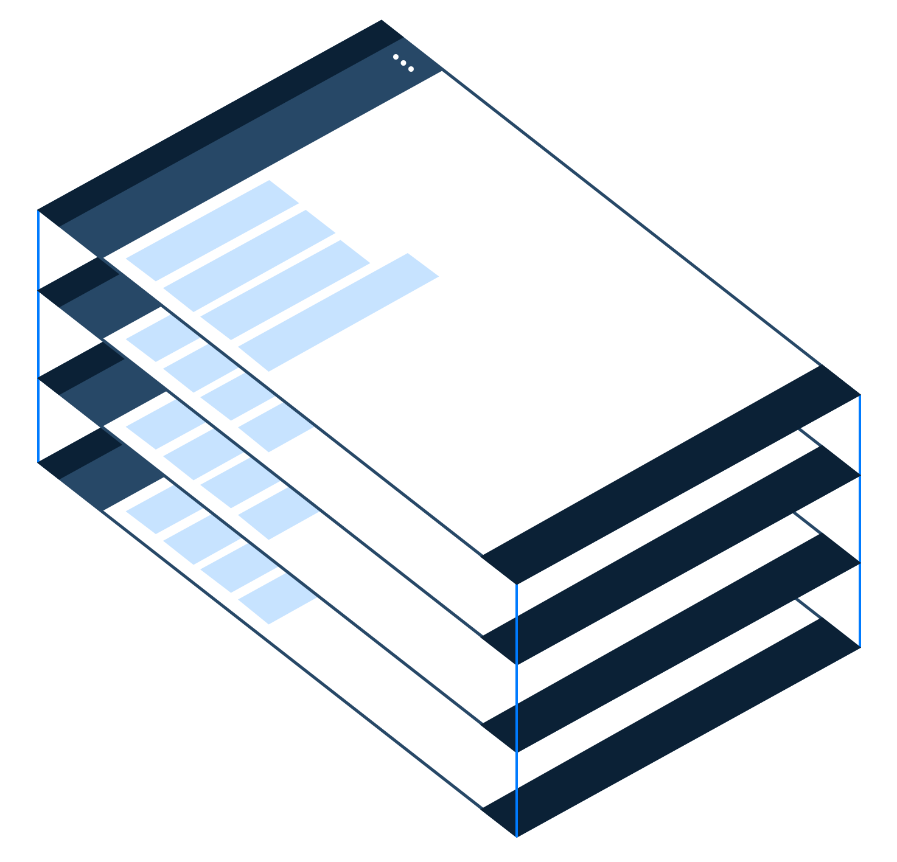
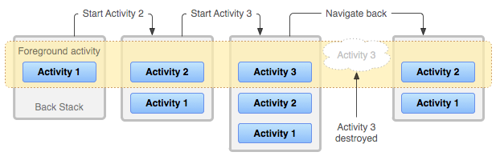
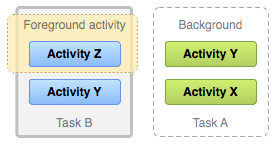
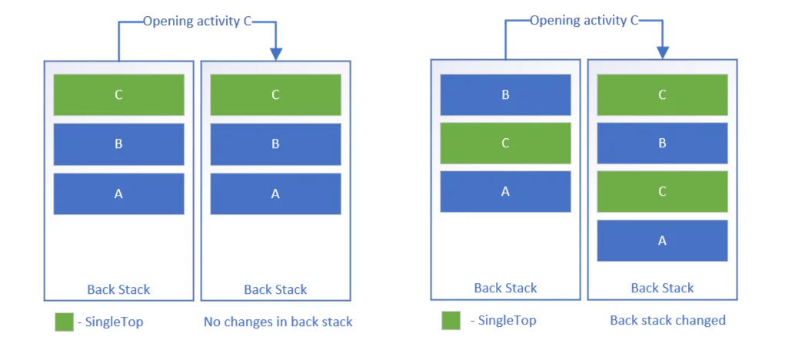
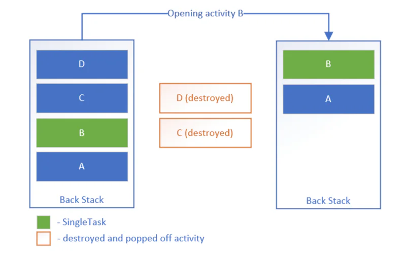
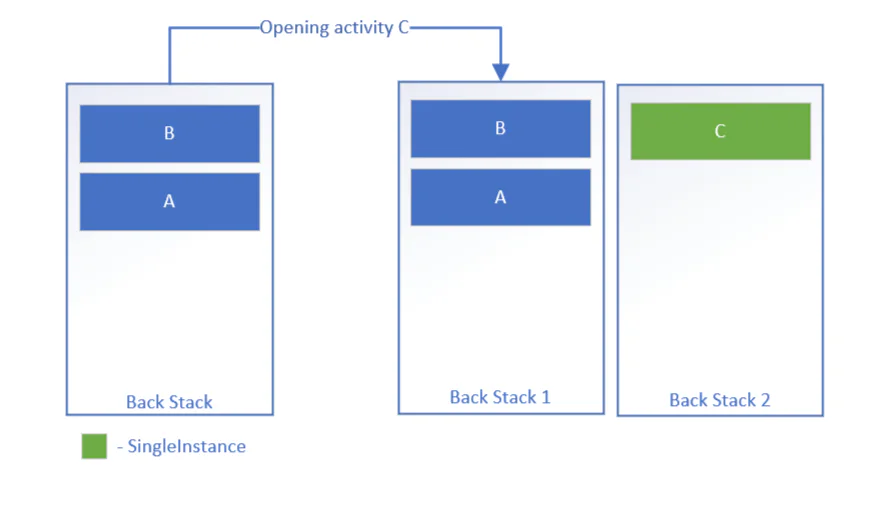

# Tasks and back stack

A **task** is a collection of activities that a user interacts with when using an app.
Activities are stacked in the **back stack** in the order in which they are opened.
In this topic, you will learn more about tasks and the back stack.
You'll find out what **launch modes** are and how to use Intent **flags** when developing your applications.

## Tasks and back stack

If you click the "Recently opened" button on your phone, you will see a list of tasks:



The activities in a task are arranged in a stack (known as the back stack).
You can see a visualization of this below:



## Lifecycle of a task and its back stack

The Home screen of the device is the starting point for most Tasks. When a user touches an icon for an application or shortcut in the app launcher (or on the home screen), that application's task is brought to the foreground. If no task exists for the application (the app hasn't been used recently), then a new task is created and the main activity of that application opens as the root activity on the stack.


When the current Activity starts another Activity, the new Activity is pushed to the top of the stack and takes focus. The previous Activity remains in the stack, but is stopped.
When an Activity stops, the system retains the current state of its user interface.
When the user performs a back action, the current Activity is popped from the top of the stack (the activity is destroyed) and the previous activity resumes (the previous state of its user interface is restored). 

Activities in the stack are never rearranged, only pushed and popped from the stack—pushed onto the stack when started by the current activity and popped off when the user leaves it by using the Back button or gesture. Thus, the back stack operates as a **last in, first out** object structure. Figure below visualizes this behavior with a timeline showing the progress between activities along with the current back stack at each point in time.



If the user continues to press or gesture Back, then each Activity in the stack is popped off to reveal the previous Activity until the user returns to the Home screen (or to whichever Activity was running when the task began). When all Activities are removed from the stack, the Task no longer exists.


### Back press behavior for root launcher activities

Root launcher activities are activities that declare an Intent filter with both `ACTION_MAIN` and `CATEGORY_LAUNCHER`. These activities are unique because they act as entry points into your application from the app launcher and are used to start a Task.

When the user presses or gestures Back from a root launcher activity, the system handles the event differently depending on which version of Android the device is running.

System behavior on Android 11 and lower:
- The system finishes the activity.
System behavior on Android 12 and higher:
- The system moves the activity and its task to the background instead of finishing the activity. This behavior matches the system's default behavior when navigating out of the app using the Home button or gesture.


In most cases, this behavior means that users can quickly resume your application from a [warm state](https://developer.android.com/topic/performance/vitals/launch-time#warm) instead of having to completely restart the application from a [cold state](https://developer.android.com/topic/performance/vitals/launch-time#cold).

If you need to [provide custom back navigation](https://developer.android.com/guide/navigation/navigation-custom-back), we recommend using the AndroidX Activity APIs, rather than overriding **onBackPressed()**. The AndroidX Activity APIs automatically defer to the appropriate system behavior if there are no components intercepting the system Back press.
However, if your application overrides onBackPressed() to handle Back navigation and finish the Activity, update your implementation to call super.onBackPressed() instead of finish(). Calling super.onBackPressed() will move the Activity and its Task to the background when appropriate and provide a more consistent navigation experience for users across applications.

## Background and foreground tasks

A Task is a cohesive unit that can move to the background when the user starts a new Task or goes to the Home Screen. While in the background, all the Activities in the Task are stopped, but the Task's back stack remains intact—the Task has simply lost focus while another Task takes place, as illustrated in the figure. Then, the Task can return to the foreground so users can pick up where they left off.




## Manage tasks

For example, you might want an activity in your app to begin a new task when it is started, instead of being placed within the current task. Or, when you start an activity, you might want to bring forward an existing instance of it, instead of creating a new instance on top of the back stack. Or you might want your back stack to be cleared of all activities except for the root activity when the user leaves the task.


These are the principal `<activity>` attributes that you can use to manage tasks:

- taskAffinity
- launchMode
- allowTaskReparenting
- clearTaskOnLaunch
- alwaysRetainTaskState
- finishOnTaskLaunch

## Launch modes

Launch modes allow you to specify how a new instance of an Activity is associated with the current task. You can define different launch modes in two ways:

1. Define launch modes using the manifest file
2. Define launch modes using Intent flags

### Define launch modes using manifest configuration

When declaring an Activity in your Manifest file, you can specify how the Activity will be associated with a Task using the `launchMode` attribute of the `<activity>` element.

There are four activity launch modes available:
- `standard`

The default launch mode. The system creates a new activity and routes an Intent to it.
The activity is pushed on top of the stack, even if the same activity is already **foregrounded**.

- `singleTop`

This mode behaves differently from `standard` if the activity you would like to start is already on the top of the stack.
Instead of creating it again, the system routes an Intent to the existing instance through a call to the `onNewIntent()` method.

Example:
The stack consists of three activities (A-B-C). C is at the top of the stack with its launch mode set to `singleTop`.

In this scenario, if you try to open activity C again, the stack will remain the same (A-B-C), and the `onNewIntent()` method will be called.

However, if the activities were ordered differently to start with (A-C-B), calling activity C again would change the stack (A-C-B-C), as you can see below.



- `singleTask`

Be careful with this launch mode because its behavior seems strange to most users.

Only one instance of an activity with this launch mode can exist at a time.

So, if this activity doesn't already exist in the task, it will be created and pushed to the top of the stack (in the same way as with `standard` mode).

But if it does exist, all activities placed higher in the stack will be immediately destroyed, revealing the one that has been called and firing an `onNewIntent()` method.

Example:
Four activities have already been pushed to the stack (A-B-C-D), and activity B has been assigned the `singleTask` launch mode. As shown below, calling activity B will pop activities C and D off the stack, leaving only A and B.



The official documentation for Android developers describes this mode's behavior differently:
"The system creates a new task and instantiates the activity at the root of the new task."
"Root" here is a first item (activity) in the task.

The `taskAffinity` attribute is used to specify which task an activity prefers to belong to, and its default value is essentially just the package name of your app.

You can change the `taskAffinity` in the relevant `<activity />` tag, which is located in the `AndroidManifest.xml` file.

However, the behavior described in the documentation only applies when the `taskAffinity` attribute is not set to the default value.
And, after changing `taskAffinity`, `singleTask` will behave exactly as the official documentation describes.

- `singleInstance`.

This mode is the same as `singleTask`, except that an activity with this launch mode will always be the only member of the task. If a `singleInstance` activity launches another activity, it will be launched in a different task (Back Stack).

Example:
The stack already contains two standard activities (A-B). Activity C is set to singleInstance, so launching it creates a new task (A-B)(C), as you can see in the below diagram.




- `singleInstancePerTask`. 

The Activity can only run as the root activity of a task, meaning it is the first Activity to create the task, so there can only be one instance of this Activity in a task. Unlike the `singleTask` launch mode, this Activity can be started in multiple instances across different tasks if the flags `FLAG_ACTIVITY_MULTIPLE_TASK` or `FLAG_ACTIVITY_NEW_DOCUMENT` are set.


> [!NOTE]
> singleTask and singleInstancePerTask will remove all activities which are above the starting activity from the task. For example, suppose a task consists of root activity A with activities B, C (the task is A-B-C; C is on top). An intent arrives for an activity of type A. If A's launch mode is singleTask or singleInstancePerTask, the existing instance of A receives the intent through onNewIntent(). B and C are finished, and the task is now A.

---

They are defined in the `AndroidManifest.xml` file in the activity tag:

```xml
<manifest xmlns:android="<http://schemas.android.com/apk/res/android>"
    package="com.hyperskill.tasks">

    <application ...> <!-- skipped some attributes -->

        <activity
            android:name=".SecondActivity"
            android:launchMode="standard" />

        <activity ...>
            <!-- intent-filter etc -->
        </activity>
    </application>
</manifest>
```
## Intent flags

Making launch mode changes in the manifest file works well when you always need the same behavior, but they can't be made during runtime.

Fortunately, Intent flags provide more flexibility.

For example:

Apps usually send interactive notifications: you click on them, and an activity pops up.

If these notifications constantly repeat, it becomes really annoying to press the "Back" button a million times to close all the created activities.

Intent flags can help us solve problems like this, so let's learn about some of them:

- `FLAG_ACTIVITY_SINGLE_TOP` If the activity being launched is already at the top of the current task’s stack, the system will not create a new instance but will instead deliver the new intent to the existing activity via the `onNewIntent()` method. This behavior is similar to the `singleTop` launch mode

- `FLAG_ACTIVITY_NEW_TASK` This flag requests the system to launch the activity in a new task. If a task already exists for the launched activity, that task will be brought to the foreground, and the activity will receive the new intent in `onNewIntent()`. This behavior is similar to the `singleTask` launch mode.

- `FLAG_ACTIVITY_CLEAR_TOP` looks at whether the activity already exists in the stack. If it does, it destroys every activity above, which results in the activity being at the top of the stack. If it doesn't already exist, it creates the activity in the usual way.
Using this flag with `FLAG_ACTIVITY_NEW_TASK` will result in similar behavior to the `singleTask` launch mode, but the activity will be restarted.
To avoid restarting and losing the activity state, use the `singleTask` launch mode in the manifest file.

- `FLAG_ACTIVITY_CLEAR_TASK` clears the stack and places the freshly opened activity at the root of the stack. It's used with `FLAG_ACTIVITY_NEW_TASK`.

- `FLAG_ACTIVITY_REORDER_TO_FRONT` reorders the opened activity to the front. For example, if the initial stack order was A-B-C-D and activity A was called with this flag, the new order of the stack would be B-C-D-A.

- `FLAG_ACTIVITY_NO_HISTORY` prevents the activity from being kept in the stack.

Once you've decided which flags you want to use, you need to add them to your existing Intent.
This can be done in the following way:

```kotlin
val intent = Intent(this, MainActivity::class.java)
intent.addFlags(Intent.FLAG_ACTIVITY_NEW_TASK)
startActivity(intent)

//in case you want to replace previous flags (if there are any) instead of adding them:

val intent = Intent(this, SecondActivity::class.java)
intent.flags = Intent.FLAG_ACTIVITY_NEW_TASK
startActivity(intent)
```
Or, when you need more than one flag:

```kotlin
val intent = Intent(this, SecondActivity::class.java)
intent.addFlags(Intent.FLAG_ACTIVITY_NEW_TASK or Intent.FLAG_ACTIVITY_CLEAR_TOP)
startActivity(intent)

//in case you want to replace previous flags (if there are any) instead of adding them:

val intent = Intent(this, SecondActivity::class.java)
intent.flags = Intent.FLAG_ACTIVITY_CLEAR_TASK or Intent.FLAG_ACTIVITY_NEW_TASK
startActivity(intent)
```

## Clear the back stack

If the user leaves a task for a long time, the system clears the task of all activities except the root activity. When the user returns to the task again, only the root activity is restored. The system behaves this way, because, after an extended amount of time, users likely have abandoned what they were doing before and are returning to the task to begin something new.

There are some activity attributes that you can use to modify this behavior:

[alwaysRetainTaskState](https://developer.android.com/guide/topics/manifest/activity-element#always)

    If this attribute is set to `true` in the root activity of a task, the default behavior just described does not happen. The task retains all activities in its stack even after a long period.

[clearTaskOnLaunch](https://developer.android.com/guide/topics/manifest/activity-element#clear)

    If this attribute is set to `true` in the root activity of a task, the task is cleared down to the root activity whenever the user leaves the task and returns to it. In other words, it's the opposite of [alwaysRetainTaskState](https://developer.android.com/guide/topics/manifest/activity-element#always). The user always returns to the task in its initial state, even after leaving the task for only a moment.

> [!NOTE]
> This attribute is ignored if FLAG_ACTIVITY_RESET_TASK_IF_NEEDED isn't set.

[finishOnTaskLaunch](https://developer.android.com/guide/topics/manifest/activity-element#finish)

    This attribute is like [clearTaskOnLaunch](https://developer.android.com/guide/topics/manifest/activity-element#clear), but it operates on a single activity, not an entire task. It can also cause any activity to finish, except for the root activity. When it's set to `true`, the activity remains part of the task only for the current session. If the user leaves and then returns to the task, it is no longer present.

> [!NOTE]
> This attribute is ignored if FLAG_ACTIVITY_RESET_TASK_IF_NEEDED isn't set.


In Android, there are three ways to clear the back stack:

- **Using Intent Flags**. You can use Intent Flags to clear the entire stack and start a new Activity. This can be done by adding the Intent Flags `FLAG_ACTIVITY_CLEAR_TASK` and `FLAG_ACTIVITY_NEW_TASK` to the Intent when starting a new Activity. This will clear all Activities in the path of the new Activity and start fresh with the new Activity.

For example:

```kotlin
val intent = Intent(this, MainActivity::class.java) 
intent.flags = Intent.FLAG_ACTIVITY_CLEAR_TASK or Intent.FLAG_ACTIVITY_NEW_TASK
 startActivity(intent)
```


- **Using the finishAffinity() Method**. You can use the `finishAffinity()` method to terminate all current Activities and clear the stack. This will return the user to the Home screen or the application's launch screen.

For example

    `finishAffinity()`

- **Using the finish() Method**. You can use the finish() method to terminate the current Activity and return to the previous Activity on the stack. This method can be used to end selected Activities or prevent them from being stored in the stack.

For example:

    `finish()`


