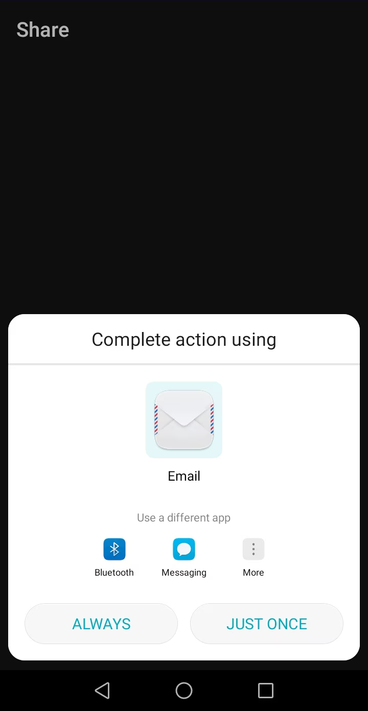

# Starting Activities: intents in detail

Communication between app components is an essential part of Android development. By app components, we are referring to activities, services, broadcast receivers, and content providers. The idea is that different app components, be it from the same app or two different apps, can interact.

For example, suppose you tap an audio file in a file browser app. Most likely, an audio player app will start to play the audio file. In this case, the file-browsing app has to communicate with the audio player app and pass the location of the audio file. Another scenario is that the file browser has its audio player in a different activity, such as `PlayerActivity`. There is still a need to pass the audio's file location to `PlayerActivity`. To achieve this, we are going to use intents.

This topic will mainly focus on communication between **Activities** through **intents**.

## Intents


As you already know, an `Intent` is a messaging object between app components. In the Intent topic, you learned that intents can be used to launch activities and even pass data between activities. To refresh your memory, here is an example:

```kotlin
val intent = Intent(this, UserActivity::class.java)
intent.putExtra("userName", someData)
startActivity(intent)
```

With the basic knowledge of intents, let's find out more about them!

An `Intent` usually contains some information. When `startActivity()` is called, passing an intent as the argument, the Android system is responsible for starting a corresponding activity. The information in intents helps the Android system figure out which activity to start. In the following sections, we'll discuss some of this information.

## Component name

This is the name of the component to be started. It is optional, but it's also key to resolving whether an `Intent` is **explicit** or **implicit**. When the component name is provided, the intent is explicit. The component name can be set through the `Intent` constructor:

```kotlin
// 'this' is the context of an activity assuming we are inside one!
val intent = Intent(this, SomeActivity::class.java)
```

Here, a reference to an activity written as `NameOfActivity::class.java` is provided as the component name (passed as the second argument). When `startActivity()` is called with the intent above, the system will open the activity referenced.

## Actions

This is a string that specifies an action to be performed. An action may include picking an image, viewing contacts, dialing a contact, sending emails, and so on. For example, if you want an intent to launch the phone app and dial a number, you can use the action `Intent.ACTION_DIAL`, which is a constant string defined in the `Intent` class:

```kotlin
// ignore Uri.parse("tel:1234556789") for now
val intent = Intent(Intent.ACTION_DIAL, Uri.parse("tel:123456789"))
startActivity(intent)
```

So how does this work? The phone app in your device is configured, in a way, to accept an intent with the action defined in `Intent.ACTION_DIAL`. The way this is done is by declaring intent filters with the specific action for activities in the `AndroidManifest.xml` file (we'll discuss it later in the topic). The system will look for apps with a matching intent filter for the intent used in `startActivity()`. If several apps are found to match the intent, the system will prompt the user to choose one.



> [!NOTE]
> Actions are not the only information considered when the system is filtering for apps that can be launched with implicit intents

The `Intent` class has many defined string constants for standardization, such as `ACTION_SEND` commonly used to send data. You can specify your own actions to use with intents. This will be covered later in the topic!

As shown in the code snippet above, actions can be set through the `Intent()` constructor. You can also specify actions with the `setAction()` method. For more examples, take a look at some of the common intents.

## Data

Data is passed to an intent as a `Uri` object (Universal Resource Identifier) that either references the data to be acted upon or the MIME (Multipurpose Internet Mail Extensions) type of the data or both. As you may have already guessed, `Uri.parse("tel:123456789")` in the example above is the data. The method `Uri.parse()` is used to create `Uri` objects from strings that are appropriately formatted. For example, you may use the string "https://www.jetbrains.com/academy/" to create a `Uri` object that references the JetBrains Academy website.

Specified data usually goes hand in hand with the action. For example, if you are using the action `ACTION_VIEW`, the data may be a `Uri` that points to the location of an image or document.

In cases where the URI is a `content:` URI, the type is guessed from the content by its provider but it's recommended that you specify the data type separately. This is because your app may only handle specific data types while several data types may have a similar URI format. A MIME type consists of two parts: **type/subtype**. Examples include: "text/plain", "image/png" or "audio/mpeg". You can also use "image/*" or "audio/*" to refer to any type of image or audio respectively. The MIME type can be specified by the method `setType()`.

The data reference is specified through the Intent constructor or the `setData()` method:

```kotlin
val intent = Intent(Intent.ACTION_VIEW)

val webpage: Uri = Uri.parse("https://www.jetbrains.com/academy/")
// Intent.setData(someData) can also be written as Intent.data = someData
intent.data = webpage

startActivity(intent)
```
## Category

The category refers to a string containing additional information about the kind of component that should handle the intent. Usually, it is not required for many intents. A common category includes the `Intent.CATEGORY_LAUNCHER`, usually used to launch the initial activity of an app, for example by the devices launcher app. Some categories are also defined as constants in the `Intent` class.

> [!NOTE]
> If the category is not specified, the method `startActivity()` always treat all intents to the category `Intent.CATEGORY_DEFAULT`.

You can specify a category for your intent with the method `addCategory()`.

## Extras

You are probably familiar with extras. These are key-value pairs that carry additional data. You can send data to other activities using extras. To add an extra, use the method `putExtra()`. The method has a number of overloads, each taking a **key** as the first argument and a **value** varying in data types as the second argument:

```kotlin
val intent = Intent(this, SomeActivity::class.java)
// Defining your keys as string constants in your code is usually good practice
intent.putExtra("customerName", "John")
intent.putExtra("customerAge", 14)
startActivity(intent)
```

In the example above, the system starts `SomeActivity` and the intent used to start the activity is passed to the activity. We can access the data in the intent as follows:

```kotlin
// This code is placed inside the class SomeActivity for us to access the intent passed

// The 'name' variable is inferred to String?
val name = intent.getStringExtra("customerName")

// The 'age' variable is inferred to Int
val age = intent.getIntExtra("customerAge", 0)
```

First, the `intent` in the code snippet above comes from the method `getIntent()` used to retrive the intent used to launch the activity.

There are different methods for getting your extras depending on the data type of what is in the extra. Some of the other methods are `getCharExtra()`, `getBundleExtra()`, `getIntArrayExtra()`.


Extras can also be used with actions in the same way that data can be used with actions. For example, to start an app to send an email with the recipient and the subject specified, you should consider doing something like this:

```kotlin
button.setOnClickListner {
    val intent = Intent(Intent.ACTION_SEND)
    intent.putExtra(Intent.EXTRA_EMAIL, "myapp@email.com")
    intent.putExtra(Intent.EXTRA_SUBJECT, "App review")
    startActivity(intent)
}
```

> [!NOTE]
> To send instances of a class as extras, you will have to implement the `Parcelable` or `Serializable` interface. You can then use the method `getParcelableExtra<NameOfClass>()` or `getSerializableExtra()` to retrieve your data.
>When using intent extras, limited yourself to a few kilobytes. Passing large data size might cause your app to crash.

## Intent filters

By now, you have probably asked yourself how are other apps, such as the phone app, a browser, or even an image-viewing app, able to receive implicit intents. The answer to that question is intent filters.

```xml
<manifest>
    ...
    <application>
        ...
        <activity
            android:name=".MainActivity"
            android:exported="true" >
            <intent-filter>
                <action android:name="android.intent.action.MAIN" /> 
                <category android:name="android.intent.category.LAUNCHER" />
            </intent-filter>
        </activity>
    </application>
</manifest>
```

If you create a new project in Android Studio, your `AndroidManifest.xml` should look similar to the snippet above (of course, without the ... used here to represent the left-out code). `MainActivity` contains an intent filter that allows it to be launched by the Android launcher.

Similarly, you can create your own intent filters such that when the system is looking for apps that have matching intent filters for an intent, yours is included in the search. If your intent filters match the intent, your app will then be chosen and either launched directly or listed among other apps that match the intent too for the user to pick one. If your app is then launched, it will be passed the `Intent` used to launch it, and you can use the data in it.

In each of your app components that includes the `intent-filter` element, you will have to set the `android:exported` attribute of the associated component explicitly. It indicates whether the component is accessible to other apps. Set it to `true` if the component is to be accessed by other applications. Otherwise, it's important that it stays `false` for security reasons.

Now, add an `intent-filter` element as a child of the targeted `activity` element in the `AndroidManifest.xml`. Inside the element, you will specify the type of intents it accepts based on the intent's action, data, and category.

Here is an example of an activity that accepts intents of action `Intent.ACTION_SEND`, the default category, and data of the "text/plain" media type:

```xml
<activity
    ...
    android:exported="true" >
        <intent-filter>
            <action android:name="android.intent.action.SEND" />
            <category android:name="android.intent.category.DEFAULT" />
            <data android:mimeType="text/plain" />
        </intent-filter>
</activity>    
```

> [!NOTE]
> The activity above can be implicitly or explicitly launched from another app since the `android:exported` attribute is set to `true`.

You might have already figured out that the constant `ACTION_SEND` in the `Intent` class is just the string "`android.intent.action.SEND`". To receive implicit intents, It is a must to include the category filter. In most cases, it would be `CATEGORY_DEFAULT`.

Try to share a text from any other app. Your app should be listed among the apps you can choose in the **chooser** (also referred to as the **disambiguation dialog**). Later in the topic, we will cover handling the data when your app is launched.


You can add multiple actions, categories, or types in the same intent filter, or even add multiple intent filters in one activity:

```xml
<activity 
    ... >
    <intent-filter>
        <action android:name="android.intent.action.SEND" />
        <category android:name="android.intent.category.DEFAULT" />
        <data android:type="video/mp4" />
    </intent-filter>
    <intent-filter>
        <action android:name="android.intent.action.SEND"/>
        <category android:name="android.intent.category.DEFAULT"/>
        <data android:mimeType="text/plain"/>
        <data android:mimeType="image/*"/>
    </intent-filter>
</activity>
```
Creating multiple intent filters is particularly useful when you want to handle multiple kinds of intents but only in specific combinations of action, category, and data type. Having multiple entries of actions, categories, or data types is useful in different cases. For example, in the code snippet above, we are able to accept both "text/plain" and "image/*" data types for the same action in the second intent filter.

You can now create your own unique actions. It's simple: just change the intent filter to match a custom action `com.example.action.RENDER` and use that to create your intents. Just make sure you include your app's package name. It helps avoid conflicts with other existing actions. You can add the action as a constant in your code:

```kotlin
const val ACTION_RENDER = "com.example.action.RENDER"

val intent = Intent(ACTION_RENDER, Uri.parse(someData))
```
## Handling data

The way you will use to handle your data from intents varies depending on the intent you receive. Here is an example:

```kotlin
override fun onCreate(savedInstanceState: Bundle?) {
    super.onCreate(savedInstanceState)
    setContentView(R.layout.main)

    if (intent?.type == "text/plain") {
        val text = intent.getStringExtra(Intent.EXTRA_TEXT)
    } else if (intent?.type?.startsWith("image/") == true) {
        (intent.getParcelableExtra<Uri?>(Intent.EXTRA_STREAM))?.let {
            image.setImageURI(it)
        }
    }
}
```

As a reminder, the important part to note is that you can access the intent delivered to your activity by calling `getIntent()`.


> [!NOTE]
> Note that for intents with the `ACTION_SEND` action, the data is contained in an extra rather than the data information of the intent. The extra might have the key `EXTRA_TEXT` or `EXTRA_STREAM` depending on the data type. If the MIME type of the data is "text/plain", then `EXTRA_TEXT` is used. Otherwise, EXTRA_STREAM is used (for example, where the data is a URI). We get the extra as a Parcelable then cast it to a Uri? as follows: getParcelableExtra<Uri?>(Intent.EXTRA_STREAM). Here, you can find more information on the ACTION_SEND action and others.

For some intents with actions such as `ACTION_DIAL` and others, the data is usually supplied as the intent's data information and can be accessed as follows:

```kotlin
override fun onCreate(savedInstanceState: Bundle?) {
    super.onCreate(savedInstanceState)
    setContentView(R.layout.main)

    // You can get the intent's data information (if it exists) as follows
    val data: Uri? = intent?.data
}
```

## Tips

If you want to always display the chooser when using an implicit intent, you can do so by using the `createChooser()` method. This allows the user to select different apps to handle the intent, such as sharing an image, each time the intent is launched. This can be useful if the user wants to share the same content with different apps or recipients:

```kotlin
val intent = Intent(Intent.ACTION_SEND)

val title = "Share this image with"
val chooser = Intent.createChooser(intent, title)

startActivity(chooser)
```

> [!NOTE]
> In the code above, the string is hardcoded, which is not recommended. Always prefer to use string resources.

## reference

- [Starting Activities: Intents in detail](https://hyperskill.org/learn/step/24801)


