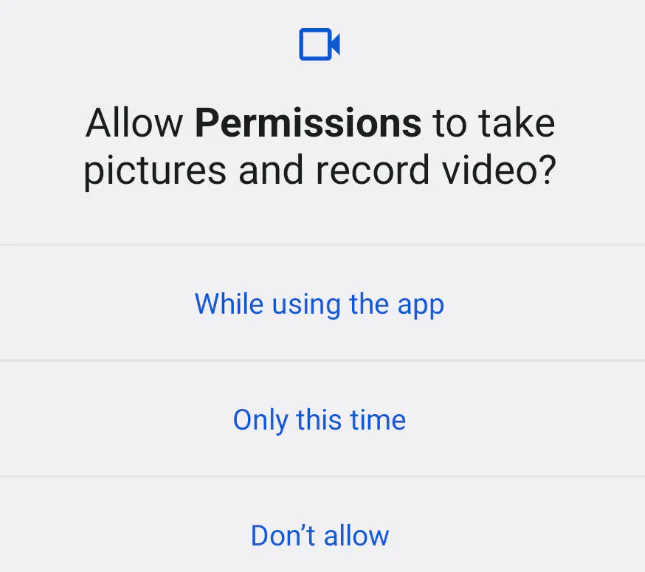

# Permissions
Permissions protect user privacy by restricting access to sensitive device functions. You have probably seen them earlier: almost every app asks you for some sort of permission.

## About permissions

Permissions restrict access to sensitive sensors or data on your device. Before Android **6.0**, users saw a list of permissions required for the app before it was installed. By installing it, you automatically granted all of them. That wasn't all that cool, because some developers abused this system. For example, a flashlight app could have permission to see contacts, send text messages, or access calendar.

Thankfully, this behavior has changed: now, apps ask you whether you want to allow some dangerous permissions: location, camera, microphone, storage access, etc. It's called **runtime permissions**. There are still some permissions that don't need approval, for example, Internet access, running at startup, and so on.

These type of permissions are called **install-time permissions**. They are considered harmless, and that's why they don't need to be approved.

There are also **special permissions** available, but they are defined by the manufacturers of the phone and usually protect access to specific actions, like drawing over apps or defining settings. They are different for every manufacturer.

## Permissions and user experience

A runtime permissions request looks like an alert which contains the icon, a name of permission to be approved, and two or three buttons (depending on the OS version):



Sometimes, these alerts are self-explanatory: when you are downloading a Camera app, it will not work without permission to access camera. But permission to access contacts in the Notes app may be not so easy to understand. That's why it's important to request them at the right moment.

Take some time to think about how to appropriately ask for permission in your app. You can follow these rules to make it easier:

- If your app can't run without this permission and it's completely clear why it's needed — ask for it right away! If the user denies that permission, you can show a screen that explains why you need this permission and why your app won't work without it. For example, it's clear why a Camera app needs access to the camera, so no need to explain that before asking for permission.

- If your app can't run without this permission, but it's not clear why you ask for it — show an explanation of why you need it, then ask for the permission. For example, a Wi-Fi scanning app asking for Location permission. Before Android 13, you needed to grant location permission to work with Wi-Fi-related stuff. That could confuse people, so developers usually provided an explanation why they needed location access permission beforehand.

- If your app can run without this permission, but it's completely obvious that using this function will require this permission — ask for it at the moment when the user tries to use that function. For example, Voice Messages in a messaging app — it's obvious that you need Microphone access to record a voice message. If the permission was denied, you can show an explanation like "Recording voice messages requires access to the microphone".

- If your app can run without this permission, but it's not obvious why you need it — show an explanation and then ask for permission. For example, saving an achievement in a game to the gallery. It's not obvious why the game asks for storage permission when you press "Share". Explain why you need the storage permission, then show the request.

## Declaring permissions

To declare a permission (both an install-time and runtime) you need to add it to the manifest file. Permissions can be added within the `<manifest>` tag before `<application>` tag like this:


```xml
<manifest xmlns:android="<http://schemas.android.com/apk/res/android>"
    package="com.hyperskill.permissions">

    <uses-permission android:name="android.permission.CAMERA" />
    <uses-permission android:name="android.permission.READ_EXTERNAL_STORAGE" />

    <application ...>
        ...
    </application>

</manifest>
```

You should add every permission your app needs to function. If the requested permission is an install-time one, the user won't need to do any actions to allow them after the app has been installed. Runtime permissions require somewhat more than just a few lines in the manifest. Let's see how they work.

## Checking for a runtime permission


After declaring a permission in the manifest, you can wait for the user to attempt a specific action that requires permission.
There is a method to check whether your app has already been granted the required permission — the `checkSelfPermission()` method:

```kotlin
if (ContextCompat.checkSelfPermission(this, Manifest.permission.CAMERA) ==
    PackageManager.PERMISSION_GRANTED) {
    // continue executing the permission-blocked action
} else {
    // no permission, request it
}
```


This method takes `Context` and the permission name as parameters, and returns an Int. The returned Int is either `PackageManager.PERMISSION_GRANTED`, which equals 0, or `PackageManager.PERMISSION_DENIED`, which equals -1. We should request permission if `checkSelfPermission` returned `PERMISSION_DENIED`.

You can request permissions using Activity Result APIs or `requestPermissions()`. We will look at Activity Result APIs first.

## Requesting permission using Activity Result APIs


Activity Result APIs is a new programming interface for exchanging data between activities.
It allows for creating a launcher with a specified contract and register a callback to be invoked when the result arrives.

There are two contracts that can help us: 
- `RequestPermission` 
- `RequestMultiplePermissions`.

As their names suggest, the first one is used to request one permission, and the second one can be used to request two or more permissions at once. We need to register the contract in activity. You can do it using `registerForActivityResult()` which accepts a contract and a callback as parameters:

```kotlin
private val cameraRequestPermissionLauncher =
    registerForActivityResult(ActivityResultContracts.RequestPermission()) { granted ->
        if (granted) {
            // TODO use camera, take pictures
        } else {
            // User has denied the permission.
        }
    }
```

Or, alternatively, you can use a function reference instead of a lambda expression:

```kotlin
private val cameraRequestPermissionLauncher =
    registerForActivityResult(
        ActivityResultContracts.RequestPermission(),
        ::onRequestCameraPermissionResult
    )

private fun onRequestCameraPermissionResult(granted: Boolean) {
    if (granted) {
        // …
    } else {
        // …
    }
}
```

For `RequestMultiplePermissions()`, the callback will receive `Map<String, Boolean>` with a result for each permission request:

```kotlin
private val requestAllPermissionsLauncher =
    registerForActivityResult(ActivityResultContracts.RequestMultiplePermissions()) { granted ->
        if (granted.isNotEmpty() && granted.values.all()) {
            // …
        } else {
            // …
        }
    }
```
To check if the permission was denied before and you need to show the explanation before asking for permission, use `shouldShowRequestPermissionRationale()`:

```kotlin
if (ActivityCompat
    .shouldShowRequestPermissionRationale(this, Manifest.permission.CAMERA)) {
    // explain why we need this permission
}
```

Putting it all together, checking for permission, showing rationale and launching permission request would look like this:

```kotlin
cameraButton.setOnClickListener {
    when {
        ContextCompat.checkSelfPermission(this, Manifest.permission.CAMERA) ==
            PackageManager.PERMISSION_GRANTED -> {
            // Camera permission is already granted. Feel free to take photos!
        }
        ActivityCompat.shouldShowRequestPermissionRationale(Manifest.permission.CAMERA) -> {
            // The permission was denied some time before. Show the rationale!
            AlertDialog.Builder(this)
                .setTitle("Permission required")
                .setMessage("This app needs permission to access this feature.")
                .setPositiveButton("Grant") { _, _ ->
                    cameraRequestPermissionLauncher
                        .launch(Manifest.permission.CAMERA)
                }
                .setNegativeButton("Cancel", null)
                .show()
        }
        else -> {
            // The permission is not granted. Ask for it
            cameraRequestPermissionLauncher.launch(Manifest.permission.CAMERA)
        }
    }
}
```

When the user grants or denies the requested permission, our callback is invoked with an argument describing the result. If the permission was denied, we can check whether it was denied forever by calling shouldShowRequestPermissionRationale function again: if it returns false, the "don't ask again" checkbox was set and we can't ask for this permission again, but we can ask to enable it manually in Settings.

```kotlin
private fun onRequestCameraPermissionResult(granted: Boolean) {
    if (granted) {
        // Fine. Feel free to take photos!
    } else if (!ActivityCompat
        .shouldShowRequestPermissionRationale(this, Manifest.permission.CAMERA)) {
        // "Don't ask again"
        AlertDialog.Builder(this)
            .setTitle("Permission required")
            .setMessage("This app needs permission to access this feature. " +
                "Please grant it in Settings.")
            .setPositiveButton("Grant") { _, _ ->
                val intent = Intent(
                    Settings.ACTION_APPLICATION_DETAILS_SETTINGS,
                    Uri.fromParts("package", packageName, null),
                )
                try {
                    startActivity(intent)
                } catch (e: ActivityNotFoundException) {
                    Toast.makeText(this, "Cannot open settings", Toast.LENGTH_LONG)
                        .show()
                }
            }
            .setNegativeButton("Cancel", null)
            .show()
    } else {
        // The permission was denied without checking "Don't ask again".
        // Do nothing, wait for better times…
    }
}
```

In this method, we've created an `AlertDialog`, which explains once again why we request this permission and allows the user to either switch to the Settings and allow permissions manually, or cancel and get back to the application without these permissions.

## Requesting permissions with `requestPermissions()`


In some existing applications, you may encounter an older way of requesting permissions. There's no callback: instead, you pass an arbitrary number as requestCode to the permission request, and the response contains that code, so you can figure out which request it answers.

The `requestPermissions()` method is part of the `Activity` class, and can be called directly within its subclasses (such as `ComponentActivity`, or `AppCompatActivity`). It takes two arguments: an array of permissions, and a request code. The request code is an Int you would like to use, but bigger or equal to 0.


> [!NOTE]
> For backward compatibility with older Android versions (API level 22 and lower), you could use ActivityCompat.requestPermissions(). This method requires you to pass the activity as the first argument, followed by the permissions array and request code.

Permission request may look this way:

```kotlin
private const val MEDIA_REQUEST_CODE = 1

...

when {
    ContextCompat.checkSelfPermission(this, Manifest.permission.READ_EXTERNAL_STORAGE) ==
        PackageManager.PERMISSION_GRANTED -> {
        Toast.makeText(this, "Storage permission is granted", Toast.LENGTH_SHORT).show()
    }
    ActivityCompat
        .shouldShowRequestPermissionRationale(Manifest.permission.READ_EXTERNAL_STORAGE) -> {
        AlertDialog.Builder(this)
            .setTitle("Permission required")
            .setMessage("This app needs permission to access this feature.")
            .setPositiveButton("Grant") { _, _ ->
                requestPermissions(
                    arrayOf(Manifest.permission.READ_EXTERNAL_STORAGE),
                    MEDIA_REQUEST_CODE
                )
            }
            .setNegativeButton("Cancel", null)
            .show()
    }
    else -> {
        requestPermissions(
            arrayOf(Manifest.permission.READ_EXTERNAL_STORAGE),
            MEDIA_REQUEST_CODE
        )
    }
}
```

After clicking any button (or closing the alert), the `onRequestPermissionsResult()` method will be called.

> [!CAUTION]
> The use of onRequestPermissionsResult() for handling permission request results is deprecated (with exceptions for compatibility requirements). It is recommended to use the Activity Result APIs as shown in the previous section.

To check if the app was granted the requested permissions, we can override an `onRequestPermissionsResult()`. After the user chooses which permissions to approve or deny, this method is called. This method has three parameters: a requestCode, a permissions array, and a grantResults array.

```kotlin
override fun onRequestPermissionsResult(
    requestCode: Int,
    permissions: Array<out String>,
    grantResults: IntArray
) {
    super.onRequestPermissionsResult(requestCode, permissions, grantResults)
}
```

Here's where you will need the request code you've specified in your request earlier. With its help, we will be able to understand which actions must be performed after our request.

```kotlin
override fun onRequestPermissionsResult(
    requestCode: Int,
    permissions: Array<out String>,
    grantResults: IntArray
) {
    when (requestCode) {
        MEDIA_REQUEST_CODE -> {
            if (grantResults.isNotEmpty() &&
                grantResults[0] == PackageManager.PERMISSION_GRANTED) {
                // permission granted, use the restricted features
            } else {
                // no permission, block access to this feature
            }
        }
        else -> {
            super.onRequestPermissionsResult(requestCode, permissions, grantResults)
        }
    }
}
```

We will use when to check the request code. `MEDIA_REQUEST_CODE` in this example is a constant which is equal to 1 (but you can choose any number you like). Because Android allows you to request several permissions at a time, we get the results back as an array, too.

Keep in mind that if the user closes the alert without choosing any options, the results array might be empty. Treat an empty array as "Denied" to avoid potential problems with security exceptions because you're trying to access some permission without approval.

Everything else is similar including a possible “Don't ask again” check with shouldShowRequestPermissionRationale after getting the result.


## references
- [Permission](https://hyperskill.org/learn/step/23292)