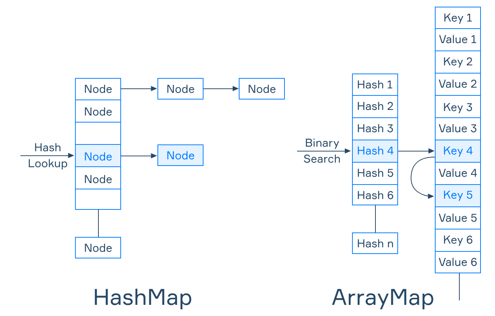

# Memory-efficient data structures in Android

Java and Kotlin support different data structures: lists, sets, maps, queues. Speaking of maps, the most popular ones are `HashMap`, `LinkedHashMap`, and `TreeMap`.

But we have data structures available in Android SDK besides the standard Java ones mentioned above:
the `ArrayMap`, `ArraySet`, and `SparseArray` family, designed for less memory consumption than standard ones.

## ArrayMap

Let's refresh your knowledge on [how standard Java HashMap works](/General/ComputerScience/2_AlgorithmsAndDataStructures/Algorithms/0_Hasing/2_HashTable.md.md)

`ArrayMap` works differently:
there are no buckets and linked lists. Instead, it has an array of sorted key hashes and an array of keys and values.

Search operation uses **binary search** to find the correct hash, and, if successful, checks the corresponding key.

Here is a **hash table with open addressing and linear probing** because key-value pairs are not locked to a certain position but located linearly, one after another:




> [!CAUTION]
> Avoiding buckets with empty spaces and references to nodes, ArrayMap gives us a more compact memory layout sacrificing lookup and insertion speed.

`ArrayMap` implements the same `(Mutable)Map` interface as `HashMap` and can be considered an easy drop-in replacement.

```kotlin
val cats = ArrayMap<String, Cat>()
cats.put("Barsik", Cat())
cats.put("Murlok", Cat())
cats.put("Vasya", Cat())
cats.forEach { (name, value) ->
    println("$name: $value")
}
```

As a bonus, ArrayMap has the `keyAt()` and `valueAt()` methods that allow us to traverse it without `.entrySet().iterator()` (which is used by `.forEach {}`).

```kotlin
for (i in 0 until cats.size) {
    println("${cats.keyAt(i)}: ${cats.valueAt(i)}")
}
```

## ArraySet

Standard Java's `HashSet` wraps `HashMap` and utilizes its keys, leaving values unused. So, `HashSet` just reuses the existing code without reinventing anything but wastes some memory

`ArraySet`, on the other hand, is a modified version of `ArrayMap` and has no values at all — only keys, which saves even more memory.

## SparseArrays

`SparseArray<T>` acts as an optimized and simplified `ArrayMap<Int, T>`. It can also be thought of as an array with gaps.

Why do we need special data structures instead of just using `Map<Int, T>` or `Map<Long, T>`? Because when using a general-purpose container for **primitive values** in Java, these integers need to be "boxed," meaning they are turned into objects. This wastes memory and increases pointer dereferencing.

`SparseArray` uses two arrays, with the first storing ordered integer keys, and the second one storing the values. Just like `ArrayMap` uses binary search for key hash lookup, `SparseArray` uses it to look up the key itself.

Apart from `SparseArray<T>`, there are several more flavors: `SparseLongArray`, `SparseIntArray` and `SparseBooleanArray`, whose values are `Long`, `Int`, and `Boolean` accordingly, plus `LongSparseArray<T>` with long keys.

In the example below, we have created 4 types of sparse arrays and filled them with data.

```kotlin
val catById = SparseArray<String>()
catById.put(9, "Charlie")
catById.put(34, "Barsik")
catById.put(38, "Molly")

val salaryByEmpId = SparseLongArray()
salaryByEmpId.put(1, 100L)
salaryByEmpId.put(5, 99L)
salaryByEmpId.put(16, 100L)
salaryByEmpId.put(42, 9223372036854775807L)
salaryByEmpId.put(56, 130L)

val interestingEpisodes = SparseBooleanArray()
interestingEpisodes.put(1, true)
interestingEpisodes.put(2, true)
// haven't watched the third episode
interestingEpisodes.put(4, false)

val catOwners = SparseIntArray()
catOwners.put(9, 1)
catOwners.put(34, 1)
catOwners.put(38, 42)
```

Besides the `get(key)` method similar to `Map`, there are also `get(key, defaultValue)`, `contains(key)`, and the pair of methods `keyAt()` and `valueAt()`.


## Why Android SDK Data Structures Are Not in the Standard Java Library

### 1. Optimized for the Android Environment
   - These data structures are specifically designed for Android, where memory is more constrained than in standard Java SE/EE applications running on desktops or servers.
   - In contrast, Java standard libraries prioritize general-purpose flexibility and overall performance rather than just memory savings.
### 2. Performance Is Not Always Better
   - `ArrayMap` uses an array instead of a hash table, resulting in `O(N)` worst-case lookup time, compared to `O(1)` for HashMap.
   - `SparseArray` performs well for small datasets, but `HashMap` can be faster for larger ones.
   - Therefore, in Java applications without strict memory constraints, standard Java collections are often more optimal.
### 3. Incompatibility with Java Collections Framework
   - The standard Java library (java.util.*) follows a unified API (Collection, Map, Set, List), making it easy for different libraries to work together.
    Android-specific data structures do not adhere to these interfaces, making integration with standard Java libraries more difficult.
### 4. Limited Generics Support
   - `SparseArray` uses `int` as a key instead of `Integer`, but it does not fully support generics like `HashMap<Integer, V>`, reducing its flexibility in general use cases.

## Conclusion

Use `ArrayMap` and `ArraySet` instead of `HashMap` and `HashSet` to **save some memory if you are ready to sacrifice the insertion speed on huge collections**.
Choose `SparseArrays` of all the possible option if **you need integer keys.**

Remember the golden rule: by sacrificing memory, we increase performance and vice versa.


