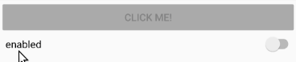

# Drawables

A **Drawable** object represents a graphic element. Any color, shape, gradient, vector, or raster image can be represented as a Drawable. It's even possible to implement your own.

## Color

A color is an integer holding four separate numbers that define the opacity (known as alpha), and the brightness of the red, green, and blue components. Consequently, any Kotlin integer can serve as a valid color representation.

For example, Purple square `0xFF8C5AFF.toInt()` is fully opaque (`FF`), quite red (`8C`), a little green (`5A`), and very blue (`FF`).

The same color can be expressed as `#8C5AFF` or `#FF8C5AFF` in XML.
Note that the alpha component is optional.

For instance, the color resource

```xml
<color name="green_lime">#CDDC39</color>
```

can be accessed via `ContextCompat.getColor(context, R.color.green_lime)`. This invocation retrieves the color from the application's resources and is synonymous with the Kotlin expression Lime square `0xFFCDDC39.toInt()`.

Colors in Android can be applied in different ways:

- `android:background="@color/green_lime"`

- `setBackgroundColor(0xFFCDDC39.toInt())`

- `setBackgroundResource(R.color.green_lime)`

these methods essentially equate to `setBackground(ColorDrawable(0xFFCDDC39.toInt()))` at the implementation level.

### Color selector

In contrast to attributes such as `background`, which typically accept `Drawable` objects, there exist several properties within the Android framework that do not inherently operate with Drawables.
These include properties like `backgroundTint` of a `View`, as well as `textColor`, `hintTextColor`, and `drawableTint` of a `TextView`.

While colors serve as appropriate values for these properties, an alternative option exists: the `ColorStateList`, commonly referred to as a color selector. 

This resource facilitates the definition of multiple colors corresponding to different states of a `View`. 


Below is an example of such a selector, depicted in the resource file `res/color/button_background_tint.xml`:


 ```xml
 <selector xmlns:android="http://schemas.android.com/apk/res/android">
    <item android:state_pressed="true" android:color="#AC8AFF"/>
    <item android:state_focused="true" android:color="#6C3ADF"/>
    <item android:state_enabled="false" android:color="#AAAAAA"/>
    <item android:color="#8C5AFF"/>
</selector>
```




The versatility of color selectors extends beyond merely defining colors for View properties like textColor to also encompass Drawable properties such as background.
This is evidenced by the fact that referencing a color selector, such as `android:textColor="@color/button_background_tint"`, can be equally valid for both color and Drawable attributes.

When fetching such a resource programmatically using ContextCompat, the return types differ based on the context: 
`ContextCompat.getColorStateList(context, R.color.button_background_tint)` yields a `ColorStateList`,
while `ContextCompat.getDrawable(context, R.color.button_background_tint)` provides a `ColorStateListDrawable`.
Furthermore, invoking getColor on a `ColorStateList` will yield the "default color" defined within the selector.

Expressing the color selector example provided earlier in Kotlin showcases an alternative syntax, highlighting a different order compared to XML.
Here, the first argument enumerates all possible states, while the second lists their corresponding colors.
Additionally, negation (`-some_state`) serves as the equivalent for the condition when a particular state is `false`.

```kotlin 
ColorStateList(
    arrayOf(
        intArrayOf(android.R.attr.state_pressed),
        intArrayOf(android.R.attr.state_focused),
        intArrayOf(-android.R.attr.state_enabled),
        intArrayOf()
    ),
    intArrayOf(
        0xFFAC8AFF.toInt(),
        0xFF6C3ADF.toInt(),
        0xFFAAAAAA.toInt(),
        0xFF8C5AFF.toInt()
    )
)
```

## Bitmap

**Bitmaps** serve as digital representations of images, composed of a grid of pixels, each pixel representing a specific color.

Commonly encountered in raster file formats such as PNG, GIF, WEBP, or JPEG, these formats store image data in a way that can be decoded into a Bitmap using various `BitmapFactory.decode*` methods available in Android development.

## Implementing a Drawable

what if you need to draw something special?

### Minimal Drawable

When we extend the Drawable class, it's necessary to implement all its abstract methods so our code can compile:
```kotlin
class MinimalDrawable : Drawable() {
    override fun setAlpha(alpha: Int) {}
    override fun setColorFilter(colorFilter: ColorFilter?) {}
    override fun getOpacity(): Int = PixelFormat.TRANSLUCENT
    override fun draw(canvas: Canvas) {}
}
```

`setAlpha` and `setColorFilter` are called if we want to change the appearance of our Drawable.

`getOpacity` allows us to specify whether our Drawable is `TRANSLUCENT`(fills some pixels within its bounds), `TRANSPARENT`  (draws nothing), or `OPAQUE` (fills every pixel within its bounds). Starting with API 29, the method is no longer used, but we must still implement it because it's abstract and required to support older versions properly.

The most interesting method is `draw`. It accepts a parameter of type `Canvas`, which is a drawing surface. 
This enables us to grab a paint can and draw something!

### Basic GradientTextDrawable

Let's do what neither `Drawables` out of the box nor `TextView` can accomplish: draw text using a gradient instead of a solid color.

To achieve this, we need the text we want to draw and its size:


```kotlin
class GradientTextDrawable(@Px size: Float, text: String) : Drawable() {
    …
}
```

All the graphics APIs work directly with pixels, so `@Px` is a hint that it's the caller's responsibility to convert the desired dimension from SP or DP.

We'll begin by drawing some plain text.
To do this, we need an instance of `TextPaint`, which is a subclass of `Paint` specifically for drawing text.
We will also use the `ANTI_ALIAS_FLAG` to make glyph edges smooth. The `canvas.drawText` function does what we want:

```kotlin
class GradientTextDrawable(
    @Px size: Float,
    private val text: String,
) : Drawable() {

    private val paint = TextPaint(Paint.ANTI_ALIAS_FLAG).apply {
        textSize = size
    }

    override fun draw(canvas: Canvas) {
        canvas.drawText(text, x, y, paint)
    }

    …
}
```

We still need to define `x` and `y` values.

- `x` sets the starting position of the text horizontally.
- `y` is not just the top of the text; it defines the baseline.
The baseline is the invisible line where most letters sit, like a, b, c, d, e. However, some letters (g, j, p, q, y) have descenders that extend below the baseline.

If we set `y = 0`, only the descenders will be visible, while the main part of the text will be cut off because it's positioned above the Drawable’s top boundary.

Fortunately, we can use `FontMetrics.ascent`: a negative number holding the distance from the baseline to the top edge of a glyph.

`bounds` is simply a tuple of (left, top, right, bottom) that defines our bounding box:

```kotlin
    private val metrics = paint.fontMetrics
    override fun draw(canvas: Canvas) {
        val x = bounds.left.toFloat()
        val y = bounds.top - metrics.ascent // metrics are all Float, Int - Float = Float
        canvas.drawText(text, x, y, paint)
    }
```

Now let's create a gradient! 

```kotlin
paint.shader = LinearGradient(
    x, 0f, x + paint.measureText(text), 0f,
    intArrayOf(
        0xFF8c5aff.toInt(),
        0xFF_408bcf.toInt(),
        0xFF_18b2b7.toInt(),
        0xFF_21d789.toInt(),
    ),
    floatArrayOf(0f, .36f, .724f, 1f),
    Shader.TileMode.CLAMP
)
```
Below, you can see a render for `GradientTextDrawable(42f * resources.displayMetrics.scaledDensity, "JetBrains Academy")`:


#### Optimize drawing

The `shader` is reallocated unconditionally on every `draw()`, but drawing should be fast, so caching everything that we can is advised. 

we will create `shader` for the case when `bounds.left` is `0` and translate `canvas`, changing the origin of the coordinates temporarily. The pattern looks like this:

- `save()` canvas, meaning "remember the current state so we can revert later";
apply transformations with any combination of `translate()`, `rotate()`, `scale()`, or `skew()`;
draw anything;
- `restore()`, which means "revert all the transformations to the last checkpoint." Anything that was drawn to the canvas remains.

So, instead of re-creating `shader` every time `bounds` change, we just make it independent from `bounds`, and translate `canvas` to the `bounds` origin during `draw()`:


```kotlin
if (paint.shader == null) paint.shader = LinearGradient(
    0f, 0f, paint.measureText(text), 0f,
    …
)
canvas.withTranslation(bounds.left.toFloat(), bounds.top.toFloat()) {
    canvas.drawText(text, 0f, -metrics.ascent, paint)
}
```

`withTranslation` is an AndroidX extension that calls save–translate–draw–restore internally.

## Become mutable

Updating existing Drawables is generally faster and more memory efficient than allocating new ones.

We have defined our own properties: `size` and `text`. Let's also make them mutable, so anyone can change our contents when necessary. 
We will use the `invalidateSelf` method to signal that the contents have been modified and must be redrawn.

Instead of asking `Paint` to create `FontMetrics` every time when text size gets changed, we will allocate `FontMetrics` once and ask `Paint` to update it, thus avoiding extra allocations

Changing text will affect our gradient length as well:

```kotlin
class GradientTextDrawable(
    @Px size: Float = 0f,
    text: String = "",
) : Drawable() {

    private val paint = TextPaint(Paint.ANTI_ALIAS_FLAG).apply {
        textSize = size
    }

    private val metrics = Paint.FontMetrics()
    
    var size: Float
        @Px get() = paint.textSize
        set(@Px size) { 
            if (paint.textSize != size) {
                paint.textSize = size
                paint.shader = null
                invalidateSelf()
            }
        }
    
    var text: String = text
        set(text) {
            if (field != text) {
                field = text
                paint.shader = null
                invalidateSelf()
            }
        }
    
    override fun draw(canvas: Canvas) {
        if (paint.textSize == 0f || text.isBlank())
            return // Draw nothing. Immediately!

        paint.getFontMetrics(metrics) // copy metrics from Paint to our own FontMetrics
        …
    }
}
```
### Deeper support of Drawable APIs

We still have empty `setAlpha()` and `setColorFilter()` methods. Let's obey the `Drawable` contract and support them.

```kotlin
override fun getAlpha(): Int = paint.alpha
override fun setAlpha(alpha: Int) {
    if (paint.alpha != alpha) {
        paint.alpha = alpha
        invalidateSelf()
    }
}

override fun getColorFilter(): ColorFilter? = paint.colorFilter
override fun setColorFilter(colorFilter: ColorFilter?) {
    paint.colorFilter = colorFilter
    invalidateSelf()
}
```
Drawables also have the concept of **intrinsic bounds** that define their preferred size. Let's implement a pair of methods to report our intrinsic width and height

```kotlin
override fun getIntrinsicWidth(): Int =
    paint.measureText(text).roundToInt()

override fun getIntrinsicHeight(): Int =
    metrics.run {
        paint.getFontMetrics(this)
        descent - ascent
    }.roundToInt()
```
But `measureText()` is potentially slow and depends on text length, so let's cache the result:

```kotlin
    private var textWidth = Float.NaN
    private var textHeight = Float.NaN

    var size: Float
        @Px get() = paint.textSize
        set(@Px size) {
            if (paint.textSize != size) {
                paint.textSize = size
                paint.shader = null
                textWidth = Float.NaN
                textHeight = Float.NaN
                invalidateSelf()
            }
        }

    var text: String = text
        set(text) {
            if (field != text) {
                field = text
                paint.shader = null
                textWidth = Float.NaN
                // don't touch textHeight, it stays unaffected
                invalidateSelf()
            }
        }

    override fun draw(canvas: Canvas) {
        if (size == 0f || text.isBlank())
            return // Draw nothing. Immediately!

        // refresh textWidth
        intrinsicWidth

        // refresh metrics (and cache textHeight, as a bonus)
        intrinsicHeight

        if (paint.shader == null) paint.shader = LinearGradient(
            0f, 0f, textWidth, 0f,
            …
        )
        canvas.withTranslation(…)
    }

    override fun getIntrinsicWidth(): Int {
        if (textWidth.isNaN())
            textWidth = paint.measureText(text)
        return textWidth.roundToInt()
    }
    override fun getIntrinsicHeight(): Int {
        if (textHeight.isNaN())
            textHeight = metrics.run {
                paint.getFontMetrics(this);
                descent - ascent
            }
        return textHeight.roundToInt()
    }
```

## Reference

- https://hyperskill.org/learn/step/13899