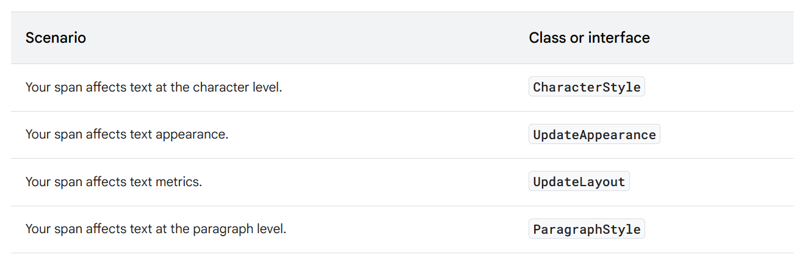

# Spans

Spans provide an easy way to refine your app's user experience by modifying text color, style, and even making it clickable.

## Span types

Over 20 types of spans are available; we will describe the commonly used ones. If you want a list of all kinds, go to the [official Android documentation.](https://developer.android.com/reference/android/text/style/package-summary)

Some span types can be added to individual characters, and others must be added to an entire paragraph.

So, we divide spans into two categories :

- Character Affecting Spans (Can be applied to individual characters)

    - Appearance Affecting Spans (color, background, style, size),

    - Metric Affecting Spans (font, alignment, line height)

- Paragraph Affecting Spans (Must be applied to an entire section)

## Span implementation

Span can be created with any of these classes in the Android library :

- **SpannedString** is a type of text that cannot be changed once created (immutable). It has a fixed length and style. You can use it to show some text that is already formatted and does not need modification.
- **SpannableString** is a type of text that cannot be changed once created (immutable).It has a fixed length but style can change. You can apply different styles and formatting to different portions of the text.
- **SpannableStringBuilder** is a type of text that can be changed in its content and style. It has a variable length and style. You can use it to perform operations on the text and its style, such as adding, removing, replacing, etc.

Select the appropriate class based on your requirements.

To apply a span, call


```kotlin
SpanObject.setSpan(Object span, int start, int end, int flags)
```

- `Object span` to apply the text to
- `int start` represents the beginning position of the text where the span should be applied.
- `int end` represents the position immediately after the last character to which the span will be applied. In other words, the span will apply up to, **but not including, the character at the position indicated by the end.**
- `int flags` the "flag" value determines how a text span reacts to the inserted text within its range. We can use the `Spannable.SPAN_EXCLUSIVE_INCLUSIVE` or `Spannable.SPAN_EXCLUSIVE_EXCLUSIVE`.
    - Spannable.`SPAN_EXCLUSIVE_INCLUSIVE` can help you when you apply a text span with this flag to a specific range of text, such as a substring, and then insert new text within that range, the span will automatically expand to include the newly inserted text. In other words, any formatting or properties associated with the span will apply to both the original text and the inserted text. This can be useful when you want the formatting of a span to encompass any modifications made within its boundaries.
    - Spannable.`SPAN_EXCLUSIVE_EXCLUSIVE`: When you apply a text span with this flag to a range of text and insert new text within that range, the span will remain fixed to its initial boundaries and not include the inserted text. In other words, the inserted text will not inherit the formatting or properties of the span. This is useful when you want to maintain a specific formatting only on the original text and prevent any inserted text from inheriting that formatting.

## Object Span

### ForegroundColorSpan

If you need to add a different color to a specific part of a text, then `ForegroundColorSpan` is the span type to use.
It belongs to a **Character Affecting Spans**, so that means we can apply it to any part of a desired part of a text.

```kotlin
    val text = "Practice makes progress. Start now!"
    val spannableString = SpannableString(text)

    val start = 25 // Start index of the text portion
    val end = 35  // End index of the text portion
    val color = Color.RED // Color for the text portion

    val colorSpan = ForegroundColorSpan(color)
    spannableString.setSpan(colorSpan, start, end, Spanned.SPAN_EXCLUSIVE_EXCLUSIVE)

    sampleSpanColorTextView.text = spannableString //sets text to TextView
```


### BackgroundColorSpan

```kotlin
    val text = "Never give up on learning"
    val spannableString = SpannableString(text)

    val start = 0 // Start index of the text portion
    val end = text.length   // End index of the text portion
    val bgColor = Color.YELLOW // Background color for the text portion

    val bgColorSpan = BackgroundColorSpan(bgColor)
    spannableString.setSpan(bgColorSpan, start, end, Spanned.SPAN_EXCLUSIVE_EXCLUSIVE)

    binding.sampleSpanBackgroundTV.text = spannableString
```


### StyleSpan

With the `StyleSpan` class, you can apply text styles such as bold, italic, underline, or strike-through to any part of a text. It is also a part of a Character Affecting Spans.

```kotlin
    val text = "This is a bold italic text style"
    val spannableString = SpannableString(text)

    val start = 10 // Start index of the text portion
    val end = 32  // End index of the text portion

    // Apply bold and italic styles
    val styleSpan = StyleSpan(Typeface.BOLD_ITALIC)
    spannableString.setSpan(styleSpan, start, end, Spanned.SPAN_EXCLUSIVE_EXCLUSIVE)

    binding.sampleSpanStyleTV.text = spannableString
```


### ClickableSpan

`ClickableSpan` is a class in Android that allows you to make a part of a text view clickable and perform some action when clicked. It is a subclass of `CharacterStyle`.
```kotlin
    val text = "Click me for an action"
    val spannableString = SpannableString(text)

    val start = 0 // Start index of the text portion
    val end = text.length // End index of the text portion

    // Define the action to be performed when the text is clicked
    val clickableSpan = object : ClickableSpan() {
        override fun onClick(widget: View) {
            // Action to perform when the text is clicked
            Toast.makeText(requireContext(), "Text Clicked!", Toast.LENGTH_SHORT).show()
        }
    }

    spannableString.setSpan(clickableSpan, start, end, Spanned.SPAN_EXCLUSIVE_EXCLUSIVE)

    // Enable clickable behavior on the TextView
    binding.sampleSpanClickableTV.movementMethod =
        android.text.method.LinkMovementMethod.getInstance()
    binding.sampleSpanClickableTV.text = spannableString
```

### Custom span

If you need the functionality of a span that isn't already provided in existing Android span classes,
you can create your custom span implementation.

First, you must decide what this span will change to know which base classes to extend and interfaces to implement.
For reference, you can check the table below :



For example, In this custom class, we will change the text color to red and make larger text with bold style.

Through inheritance, `RelativeSizeSpan` extends `CharacterStyle` and implements the two `Update` interfaces.

We created a new class with `CustomSpan` that extends `RelativeSizeSpan`(float proportion) with three parameters :
- `size`: a Float value representing the relative size of the text span.
- `color`: a @ColorInt annotation indicating the color of the text span.
- `isBoldText`: a Boolean flag indicating whether the text should be displayed in bold.

The class overrides the `updateDrawState` method, which is responsible for updating the visual appearance of the text. This method is called when the text is drawn on the screen. Inside the `updateDrawState` method:

- The `super.updateDrawState(textPaint)` call invokes the parent class's implementation of the updateDrawState method, which sets up the relative text size.
- `textPaint?.color = color` sets the text color of the span using the provided color.
- `textPaint.isFakeBoldText = isBoldText` sets the boldness of the text span based on the `isBoldText` flag.

```kotlin
class CustomSpan(
    size: Float,
    @ColorInt private val color: Int,
    val isBoldText: Boolean
) : RelativeSizeSpan(size) {
    override fun updateDrawState(textPaint: TextPaint) {
        super.updateDrawState(textPaint)
        textPaint?.color = color
        textPaint.isFakeBoldText = isBoldText
    }
}
```
We then add this custom class as a parameter to the `setSpan` method.

```kotlin
 val customSpan = CustomSpan(3.5f, Color.RED, true)
        val text = SpannableString("Custom span text")
        text.setSpan(customSpan, 0, 6, Spanned.SPAN_EXCLUSIVE_EXCLUSIVE)
        binding.sampleSpanCustom.text = text
```

Result:


