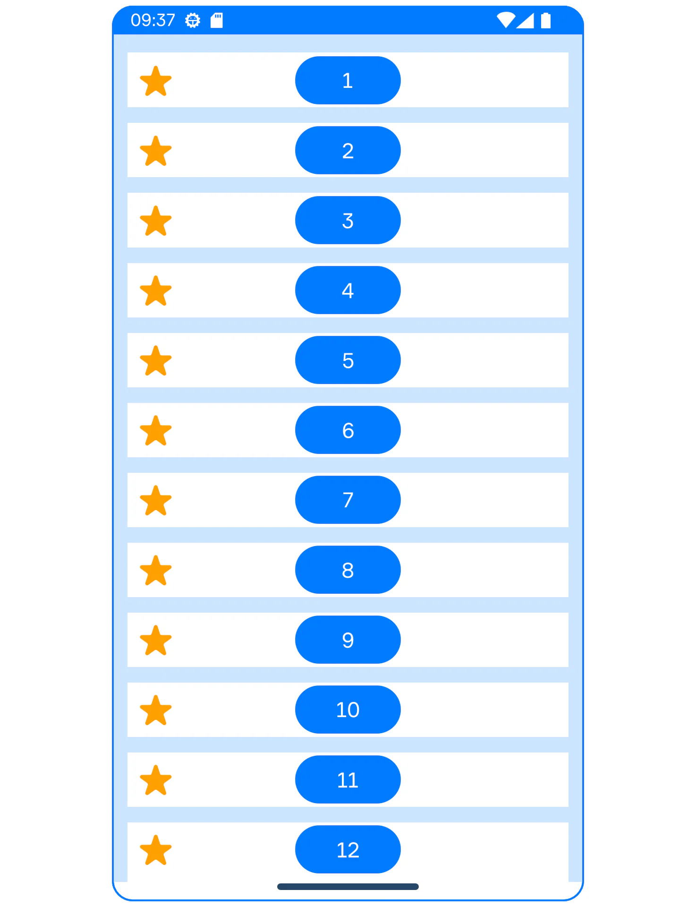

# ItemDecoration

The `ItemDecoration` is an abstract class that has three methods:

1. `getItemOffsets(outRect: Rect, view: View, parent: RecyclerView, state: RecyclerView.State)`
This method lets you set offsets around each item within a `RecyclerView`.
These offsets help control the item's placement and spacing.
The `outRect` signifies the space around the item. You can modify its properties, such as `left`, `top`, `right`, and `bottom`, to specify item spacing. The spacing will add to existing parent padding and item margins. The `view` parameter denotes the current item's View in the `RecyclerView`.

2. `onDraw(c: Canvas, parent: RecyclerView, state: RecyclerView.State)`: This method lets you draw custom decorations on the RecyclerView's canvas. Everything this method draws is drawn before the item views and will be displayed beneath.

3. `onDrawOver(c: Canvas, parent: RecyclerView, state: RecyclerView.State)`: Similar to `onDraw`, this method lets you design custom decorations on the RecyclerView's canvas. However, decorations drawn using `onDrawOver` will appear on top of the item views, unlike `onDraw`.

In all three methods, `parent` is the `RecyclerView` itself and `state` is the RecyclerView's state.

## Example

Inheriting RecyclerView.ItemDecoration

```kotlin
class OffsetItemDecoration(private val spacingInPx: Int) :
    RecyclerView.ItemDecoration() {
    override fun getItemOffsets(
        outRect: Rect,
        view: View,
        parent: RecyclerView,
        state: RecyclerView.State
    ) {
        outRect.left = spacingInPx
        outRect.top = spacingInPx
        outRect.right = spacingInPx
        outRect.bottom = spacingInPx
    }
}
```

To add this decoration to our `RecyclerView`, we'll use the `addItemDecoration` method:

```kotlin
 recycler.addItemDecoration(
        OffsetItemDecoration(resources.getDimensionPixelSize(R.dimen.offsets))
    )
```

Adding icon decoration:

```kotlin
class IconItemDecoration(
    private val iconDrawable: Drawable, private val iconSizeInPx: Int
) : RecyclerView.ItemDecoration() {

    override fun onDrawOver(c: Canvas, parent: RecyclerView, state: RecyclerView.State) {

        // parent.childCount returns the number of items displayed on the screen
        for (i in 0 until parent.childCount) { 
            
            // parent.getChildAt(index: Int) returns the view of a specific item 
            val view = parent.getChildAt(i)

            val left = view.left
            val top = view.top
            val right = left + iconSizeInPx
            val bottom = top + iconSizeInPx
            /* try to replace bottom for the following code and 
            you'll get an interesting result*/
            // val bottom = (child.bottom - top) / 2 + iconSizeInPx / 2

            iconDrawable.setBounds(left, top, right, bottom)
            iconDrawable.draw(c)
        }
    }
}
```

> [!CAUTION]
> the onDraw() method draws its content before the items are drawn, and since our icons are situated exactly in the items' corner, we can't see them. The solution is to use onDrawOver() instead of onDraw():



But let's look at one more example:

```kotlin
class FrameItemDecoration(private val frameWidthInPx: Int): RecyclerView.ItemDecoration() {

    private val framePaint = Paint().apply {
        this.isAntiAlias = true
        this.style = Paint.Style.STROKE
        this.strokeWidth = frameWidthInPx.toFloat()
        this.color = Color.parseColor("#CCE5FF")
    }

    override fun onDrawOver(c: Canvas, parent: RecyclerView, state: RecyclerView.State) {

        for (i in 0 until parent.childCount) {
            val view = parent.getChildAt(i)

            /* rect top,left,right,bottom coordinates are in the middle 
            of the frame border, so it should start to draw from 
            view.left + half of the desired width */

            val left = (view.left + frameWidthInPx / 2).toFloat()
            val top = (view.top + frameWidthInPx / 2).toFloat()
            val bottom = (view.bottom - frameWidthInPx / 2).toFloat()
            val right = (view.right - frameWidthInPx / 2).toFloat()

            // the fifth (rx) parameter is the outer radius of the corner
            // the sixth (ry) parameter is the inner radius of the corner
            c.drawRoundRect(left, top, right, bottom, 32f, 32f, framePaint)
        }
    }
}
```


As you might have noticed, when positioning our decorations, we depend on the item's position, calculating it using `view.left/top/right/bottom`.
But what if our items have some animation? Will the mentioned method provide the correct position in these cases? Unfortunately no.
But, there is a way to obtain the necessary data.
Let's see how we can do that.

Let's consider a few properties that are responsible for a view's position:

- `view.left` is the visual x-coordinate of the view's left edge relative to its parent in pixels. **It does not include any translation applied to the view.**

- `view.x` is the visual x-coordinate of the top-left corner of the view relative to its parent.
It includes any translation applied to the view. If the view has been translated horizontally, `view.x` will reflect the updated position.

- `view.translationX` is the horizontal translation of the view from its original position. It indicates how far the view has moved horizontally from its initial layout position.

Similarly, `view.top` gives the original vertical position, `view.y` reflects the current visual position, and `view.translationY` shows the vertical translation of a view.

The choice of which to use depends on whether you want your drawing to be based on the original layout positions or the current visual positions of items in the `RecyclerView`.

> [!CAUTION]
> For most part, we recommend using .x and .y because RecyclerView almost always has some animations that may affect your decorations' positioning and lead to undesirable results.

## ItemDecoration advantages

The `RecyclerView.ItemDecoration` tool helps you customize the appearance of a `RecyclerView` without changing the underlying data. **It provides several key advantages compared to adding decorations through XML layout**:

- **Separating decoration from logic**. This adherence to the principle of separation of concerns is essential for effective software design, your code becomes more modular and easier to comprehend and test.

- **Centralized and simplified decoration management**. By having a single management point within your code, maintaining and updating becomes significantly easier.

- **Reusability across item types and RecyclerViews**. After creating an `ItemDecoration`, you can apply it to different item types within the same `RecyclerView`, or even across different `RecyclerViews`

- **Dynamic Customization**. With a few lines of code, you can alter your items' appearance based on various factors, like their position in the `RecyclerView` or the data they hold


However, note that `ItemDecoration` is not interactive and does not include accessibility features. 
Decorations are not clickable, do not respond to user input, and limit drawing visuals without the ability to incorporate useful text.
**This is a key point, as decorations intend to offer visual enhancement without disturbing the items' core functionality.**

Understanding the fundamental benefits of using ItemDecoration will better prepare you to utilize its capabilities depending on the use case.

## Advanced ItemDecoration


> [!CAUTION]
> Since ItemDecorations are associated with views, they don't persist when views are recycled. When a view is reused for a different item, the decoration is lost.
> This means that you can't rely on the decoration to transport data or state from one view to another, or even to store or manipulate data associated with items in the RecyclerView.

Now, let's practice some more.
To do this, we will modify our FrameItemDecoration to create a universal frame for every three items.
To achieve this, let's make a large frame with its top border aligned with the first item and the bottom border with the third:

```kotlin
class FrameItemDecoration(private val frameWidthInPx: Int) :
    RecyclerView.ItemDecoration() {

    private val framePaint = Paint().apply {
        this.isAntiAlias = true
        this.style = Paint.Style.STROKE
        this.strokeWidth = frameWidthInPx.toFloat()
        this.color = Color.parseColor("#CCE5FF")
    }

    override fun onDrawOver(c: Canvas, parent: RecyclerView, state: RecyclerView.State) {
        if (parent.childCount >= 1) { // check is there any item in recyclerView
            val frameHeight = parent.getChildAt(0).height * 3 - frameWidthInPx
            val diff = (frameWidthInPx / 2).toFloat()

            for (i in 0 until parent.childCount) {
                val view = parent.getChildAt(i)
                val position = parent.getChildViewHolder(view).layoutPosition
                val left = (view.left + diff)
                val right = (view.right - diff)
                
                if ((position + 1) % 3 == 1) {
                    val top = (view.top + diff)
                    val bottom = (top + frameHeight)
                    c.drawRoundRect(left, top, right, bottom, 32f, 32f, framePaint)
                } else if ((position + 1) % 3 == 0) {
                    val bottom = (view.bottom - diff)
                    val top = (bottom - frameHeight)
                    c.drawRoundRect(left, top, right, bottom, 32f, 32f, framePaint)
                }
            }
        }
    }
}
```


Using this frame as a reference, it's clear that drawing with `Canvas` is not complex.
It allows us to accomplish exciting results, but it requires attention and accuracy, especially when working on a dynamic `RecyclerView`.

Although `Canvas` is suitable for dynamic drawings, creating complicated decorative elements in XML layout might be more efficient in terms of development time.
XML offers a declarative way to express UI, which can be beneficial for certain static or less dynamic elements, saving time compared to manually drawing with Canvas.


**When deciding between XML layout and Canvas, consider the complexity and dynamism of your decoration.**


## Reference

[ItemDecoration](https://hyperskill.org/learn/step/39548)


