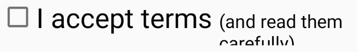
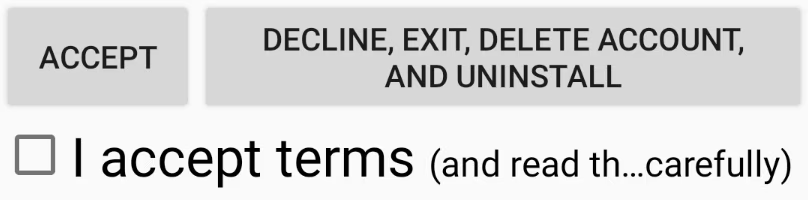
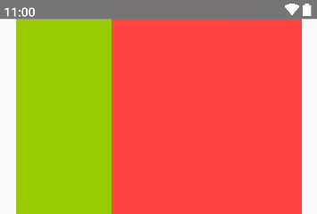

# LinearLayout

This type of layout is simple. All elements in LinearLayout are lined up vertically or horizontally along a single line

There are two main arguments for this layout: `android:orientation`, which is the main attribute for the layout itself, and the `android:layout_weight` attribute for the Views.

## LinearLayout baseline alignment

Every line of text has a baseline — an imaginary horizontal line on which its letters "stand."

A horizontal LinearLayout is baselineAligned by default. 
This means that all TextView children share the same baseline.

Consider the following layout example (note that CheckBox inherits TextView and also has a baseline):

```xml
<?xml version="1.0" encoding="utf-8"?>
<LinearLayout
    xmlns:android="http://schemas.android.com/apk/res/android"
    android:orientation="horizontal"
    android:layout_width="match_parent"
    android:layout_height="wrap_content">

    <CheckBox
        android:layout_width="wrap_content"
        android:layout_height="wrap_content"
        android:textSize="24sp"
        android:text="I accept terms " />

    <TextView
        android:layout_width="wrap_content"
        android:layout_height="wrap_content"
        android:textSize="16sp"
        android:text="(and read them carefully)" />

</LinearLayout>
```


These TextViews each have a different textSize and a different height. No gravities have been specified, and you can see how the layout looks below (a gray line has been added to indicate the baseline):


The above is rendered nicely, but you need to be aware that baseline alignment can play a nasty trick on you when dealing with multiline text. The following screenshot is taken on a screen with smaller width:



Another case where problems can occur is with bordered components such as buttons:


The lesson here is that baseline alignment plays well with single-line pieces of text but gives unexpected results with multiline ones. It should therefore be explicitly disabled for every horizontal `LinearLayout` where this type of alignment is not intended.


Disabling baseline alignment is not the only cure. Buttons look better when they have equal height, and plain text can be forced to remain on a single line, as shown below:

```xml
<?xml version="1.0" encoding="utf-8"?>
<LinearLayout
    xmlns:android="http://schemas.android.com/apk/res/android"
    android:orientation="vertical"
    android:layout_width="match_parent"
    android:layout_height="wrap_content">

    <LinearLayout
        android:layout_width="match_parent"
        android:layout_height="wrap_content"
        android:baselineAligned="false">
        <!--
        baselineAligned won't break this layout
        because buttons have match_parent height.
        However, it is disabled both for explicitness
        and performance reasons.
        -->

        <Button
            android:layout_width="wrap_content"
            android:layout_height="match_parent"
            android:text="Accept" />

        <Button
            android:layout_width="wrap_content"
            android:layout_height="match_parent"
            android:text="Decline, exit, delete\u00A0account, and\u00A0uninstall" />

    </LinearLayout>

    <LinearLayout
        android:layout_width="match_parent"
        android:layout_height="wrap_content">

        <CheckBox
            android:layout_width="wrap_content"
            android:layout_height="wrap_content"
            android:textSize="24sp"
            android:text="I accept terms " />

        <TextView
            android:layout_width="wrap_content"
            android:layout_height="wrap_content"
            android:textSize="16sp"
            android:ellipsize="middle"
            android:singleLine="true"
            android:text="(and read them carefully)" />

    </LinearLayout>

</LinearLayout>
```



## LinearLayout dividers

LinearLayout can also draw dividers between children. To take advantage of this feature, you simply need to create an appropriate drawable (a horizontal line, in our case), set it as a divider, and specify where you want it to be placed:

```xml
<!-- drawable/divider.xml -->
<?xml version="1.0" encoding="utf-8"?>
<shape xmlns:android="http://schemas.android.com/apk/res/android">
    <solid android:color="#20000000" />
    <size android:height="1dp" />
</shape>
```


```xml
<!-- layout/linear_with_dividers.xml -->
<?xml version="1.0" encoding="utf-8"?>
<LinearLayout
    xmlns:android="http://schemas.android.com/apk/res/android"
    android:layout_width="match_parent"
    android:layout_height="wrap_content"
    android:orientation="vertical"
    android:divider="@drawable/divider"
    android:showDividers="middle|end">

    <TextView
        android:layout_width="match_parent"
        android:layout_height="wrap_content"
        android:padding="8dp"
        android:textAppearance="?android:textAppearanceLarge"
        android:text="Thing #1" />

    <TextView
        android:layout_width="match_parent"
        android:layout_height="wrap_content"
        android:padding="8dp"
        android:textAppearance="?android:textAppearanceLarge"
        android:text="Thing #2" />

</LinearLayout>
```

The other option is `beginning`, which draws a divider before the first view. You can specify any combination of these three options, including all three together if you wish: `beginning|middle|end`.

## LinearLayout weights

For example, we can specify that one child uses 30% and another uses 60% of the available space:
```xml
<?xml version="1.0" encoding="utf-8"?>
<LinearLayout
    xmlns:android="http://schemas.android.com/apk/res/android"
    android:layout_width="match_parent"
    android:layout_height="match_parent"
    android:orientation="horizontal"
    android:weightSum="1"
    android:gravity="center_horizontal">

    <View
        android:layout_width="0dp"
        android:layout_height="match_parent"
        android:layout_weight=".3"
        android:background="@android:color/holo_green_light" />

    <View
        android:layout_width="0dp"
        android:layout_height="match_parent"
        android:layout_weight=".6"
        android:background="@android:color/holo_red_light" />

</LinearLayout>
```


## TextView compound drawables

We often need to place an image and text next to each other: a product photo near its name, a profile photo above a username, or even a button with an icon.

An obvious way to do this is to enclose a `TextView` and an `ImageView` in a `LinearLayout`.
This is acceptable, but there's another option that is simpler and more performant.

A `TextView` has six XML attributes that enable you to attach images known as compound drawables next to its contents:
`drawable(Left|Start|Top|Right|End|Bottom)`. This means that a `TextView` is capable of showing up to four drawables on its own.
It's also possible to distance drawables from text using the `drawablePadding` attribute.

```xml
<Button
    xmlns:android="http://schemas.android.com/apk/res/android"
    android:layout_width="wrap_content"
    android:layout_height="wrap_content"
    android:text="Play"
    android:drawablePadding="4dp"
    android:drawableTop="@android:drawable/ic_media_play" />
```


There are, of course, some restrictions, which are listed below. 
But you can use a `LinearLayout` if you run into any of them:

- `gravity` never affects compound drawables; it only impacts text positioning.

- There is only one `drawablePadding` attribute for all four drawables
(you can work around this by creating an XML drawable file with `<inset>` root tag and specifying different offsets).

- There's no `scaleType` and many other `ImageView`-specific attributes are also missing.

- Also, there aren't separate click listeners to indicate when the specific drawable is clicked 
an `OnClickListener` can only be applied to the whole `TextView`.


The Java/Kotlin API related to compound drawables slightly differs from the XML attributes.
There's a `(get|set)CompoundDrawablePadding` method pair for the `drawablePadding` attribute,
and a bunch of methods for getting and setting drawables themselves.

These can be expressed generally as
`setCompoundDrawables[Relative][WithIntrinsicBounds](4×(Drawable? or @DrawableRes Int))` and `getCompoundDrawables[Relative](): Array<Drawable>`.

The simplest one is `setCompoundDrawablesWithIntrinsicBounds(left: Int, top: Int, right: Int, bottom: Int)`: you just pass drawable resource IDs, and it works. 

For example, `setCompoundDrawablesWithIntrinsicBounds(0, android.R.drawable.ic_media_play, 0, 0)` is similar to the XML version above.
Relative versions use start and end instead of left and right. Also, both methods are overloaded to accept the Drawable? type for times when they are already instantiated or created programmatically.

So what does "with intrinsic bounds" mean? Some drawables have their own sizes (all vector ones do),
and some of them don't (like color drawables).
Shapes are even more variable: they can have width only, height only, both, or none. 
The `WithIntrinsicBounds` method versions use the sizes provided by drawables.

If you need to specify a drawable's size explicitly, you can only do this programmatically. 
Start by setting the drawables' bounds, and then call `setCompoundDrawables[Relative](Drawable?, Drawable?, Drawable?, Drawable?)`,
which never uses intrinsic bounds. The following snippet illustrates this approach by creating the whole TextView and a shape programmatically:

```kotlin
val sp = resources.displayMetrics.scaledDensity

TextView(context).apply {
    text = "#8C5AFF"
    setTextColor(Color.BLACK)
    textSize = 24f
    typeface = Typeface.MONOSPACE
    setCompoundDrawables(
        GradientDrawable().apply {
            cornerRadius = 4 * sp
            setColor(0xFF8C5AFF.toInt())
            setBounds(0, 0, (24 * sp).toInt(), (24 * sp).toInt())
        },
        null,
        null,
        null,
    )
    compoundDrawablePadding = (4 * sp).toInt()
}
```
It's important to pay attention to the `setBounds` method call: 
it accepts `left`, `top`, `right`, and `bottom` integers.
In the above example, we have passed the desired width for the `right` parameter and the height for the `bottom` one. You can see how the result looks below:


