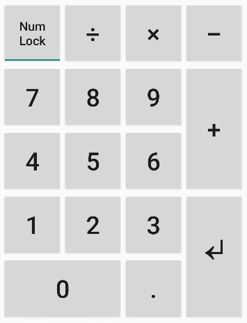

# Grids and tables

`GridLayout` is a container that places its children in a two-dimensional grid.
You can use it to create complex user interfaces and present some table-like data.


Similarly to `LinearLayout`, there's the orientation property defining row direction:
`horizontal` GridLayout will place cells from left to right and rows top to bottom.
The number of rows and columns can be specified with the rowCount and columnCount attributes.

Also, like in `LinearLayout`, children can have weights, but in both axes:
`layout_columnWeight` and `layout_rowWeight`.
Similarly to HTML tables, a view can occupy more than one cell in any direction,
thanks to the `layout_columnSpan` and `layout_rowSpan` properties.

Unlike HTML tables or nested `LinearLayouts`, cell views are added directly to a `GridLayout` without intermediate row or cell containers.


```xml
<?xml version="1.0" encoding="utf-8"?>
<GridLayout
    xmlns:android="http://schemas.android.com/apk/res/android"
    android:layout_width="match_parent"
    android:layout_height="match_parent"
    android:orientation="horizontal"
    android:columnCount="4">

    <ToggleButton
        android:layout_width="0dp" android:layout_height="0dp"
        android:layout_columnWeight="1" android:layout_rowWeight="1"
        android:textOn="Num\nLock" android:textOff="Num\nLock"
        android:textAllCaps="false" android:textSize="18sp"
        android:checked="true" />

    <Button
        android:layout_width="0dp" android:layout_height="0dp"
        android:layout_columnWeight="1" android:layout_rowWeight="1"
        android:text="÷" android:textSize="36sp" />

    <Button
        android:layout_width="0dp" android:layout_height="0dp"
        android:layout_columnWeight="1" android:layout_rowWeight="1"
        android:text="×" android:textSize="36sp" />

    <Button
        android:layout_width="0dp" android:layout_height="0dp"
        android:layout_columnWeight="1" android:layout_rowWeight="1"
        android:text="–" android:textSize="36sp" />

    <Button
        android:layout_width="0dp" android:layout_height="0dp"
        android:layout_columnWeight="1" android:layout_rowWeight="1"
        android:text="7" android:textSize="36sp" />

    <Button
        android:layout_width="0dp" android:layout_height="0dp"
        android:layout_columnWeight="1" android:layout_rowWeight="1"
        android:text="8" android:textSize="36sp" />

    <Button
        android:layout_width="0dp" android:layout_height="0dp"
        android:layout_columnWeight="1" android:layout_rowWeight="1"
        android:text="9" android:textSize="36sp" />

    <Button
        android:layout_width="0dp" android:layout_height="0dp"
        android:layout_columnWeight="1" android:layout_rowWeight="1"
        android:layout_rowSpan="2"
        android:text="+" android:textSize="36sp" />

    <Button
        android:layout_width="0dp" android:layout_height="0dp"
        android:layout_columnWeight="1" android:layout_rowWeight="1"
        android:text="4" android:textSize="36sp" />

    <Button
        android:layout_width="0dp" android:layout_height="0dp"
        android:layout_columnWeight="1" android:layout_rowWeight="1"
        android:text="5" android:textSize="36sp" />

    <Button
        android:layout_width="0dp" android:layout_height="0dp"
        android:layout_columnWeight="1" android:layout_rowWeight="1"
        android:text="6" android:textSize="36sp" />

    <Button
        android:layout_width="0dp" android:layout_height="0dp"
        android:layout_columnWeight="1" android:layout_rowWeight="1"
        android:text="1" android:textSize="36sp" />

    <Button
        android:layout_width="0dp" android:layout_height="0dp"
        android:layout_columnWeight="1" android:layout_rowWeight="1"
        android:text="2" android:textSize="36sp" />

    <Button
        android:layout_width="0dp" android:layout_height="0dp"
        android:layout_columnWeight="1" android:layout_rowWeight="1"
        android:text="3" android:textSize="36sp" />

    <Button
        android:layout_width="0dp" android:layout_height="0dp"
        android:layout_columnWeight="1" android:layout_rowWeight="1"
        android:layout_rowSpan="2"
        android:text="↵" android:textSize="80sp" />

    <Button
        android:layout_width="0dp" android:layout_height="0dp"
        android:layout_columnWeight="1" android:layout_rowWeight="1"
        android:layout_columnSpan="2"
        android:text="0" android:textSize="36sp" />

    <Button
        android:layout_width="0dp" android:layout_height="0dp"
        android:layout_columnWeight="1" android:layout_rowWeight="1"
        android:text="." android:textSize="36sp" />

</GridLayout>
```


You might also want to find out about `TableLayout`, which is a rather different layout used for similar purposes.


