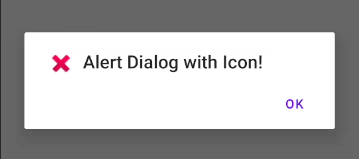

# AlertDialog

AlertDialog, a tool provided by the Android system to offer users a choice in specific situations.

## Types of AlertDialogs


`AlertDialog` is a special class that allows you to create and display dialog popups.
The standard features of this class allow you to implement several types of `AlertDialog`.

For example, it can be a simple pop-up window with a title and some text or a pop-up with selection buttons. We can also create a window with a list of items and use single or multiple selections for them.

The actions performed in the pop-ups can affect the behavior of the application: we can leave the application, delete some data, transfer the selected items to our activity, etc.

## Simple AlertDialog


To show an `AlertDialog`, use the `AlertDialog.Builder` class by passing a context to its constructor.

In the `activity_main.xml` markup file, we have defined a button with the id `alertDialogButton`. The `AlertDialog.Builder` class will allow us to build our pop-up piece by piece. First, we will set the title, then the message, and then our two buttons with their corresponding handler functions:


```kotlin
alertDialogButton.setOnClickListener {
    AlertDialog.Builder(this)
        .setTitle("Simple Alert Dialog!")
        .setMessage("Now you know how to use a new component!")
        .setPositiveButton(android.R.string.ok) { _, _ ->
            Toast.makeText(this, "Ok", Toast.LENGTH_SHORT).show()
        }
        .setNegativeButton(android.R.string.cancel, null)
        .show()
}
```


`set**Button` functions accept button text and a `DialogInterface.OnClickListener` instance with a single abstract onClick method. It receives the following parameters: **dialog** (the dialog that received the click) and **which (the button that was clicked or the position of the item clicked)**. This helps to figure out which button in which dialog was clicked if the same callback is used more than once.

When the user clicks on any button, the dialog gets dismissed automatically. Thus, if no more action needed, the listener could be `null`.

We can create a dialog using Builder's `create()` method, save it to a variable, and only then show it:

```kotlin
val dialog = AlertDialog.Builder(this)
    .setTitle("Simple Alert Dialog!")
    .setMessage("Now you know how to use a new component!")
    .create()

alertDialogButton.setOnClickListener {
    dialog.show()
}
```
## AlertDialog with a list of items

### 1. Single selection from a variety of choices without confirmation button

We can create an `AlertDialog` that allows the user to make a single selection from a variety of choices. In this case, the options are stored in an array. A dialog of this type will close once you click on an item in the list, **so buttons are useless in this situation.**

Don't forget to remove `.setMessage()`: otherwise, this message will be displayed instead of the list.

```kotlin
val items = arrayOf("First Item", "Second Item", "Third Item")

alertDialogButton.setOnClickListener {
    AlertDialog.Builder(this)
        .setTitle("Alert Dialog with a List!")
        .setItems(items) { _, i ->
            Toast.makeText(this, items[i] + " is selected", Toast.LENGTH_SHORT).show()
        }
        .show()
}
```
### 2. Single-choice item list with confirmation button
Now let's create an `AlertDialog` with a single-choice item list: for this, we are going to use the `setSingleChoiceItems` method.

The second parameter is responsible for the default item. In this case, `-1` means that there is no default value:

```kotlin
val items = arrayOf("First Item", "Second Item", "Third Item")
var selectedItem = ""

alertDialogButton.setOnClickListener {
    AlertDialog.Builder(this)
        .setTitle("Alert Dialog with SingleChoiceItems List!")
        .setSingleChoiceItems(items, -1) { _, i ->
            selectedItem = items[i]
        }
        .setPositiveButton(android.R.string.ok) { _, _: Int ->
            Toast.makeText(this, selectedItem, Toast.LENGTH_SHORT).show()
        }
        .show()
}
```
### 3. AlertDialog with  multiple-choice list
If you need a multiple-choice list, you can create it using the `setMultiChoiceItems` method. Again, the second parameter is responsible for the default items. You can pass a boolean array there, but here, we will pass `null`. Next, we pass the `onClick` method lambda of the `OnMultiChoiceClickListener` interface. `onClick` method signature :

```kotlin
onClick(dialog: DialogInterface, which: Int, isChecked: Boolean)
```

- dialog: dialog where the selection was made
- which: position of the selected item
- isChecked: true if the click checked the item, false if unchecked.

```kotlin
val items = arrayOf("First Item", "Second Item", "Third Item")
val selectedItems = ArrayList<String>()

alertDialogButton.setOnClickListener {
    AlertDialog.Builder(this)
        .setTitle("Alert Dialog with MultiChoiceItems List!")
        .setMultiChoiceItems(items, null) { _, i, isChecked ->
            if (isChecked)
                selectedItems.add(items[i])
            else
                selectedItems.remove(items[i])
            Toast.makeText(this, selectedItems.toString(), Toast.LENGTH_SHORT).show()
        }
        .setPositiveButton(android.R.string.ok) { _, _ ->
            Toast.makeText(this, selectedItems.toString(), Toast.LENGTH_SHORT).show()
            selectedItems.clear()
        }
        .show()
}
```

## AlertDialog with custom content view

You can use the `setView()` method to specify more complex content. To do this, you need to define your own dialog content view:

```xml
<?xml version="1.0" encoding="utf-8"?>
<FrameLayout xmlns:android="http://schemas.android.com/apk/res/android"
    android:layout_width="match_parent"
    android:layout_height="wrap_content"
    android:padding="20dp">

    <EditText
        android:id="@+id/editText"
        android:layout_width="match_parent"
        android:layout_height="wrap_content" />

</FrameLayout>
```

Then you need to create (inflate) the view and pass it to the `setView()` method:

```kotlin
alertDialogButton.setOnClickListener {
    val contentView = LayoutInflater.from(this).inflate(R.layout.dialog_main, null, false)
    AlertDialog.Builder(this)
        .setTitle("Alert Dialog with Custom View!")
        .setView(contentView)
        .setPositiveButton(android.R.string.ok) { _, _ ->
            val editText = contentView.findViewById<EditText>(R.id.editText)
            Toast.makeText(this, editText.text, Toast.LENGTH_SHORT).show()
        }
        .show()
}
```

> [!CAUTION]
> When calling inflate(resId, null …) like this, passing null for root parameter, any layout_ XML attributes will be ignored. That's why we have an extra FrameLayout with padding instead of specifying layout_margin directly to EditText.

## Additional features

Along with setTitle() and setMessage(), we can use the method setIcon() to set an icon for our AlertDialog:

```kotlin
.setIcon(android.R.drawable.ic_delete)
```



We can also set a handler for the situation when the window is closed as a result of pressing the button inside the window or the back button:

```kotlin
.setOnDismissListener {
    Toast.makeText(this, "AlertDialog dismissed", Toast.LENGTH_SHORT).show()
}
```

A similar method `setOnShowListener()` sets the callback to the moment when the window appears.

We can override the ability to close the `AlertDialog` with the back button by calling `.setCancelable(false)`.

Finally, the `.dismiss()` method will force our `AlertDialog` to close.

## DialogFragment

It’s also possible to create an `AlertDialog` within a fragment. Before we discover how to do this, let's first remind ourselves what a fragment is by looking at the definition given in the official Android documentation:

"A fragment represents a modular portion of the user interface within an activity. A fragment has its own lifecycle, receives its own input events, and you can add or remove fragments while the containing activity is running."

An `AlertDialog` can be displayed inside a fragment if it's contained in a `DialogFragment`. Here's how a DialogFragment is described in the documentation:

"A fragment that displays a dialog window, floating on top of its activity's window. This fragment contains a Dialog object, which it displays as appropriate based on the fragment's state."

> [!NOTE]
> Creating a dialog this way is generally more complex and lengthy, but it gives us greater flexibility, including the API of fragment lifecycle callback methods.

To create our own `DialogFragment`, we **have to** create a class that inherits from `DialogFragment`:

```kotlin
class ReactionDialogFragment : DialogFragment() {
    override fun onCreateDialog(savedInstanceState: Bundle?): Dialog {
        return AlertDialog.Builder(requireActivity())
            .setTitle("Alert Dialog with Fragment Lifecycle!")
            .setMessage("FragmentDialog!")
            .setPositiveButton(android.R.string.ok) { _, _ ->
                Toast.makeText(requireActivity(), "Ok", Toast.LENGTH_SHORT).show()
            }
            .show()
    }
}
```

We simply pass the same dialog to the `onCreateDialog` method as we did before.

Next, in `MainActivity`, start this dialog by clicking the button:

```kotlin
alertDialogButton.setOnClickListener {
    ReactionDialogFragment().show(supportFragmentManager, null)
}
```

We end up with the same result as we would with a simple `AlertDialog`, but now our dialog has a fragment lifecycle and the corresponding features.


## reference

- [AlertDialog](https://hyperskill.org/learn/step/12330)