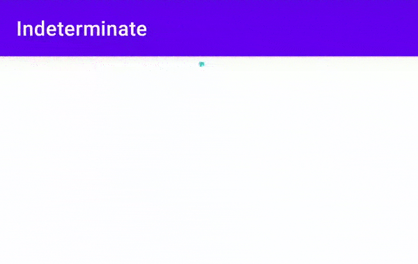
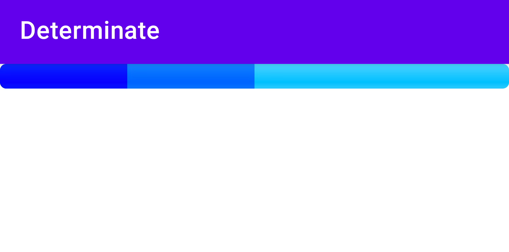
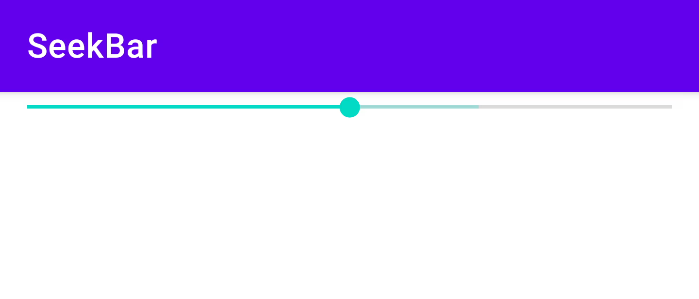
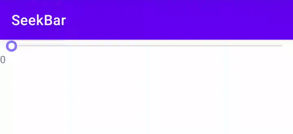

# ProgressBar, SeekBar and RatingBar

We will cover some of the widgets provided by the Android framework to make your application more intuitive and convenient to use: ProgressBar, SeekBar, and RatingBar.

## ProgressBar

`ProgressBar` is a user interface element that indicates the progress of an operation.

ProgressBar has two modes: 
- `indeterminate`
- `determinate`

### Indeterminate mode
The indeterminate mode does not show how long the operation will take. That is the default mode for `ProgressBar`. 
You can show it when you start an operation and hide it after it is completed with the `setVisibility()` method or the `android:visibility` attribute. The default value for `visibility` is `'visible'`. Here is how you can create it:

```xml
<ProgressBar
    android:layout_width="match_parent"
    android:layout_height="wrap_content"/>
```



### Determinate mode
To indicate determinate progress you can set the style to `android.R.style.Widget_ProgressBar_Horizontal`, like in the following snippet:

```xml
<ProgressBar
    style="@android:style/Widget.ProgressBar.Horizontal"
    android:layout_width="match_parent"
    android:layout_height="wrap_content"
    android:secondaryProgress="50"
    android:progress="25"/>
```

You also can use this style for a more modern look:

```xml
style="@style/Widget.AppCompat.ProgressBar.Horizontal"
```

How can you customize `ProgressBar`?

You should set `android:progressDrawable`. But let's create one first:

```xml
<?xml version="1.0" encoding="utf-8"?>
<!--our_progress_drawable.xml-->

<layer-list xmlns:android="http://schemas.android.com/apk/res/android">

    <item android:id="@android:id/background">
        <shape>
            <corners android:radius="5dp" />
            <gradient
                android:startColor="#B300BFFF"
                android:centerColor="#00BFFF"
                android:centerY="0.75"
                android:endColor="#CE00BFFF"
                android:angle="270"
                />
        </shape>

    </item>

    <item android:id="@android:id/secondaryProgress">
        <clip>
            <shape>
                <corners android:radius="5dp" />
                <gradient
                    android:startColor="#B30062FF"
                    android:centerColor="#0062FF"
                    android:centerY="0.75"
                    android:endColor="#CE0062FF"
                    android:angle="270"
                    />
            </shape>
        </clip>
    </item>

    <item android:id="@android:id/progress">
        <clip>
            <shape>
                <corners android:radius="5dp" />
                <gradient
                    android:startColor="#B30800FF"
                    android:centerColor="#0800FF"
                    android:centerY="0.75"
                    android:endColor="#CE0800FF"
                    android:angle="270"
                    />
            </shape>
        </clip>
    </item>

</layer-list>
```

Here we've defined `<layer-list>` with three items:

- `@android:id/background`

- `@android:id/secondaryProgress`

- `@android:id/progress`,

which define `background`, `secondaryProgress`, and `progress`, `respectively`. In this example, we used shapes but items could be also `Color` or `9-patch`. However, vector drawable won't work here.

Now, let's apply our `progressDrawable` to `ProgressBar`:

```xml
<ProgressBar
    android:layout_width="match_parent"
    android:layout_height="wrap_content"
    android:indeterminateOnly="false"
    android:maxHeight="20dp"
    android:minHeight="20dp"
    android:progress="25"
    android:progressDrawable="@drawable/our_progress_drawable"
    android:secondaryProgress="50" />
```



but what if we wanted to customize indeterminate `ProgressBar`? In such case we should create a drawable that will rotate:

```xml
<?xml version="1.0" encoding="utf-8"?>
<!--rotate_drawable.xml-->

<rotate xmlns:android="http://schemas.android.com/apk/res/android"
    android:fromDegrees="0"
    android:pivotX="50%"
    android:pivotY="50%"
    android:toDegrees="360">
    <shape
        android:innerRadiusRatio="4"
        android:shape="ring"
        android:thicknessRatio="5.333"
        android:useLevel="false">
        <size
            android:width="18dp"
            android:height="18dp" />

        <gradient
            android:centerColor="#880800FF"
            android:centerY="50%"
            android:endColor="#ff0800FF"
            android:startColor="#000800FF"
            android:type="sweep"
            />
    </shape>
</rotate>
```


## SeekBar
`SeekBar` is an extension of `ProgressBar`. The difference is that now we have a draggable thumb.
The fact that SeekBar is the extension of the `ProgressBar` means that they have mostly the same attributes.
For example, we still have `android:max`, `android:progress`, `android:secondaryProgress`.

So let's create our first `SeekBar`:

```xml
<SeekBar
    android:id="@+id/seekBar"
    android:progress="50"
    android:secondaryProgress="70"
    android:layout_width="match_parent"
    android:layout_height="wrap_content"/>
```
And this is how it will look:



The most important feature of `SeekBar` is that we can attach `SeekBar.OnSeekBarChangeListener` to be notified of the users' actions. Let's illustrate it with a small application that would show us the progress of `SeekBar` into `TextView`!

First of all, define our layout with `SeekBar` and `TextView`:

```xml
<?xml version="1.0" encoding="utf-8"?>
<LinearLayout xmlns:android="http://schemas.android.com/apk/res/android"
    xmlns:tools="http://schemas.android.com/tools"
    android:layout_width="match_parent"
    android:layout_height="match_parent"
    android:orientation="vertical"
    tools:context=".MainActivity">

    <SeekBar
        android:id="@+id/seekBar"
        android:layout_width="match_parent"
        android:layout_height="wrap_content" />

    <TextView
        android:id="@+id/progressTv"
        android:layout_width="wrap_content"
        android:layout_height="wrap_content"
        android:text="0" />
</LinearLayout>
```
After we defined our layout we go to our activity, get views, and set change listener:

```kotlin
val progressTv = findViewById<TextView>(R.id.progressTv)
val seekBar = findViewById<SeekBar>(R.id.seekBar)


seekBar.setOnSeekBarChangeListener(object : SeekBar.OnSeekBarChangeListener {
    override fun onProgressChanged(sb: SeekBar, progress: Int, fromUser: Boolean) {
        // we get in parameters SeekBar in case we add this listener to more that one SeekBar
        // fromUser give us information if change was initiated by user or programmatically
        
        // we set text in our TextView to the progress value we got
        progressTv.text = progress.toString()
    }
    
    override fun onStartTrackingTouch(seekBar: SeekBar) {
        println("Tracking started!")
    }
        
    override fun onStopTrackingTouch(seekBar: SeekBar) {
        println("Tracking stopped!")
    }
        
})
```
The `onStartTrackingTouch()` and `onStopTrackingTouch()` methods can be useful if you want to perform some action when the user starts or stops dragging a thumb.
Even if you don't use them, they still should be overridden. If they aren't, a compile error will occur.

And here is the result:



## RatingBar

`RatingBar` is an extension of `SeekBar` that shows a rating in stars. It has a few main XML attributes:

- `android:isIndicator` which can be set to true or false and define if users can change the rating by themselves or if it is used only as an indicator.

- set the layout width to `wrap_content`, otherwise, the result is unpredictable!

- `android:rating` which sets the initial rating in stars to the widget.

- `android:stepSize` sets the minimum step size in stars.

In case you're using it in interactive mode, you probably would want to be notified when the user changes the rating. For this purpose, you can attach RatingBar.onRatingBarChangeListener. This interface has only one method, so you can implement it in lambda inside `RatingBar.setOnRatingBarChangeListener()` like this:

```kotlin
yourRatingBar.setOnRatingBarChangeListener { ratingBar: RatingBar, rating: Float, fromUser: Boolean ->
    // perform your actions here!
}
```

The meanings of ratingBar, rating, and fromUser are similar to the ones in `SeekBar.onSeekBarChangeListener`.

Now to illustrate what we've just learned, let's modify the snippets we saw in `SeekBar` part with `RatingBar` and make `TextView` show ratings from `RatingBar` in stars!

First of all, we define our layout with `RatingBar` and `TextView`:


```xml
<?xml version="1.0" encoding="utf-8"?>
<LinearLayout xmlns:android="http://schemas.android.com/apk/res/android"
    xmlns:tools="http://schemas.android.com/tools"
    android:layout_width="match_parent"
    android:layout_height="match_parent"
    android:orientation="vertical"
    tools:context=".MainActivity">

    <RatingBar
        android:layout_width="wrap_content"
        android:id="@+id/ratingBar"
        android:layout_height="wrap_content"
        android:numStars="5"
        android:stepSize="0.5" />

    <TextView
        android:id="@+id/ratingBarTv"
        android:layout_width="wrap_content"
        android:layout_height="wrap_content"
        android:text="0" />
</LinearLayout>
```

We set five stars as the maximum rating and half of a star as a step for our `RatingBar`.

Now we need to attach `RatingBar.onRatingBarChangeListener` inside our activity:

```kotlin
val tv = findViewById<TextView>(R.id.ratingBarTv)
val rb = findViewById<RatingBar>(R.id.ratingBar)
        
// We do not use first and third parameters so we should omit them and replace them with _
rb.setOnRatingBarChangeListener { _, rating, _ ->
    // We set text in out TextView to the number of stars that was set on RatingBar
    tv.text = rating.toString()
}
```


## reference
- [Overview of ProgressBar, SeekBar and RatingBar](https://hyperskill.org/learn/step/28515)