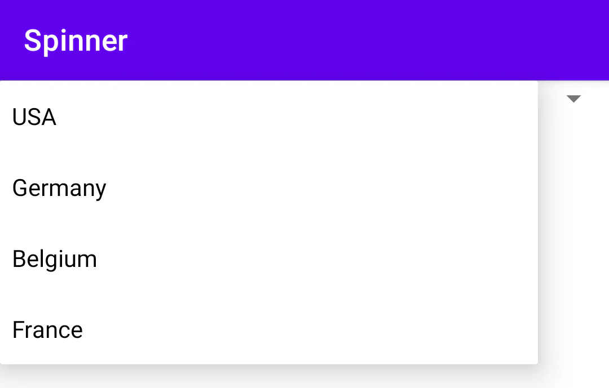

# Spinners

`Spinner` provides a quick way to choose a value from a set with a **dropdown list of options**. Here is how it looks:



So, how can we create one? First of all, we should add `Spinner` to our layout.

```xml
<Spinner
    android:id="@+id/countries_spinner"
    android:layout_width="match_parent"
    android:layout_height="wrap_content" />
```

If in this case list of options is predefined, we can use XML resources to populate the adapter, so let's create our countries list in the `strings.xml` file.

And then create and apply our `ArrayAdapter` with this list.

```kotlin
val spinner = findViewById<Spinner>(R.id.countries_spinner)

// Create an ArrayAdapter using the string array and a default spinner layout
ArrayAdapter.createFromResource(
    this,
    R.array.countries_array,
    // Specify the layout to use when the list of choices appears
    android.R.layout.simple_spinner_item
).also { adapter ->
    // Set the layout for the drop down list
    adapter.setDropDownViewResource(android.R.layout.simple_spinner_dropdown_item)

    // Apply the adapter to the spinner
    spinner.adapter = adapter
}
```

Or we can use a list of objects to define user choices.

```kotlin
ArrayAdapter(
    this,
    android.R.layout.simple_spinner_item,
    listOf("USA", "Germany", "Belgium", "France")
)
```

## Get user selections

To solve this we simply need to implement `AdapterView.OnItemSelectedListener` and apply it our Spinner just like this:

```kotlin
val listener = object : AdapterView.OnItemSelectedListener {
    override fun onItemSelected(parent: AdapterView<*>, view: View?, pos: Int, id: Long) {
        // We retrieve the selected item from the Spinner via its position in list
        val selectedItem = parent.getItemAtPosition(pos)

        // Show toast with selected item
        Toast.makeText(
            this@MainActivity,
            "Selected item: $selectedItem",
            Toast.LENGTH_SHORT
        ).show()
    }

    override fun onNothingSelected(parent: AdapterView<*>) {
        //This method will be invoked when the selection disappears from the view
        Toast.makeText(
            this@MainActivity,
            "Nothing selected",
            Toast.LENGTH_SHORT
        ).show()
    }
}


spinner.onItemSelectedListener = listener
```

You also can get user selections on demand with `selectedItem` and `selectedItemPosition` properties.

## AutoCompleteTextView

This is editable text view that will provide suggestions with drop down from the provided list


First of all we need to add `AutoCompleteTextView` to our layout:

```xml
<AutoCompleteTextView
    android:hint="your country..."
    android:id="@+id/countries_autocomplete"
    android:layout_width="match_parent"
    android:layout_height="wrap_content" />
```

Then we create and apply `ArrayAdapter` the same way we did it with `Spinner`, except that we use another default drop down item layout.


```kotlin
// Create an ArrayAdapter using the string list and a default drop down layout
ArrayAdapter(
    this,
    android.R.layout.simple_dropdown_item_1line,
    listOf("USA", "Germany", "Belgium", "France")
).also { adapter ->
    autoCompleteTextView.setAdapter(adapter)
}
```

We can also use `setThreshold()` method or android `android:completionThreshold` XML attribute to set the threshold value, the number of characters from which `AutoCompleteTextView` starts make its suggestion.

You can set an `AdapterView.OnItemSelectedListener` using the `setOnItemSelectedListener()` method, but there's no guarantee that the user will select an item from the suggestion list—they might just enter their own text and leave it in the field.


