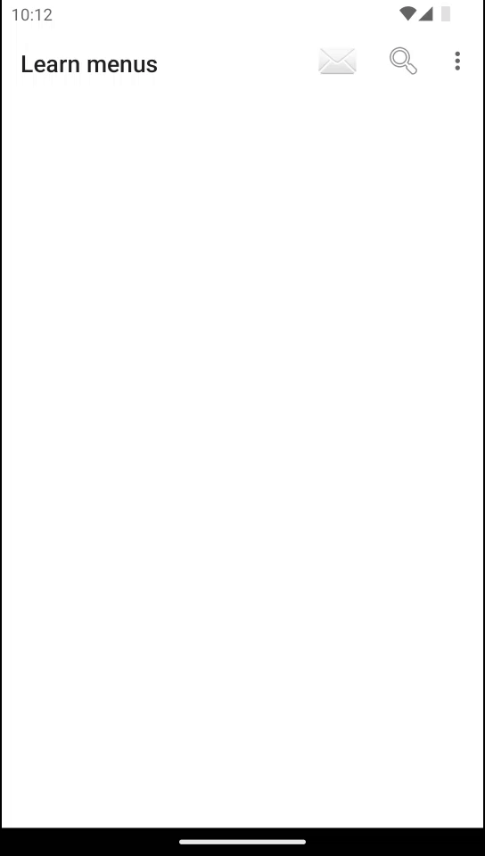

# Menus: Options, Popup

An app sometimes provides a list of available actions. Such lists are called **menus** and they may look different in different contexts.

## Menu resources


There's a special type of XML resources for menus. To explore it, let's create a Menu Resource File `app/src/main/res/menu/example.xml` and try out different features.


```xml
<?xml version="1.0" encoding="utf-8"?>
<menu
    xmlns:android="http://schemas.android.com/apk/res/android"
    xmlns:app="http://schemas.android.com/apk/res-auto">

    <item
        android:id="@+id/basic"
        android:title="Basic item" />

    <item
        android:id="@+id/checkbox"
        android:title="Checkable"
        android:checkable="true" />

    <item
        android:id="@+id/with_icon"
        android:icon="@android:drawable/ic_dialog_email"
        android:title="With icon"
        app:showAsAction="ifRoom" />

    <item
        android:id="@+id/search_icon"
        android:icon="@android:drawable/ic_menu_search"
        app:showAsAction="always|collapseActionView"
        app:actionViewClass="androidx.appcompat.widget.SearchView"
        android:title="Search" />

</menu>
```

What do we have here?

- A **basic** item. It has a title and can be clicked.
- A **checkable** item. It has a check box, but setting the checked state when it gets clicked is your responsibility.
- An item with an icon. `showAsAction="ifRoom"` means that we'd like to see it as an icon. But, if it exceeds the available space, it will be shown in the overflow menu as a text item.
- A custom item. A search input field appears when clicked. Always shown as an action because having a search item in the overflow menu looks impractical. The `collapseActionView` flag makes the user interface more friendly when the search is expanded.

> [!NOTE]
> Menu items may also contain submenus. Despite being relatively easy, this technique is beyond the scope of this topic but can be learned from [the official documentation](https://developer.android.com/develop/ui/views/components/menus#xml).

Now it's time to show this menu on a screen. We will need a view serving as a menu host.

## Toolbar

A **Toolbar** is a horizontal view, typically on top of the screen, providing quick actions, an app icon or back button, and a screen title. It is typically added to the layout manually.

```xml
<androidx.appcompat.widget.Toolbar
    android:id="@+id/toolbar"
    android:layout_width="match_parent"
    android:layout_height="?actionBarSize"
    app:title="Learn menus" />
```
> [!WARNING]
> Make sure that the activity theme is set to something with .NoActionBar. Otherwise, a Toolbar will be created automatically and we will have less control over it.

Now we need to instruct the `Activity` that we have a `Toolbar` and inflate a menu. The up-to-date way to add menus is by implementing a `MenuProvider`.


```kotlin
override fun onCreate(savedInstanceState: Bundle?) {
    super.onCreate(savedInstanceState)
    setContentView(R.layout.activity_with_toolbar)

    val toolbar = findViewById<Toolbar>(R.id.toolbar)
    setSupportActionBar(toolbar)
    addMenuProvider(object : MenuProvider {
        override fun onCreateMenu(menu: Menu, menuInflater: MenuInflater) {
            menuInflater.inflate(R.menu.example, menu)
        }
        
        override fun onMenuItemSelected(menuItem: MenuItem): Boolean {
            TODO()
        }
        
    })
}
```

With Fragments, do `requireActivity().addMenuProvider(..., viewLifecycleOwner)` in `onCreateView()` to add a menu that will be disposed of automatically when a Fragment disappears.

The `onMenuItemSelected` function is called when a menu item is clicked. Here we can check which item it was and perform any required actions. Returning `true` means that we've handled that action.

```kotlin
override fun onMenuItemSelected(menuItem: MenuItem): Boolean = when (menuItem.itemId) {
    R.id.basic -> {
        Toast.makeText(this@MainActivity, menuItem.title, Toast.LENGTH_SHORT).show()
        true
    }
    R.id.checkbox -> {
        menuItem.isChecked = !menuItem.isChecked
        true
    }
    R.id.with_icon -> {
        Toast.makeText(this@MainActivity, menuItem.title, Toast.LENGTH_SHORT).show()
        true
    }
    R.id.search_icon -> {
        true // nothing to do here
    }
    else -> {
        false // none of my business
    }
}
```

`SearchView` requires special handling. To make the search useful, we need to handle some additional events.

```kotlin
override fun onCreateMenu(menu: Menu, menuInflater: MenuInflater) {
    menuInflater.inflate(R.menu.example, menu)

    val search = menu.findItem(R.id.search_icon)
    val searchView = search.actionView as SearchView
    searchView.setOnQueryTextListener(object : OnQueryTextListener {

        override fun onQueryTextSubmit(query: String): Boolean {
            // The search was submitted by the user. Do something:
            Toast.makeText(this@MainActivity, query, Toast.LENGTH_SHORT).show()
            // …and collapse SearchView.
            search.collapseActionView()
            return true
        }

        override fun onQueryTextChange(newText: String): Boolean {
            return true
        }
    })
}
```
And here's the result:



## Popup

The same **popup** or **drop-down** can be created without a `Toolbar` and anchored to an arbitrary view. Just create a `PopupMenu`, inflate a menu, set a listener to handle clicks, and show it.

```kotlin
anyView.setOnClickListener { anyView ->
    PopupMenu(this@MainActivity, anyView).apply {
        inflate(R.menu.example)
        setForceShowIcon(true)
        setOnMenuItemClickListener { item ->
            Toast.makeText(it.context, item.title, Toast.LENGTH_SHORT).show()
            true
        }
        show()
    }
}
```
The `setForceShowIcon` function can be used to display icons in a list along with titles.

See also

- Menu items can be [gathered in groups](https://developer.android.com/develop/ui/views/components/menus#groups), which is especially useful for checkable items.

- A menu can be shown by long clicking on a view. This is called a [contextual menu](https://developer.android.com/develop/ui/views/components/menus#context-menu).
- If your app allows users to perform batch actions on selected items—like deleting or moving multiple files in a file manager or gallery—it's best to use [context action mode](https://developer.android.com/develop/ui/views/components/menus#CAB) for a better user experience.


