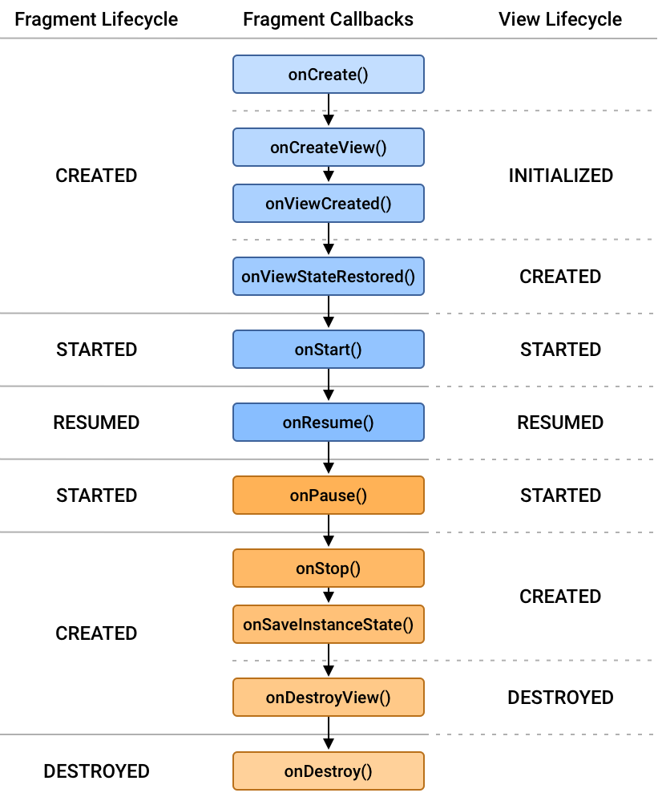
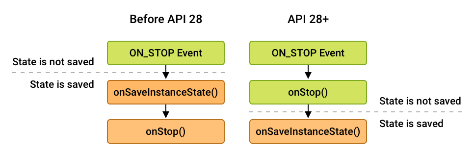
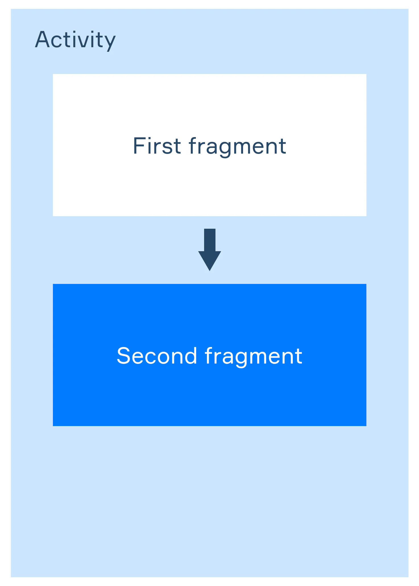
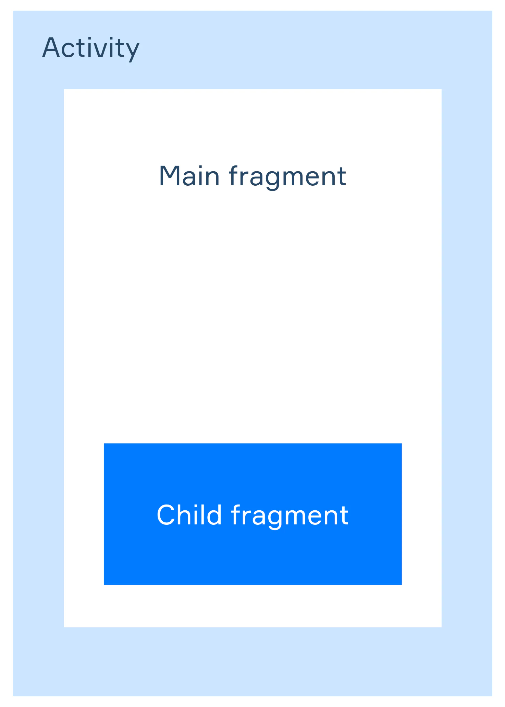

# Fragments

A Fragment is like an Activity that can be connected to different parts of an application.
However, it is important to understand that they are not the same.
This means that a Fragment cannot exist unless it's embedded in an Activity.

Fragments are used in **Single Activity Architecture** to create Navigation and save state.

## Fragment lifecycle

To manage lifecycle, `Fragment` implements `LifecycleOwner`, exposing a `Lifecycle` object that you can access through the `getLifecycle()` method.

Each possible `Lifecycle` state is represented in the `Lifecycle.State`

- `INITIALIZED`
- `CREATED`
- `STARTED`
- `RESUMED`
- `DESTROYED`

   A fragment's view has a separate `Lifecycle` that is managed independently from that of the fragment's `Lifecycle`.


## Fragment lifecycle states and callbacks

     As a fragment progresses through its lifecycle, it moves upward and downward through its states. For example, a fragment that is added to the top of the back stack moves upward from `CREATED` to `STARTED` to `RESUMED`. Conversely, when a fragment is popped off of the back stack, it moves downward through those states, going from `RESUMED` to `STARTED` to `CREATED` and finally `DESTROYED`.



## Upward state transitions

    When moving upward through its lifecycle states, a fragment first calls the associated lifecycle callback for its new state. Once this callback is finished, the relevant `Lifecycle.Event` is emitted to observers by the fragment's `Lifecycle`


#### Fragment CREATED

        When your fragment reaches the `CREATED` state, it has been added to a `FragmentManager` and the `onAttach()` method has already been called.

        Note that the fragment's view has not been created at this time, and any state associated with the fragment's view should be restored only after the view has been created.

#### Fragment CREATED and View INITIALIZED

    The fragment's view `Lifecycle` is created only when your `Fragment` provides a valid `View` instance. In most cases, you can use the fragment constructors that take a `@LayoutId`, which automatically inflates the view at the appropriate time. You can also override `onCreateView()` to programmatically inflate or create your fragment's view.

    If and only if your fragment's view is instantiated with a non-null `View`, that `View` is set on the fragment and can be retrieved using `getView()`. The `getViewLifecycleOwnerLiveData()` is then updated with the newly `INITIALIZED` `LifecycleOwner`corresponding with the fragment's view. The `onViewCreated()` lifecycle callback is also called at this time.

    This is the appropriate place to set up the initial state of your view, to start observing `LiveData` instances whose callbacks update the fragment's view, and to set up adapters on any `RecyclerView` or `ViewPager2` instances in your fragment's view.

VN : ý trên nghĩa là sau khi onCreate chạy xong thì Lifecycle của view mới được init nghĩa là lúc này LifecycleOwner mới được khởi tạo tương ứng với View

### Fragment and View CREATED

After the fragment's view has been created, the previous view state, if any, is restored, and the view's `Lifecycle` is then moved into the `CREATED` state.  state. The view lifecycle owner also emits the `ON_CREATE` event to its observers. Here you should restore any additional state associated with the fragment's view.

### Fragment and View STARTED

It is strongly recommended to tie Lifecycle-aware components to the `STARTED` state of a fragment, as this state guarantees that the fragment's view is available, if one was created, and that it is safe to perform a `FragmentTransaction` on the child `FragmentManager` of the fragment. If the fragment's view is non-null, the fragment's view `Lifecycle` is moved to `STARTED` immediately after the fragment's `Lifecycle` is moved to `STARTED`.

When the fragment becomes `STARTED`, the `onStart()` callback is invoked.

### Fragment and View RESUMED

    When the fragment is visible, all `Animator` and `Transition` effects have finished, and the fragment is ready for user interaction. The fragment's `Lifecycle` moves to the `RESUMED` state, and the `onResume()` callback is invoked.

    The transition to `RESUMED` is the appropriate signal to indicate that the user is now able to interact with your fragment.

    Fragments that are not `RESUMED` should not manually set focus on their views or attempt to handle input method visibility.

## Downward state transitions

        When a fragment moves downward to a lower lifecycle state, the relevant `Lifecycle.Event` is emitted to observers by the fragment's view `Lifecycle`, if instantiated, followed by the fragment's `Lifecycle`. After a fragment's lifecycle event is emitted, the fragment calls the associated lifecycle callback.

### Fragment and View STARTED

        As the user begins to leave the fragment, and while the fragment is still visible, the `Lifecycle`s for the fragment and for its view are moved back to the `STARTED` state and emit the `ON_PAUSE` event to their observers. The fragment then invokes its `onPause()` callback.

### Fragment and View CREATED

        Once the fragment is no longer visible, the `Lifecycle`s for the fragment and for its view are moved into the `CREATED` state and emit the `ON_STOP` event to their observers. This state transition is triggered not only by the parent activity or fragment being stopped, but also by the saving of state by the parent activity or fragment

    This behavior guarantees that the `ON_STOP` event is invoked before the fragment's state is saved. This makes the `ON_STOP` event the last point where it is safe to perform a `FragmentTransaction` on the child `FragmentManager`.

     the ordering of the `onStop()` callback and the saving of the state with `onSaveInstanceState()` differs based on API level. For all API levels prior to API 28, `onSaveInstanceState()` is invoked before `onStop()`. For API levels 28 and higher, the calling order is reversed.



## Fragment CREATED and View DESTROYED

    After all of the exit animations and transitions have completed, and the fragment's view has been detached from the window, the fragment's view `Lifecycle` is moved into the `DESTROYED` state and emits the `ON_DESTROY` event to its observers. The fragment then invokes its `onDestroyView()` callback. At this point, the fragment's view has reached the end of its lifecycle and `getViewLifecycleOwnerLiveData()` returns a `null` value.

    At this point, all references to the fragment's view should be removed, allowing the fragment's view to be garbage collected

#### Fragment DESTROYED

    If the fragment is removed, or if the `FragmentManager` is destroyed, the fragment's `Lifecycle` is moved into the `DESTROYED` state and sends the `ON_DESTROY` event to its observers. The fragment then invokes its `onDestroy()` callback. At this point, the fragment has reached the end of its lifecycle.


## Fragment Lifecycle callback detail


**The lifecycle of a fragment is slightly different from that of an activity since the fragment itself is completely dependent on the activity and doesn't exist on its own.** So, many methods are either named the same as activity methods or have very similar names:

- `onAttach()` the method called when the fragment is attached to the activity.

- `onCreate()` the method called when a fragment is created.

- `onCreateView()` the method which creates and returns the view hierarchy associated with the fragment. You can use it to inflate your layout.

- `onViewCreated()` the method called when the views have been created and attached. All views must be initialized here.

- `onActivityCreated()` — the method called after the `Activity.onCreate()` method.

- `onStart()` — the method called when the fragment becomes visible to the user (see the `Activity.onStart()` method).

- `onResume()` — the method called before the fragment becomes available for user interaction (see the `Activity.onResume()` method).

- `onPause()` — the user doesn't interact with the fragment but part of the fragment is visible to the user.

- `onStop()` — the method that makes the fragment invisible to the user.

- `onSaveInstanceState()` — the method that saves the fragment state.

- `onDestroyView()` – the fragment clears the resources associated with the view hierarchy. Here you have to null all your views because holding destroyed views can cause a memory leak.

- `onDestroy()` – the method called before the fragment is destroyed.

- `onDetach()` – method called before the fragment is detached from the activity.


## Fragment manager

Fragments inherit from the `androidx.fragment.app.Fragment` class, which comes from the AndroidX library.
But there are also several Fragment subclasses: `ListFragment`, `DialogFragment`, `PreferenceFragment`, `WebViewFragment`, and others.

### Access the FragmentManager

1. **Accessing in an Activity**

        Every `FragmentActivity` and subclasses thereof, such as `AppCompatActivity`, have access to the `FragmentManager` through the `getSupportFragmentManager()` method.

2. **Accessing in a Fragment**

Fragments are also capable of hosting one or more child fragments. Inside a fragment, you can get a reference to the `FragmentManager` that manages the fragment's children through `getChildFragmentManager()`. If you need to access its host `FragmentManager`, you can use `getParentFragmentManager()`.

### FragmentManager usage

There are two methods in `FragmentManager` that can be used to find Fragments associated with an Activity.
These are `findFragmentById(int id)` and `findFragmentByTag(String tag)`.
The `findFragmentById()` method finds a Fragment by an identifier and `findFragmentByTag()` searches by a given tag.
If you want to perform any operations on Fragments, be it replacing, deleting, or hiding them, you need to use the special `androidx.app.FragmentTransaction` class.

The main methods of the `FragmentTransaction` class are below:

- `add()` adds the Fragment to the Activity.
- `remove()` is used to remove the Fragment from the Activity.
- `replace()` replaces one Fragment with another.
- `hide()` is used to hide the Fragment on the screen.
- `show()` shows the Fragment on the screen.

Lastly, it's important to remember that you must call the `commit()` method at the end of every transaction!

## Communicating to activity

### 1. Using Interface
   
In order to pass something to an activity, first, you need to create an interface in the desired fragment.

```kotlin
class YourFragment : Fragment() {

    override fun onCreateView(...) { ... }

    interface YourFragmentListener {
        fun doSomething()
    }
}
```
Next, you need to implement your interface in the desired activity.

```kotlin
class MainAсtivity : AppCompatActivity(), YourFragment.YourFragmentListener {

    ...

    override fun doSomething() {
        Log.d("Log", "Doing something!")
    }
}
```

The penultimate step is to get an instance of the Activity implementing your interface in the Fragment.

```kotlin
    private var callback: YourFragmentListener? = null
    override fun onAttach(context: Context) {
        super.onAttach(context)
        callback = context as YourFragmentListener
    }
    override fun onDetach() {
        super.onDetach()
        callback = null
    }
```

Finally, you only need to call the interface instance at the location you want,

### 2. Result listener

Android has a very useful API for passing data between fragments, the **Fragment Result API**. It's a tool that makes it possible to pass data between fragments using a user-specified key. 

All this happens with a `FragmentManager` — `parentFragmentManager` and `childFragmentManager`.

If your fragments are independent of each other, it's a good idea to use `parentFragmentManager`.



In cases when one fragment is a child fragment, the parent fragment must use `childFragmentManager`, and the child fragment must use `parentFragmentManager`.



After selecting the desired `FragmentManager` in the fragment which will send data, call the `setFragmentResult()` method.

In this method, set the result in the `FragmentManager` identical to the first one and use the same key.
The parameters of this method are the key itself and the `Bundle` object that needs to be passed to another fragment.

```kotlin
button.setOnClickListener {
    parentFragmentManager.setFragmentResult("key", bundleOf("bundleKey" to yourObject))
}
```

Next, in the `onCreate()` method of the fragment where you want to receive your data, you need to call the `setFragmentResultListener()` method.

The first parameter of this method is the key parameter: it must be the same as the key you specified in the other fragment.

```kotlin
YourFragmentManager.setFragmentResultListener("key", this) { key, bundle ->
    val result = bundle.get("bundleKey")
}
```

### 3. ViewModel

To share data between fragments and their host activity, use a `ViewModel` with activity scope.

Example:

```kotlin
class ItemViewModel : ViewModel() {
    private val mutableSelectedItem = MutableLiveData<Item>()
    val selectedItem: LiveData<Item> get() = mutableSelectedItem

    fun selectItem(item: Item) {
        mutableSelectedItem.value = item
    }
}
```
Using `LiveData` ensures data remains lifecycle-aware.

Using ViewModel in Activity

```kotlin
class MainActivity : AppCompatActivity() {
    private val viewModel: ItemViewModel by viewModels()

    override fun onCreate(savedInstanceState: Bundle?) {
        super.onCreate(savedInstanceState)
        viewModel.selectedItem.observe(this, Observer { item ->
            // Handle item update
        })
    }
}
```
Using ViewModel in Fragment

```kotlin
class ListFragment : Fragment() {
    private val viewModel: ItemViewModel by activityViewModels()

    fun onItemClicked(item: Item) {
        viewModel.selectItem(item)
    }
}
```
> [!CAUTION]
>  Ensure the same scope (MainActivity) is used in both MainActivity and ListFragment to share the same ViewModel. Using the fragment as its own scope would create a separate instance.


## Communicating with the other Fragment

### Using sharedViewModel

Fragments within the same activity often need to communicate without being tightly coupled. Using a shared `ViewModel` with activity scope allows them to exchange data while remaining independent.

Example:

```kotlin
class ListViewModel : ViewModel() {
    val filters = MutableLiveData<Set<Filter>>()

    private val originalList: LiveData<List<Item>>() = ...
    val filteredList: LiveData<List<Item>> = ...

    fun addFilter(filter: Filter) { ... }
    fun removeFilter(filter: Filter) { ... }
}
```
Using `ViewModel` in `ListFragment`
```kotlin
class ListFragment : Fragment() {
    private val viewModel: ListViewModel by activityViewModels()

    override fun onViewCreated(view: View, savedInstanceState: Bundle?) {
        viewModel.filteredList.observe(viewLifecycleOwner, Observer { list ->
            // Update the list UI
        })
    }
}
```
Using `ViewModel` in `FilterFragment`

```kotlin
class FilterFragment : Fragment() {
    private val viewModel: ListViewModel by activityViewModels()

    override fun onViewCreated(view: View, savedInstanceState: Bundle?) {
        viewModel.filters.observe(viewLifecycleOwner, Observer { set ->
            // Update the selected filters UI
        })
    }

    fun onFilterSelected(filter: Filter) = viewModel.addFilter(filter)
    fun onFilterDeselected(filter: Filter) = viewModel.removeFilter(filter)
}
```

> [!CAUTION]
> The ViewModel remains in memory until the ViewModelStoreOwner to which it's scoped goes away permanently. 
> In a single activity architecture, if the ViewModel is scoped to the activity, it's essentially a singleton. After the ViewModel is first instantiated, subsequent calls to retrieve the ViewModel using the activity scope always returns the same existing ViewModel, along with the existing data until the activity's lifecycle has permanently ended.

### Share data between a parent and child fragment via ViewModel

When working with child fragments, your parent fragment and its child fragments might need to share data with each other.
To share data between these fragments, use the parent fragment as the `ViewModel` scope, as shown in the following example:

```kotlin
class ListFragment: Fragment() {
    // Using the viewModels() Kotlin property delegate from the fragment-ktx
    // artifact to retrieve the ViewModel.
    private val viewModel: ListViewModel by viewModels()
    override fun onViewCreated(view: View, savedInstanceState: Bundle?) {
        viewModel.filteredList.observe(viewLifecycleOwner, Observer { list ->
            // Update the list UI.
        })
    }
}

class ChildFragment: Fragment() {
    // Using the viewModels() Kotlin property delegate from the fragment-ktx
    // artifact to retrieve the ViewModel using the parent fragment's scope
    private val viewModel: ListViewModel by viewModels({requireParentFragment()})
    
}
```

### Scope a ViewModel to the Navigation Graph (Jetpack navigation)

If you're using the Navigation library, you can also scope a `ViewModel` to the lifecycle of a destination's `NavBackStackEntry`. For example, the `ViewModel` can be scoped to the `NavBackStackEntry` for the `ListFragment`:

```kotlin
class ListFragment: Fragment() {
    // Using the navGraphViewModels() Kotlin property delegate from the fragment-ktx
    // artifact to retrieve the ViewModel using the NavBackStackEntry scope.
    // R.id.list_fragment == the destination id of the ListFragment destination
    private val viewModel: ListViewModel by navGraphViewModels(R.id.list_fragment)

    override fun onViewCreated(view: View, savedInstanceState: Bundle?) {
        viewModel.filteredList.observe(viewLifecycleOwner, Observer { item ->
            // Update the list UI.
        })
    }
}
```

### Using bundle with Jetpack navigation

To pass any data between fragments, use an arguments bundle. To do this, in the fragment from which you want to transfer data, create a Bundle and put all the necessary objects in it, giving them a key to refer to later in the target fragment.

```kotlin
val bundle = Bundle()
bundle.putString("Key", thing)
```
Note that you can also create a Bundle like this:

```kotlin
val bundle = bundleOf("Key" to thing)
```

Next, add your bundle as an argument to the `navigate()` function to the transition to the next fragment.

```kotlin
findNavController().navigate(R.id.firstFragment, bundle)
```
In the receiving fragment, you can get the arguments bundle to use its contents.

```kotlin
val thing = arguments?.getString("Key")
```


references:

https://hyperskill.org/learn/step/12981

https://hyperskill.org/learn/step/21929

https://developer.android.com/guide/fragments/communicate
