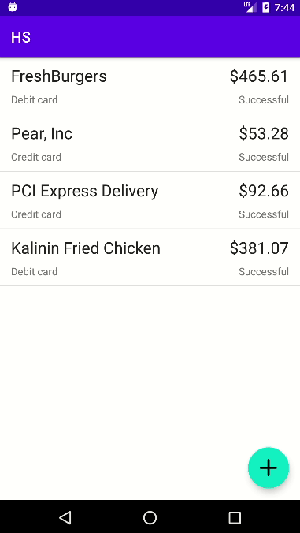
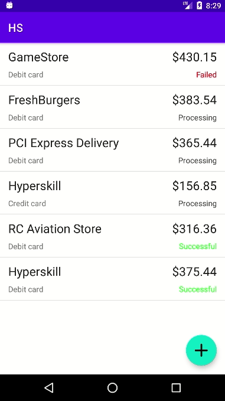
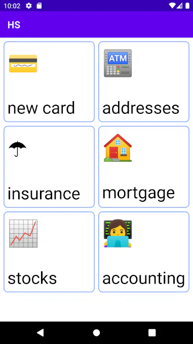
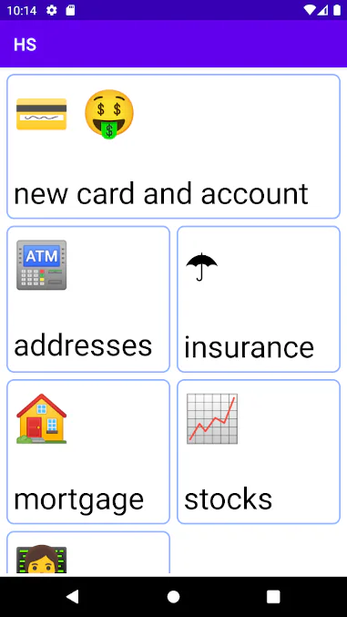
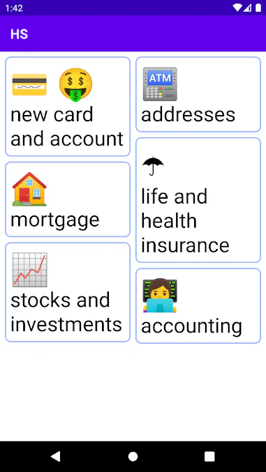
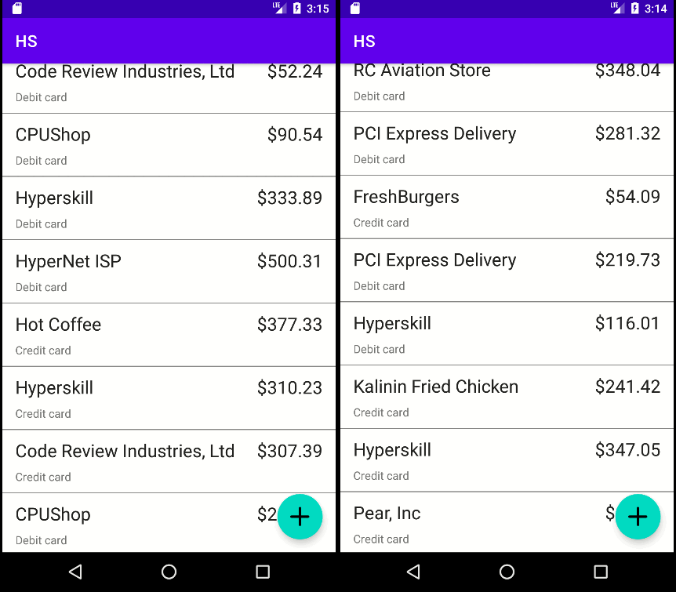

# Customize RecyclerView

## Changing adapter contents

A typical adapter is backed by a list. But if we replace the list or change its contents, the adapter won't be aware, leading to inconsistent behavior and even crashes. So when a change occurs, we must notify the adapter about it via the appropriate method:

- `notifyDataSetChanged`: forget everything and populate RecyclerView from scratch.

- `notifyItemChanged` / `notifyItemRangeChanged`: bind the specified item(s) again.

- `notifyItemInserted` / `notifyItemRangeInserted`: insert item(s) at the specified position.

- `notifyItemRemoved` / `notifyItemRangeRemoved`: make the specified item(s) disappear.

- `notifyItemMoved`: change the location of an item.


`notifyDataSetChanged()` is a universal way to make an update, but it's terribly inefficient, and animations that have been changed won't run. So this method should only be used as a last resort.

The other methods listed above are utilized when the relevant situations occur. As an example of how to do this, let's implement an add method that calls `notifyItemInserted()`:

```kotlin
class TransactionAdapter(
    transactions: List<Transaction>,
) : RecyclerView.Adapter<TransactionAdapter.TransactionViewHolder>() {

    private val transactions = transactions.toMutableList()

    fun add(transaction: Transaction) {
        transactions.add(transaction)
        notifyItemInserted(transactions.size - 1)
    }

}
```

You can see it in use below:



So far, so good. But what if we need to replace content items when we don't know exactly what's changed? This frequently happens when you request data from a network, and the server gives out fresh data without any details about how it differs from the old data set. In these circumstances, we need DiffUtil — a tool for finding these differences. The easiest way to use it is by inheriting from androidx.recyclerview.widget.ListAdapter, which calculates differences asynchronously for us. To see how it works, let's migrate the adapter superclass by:

- Removing our transaction list property (ListAdapter manages its own list)

- Supplying the data into the submitList() method

- Getting the current data set by reading the currentList property

- Removing the getItemCount method implementation (ListAdapter is capable of doing this for us, too)

```kotlin
class TransactionsAdapter(transactions: List<Transaction>) :
    ListAdapter<Transaction, TransactionsAdapter.TransactionViewHolder>(
        object : DiffUtil.ItemCallback<Transaction>() {
            override fun areItemsTheSame(
                oldItem: Transaction, newItem: Transaction,
            ): Boolean =
                TODO("Not yet implemented")

            override fun areContentsTheSame(
                oldItem: Transaction, newItem: Transaction,
            ): Boolean =
                TODO("Not yet implemented")

        }) {
    
    init {
        submitList(transactions)
    }

    override fun onCreateViewHolder(
        parent: ViewGroup, viewType: Int,
    ): TransactionViewHolder =
        TransactionViewHolder(
            LayoutInflater.from(parent.context)
                .inflate(R.layout.item_transaction, parent, false)
        )

    override fun onBindViewHolder(holder: TransactionViewHolder, position: Int) {
        val t = getItem(position)
        // holder… stays the same
    }

    fun add(transaction: Transaction) {
        submitList(currentList + transaction)
    }

    // ViewHolder stays the same

}
```

Now we need to implement two functions of DiffUtil.ItemCallback abstract class. The areItemsTheSame function figures out whether the items come from the same entity: if so, they may have been updated or moved. areContentsTheSame then checks whether the contents of these items are equal: if not, they must have been updated.


For our example, let's say that our transaction items are the same if the payment receiver, account, and amount are all equal. But if the status has changed from "Processing" to "Successful" or "Failed," the contents are different:


```kotlin
override fun areItemsTheSame(oldItem: Transaction, newItem: Transaction): Boolean =
    oldItem.account == newItem.account &&
        oldItem.receiver == newItem.receiver &&
        oldItem.amount == newItem.amount
```

To complete the content equality check, we can add the data modifier to our Transaction class. This enables us to take advantage of its auto-generated equals() method by using the == operator:

```kotlin
data class Transaction(
    // the rest of the class remains the same
)

//…

override fun areContentsTheSame(oldItem: Transaction, newItem: Transaction): Boolean =
    oldItem == newItem
```

You can see this content replacement approach in use below:



## Handling item events

RecyclerView doesn't have its own setOnItemClickListener method or a similar facility. It's the adapter's responsibility to set the necessary event listeners and pop these events. Let's give it a go:

```kotlin
class TransactionAdapter(
    private val transactions: List<Transaction>,
    private val onTransactionClick: (Transaction) -> Unit,
) : RecyclerView.Adapter<TransactionAdapter.TransactionViewHolder>() {

    override fun onCreateViewHolder(
        parent: ViewGroup, viewType: Int,
    ): TransactionViewHolder {
        val holder = TransactionViewHolder(
            LayoutInflater.from(parent.context)
                .inflate(R.layout.transaction_item, parent, false))

        holder.itemView.setOnClickListener {
            onTransactionClick(TODO("figure out transaction"))
        }

        return holder
    }

    ...

}
```

So how do we know which Transaction the current holder is bound to? To figure this out, we can ask for its position. But a single holder could belong to different positions simultaneously if it's used in different RecyclerView components. ViewHolder.layoutPosition defines the position in terms of the LayoutManager. And, when RecyclerView applies data changes, this can temporarily differ from the position in terms of the adapter.

The adapter position is provided by ViewHolder.adapterPosition, or ViewHolder.bindingAdapterPosition in newer RecyclerView library versions. However, a holder could belong to the invalid position -1, meaning that it's in the process of being unbound and will disappear. We therefore need to carry out a sanity check on this value:

```kotlin
holder.itemView.setOnClickListener {
    val pos = holder.bindingAdapterPosition
    if (pos >= 0) {
        onTransactionClick(transactions[pos])
    }
}
```

You can handle clicks on any views inside holders, long clicks, or any other events in a similar fashion.

## Dividers and spaces

We can add the effect we're looking for with a more appropriate tool. Using an ItemDecoration is the best solution. But before we create it, let's restore the indent that was included in the view. We can do this by adding paddingBottom to the container as a replacement for the divider's layout_marginTop. The differences are shown below:

```xml
<?xml version="1.0" encoding="utf-8"?>
<RelativeLayout
    xmlns:android="http://schemas.android.com/apk/res/android"
    xmlns:tools="http://schemas.android.com/tools"
    android:layout_width="match_parent"
    android:layout_height="wrap_content"
    android:paddingBottom="10dp"> <!-- added -->

    <!-- TextViews remain the same -->

    <!-- View android:id="@+id/divider"... was removed -->

</RelativeLayout>
```

To achieve the desired result, we're going to use DividerItemDecoration, which is available out of the box. This requires a drawable to serve as a divider, which we can define in the following way:

```xml
<!-- res/drawable/divider.xml -->
<?xml version="1.0" encoding="utf-8"?>
<shape xmlns:android="http://schemas.android.com/apk/res/android">
    <solid android:color="#888888" />
    <size android:height="1dp" />
</shape>
```

Now let's create the decoration, pass the drawable, and attach the decoration to our RecyclerView:

```kotlin
recyclerView.addItemDecoration(
    DividerItemDecoration(this, DividerItemDecoration.VERTICAL).apply {
        setDrawable(getDrawable(R.drawable.divider)!!)
    }
)
```

Done! DividerItemDecoration adds horizontal lines with a height of 1dp, as specified by the divider's android:height attribute.

You will learn how to customize dividers and add offsets in a later topic.

## Animations

By default, every RecyclerView uses the DefaultItemAnimator class. So when adapter contents are altered, animations are applied to the affected items. This makes items that are added and removed fade in and out. As well as crossfading items that have been changed and altering the position of items that have been moved.

Animators can be tuned to run at faster or slower speeds. For example, recyclerView.itemAnimator!!.addDuration = 1000 will make items appear extremely slowly comparing to default 120 ms.

Animators that inherit from SimpleItemAnimator (including DefaultItemAnimator) allow you to disable change animation only. Meaning that animations associated with the appearance, disappearance, and movement of items will continue to work:

```kotlin
(recyclerView.itemAnimator as SimpleItemAnimator).supportsChangeAnimations = false
```

In order to disable all animations, just drop the existing item animator: recyclerView.itemAnimator = null.

There aren't any other animators provided out of the box. But there are a lot of custom ones on GitHub! For instance, check out the libraries by Daichi Furiya or Gabriele Mariotti.

## Exploring layout managers

The RecyclerView library ships with three basic layout managers: Linear, Grid, and StaggeredGrid. You're already familiar with the Linear option, so now let's take a look at the other two.

GridLayoutManager requires a span count (number of columns) to be passed along with context: layoutManager = GridLayoutManager(this, 2). The result (with a completely different adapter) is shown below:



But the span count isn't fixed! You can make any item take any number of spans. To demonstrate this, let's give the first item a span of 2, so it occupies both columns:

```kotlin
layoutManager = GridLayoutManager(this, 2).apply {
    spanSizeLookup = object : SpanSizeLookup() {
        override fun getSpanSize(position: Int): Int =
            if (position == 0) 2 else 1
    }
}
```



The staggered grid configuration is also interesting: its cells are allowed to have different heights. The constructor requires a column count and orientation:

```kotlin
layoutManager = StaggeredGridLayoutManager(2, StaggeredGridLayoutManager.VERTICAL)
```
You can see how this looks below:




> [!NOTE]
> If you want maximum flexibility, take a look at Google's FlexboxLayoutManager.


## Programmatic scroll

Sometimes you need a way to scroll a RecyclerView programmatically. This is most commonly required when the contents of the RecyclerView have been updated and need to be shown from the beginning. But there are many other situations when scrolling programmatically can also prove useful. The RecyclerView itself has the following methods:

- scrollToPosition(Int)

- smoothScrollToPosition(Int)




The difference between these methods seems to be obvious from their names, but in fact scrollToPosition (left) behaves quite unexpected and triggers some unintended animations.

But the real problem is that they don't have fine control over scroll positioning. They will scroll until the item is visible. But there's no way to specify that it should be placed at the start, the center, the end, or at an arbitrary place in the RecyclerView.

The good news is that LinearLayoutManager has a method named scrollToPositionWithOffset(position: Int, offset: Int). The bad news is that offset is specified in pixels, so 0 offset means "snap the start of the item to the start of the RecyclerView." But snapping center to center or end to end becomes problematic. Also, this method makes an instantaneous jump instead of scrolling smoothly. Fortunately, there's another LayoutManager method that allows us to customize whatever we like: startSmoothScroll(SmoothScroller).

Under the hood, the previously mentioned RecyclerView.smoothScrollToPosition() does the following:

```kotlin
val linearSmoothScroller = LinearSmoothScroller(context)
linearSmoothScroller.targetPosition = position
layoutManager.startSmoothScroll(linearSmoothScroller)
```

And we are free to extend the LinearSmoothScroller class and override several methods to make it do what we want. As an example, let's snap to the start and halve the scrolling speed:

```kotlin
recyclerView.layoutManager!!.startSmoothScroll(object : LinearSmoothScroller(this) {

    override fun calculateSpeedPerPixel(displayMetrics: DisplayMetrics): Float =
        super.calculateSpeedPerPixel(displayMetrics) / 2

    override fun getVerticalSnapPreference(): Int =
        SNAP_TO_START

}.also { it.targetPosition = 0 })
```

There are, of course, many other things that can be tuned. For example, [this Stack Overflow answer](https://stackoverflow.com/a/53756296/3050249) shows how to scroll to the center of an item.


## reference:

- [Customize RecyclerView](https://hyperskill.org/learn/step/19037)


