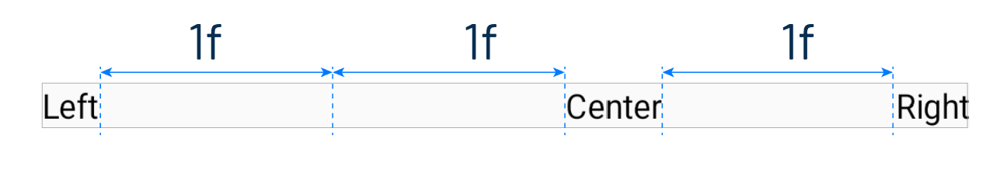
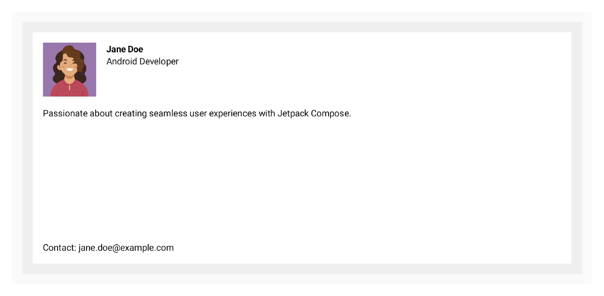

# Spacer and padding

## Spacer


You might be familiar with the "box model" from the Android View system, where each view is a box that can have an outer space called "margin" and an inner space called "padding".

Jetpack Compose simplifies many things, including the box model.

Jetpack Compose offers a more flexible way to space elements with Spacer and padding.
This choice fits with Compose's aim to have a more declarative UI, letting developers create custom spacing for their layouts.

The `Spacer` composable is an invisible component that creates space between UI elements. You can set a specific size to it, acting like what you would usually call a margin.

### Spacer flexibility

In Jetpack Compose, `Spacer` is not just a static space inserter; it's a flexible tool that can adapt to the available space within a layout.

- The `weight` modifier can be used with a `Spacer` to divide up the available space in a `Row` or `Column`.
When you use `weight`, you are asking Compose to give a part of the available space to the `Spacer`, depending on its weight compared to other elements with weights.

- You can place multiple `Spacer` composables with different `weights` to control how the space is divided.

For instance:
```kotlin
@Composable
fun FlexibleSpaceDistributionExample() {
    Row(modifier = Modifier.fillMaxWidth()) {
        Text("Left")
        Spacer(modifier = Modifier.weight(2f)) // Takes twice as much space as the right spacer
        Text("Center")
        Spacer(modifier = Modifier.weight(1f)) // Uses available space
        Text("Right")
    }
}
```



- Sometimes you might want a `Spacer` with a size that changes based on content or limits. You can do this by mixing the `weight` modifier with minimum size limits.


```kotlin
@Composable
fun DynamicSpacerSizeExample() {
    Column(modifier = Modifier.fillMaxHeight()) {
        Text("Top")
        Spacer(modifier = Modifier.weight(1f).heightIn(min = 50.dp)) // At least 50.dp tall
        Text("Bottom")
    }
}
```

## Padding

While `Spacer` adds space between elements, padding is used to add space inside the boundaries of a composable. You can apply padding to any composable using the `padding` modifier.

You can apply padding in different ways
- One way is to add the same padding to all sides of a composable by giving a single value to the `padding` modifier.

```kotlin
@Composable
fun ProfileCard() {
    Column(
        modifier = Modifier
            .fillMaxWidth()
            .padding(all = 16.dp)
            .background(Color(0xFFEEEEEE)) // Color of the shadow effect
            .padding(all = 16.dp) // Additional padding for the shadow effect
            .background(Color.White)
            .padding(all = 16.dp)
    ) {
        /*...*/
    }        
}
```

This adds three layers of padding—`16.dp` each—to all sides of the `Column`, centering the content with equal space around it.



- Instead of the same padding on all sides, you can specify it for individual sides: `top`, `bottom`, `start`, or `end`.


- The `absolutePadding` modifier lets you specify padding as `left` and `right` rather than `start` and `end`. 
In a left-to-right (LTR) layout, `start` means `left`, and `end` means `right`. But in a right-to-left (RTL) language like Arabic or Hebrew, `start` is `right`, and `end` is `left`.


The `absolutePadding` ignores this and applies padding to the actual sides of the screen.

Use `absolutePadding` carefully, since it can create a strange feeling for RTL users. Think about the overall app and whether keeping the padding's direction makes for a better experience.

### Horizontal and vertical padding

In this case, you have the `horizontal` parameter to apply the same padding to the `start` and `end` sides, and the `vertical` parameter to apply the same padding to the `top` and `bottom` sides.

### Padding from baseline

The `paddingFromBaseline` modifier is a specialized form of padding that's very useful when dealing with text elements.

`paddingFromBaseline` takes values in `dp` or `sp` (scaled pixels) units.
`sp` is the better unit for Text components because it respects the user's font size preferences and accessibility settings.

Here's how you can use `paddingFromBaseline`:


```kotlin
@Composable
fun TextWithPaddingFromBaseline() {
    Column {
        Text(
            text = "Headline",
            style = MaterialTheme.typography.headlineLarge,
            modifier = Modifier.paddingFromBaseline(top = 40.sp)
        )
        Text(
            text = "Subhead",
            style = MaterialTheme.typography.headlineSmall,
            modifier = Modifier.paddingFromBaseline(top = 32.sp, bottom = 24.sp)
        )
    }
}
```

In this example, the `paddingFromBaseline` modifier ensures there's a `40.sp` space from the "Headline" `Text` baseline and a `32.sp` space from the "Subhead" `Text` baseline. It also adds a `24.sp` space from the baseline to the bottom of the "Subhead" `Text`, making room for the next element.


> [!WARNING]
> Remember, paddingFromBaseline will look different depending on the font and size, as these affect the baseline position. So, when you use this modifier, think about your design's specific text needs and test it with different text settings to make sure it works right.

## The "offset" modifier

Sometimes you may need negative padding to place a component exactly where you want,
but if you try something like this: `Modifier.padding(start = (-4).dp)`,
you will get an error saying: "Padding must be non-negative".

To deal with this issue, Jetpack Compose offers the `offset` modifier.
This modifier allows you to move a composable by shifting it from its original spot by a specific `x` (horizontal) and `y` (vertical) distance.

> [!IMPORTANT]
> Using offset changes the visual position of a composable but does not change the layout space it takes up (That's why a white space is left at the end in our previous example's preview).
> The space reserved for the composable before the offset stays the same, and the composable may cover other elements due to the offset.

## Best practices

- **Be consistent**: Keep your spacing consistent throughout your app.
Choose a consistent set of spacing values, such as multiples of `4.dp` or `8.dp`, to create a balanced interface.
Consistent spacing helps to keep a rhythm in your design.

- **Avoid too much Spacer**: Although `Spacer` is useful, using it too much can fill your composable functions with unnecessary parts. If you are using many `Spacers`, think about using `padding` or changing your layout approach.

- **Use modifier chains smartly**: You can chain modifiers together in Jetpack Compose. When you combine `padding` with other modifiers, the order can change the layout.

- **Responsive design**: Make sure your layout with padding and Spacers works well on different screen sizes and positions.

- **Avoid hardcoded numbers**: Instead of writing `padding` and `Spacer` values straight into your code, **set them as constants or in a theme**. This makes global adjustments easier and your code more tidy.


## Reference

- https://hyperskill.org/learn/step/42034


