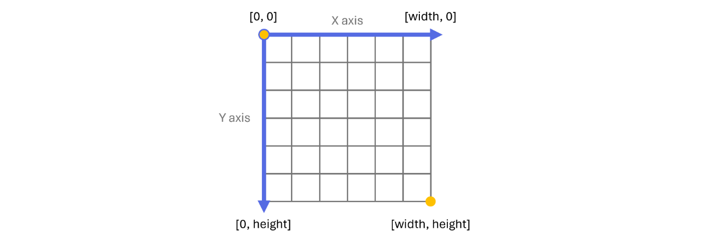
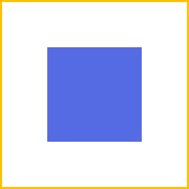

# Shapes in Compose

## Built-in shapes

Compose offers a variety of pre-defined shapes that can be readily used in your app's design. Let's explore these shapes:

### `CircleShape`

Use it for scenarios where you need a circular element, such as profile pictures, or some decorative elements:

```kotlin
Image(
    painter = painterResource(R.drawable.profile_picture),
    contentDescription = "Profile Picture",
    contentScale = ContentScale.Crop,
    modifier = Modifier
        .clip(CircleShape) // Apply the CircleShape
        .size(100.dp)
)
```
> [!WARNING]
> If the composable has unequal dimensions, CircleShape will result in an oval or elliptical shape.

### `RoundedCornerShape`

This allows you to create rectangles with rounded corners. 

```kotlin
Button(
    onClick = { /* Do something */ },
    shape = RoundedCornerShape(8.dp) // Round corners by 8.dp
) {
    Text("Click me")
}
```

`RoundedCornerShape` offers various ways to control the corner radius:

- **Uniform corner radius**: Pass a single `size: Dp`, `corner: CornerSize`, `size: Float`, or **percent: Int** (values ranging from 0 to 100)

- **Individual corner radii**: Use the `topStart`, `topEnd`, `bottomEnd`, and `bottomStart` parameters passing either `Dp`, `Float`, or `CornerSize` values to specify different radii for each corner.
You can also pass percent values as integers using `topStartPercent`, `topEndPercent`, and so on.

### `RectangleShape`

This represents a simple rectangle with sharp corners.

### `CutCornerShape`

This allows you to create rectangles with cut corners

## Custom shapes

Sometimes you need a unique shape that perfectly fits your design requirements.
To create a custom shape, you need to extend the `Shape` interface and implement the `createOutline` function.

This function is responsible for defining the shape's outline, essentially drawing its boundaries:

```kotlin
// Import `Shape` from here
import androidx.compose.ui.graphics.Shape

class MyCustomShape : Shape {
    override fun createOutline(
        size: Size,
        layoutDirection: LayoutDirection,
        density: Density
    ): Outline {
        // Define your custom shape here
    }
}
```
Let's break down the parameters of the `createOutline` function:

- **size**: The `Size` object provides the width and height of the area where the shape will be drawn.
- **layoutDirection**: This indicates the layout direction (left-to-right or right-to-left) of the composable using the shape. You can use this information to create shapes that adapt to different language directions.

- **density**: This `Density` object provides information about the screen density, which can be useful for scaling your shape appropriately across different devices.


Within the `createOutline` function, you'll use the `Outline` class and its various functions to describe the shape's contour. The `Outline` class acts as a container for your shape's path data.

Compose employs a Cartesian coordinate system, where the position of any point on the screen is defined by two values: X and Y (as Floats).

The origin (0, 0) of this coordinate system is located at the top-left corner of the composable you're working on:



For instance, we can create a rectangle shape that's half the size of the composable it's applied to:

```kotlin
class HalfSizeRectangleShape : Shape {
    override fun createOutline(
        size: Size,
        layoutDirection: LayoutDirection,
        density: Density
    ): Outline {
        val halfWidth = size.width / 2 // size.width is a Float
        val halfHeight = size.height / 2 // size.height is also a Float
        val rect = Rect(
            left = halfWidth / 2,
            top = halfHeight / 2,
            right = halfWidth + halfWidth / 2,
            bottom = halfHeight + halfHeight / 2
        )
        return Outline.Rectangle(rect)
    }
}
```



The golden border is simply for illustrative purposes and shows the actual size of the composable.


> [!NOTE]
> The Rect function comes with multiple variations. you can apply this method to explore overloads for other functions mentioned.

The `Outline` class has three nested classes:

- `Outline.Rectangle`. This class allows you to create rectangular outlines with sharp corners.
- `Outline.Rounded`. allows us to create rounded rectangles.
- `Outline.Generic`.With Path class, You move the pen from one point to another, creating straight lines or curves, and finally close the shape.

For instance, to create a triangle:

```kotlin
class TriangleShape : Shape {
    override fun createOutline(
        size: Size,
        layoutDirection: LayoutDirection,
        density: Density
    ): Outline {
        val path = Path().apply {
            moveTo(size.width / 2f, 0f) // Move to top center
            lineTo(size.width, size.height) // Draw line to bottom right
            lineTo(0f, size.height) // Draw line to bottom left
            close() // Close the path
        }
        return Outline.Generic(path)
    }
}
```

> [!TIP]
> Creating complex shapes often involves some math, especially for curves. 
> Bézier curves, for example, use control points to define the curvature of the path.
> Understanding basic geometric principles and mathematical functions can greatly expand your custom shape possibilities.


Compose offers a handy class called `GenericShape` that simplifies the creation of custom shapes with paths.
This can be particularly useful when you want to create a one-time custom shape without defining a whole new class

```kotlin
Box(
    modifier = Modifier
        .size(100.dp)
        .clip(GenericShape {size, layoutDirection ->
            // Bottom right quadrant shape
            moveTo(size.width, 0f)
            quadraticBezierTo(size.width, size.height, 0f, size.height)
            lineTo(0f, 0f)
        })
        .background(Color.Blue)
)
```


