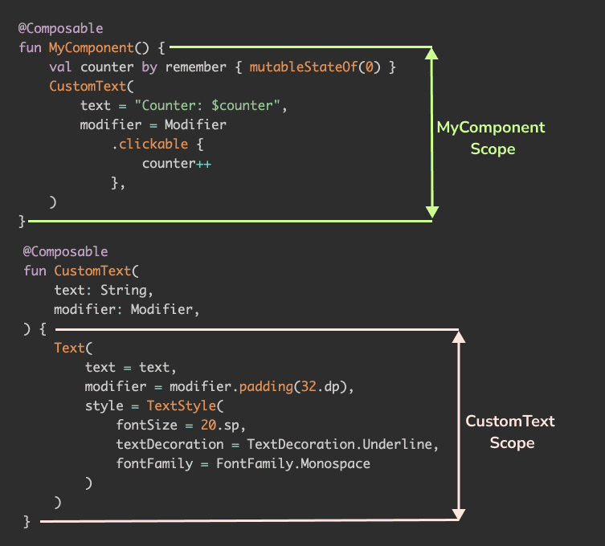
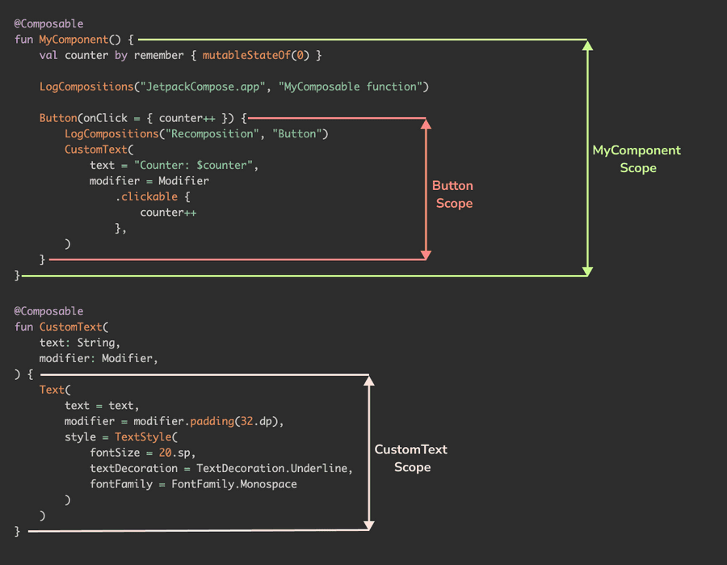
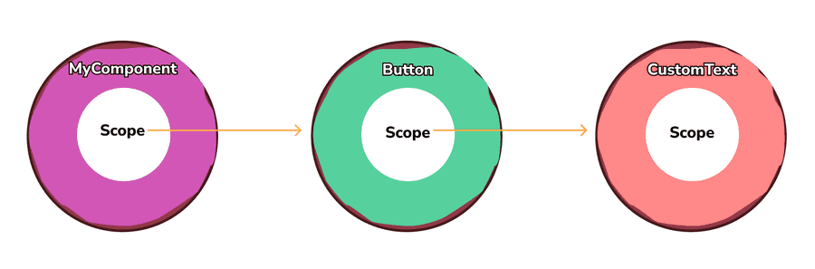
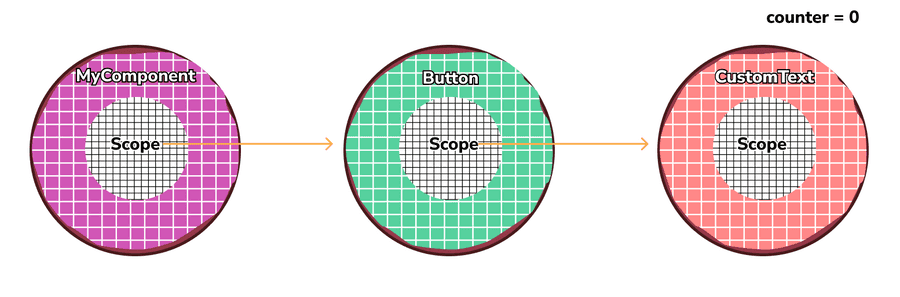
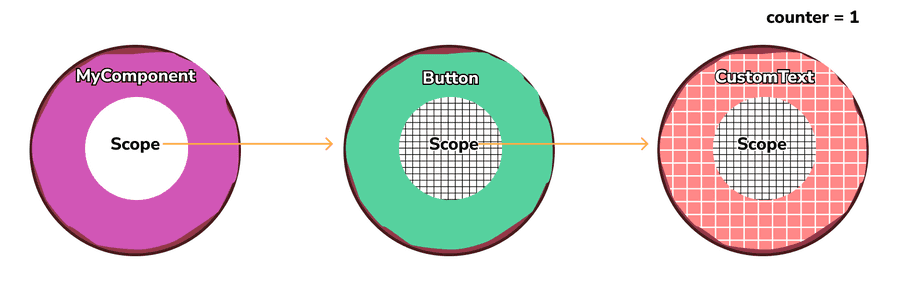
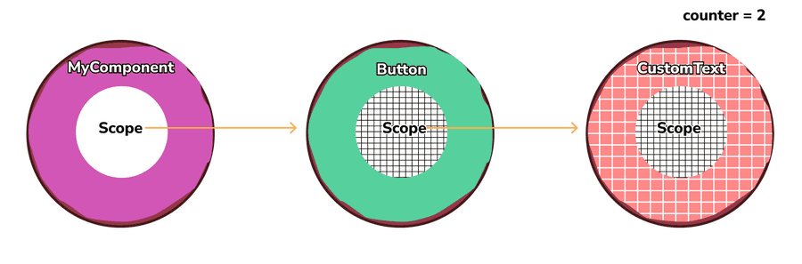
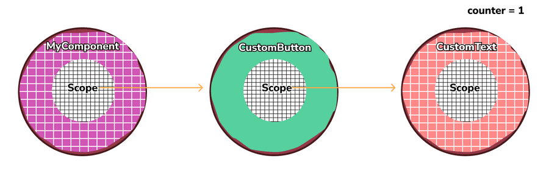
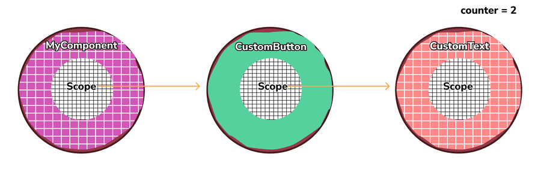

# Donut Hole Skipping in Jetpack Compose

## Recompostion Scope
For example :

```kotlin
class Ref(var value: Int)

// Note the inline function below which ensures that this function is essentially
// copied at the call site to ensure that its logging only recompositions from the
// original call site.
@Composable
inline fun LogCompositions(tag: String, msg: String) {
    if (BuildConfig.DEBUG) {
        val ref = remember { Ref(0) }
        SideEffect { ref.value++ }
        Log.d(tag, "Compositions: $msg ${ref.value}")
    }
}
```


```kotlin
@Composable
fun MyComponent() {
    val counter by remember { mutableStateOf(0) }

   LogCompositions("JetpackCompose.app", "MyComposable function")

    CustomText(
        text = "Counter: $counter",
        modifier = Modifier
            .clickable {
                counter++
            },
    )
}

@Composable
fun CustomText(
    text: String,
    modifier: Modifier = Modifier,
) {
   LogCompositions("JetpackCompose.app", "CustomText function")

    Text(
        text = text,
        modifier = modifier.padding(32.dp),
        style = TextStyle(
            fontSize = 20.sp,
            textDecoration = TextDecoration.Underline,
            fontFamily = FontFamily.Monospace
        )
    )
}
```


the result will be:

```
MyComposeable function 0
CustomText function 0
MyComposeable function 1
CustomText function 1
MyComposeable function 2
CustomText function 2
```




When the value of the the counter changes, we previously noticed that both these scopes were being reinvoked and here's why:

- `CustomText` is recomposed because its text parameter changed as it includes the counter value. This makes sense and is probably what you want anyway.
- `MyComponent` is recomposed because its lambda scope captures the counter state object and a smaller lambda scope wasn't available for any recomposition optimizations to kick in.

Example 2:

```kotlin
@Composable
fun MyComponent() {
    val counter by remember { mutableStateOf(0) }

    LogCompositions("JetpackCompose.app", "MyComposable function")

    Button(onClick = { counter++ }) {
        LogCompositions("JetpackCompose.app", "Button")
        CustomText(
            text = "Counter: $counter",
        )
    }
}
```
The result:

```
MyComposeable function 0
Button 0
CustomText function 0
Button 1
CustomText function 1
Button 2
CustomText function 2
```



We see that the body of `MyComponent` was executed during the very first composition along with the body of the `Button` composable and theCustomText composable. However, every subsequent recomposition only causes the `Button` and the `CustomText` composable to be invoked again while the body of `MyComponent` is skipped altogether.

- Even though the initialization of the counter is in the scope of MyComponent, it doesn't read its value, at least not directly in the parent scope.
- The Button scope is where the value of counter is read and passed to the CustomText composable as an input

**Since the compose runtime was able to find a smaller scope (Button scope) where the value of the counter was being read**, it skipped invoking the `MyComponent` scope and only invoked the `Button` scope (where the value is being read) & the `CustomText` scope (as its input changed). In fact, it also skipped invoking the `Button` composable (it invoked its scope, not the `Button` composable itself).


Let's visualize the composables in example 2 with this lens and see how they are being recomposed. Anything with the chequered pattern represents that it was recomposed.


State before any of these functions are composed


Counter = 0 First composition, all composable functions and their scopes are executed and composed



Counter = 1 Only Button Scope and CustomText, & CustomText Scope are recomposed. MyComponent, MyComponent Scope & Button are skipped from recomposition.


Counter = 2 Only Button Scope and CustomText, & CustomText Scope are recomposed. MyComponent, MyComponent Scope & Button are skipped from recomposition.

### Compose still doing smart recomposition

Example 3 :

```kotlin
@Composable
fun MyComponent() {
    val counter by remember { mutableStateOf(0) }

    LogCompositions("JetpackCompose.app", "MyComposable function")

    val readingCounter = counter
    CustomButton(onClick = { counter++ }) {
        LogCompositions("JetpackCompose.app", "CustomButton scope")
        CustomText(
            text = "Counter: $counter",
            modifier = Modifier
                .clickable {
                    counter++
                },
        )
    }
}
```

with:


```kotlin
@Composable
fun CustomButton(
    onClick: () -> Unit,
    content: @Composable () -> Unit
) {
    LogCompositions("JetpackCompose.app", "CustomButton function")
    Button(onClick = onClick, modifier = Modifier.padding(16.dp)) {
        LogCompositions("JetpackCompose.app", "Button function")
        content()
    }
}

@Composable
fun CustomText(
    text: String,
    modifier: Modifier = Modifier,
) {
   LogCompositions("JetpackCompose.app", "CustomText function")

    Text(
        text = text,
        modifier = modifier.padding(32.dp),
        style = TextStyle(
            fontSize = 20.sp,
            textDecoration = TextDecoration.Underline,
            fontFamily = FontFamily.Monospace
        )
    )
}
```

The result: 

```
MyComposable function 0
CustomButton function 0
Button function 0
CustomButton Scope 0
CustomText function 0

MyComposable function 1
CustomButton Scope 1
CustomText function 1

MyComposable function 2
CustomButton Scope 2
CustomText function 2
```

Everytime time the value of the `counter` changes, `CustomButton` function and `Button` function are skipped altogether.

**We learnt from the previous examples that Compose will be smart about skipping Composable functions that aren't reading a mutable state object or if their inputs don't change.**

However, there's something unique about the behavior of Jetpack Compose that's worth highlighting and you probably missed it when you looked at the logs of this example. In order to visualize this, let's look at the donut diagram for Example 3


State before any of these functions are composed


Counter = 0 First composition, all composable functions and their scopes are executed and composed


Counter = 1 Everything except CustomButton is recomposed again


Counter = 2 Everything except CustomButton is recomposed again

What makes Compose special is the fact that its able to skip the recomposition of CustomButton while recomposing its parent (MyComponent) and its child (CustomText) 🤯

And this, folks, is why this optimization by Compose is referred to as “donut-hole skipping” as its able to skip nodes in the subtree that don't need to be recomposed.

### Reference 

https://www.jetpackcompose.app/articles/donut-hole-skipping-in-jetpack-compose