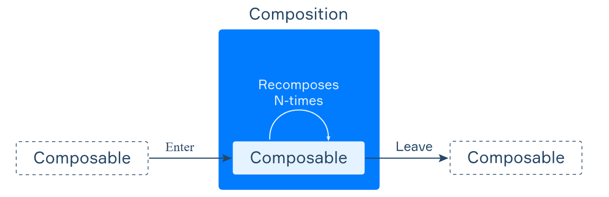
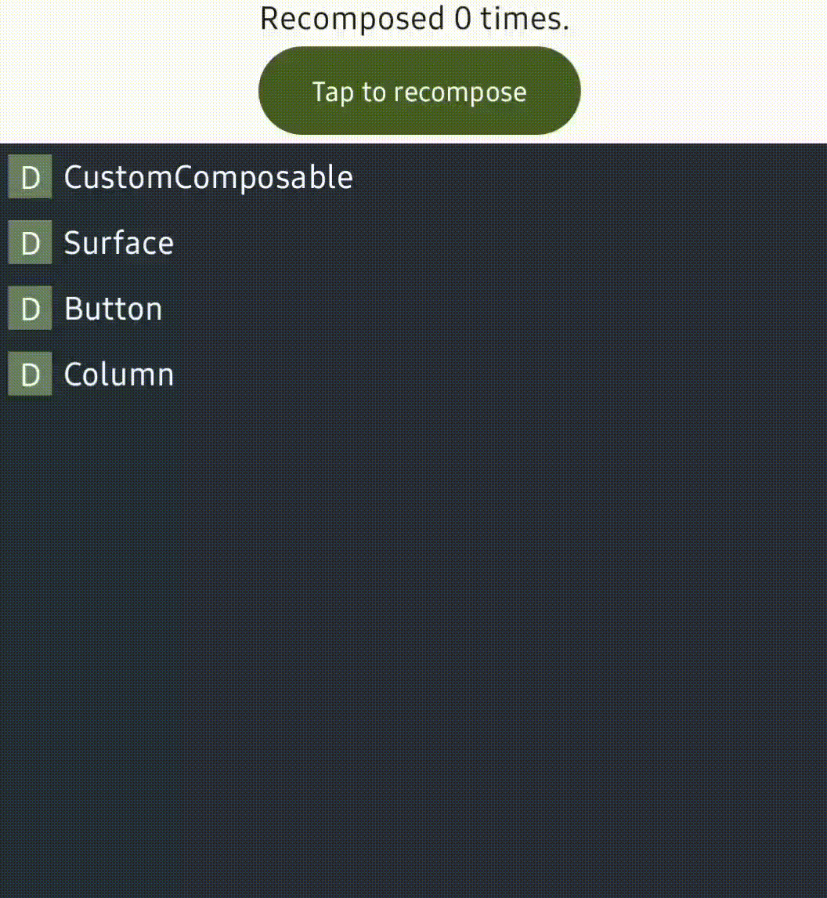
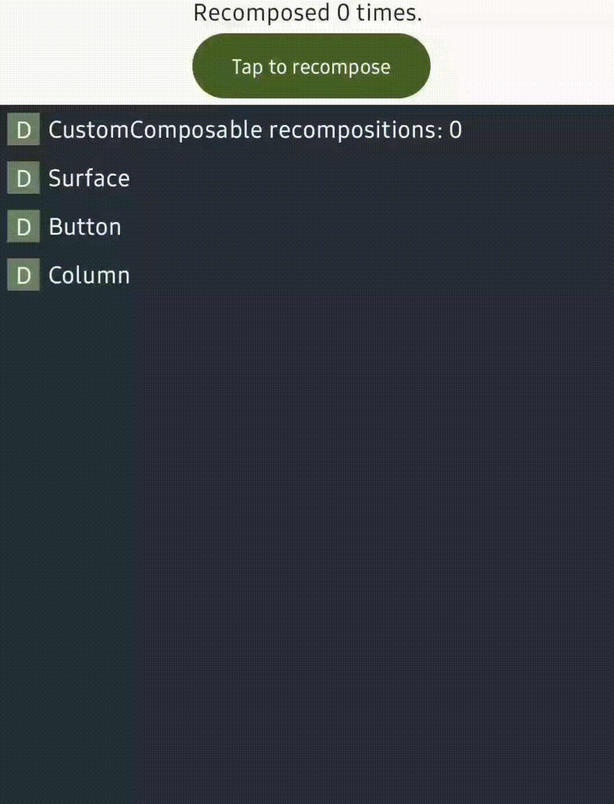
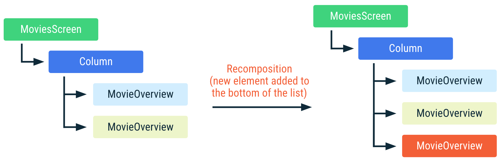
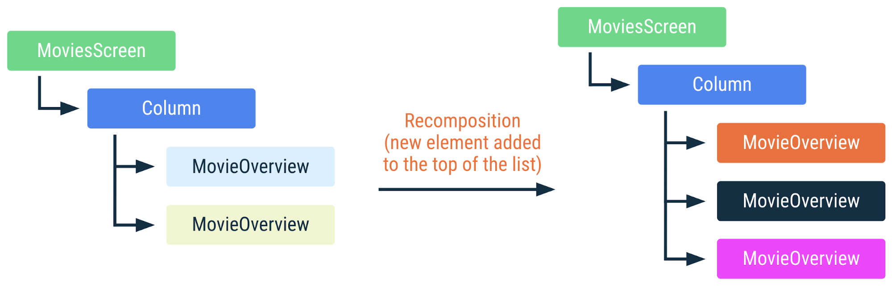
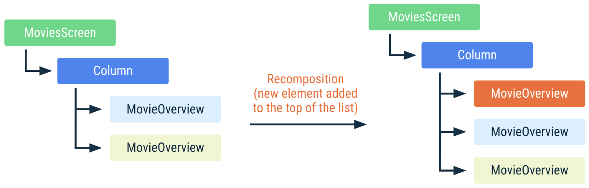

# Lifecycle of composables

**A Composition** describes the UI of your app and is produced by running composables. A Composition is a tree-structure of the composables that describe your UI.

During the initial run of your composables, Jetpack Compose keeps track of them in a Composition to describe your UI. A **state** is any value that can be changed at any point in time during the execution of an application. When your app's state changes, Jetpack Compose schedules a **recomposition**. This involves re-executing the composables that may have changed due to state changes, and updating the Composition accordingly.

A Composition can only be produced by an initial composition and updated by recomposition. The only way to modify a Composition is through recomposition.




Recomposition is typically triggered by a change to a `State<T>` object. Compose tracks these and runs all composables in the Composition that read that particular `State<T>`, and any composables that they call that cannot be skipped.


> [!NOTE]
> A composable's lifecycle is simpler than the lifecycle of views, activities, and fragments. When a composable needs to manage or interact with external resources that do have a more complex lifecycle, you should use effects.(An effect is a composable function that doesn't emit UI and causes side effects to run when a composition completes.)


## Anatomy of a composable in Composition

If during a recomposition a composable calls different composables than it did during the previous composition,
**Compose will identify which composables were called** or not called and for the composables that were called in both compositions, Compose will **avoid recomposing them if their inputs haven't changed and haven't defined directly within the body of Composable**

Example:

```kotlin
val recompositionCount = mutableStateOf(0)

@Composable
fun CustomComposable() {
    Log.d("Recomposition", "CustomComposable")

    Column {
        Log.d("Recomposition", "Column")

        Surface {
            Log.d("Recomposition", "Surface")

            Text(text = "Recomposed ${recompositionCount.value} times.")
        }

        Button(onClick = { recompositionCount.value++ }) {
            Log.d("Recomposition", "Button")

            Text(text = "Tap to recompose")
        } 

    }
}
```
Output :



Now let's just replace one line `Log.d("Recomposition", "CustomComposable")` with
`Log.d("Recomposition", "CustomComposable recompositions: ${recompositionCount.value}")` and take a look at the result:




Thus, **by accessing the state variable directly within the body of the CustomComposable, this function becomes state-dependent**, even though it does not affect the screen image in any way. However, changing this state now will cause recomposition of the `CustomComposable`, `Column`, and `Surface`.

**The thing is that some composables can trigger recomposition of the parent composable when the state of their child composables changes**.
Similarly, as child composables, they will also be re-executed whenever their parent composable is recomposed, even if their own state hasn’t changed.
These are such functions as `Column`, `Row`, `Box`, and others. 

## Add extra information to help smart recompositions

Example:

```kotlin
@Composable
fun MoviesScreen(movies: List<Movie>) {
    Column {
        for (movie in movies) {
            // MovieOverview composables are placed in Composition given its
            // index position in the for loop
            MovieOverview(movie)
        }
    }
}
```

In the example above, Compose uses the execution order in addition to the call site to keep the instance distinct in the Composition. If a new movie is added to the bottom of the list, Compose can reuse the instances already in the Composition since their location in the list haven't changed and therefore, the `movie` input is the same for those instances.



**Figure 2.** Representation of MoviesScreen in the Composition when a new element is added to the bottom of the list.
`MovieOverview` composables in the Composition can be reused. Same color in `MovieOverview` means the composable hasn't been recomposed.


However, if the `movies` list changes by either adding to the top or the middle of the list, removing or reordering items, it'll cause a recomposition in all `MovieOverview` calls whose input parameter has changed position in the list.
That's extremely important if, for example, `MovieOverview` fetches a movie image using a side effect. If recomposition happens while the effect is in progress, it will be cancelled and will start again.


```kotlin
@Composable
fun MovieOverview(movie: Movie) {
    Column {
        // Side effect explained later in the docs. If MovieOverview
        // recomposes, while fetching the image is in progress,
        // it is cancelled and restarted.
        val image = loadNetworkImage(movie.url)
        MovieHeader(image)

        /* ... */
    }
}
```



**Figure 3.** Representation of MoviesScreen in the Composition when a new element is added to the list. MovieOverview composables cannot be reused and all side effects will restart.
A different color in MovieOverview means the composable has been recomposed.

By wrapping a block of code with a call to the `key` composable with one or more values passed in, those values will be combined to be used to identify that instance in the composition.
The value for a `key` does not need to be globally unique, it needs to only be unique amongst the invocations of composables at the call site.
So in this example, each `movie` needs to have a `key` that's unique among the `movies`; it's fine if it shares that key with some other composable elsewhere in the app.

```kotlin
@Composable
fun MoviesScreenWithKey(movies: List<Movie>) {
    Column {
        for (movie in movies) {
            key(movie.id) { // Unique ID for this movie
                MovieOverview(movie)
            }
        }
    }
}
```

**With the above, even if the elements on the list change, Compose recognizes individual calls to MovieOverview and can reuse them.**



Some composables have built-in support for the `key` composable. For example, `LazyColumn` accepts specifying a custom `key` in the `items`.

```kotlin
@Composable
fun MoviesScreenLazy(movies: List<Movie>) {
    LazyColumn {
        items(movies, key = { movie -> movie.id }) { movie ->
            MovieOverview(movie)
        }
    }
}
```

## The Foundations of Recomposition

There are several important key points of the behavior of composable functions during initial composition and subsequent recomposition that you should always keep in mind.

1. **Composable functions can be executed in any order.**
Jetpack Compose can prioritize some more important composables over others and render them first.
2. **Composables can run in parallel.**
Compose can run lower-priority composables on a background thread to optimize and improve performance.
3. **Recomposition may be canceled.**
This is another important aspect, which is due to the fact that the data can change too quickly.
When the data changes before the recomposition is completed, it can be canceled because it has already become outdated. Thanks to this, you can start the next recomposition with the latest data right now, without waiting for its completion.
4. **Recomposition skips as many composables as possible.**
Our task as developers is to assist recomposition, providing the best performance for our application as well as the user experience.
5. **Recomposition can be executed as often as every animation frame.** 
All operations that are not directly related to the UI should be executed in a separate thread to avoid UI junks.
In turn, the results of these operations must be passed to composable functions using `mutableStateOf()` or `mutableStateListOf()`.

## References:

- https://developer.android.com/develop/ui/compose/lifecycle
- https://hyperskill.org/learn/step/28325#comment


