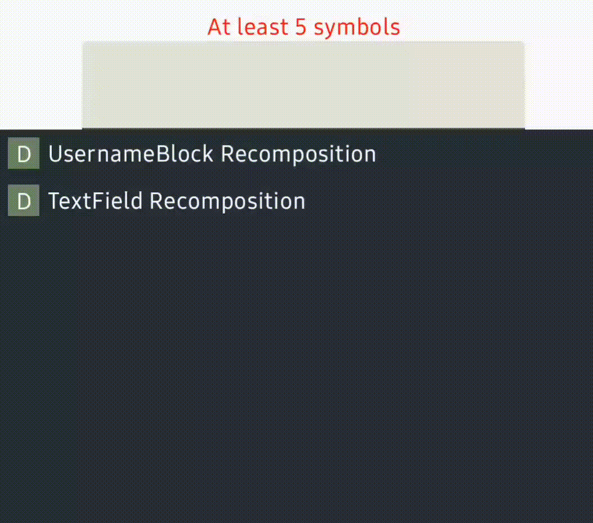

# Managing State in Jetpack Compose

## State and Jetpack Compose


**State** is any value that can be changed at any point in time during the execution of an application.

### State and composition

**Compose is declarative and as such the only way to update it is by calling the same composable with new arguments, recomposition needs to occur.** These arguments are representations of the UI state.
To track state changes, Jetpack Compose has its own special observable system of type `State<T>` and `MutableState<T>`. This system monitors the value parameter and triggers a recomposition whenever it changes.

> [!NOTE]
> Key term:
> Initial composition: creation of a Composition by running composables the first time.
> Recomposition: re-running composables to update the Composition when data changes.

### State observing

`mutableStateOf` creates an observable `MutableState<T>`, which is an observable type integrated with the compose runtime.


```kotlin
interface MutableState<T> : State<T> {
    override var value: T
}
```

There are three ways to declare a MutableState object in a composable:

- `val mutableState = remember { mutableStateOf(default) }`
- `var value by remember { mutableStateOf(default) }`
- `val (value, setValue) = remember { mutableStateOf(default) }`

These declarations are equivalent, and are provided as syntax sugar for different uses of state.You should pick the one that produces the easiest-to-read code in the composable you're writing.

You can use the remembered value as a parameter for other composables or even as logic in statements to change which composables are displayed. 

[Read more about remember](/General/ComputerScience/3_Mobile/0_Android/1_UserInterface/2_UIComponents/1_Compose/1_UIArchitecture/5_Remember.md)

### State observing with Collection

Let's say we have not just one value but a whole list
For example, a shopping list of items to buy at the store. We can pass it as an argument to `mutableStateOf(value = mutableListOf(“candy”, “chocolate”, “cookies”))`,
but when we add or remove elements from the list, nothing will change because `mutableStateOf()` tracks the object as a whole, not its internal content.
In this case, the `mutableStateListOf("candy", "chocolate", "cookies")` function comes to play.

We can also use the `Collection<T>.toMutableStateListOf()` extension function to transform an existing list.
Now, Compose will be notified whenever the list changes and the list displayed on the screen will be updated.

Similarly, we can use `mutableStateMapOf()` to create an observable `Map<T>`.

Or You can use the others approach. Use an observable data holder such as `State<List<T>>` and the immutable `listOf()`.

### Derived State

Let's imagine a different situation.
Suppose we have TextField, and we need to check whether the length of the username matches the minimum set size with each entered character.

```kotlin
const val MIN_LENGTH = 5
val username = mutableStateOf("")

@Composable
fun UsernameBlock() {
    Log.d("Recomposition", "UsernameBlock Recomposition")

    Column {
        Log.d("Recomposition", "Column Recomposition")

        val isMinLength = username.value.length >= MIN_LENGTH

        if (!isMinLength) {
            Text("At least 5 symbols", color = Color.Red)
        }

        Surface {
            Log.d("Recomposition", "TextField Recomposition")

            TextField(value = username.value, onValueChange = { username.value = it })
        }
    }
}
```

Result:


As you can see, each time the value of the `TextField` changes, the entire `UsernameBlock` composable is recomposed.
This is because the `Column` composable depends on the state of `username`.
Thus, we trigger unnecessary recompositions, despite the fact that the composition on the screen does not change until the text length reaches the set minimum.

`derivedStateOf` allows you to create a state that depends on one or more other states.
This function has a single calculation parameter that takes functions as an argument that performs specific calculations and returns the result of their calculations.
When any of the states it depends on changes, the state created by `derivedStateOf` will also change, and all Composables listening to that state will be recomposed.

Let's try to improve our code:

```kotlin
const val MIN_LENGTH = 5
val username = mutableStateOf("")
val derivedState = derivedStateOf { 
    username.value.length >= MIN_LENGTH 
}

@Composable
fun UsernameBlock() {
    Log.d("Column", "UsernameBlock Recomposition")

    Column {
        Log.d("Column", "Column Recomposition")

        if (!derivedState.value) {
            Text("At least 5 symbols", color = Color.Red)
        }

        Surface {
            Log.d("Column", "Surface Recomposition")

            TextField(value = username.value, onValueChange = { username.value = it })
        }
    }
}
```



### Other supported types of state

Compose doesn't require that you use `MutableState<T>` to hold state; it supports other observable types. Before reading another observable type in Compose, **you must convert it to a `State<T>` so that composables can automatically recompose when the state changes.**

Compose ships with functions to create `State<T>` from common observable types used in Android apps. Before using these integrations, add the appropriate artifact(s) as outlined below:

- Flow: `collectAsStateWithLifecycle()` and `collectAsState()`

Both `collectAsStateWithLifecycle()` and `collectAsState()` collect values from a `Flow` and transform them into Compose State, representing the latest emitted value. `collectAsStateWithLifecycle()` is **lifecycle-aware**, helping conserve app resources on Android, and is the recommended API for collecting flows. `collectAsState()` offers similar functionality but lacks lifecycle awareness.

Use collectAsState for platform-agnostic code instead of `collectAsStateWithLifecycle`, which is Android-only.

- Live Data: `observeAsState()`

`observeAsState()` starts observing this `LiveData` and represents its values via `State`.
- RxJava2/RxJava3: `subscribeAsState()`

`subscribeAsState()` are extension functions that transform reactive streams of (RxJava2/RxJava3) (e.g. `Single`, `Observable`, `Completable`) into Compose `State`.


> [!IMPORTANT]
> Compose automatically recomposes from reading `State` objects. If you use another observable type such as `LiveData` in Compose, you should convert it to State before reading it. Make sure that type conversion happens in a composable, using a composable extension function like `LiveData<T>.observeAsState()`.

### Custom Compose state

You are not limited to these integrations. You can build an extension function for Jetpack Compose that reads other observable types.
If your app uses a custom observable class, convert it to produce `State<T>` using the `produceState()` API. This function allows you to use subscription-driven states such as `Flow`, `LiveData`, or `RxJava` directly in composable ones

> [!NOTE]
> unlike mutableStateOf() and derivedStateOf(), the produceState() function is a composable that returns an object of type `State<T>`. As a result, this function can only be called within another composable.

Let's try create a generic extension function with a `@Composable` annotation to convert the state using `LiveData` as an example now:

```kotlin
@Composable
fun <T> LiveData<T>.observeAsState(): State<T?> { 
    val liveData = this 
    val owner = LocalLifecycleOwner.current
    // we need to call the produceState() function, which will return an object of the State<T> type.
    // This function has two required parameters: initialValue of generic type and a producer parameter,
    val state = produceState(initialValue = liveData.value) {
        /**
        Note that inside the lambda expression of the producer parameter you can execute
        both regular functions and suspended functions.
        This is because produceState launches a coroutine scoped to the composition. 
        This means that the producer function will be launched when produceState() 
        enters composition and will be canceled when it leaves composition.
        **/
        liveData.observe(owner) { recentData ->
            value = recentData
        }
    }
    return state
}
```

Now we just need to call the extension function on the LiveData object and handle this state in the way we need, for example, as shown here:

```kotlin
val liveData = MutableLiveData(0)

@Composable
fun LiveStateBlock() {
    val liveState = liveData.observeAsState()

    Button(onClick = { liveData.value = liveData.value!! + 1 }) {
        Text("Clicks: ${liveState.value}")
    }
}
```


## Stateful versus stateless

A composable that uses remember to store an object creates internal state, making the composable stateful. HelloContent is an example of a stateful composable because it holds and modifies its name state internally. This can be useful in situations where a caller doesn't need to control the state and can use it without having to manage the state themselves. However, composables with internal state tend to be less reusable and harder to test.

A stateless composable is a composable that doesn't hold any state. An easy way to achieve stateless is by using state hoisting.

As you develop reusable composables, you often want to expose both a stateful and a stateless version of the same composable. The stateful version is convenient for callers that don't care about the state, and the stateless version is necessary for callers that need to control or hoist the state.


## State hoisting

State hoisting in Compose is a pattern of moving state to a composable's caller to make a composable stateless. The general pattern for state hoisting in Jetpack Compose is to replace the state variable with two parameters:

- `value T`: the current value to display
- `onValueChange: (T) -> Unit`: an event that requests the value to change, where T is the proposed new value

However, you are not limited to `onValueChange`. If more specific events are appropriate for the composable, you should define them using lambdas.

**State that is hoisted this way has some important properties:**

- **Single source of truth**: By moving state instead of duplicating it, we're ensuring there's only one source of truth. This helps avoid bugs.
- **Encapsulated**: Only stateful composables can modify their state. It's completely internal.
Shareable: Hoisted state can be shared with multiple composables. If you wanted to read name in a different composable, hoisting would allow you to do that.
- **Interceptable**: callers to the stateless composables can decide to ignore or modify events before changing the state.
- **Decoupled**: the state for the stateless composables may be stored anywhere. For example, it's now possible to move name into a ViewModel.

> [!IMPORTANT]
> When hoisting state, there are three rules to help you figure out where state should go:
> 1. State should be hoisted to at least **the lowest common parent** of all composables that use the state (read).
> 2. State should be hoisted to at least **the highest level it may be changed** (write).
> 3. If **two states change in response to the same events** they should be **hoisted together**.

## Restoring state in Compose

The `rememberSaveable` API behaves similarly to `remember` because it retains state across recompositions, and also across activity or process recreation using the saved instance state mechanism. For example, this happens, when the screen is rotated.

> [!NOTE]
> rememberSaveable will not retain state if the activity is [completely dismissed by the user](https://developer.android.com/topic/libraries/architecture/saving-states#ui-dismissal-user). For example, it does not retain state if the user swipes the current activity up from the [recents screen](https://developer.android.com/guide/components/activities/recents).

### Ways to store State

All data types that are added to the `Bundle` are saved automatically. If you want to save something that cannot be added to the `Bundle`, there are several options.

#### Parcelize

The simplest solution is to add the `@Parcelize` annotation to the object. The object becomes parcelable, and can be bundled. For example, this code makes a parcelable `City` data type and saves it to the state.

```kotlin
@Parcelize
data class City(val name: String, val country: String) : Parcelable

@Composable
fun CityScreen() {
    var selectedCity = rememberSaveable {
        mutableStateOf(City("Madrid", "Spain"))
    }
}
```

#### MapSaver

If for some reason `@Parcelize` is not suitable, you can use mapSaver to define your own rule for converting an object into a set of values that the system can save to the `Bundle`.

```kotlin
data class City(val name: String, val country: String)

val CitySaver = run {
    val nameKey = "Name"
    val countryKey = "Country"
    mapSaver(
        save = { mapOf(nameKey to it.name, countryKey to it.country) },
        restore = { City(it[nameKey] as String, it[countryKey] as String) }
    )
}

@Composable
fun CityScreen() {
    var selectedCity = rememberSaveable(stateSaver = CitySaver) {
        mutableStateOf(City("Madrid", "Spain"))
    }
}
```

#### ListSaver

To avoid needing to define the keys for the map, you can also use `listSaver` and use its indices as keys:

```kotlin
data class City(val name: String, val country: String)

val CitySaver = listSaver<City, Any>(
    save = { listOf(it.name, it.country) },
    restore = { City(it[0] as String, it[1] as String) }
)

@Composable
fun CityScreen() {
    var selectedCity = rememberSaveable(stateSaver = CitySaver) {
        mutableStateOf(City("Madrid", "Spain"))
    }
}
```

## State holders in Compose

Simple state hoisting can be managed in the composable functions itself. However, if the amount of state to keep track of increases, or the logic to perform in composable functions arises, it's a good practice to delegate the logic and state responsibilities to other classes: **state holders.** -> **State holders manage logic and state of composables.**


## Retrigger remember calculations when keys change

In general, `remember` takes a calculation lambda parameter. When `remember` is first run, it invokes the calculation lambda and stores its result. During recomposition, `remember` returns the value that was last stored.

Apart from caching state, you can also use `remember` to store any object or result of an operation in the Composition that is expensive to initialize or calculate. You might not want to repeat this calculation in every recomposition. 

`remember` stores the value until it leaves the Composition. However, **there is a way to invalidate the cached value**. The `remember` API also takes a `key` or `keys` parameter. If any of these keys change, the next time the function recomposes, **`remember` invalidates the cache and executes the calculation lambda block again. This mechanism gives you control over the lifetime of an object in the Composition**. The calculation remains valid until the inputs change, instead of until the remembered value leaves the Composition.

Example:

```kotlin
@Composable
private fun BackgroundBanner(
    @DrawableRes avatarRes: Int,
    modifier: Modifier = Modifier,
    res: Resources = LocalContext.current.resources
) {
    val brush = remember(key1 = avatarRes) {
        ShaderBrush(
            BitmapShader(
                ImageBitmap.imageResource(res, avatarRes).asAndroidBitmap(),
                Shader.TileMode.REPEAT,
                Shader.TileMode.REPEAT
            )
        )
    }

    Box(
        modifier = modifier.background(brush)
    ) {
        /* ... */
    }
}
```

## References

- https://developer.android.com/develop/ui/compose/state
- https://hyperskill.org/learn/step/28475