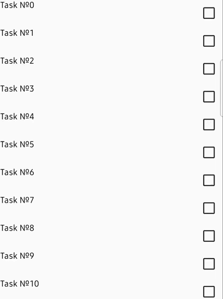
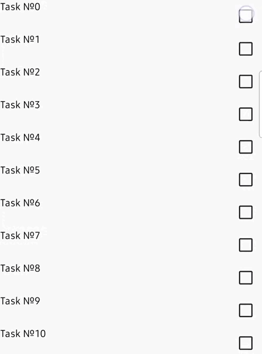

# Rememeber in Compose


Composable functions can use the `remember` API to store an object in memory.
A value computed by `remember` is stored in the Composition during initial composition, and the stored value is returned during recomposition.
`remember` can be used to store both mutable and immutable objects.

> [!NOTE]
>  Objects stored by remember will be discarded when the corresponding composable is removed or no longer needed.


## remember

### Issue
Earlier, to save the composable's state, we declared it outside the composable function itself, and it worked.

However, if we want to reuse this function, we will face some problems.
The point is that a composable that has been used multiple times will consistently rely on the same state

When this state changes, all composables will be re-composed and each of them will display the new value just like all the others.

Let's look at the example of a to-do list with completion checkboxes:

```kotlin
val isChecked = mutableStateOf(false)

@Composable
fun Task() {
    Row(horizontalArrangement = Arrangement.SpaceBetween, modifier = Modifier.fillMaxWidth()) {
        Text(text = "Task №${Random.nextInt()}")
        Checkbox(checked = isChecked.value, onCheckedChange = { isChecked.value = !isChecked.value})
    }
}
```
MainActivity class :
```kotlin
val taskList = List(100) { "Task №$it"}

class MainActivity : ComponentActivity() {
    override fun onCreate(savedInstanceState: Bundle?) {
        super.onCreate(savedInstanceState)
        setContent {
            HyperskillTheme {

                Column {
                    taskList.forEach { task ->
                        Task(description = task)
                    }
                }

            }
        }
    }
}
```
When you try to mark one of the tasks as "completed", all other tasks will also be checked:



To fix this issue We need is to move the state inside the composable itself, creating a new state every time it is reused.

The point is that even if we move the line `val isChecked = mutableStateOf(false)` inside our composable, Compose will track its state and trigger recomposition when it changes.
But the problem is that when the composable is re-called during recomposition, **it will be called with the originally assigned values.**

### Solution

However, there is a neat solution that allows you to survive the recomposition and keep the state within the composable.
To do this, we will use the remember function, which we will wrap our state with:

```kotlin
@Composable
fun Task() {
    val isChecked = remember { mutableStateOf(false) }

    Row(horizontalArrangement = Arrangement.SpaceBetween, modifier = Modifier.fillMaxWidth()) {
        Text(text = "Task №${Random.nextInt()}")

        Checkbox(checked = isChecked.value, onCheckedChange = { isChecked.value = !isChecked.value})
    }
}
```



## rememberSaveable

### Issue

`remember` stores objects during initial composition, and the stored value is returned during recomposition.
But it forgets the object when the composable called `remember` is removed from the composition.

You can see it in these example below.
- We will use `LazyColumn` instead of `Column`. Its main difference is that it doesn't load all list items at once.
It only executes as many composables as can be displayed on the screen.
At the same time, composables that leave the visible area of the screen also leave the composition. 
So, when the composable leaves the composition, `remember` forgets the stored object, and when it returns to the composition, **its state returns to its initial state.**
- the state is not retained across configuration changes, such as when rotating the screen.

### Solution

To solve these problems, you need `rememberSaveable`, which automatically saves the value in a `Bundle`.

`rememberSaveable` allows the state to survive not only recomposition, but also activity recreation and system-initiated process death.

## Performance improvements
We passed all the values that we previously passed to the `remember` function to the lambda parameter `calculations` of this function.

When a composable function is initialized the first time, `remember` performs calculations on the objects declared within the lambda expression and stores the result of those calculations. During subsequent recompositions, `remember` no longer performs new calculations but only restores the result of the initial ones.

It is this feature that allows you to improve application performance.

 
> [!NOTE]
> There are many cases where different composables need to access the same state in order to read or modify it.
> Also, data can be stored in the view model and must be passed to the composable function.
> To do this, state values must be passed to the parameters of the composable as arguments to respect the fundamental principle of a "pure function".
> This way we get rid of the state inside the composable. This process is called state hoisting.

```kotlin
@Composable
fun SortedTaskList(
    taskList: List<String>,
    sortComparator: Comparator<String>
) {
    val sortedTasks = taskList.sortedWith(sortComparator)
    
    LazyColumn {
        items(sortedTasks.size) {
            Task(description = sortedTasks[it])
        }
    }
}
```
But as soon as it the list slightly increased, UI jank is guaranteed.

In this case, it is vital to use `remember`.
With it, sorting will be performed only once.
Note that if the state of `taskList` or `sortComparator` is changed, **we must notify remember about it**. 
To do this, add `key` values, and if at least one of them changes, the calculations will be called again.

```kotlin
@Composable
fun SortedTaskList(
    taskList: List<String>,
    sortComparator: Comparator<String>
) {
    val sortedTasks = remember(key1 = taskList, key2 = sortComparator) {
        taskList.sortedWith(sortComparator)
    }
    
    LazyColumn {
        items(sortedTasks.size) {
            Task(description = sortedTasks[it])
        }
    }
}
```


