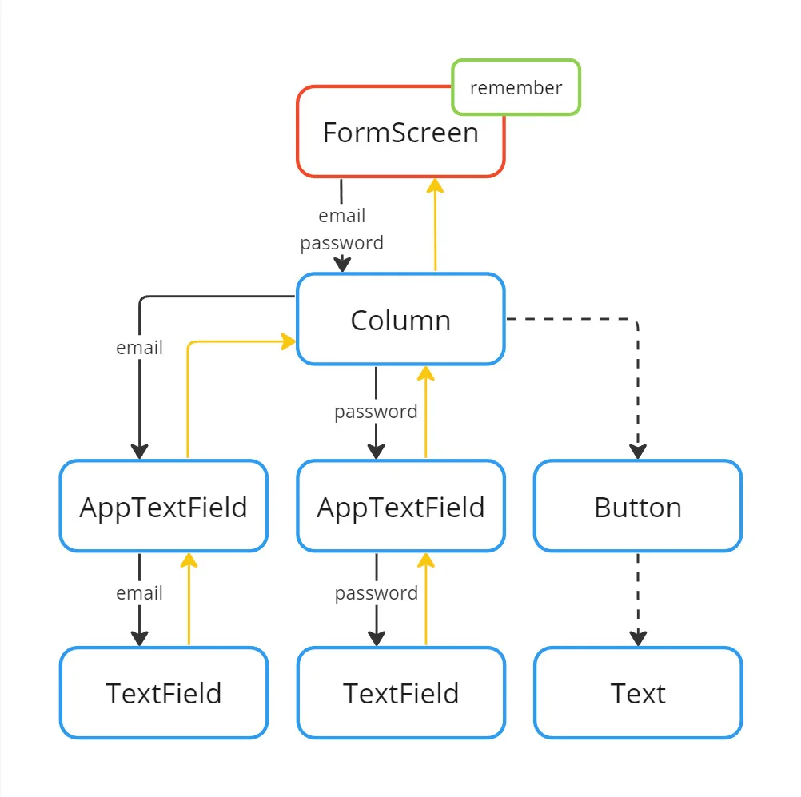

# State Hosting

Where to hoist state ?

## UI State
UI state is the property that describes the UI. There are two types of UI state:
 - **Screen UI state**: is what you need to display on the screen. (For example, a NewsUiState class...)
 - **UI element state**: refers to properties intrinsic to UI elements that influence how they are rendered. A UI element may be shown or hidden and may have a certain font, font size, or font color. ( An example of this are the get and set methods of the TextView class for its text.)

 ## Logic

 Logic in an application can be either business logic or UI logic:
 - **Business logic** is the implementation of product requirements for app data.
 - **UI logic** is related to how to display UI state on the screen

 ### UI logic

 When UI logic needs to read or write state, **you should scope the state to the UI**, following its lifecycle. To achieve this, **you should hoist the state at the correct level in a composable function**. Alternatively, you can do so in a plain state holder class, also scoped to the UI lifecycle.

Below is a description of both solutions and explanation of when to use which.

#### Composables as state owner
Having UI logic and UI element state in composables **is a good approach if the state and logic is simple**. You can leave your state internal to a composable or hoist as required.

#### No state hoisting needed

**Hoisting state isn't always required**. State can be kept internal in a composable when no other composable need to control it. In this snippet, there is a composable that expands and collapses on tap:

```kotlin
@Composable
fun ChatBubble(
    message: Message
) {
    var showDetails by rememberSaveable { mutableStateOf(false) } // Define the UI element expanded state

    ClickableText(
        text = AnnotatedString(message.content),
        onClick = { showDetails = !showDetails } // Apply simple UI logic
    )

    if (showDetails) {
        Text(message.timestamp)
    }
}
```

#### Hoisting within composables

Hoisting the state implies moving it up in the hierarchy so it's managed by a parent composable or the screen, rather than by individual UI elements.

Understanding state hoisting necessitates a comprehension of **stateful** and **stateless** functions. 

- A stateful function is one that includes any state storage mechanism; for instance, a `remember` or `rememberSaveable` function. It can manage, store, and share the state with child or grandchild composables.
-  In contrast, a stateless function does not manage or store the state; it simply displays the state provided by a parent composable or sends events back to the parent. 

**If you need to share your UI element state with other composables and apply UI logic to it in different places**, you can hoist it higher in the UI hierarchy. This also makes your composables more reusable and easier to test.

Example, Consider a simple form with multiple text fields. Each text field can have its own state — the current text.
However, The screen containing the form usually needs to know the overall state(the data entered across all fields).
By employing state hoisting, we can manage all these states at the form level.

```kotlin

import androidx.compose.runtime.getValue
import androidx.compose.runtime.mutableStateOf
import androidx.compose.runtime.remember
import androidx.compose.runtime.setValue

@Composable
fun FormScreen() {
    var email by remember { mutableStateOf("") }
    var password by remember { mutableStateOf("") }
    Column {
        AppTextField(
            label = "Email",
            value = email,
            onValueChange = { email = it }
        )
        AppTextField(
            label = "Password",
            value = password,
            onValueChange = { password = it }
        )
        Button(onClick = { /* Handle business logic */ }) {
            Text("Submit")
        }
    }
}

@Composable
fun AppTextField(label: String, value: String, onValueChange: (String) -> Unit) {
    TextField(
        value = value,
        onValueChange = onValueChange,
        label = { Text(label) }
    )
}
```

we have a `FormScreen` composable that contains two pieces of state: `email` and `password`.
Each state is managed at the form level using remember and `mutableStateOf`.
We then pass each piece of state down to an `AppTextField` composable, along with a corresponding `onValueChange` callback, which updates the state when the text changes.

The `AppTextField` accepts a `label`, the current `value`, and an `onValueChange` callback as parameters. 
This setup makes each text field a pure (stateless) composable of its state, with no internal state management. Let's look at this setup in the form of a diagram.



Another important aspect is that data flows in one direction—from `FormScreen` to `TextField`—while events that update the state, such as user inputs, flow in the opposite direction.
This pattern is known as a [unidirectional data flow](/General/ComputerScience/3_Mobile/0_Android/3_Architecture/2_StateManagement/UnidirectionalDataFlow.md).
It makes it easier to track how data and events move through the app, thus simplifying debugging and problem-solving.

It also helps prevent bugs that happen when data changes unexpectedly or moves in ways you didn’t intend—this is a common problem in **bidirectional data flow**, where data can go back and forth.

#### Plain state holder class as state owner

When a composable contains complex UI logic that involves one or multiple state fields of a UI element, it should delegate that responsibility to `state holders`, like a plain state holder class. This makes the composable's logic more testable in isolation, and reduces its complexity. This approach favors [the separation of concerns principle](/General/DesignPrinciple/SeparationOfConcernsPrinciple.md): **the composable is in charge of emitting UI elements, and the state holder contains the UI logic and UI element state.**

Plain state holder classes provide convenient functions to callers of your composable function, so they don't have to write this logic themselves.

These plain classes are created and remembered in the Composition. Because they follow the [composable's lifecycle](/General/ComputerScience/3_Mobile/0_Android/1_UserInterface/2_UIComponents/1_Compose/1_UIArchitecture/LifecycleOfComposables.md), they can take types provided by the Compose library such as `rememberNavController()` or `rememberLazyListState()`.

<details>
  <summary style="color: orange;">
  <b>
  An example of this
  </b>
  </summary>
  
  <p>
   the LazyListState plain state holder class, implemented in Compose to control the UI complexity of LazyColumn or LazyRow.

```kotlin
// LazyListState.kt

@Stable
class LazyListState constructor(
    firstVisibleItemIndex: Int = 0,
    firstVisibleItemScrollOffset: Int = 0
) : ScrollableState {
    /**
     *   The holder class for the current scroll position.
     */
    private val scrollPosition = LazyListScrollPosition(
        firstVisibleItemIndex, firstVisibleItemScrollOffset
    )

    suspend fun scrollToItem(/*...*/) { /*...*/ }

    override suspend fun scroll() { /*...*/ }

    suspend fun animateScrollToItem() { /*...*/ }
}
```


>Trong Compose, @Stable là một Annotation được sử dụng để đánh dấu rằng một lớp hoặc một hàm là không thay đổi về nội dung sau khi được khởi tạo. Khi một đối tượng được đánh dấu là @Stable, nó sẽ không bị thay đổi giá trị trong suốt vòng đời của ứng dụng.

>Trong trường hợp của lớp LazyListState, việc đánh dấu là @Stable là quan trọng để đảm bảo rằng trạng thái của LazyListState không thay đổi sau khi được tạo ra. Điều này cần thiết vì LazyListState thường được sử dụng để theo dõi vị trí cuộn của danh sách hoặc RecyclerView trong giao diện người dùng. Nếu trạng thái của LazyListState thay đổi trong khi ứng dụng đang chạy, có thể gây ra sự không nhất quán hoặc lỗi trong việc hiển thị danh sách. Điều này đặc biệt quan trọng trong việc xây dựng các giao diện người dùng có hiệu suất cao, nơi mà việc giữ cho trạng thái không thay đổi là rất quan trọng.

LazyListState encapsulates the state of the LazyColumn storing the scrollPosition for this UI element. It also exposes methods to modify the scroll position by for instance scrolling to a given item.

  </p>
</details>

As you can see, **incrementing a composable's responsibilities increases the need for a state holder**. The responsibilities could be in UI logic, or just in the amount of state to keep track of.

> [!NOTE]
> If plain state holder classes contain state you want to preserve after an Activity or process is recreated, use `rememberSaveable` and create a custom `Saver` for it.


### Business logic

If your UI element state is hoisted to the `ViewModel` because it is required by business logic, you can use `ViewModel`'s APIs.

<details>
  <summary style="color: orange;">
  <b>
    The main benefits of using a ViewModel
  </b>
  </summary>
  
  <p>

One of the main benefits of using a ViewModel in your Android application is that it handles configuration changes for free. When there is a configuration change, and the activity is destroyed and recreated, the UI state hoisted to the ViewModel is kept in memory. After the recreation, the old ViewModel instance is attached to the new activity instance.

  </p>
</details>


> [!NOTE]
> The `ViewModel`, as the implementation of a screen level state holder, handles the business logic used to produce screen UI state. **You should hoist the UI state to the `ViewModel`, not because it will handle configuration changes for free, but because it makes sense for your architecture**.

However, a `ViewModel` instance does not survive system-initiated process death. To have the UI state survive this, use the Saved State module for `ViewModel`, which contains the `SavedStateHandle` API.


## Reference

- https://developer.android.com/develop/ui/compose/state
- https://hyperskill.org/learn/step/40623