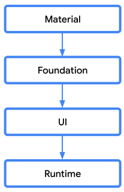

# Jetpack Compose architectural

This page provides a high-level overview of the architectural layers that make up Jetpack Compose, and the core principles that inform this design.

Jetpack Compose is not a single monolithic project; it is created from a number of modules which are assembled together to form a complete stack. Understanding the different modules that make up Jetpack Compose enables you to:

- Use the appropriate level of abstraction to build your app or library
- Understand when you can ‘drop down’ to a lower level for more control or customization
- Minimize your dependencies

## Layer

The major layers of Jetpack Compose are:

Each layer is built upon the lower levels, combining functionality to create higher level components. Each layer builds on public APIs of the lower layers to verify the module boundaries and enable you to replace any layer should you need to. Let's examine these layers from the bottom up.

1. **Runtime**
    This module provides the fundamentals of the Compose runtime such as `remember`, `mutableStateOf`, the `@Composable` annotation and SideEffect.**You might consider building directly upon this layer if you only need Compose’s tree management abilities, not its UI.**

2. **UI**
    The UI layer is made up of multiple modules ( `ui-text`, `ui-graphics`, `ui-tooling`, etc.). These modules implement the fundamentals of the UI toolkit, such as `LayoutNode`, `Modifier`, input handlers, custom layouts, and drawing. **You might consider building upon this layer if you only need fundamental concepts of a UI toolkit.**

3. **Foundation**
    This module provides design system agnostic building blocks for Compose UI, like `Row` and `Column`, `LazyColumn`, recognition of particular gestures, etc. **You might consider building upon the foundation layer to create your own design system.**

4. **Material**
    This module provides an implementation of the Material Design system for Compose UI, providing a theming system, styled components, ripple indications, icons. **Build upon this layer when using Material Design in your app.**