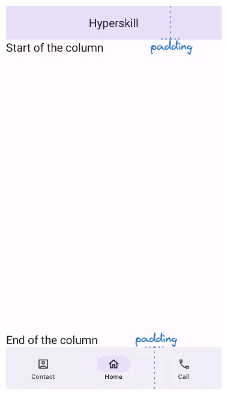

# Scaffold


The Scaffold encapsulates the basic Material Design layout structures, ensuring consistency across screens and applications.That simplifies the implementation of common Material Design components and layout patterns

```kotlin
@Composable
fun Scaffold(
    modifier: Modifier = Modifier,
    topBar: @Composable () -> Unit = {},
    bottomBar: @Composable () -> Unit = {},
    snackbarHost: @Composable () -> Unit = {},
    floatingActionButton: @Composable () -> Unit = {},
    floatingActionButtonPosition: FabPosition = FabPosition.End,
    containerColor: Color = MaterialTheme.colorScheme.background,
    contentColor: Color = contentColorFor(containerColor),
    contentWindowInsets: WindowInsets = ScaffoldDefaults.contentWindowInsets,
    content: @Composable (PaddingValues) -> Unit
)
```

- The `contentWindowInsets` parameter is crucial for providing the correct padding to the Scaffold's content, ensuring it respects the system's UI boundaries. 
This consideration is particularly important in modern Android UIs with edge-to-edge content and gesture navigation


- The `content` parameter is essential for defining the main components of your screen,
This lambda function receives a `PaddingValues` object as input, which is provided by the Scaffold composable. 
It indicates the necessary padding around your content to account for the space taken up by elements such as the Top Bar or Bottom Bar.

Example:

```kotlin
import androidx.compose.material3.Scaffold
import androidx.compose.material3.ExperimentalMaterial3Api
import androidx.compose.material3.BottomAppBar
import androidx.compose.material3.CenterAlignedTopAppBar

@OptIn(ExperimentalMaterial3Api::class)
@Composable
fun ScaffoldScreen() {
    Scaffold(
        topBar = {
            CenterAlignedTopAppBar(
                title = { Text("Hyperskill") },
                /*...*/
            )
        },
        bottomBar = {  
		    BottomAppBar { /*...*/ }  
		}
    ) { innerPadding ->  
	    ScaffoldContent(modifier = Modifier.padding(innerPadding).fillMaxSize())  
	}
}
```



## Best practices and performance considerations

The state of the Scaffold or its components can sometimes cause the entire Scaffold hierarchy to recompose. It's important to consider where your state updates originate.

- If changes in state affect only a small part of your screen, you should encapsulate that part in its own composable to limit recomposition to just that area.
- The `content` area of the Scaffold is the heart of your screen.
Be aware of the performance impact if this area includes long lists, intricate layouts, or is subject to frequent updates.
Using techniques like `LazyColumn` for lists and isolating computationally intensive composables can help ensure a good user experience. 


## Reference

- https://hyperskill.org/learn/step/45216


