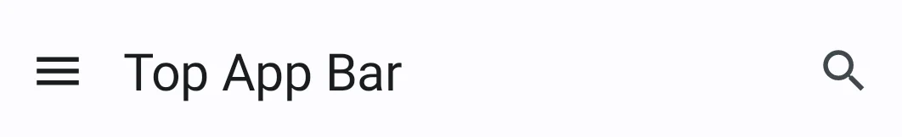
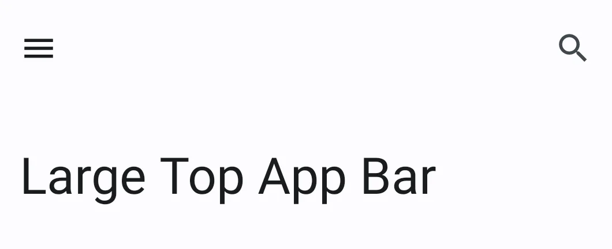
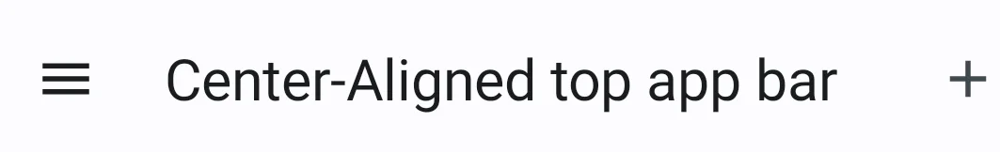
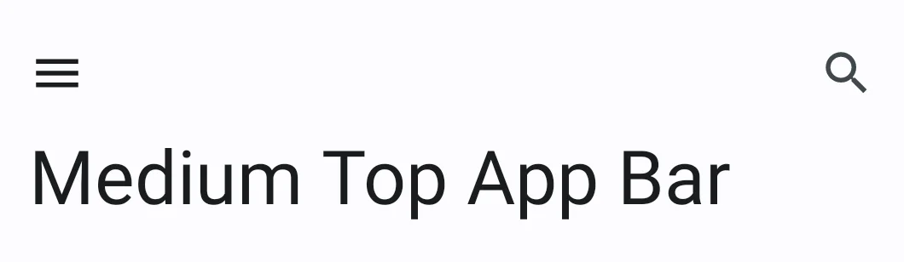
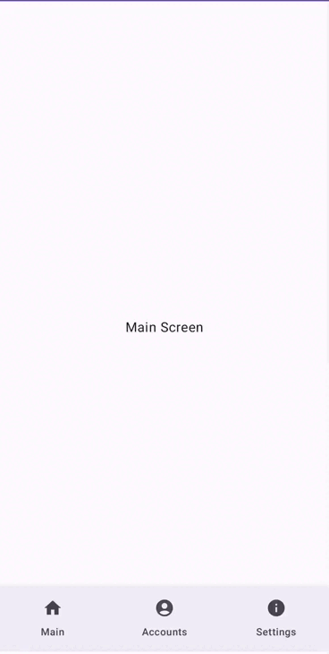

# App bar

App bars are containers that give users access to key features and navigation items.
In Jetpack Compose For Android, there are two types of app bars:

- **Top app bar**: This appears at the top of the screen and provides access to key tasks and information.
It usually includes a title, core action items, and certain navigation items.

- Bottom app bar: This appears at the bottom of the screen and includes core navigation items.
It may also provide access to other key actions, such as through a floating action button.

## Types of Top app bars

Jetpack Compose offers several types of top app bars to cater to different app requirements and design patterns.
They include:

- `TopAppBar`: A standard app bar that typically contains the screen title, navigation icon, and action icons.
It is suitable for most app scenarios and provides a consistent look and feel.

```kotlin
@Composable
fun MyAppBar() {
    TopAppBar(
        title = { Text("Top App Bar") },
        navigationIcon = {
            IconButton(onClick = { /* Handle navigation */ }) {
                Icon(Icons.Default.Menu, contentDescription = "Menu")
            }
        },
        actions = {
            IconButton(onClick = { /* Handle search */ }) {
                Icon(Icons.Default.Search, contentDescription = "Search")
            }
        }
    )
}
```



- `LargeTopAppBar`: An app bar with an expanded height, allowing for more prominent branding elements or additional content.
It is often used in conjunction with a collapsing toolbar or when you want to make a strong visual impact.


```kotlin
@Composable
fun MyLargeAppBar() {
    LargeTopAppBar(
        title = { Text("Large Top App Bar", style = MaterialTheme.typography.h4) },
        navigationIcon = {
            IconButton(onClick = { /* Handle navigation */ }) {
                Icon(Icons.Default.Menu, contentDescription = "Menu")
            }
        },
        actions = {
            IconButton(onClick = { /* do something */ }) {
                Icon(
                    imageVector = Icons.Filled.Search,
                    contentDescription = "Localized description"
                )
            }
        }
    )
}
```




- `CenterAlignedTopAppBar`: An app bar variant where the title is centered horizontally.
This style is commonly used in media-focused apps or when you want to emphasize symmetry in your app's design.

```kotlin
@Composable
fun MyCenteredAppBar() {
    CenterAlignedTopAppBar(
        title = { Text(text = "Center-Aligned top app bar") },
        navigationIcon = {
            IconButton(onClick = { /*TODO*/ }) {
                Icon(imageVector = Icons.Default.Menu, contentDescription = null)
            }
        },
        actions = {
            Icon(imageVector = Icons.Default.Add, contentDescription = null)
        }
    )
}
```



- `MediumTopAppBar`: A medium top app bar is similar to the large, though the padding between the title and the icons is smaller and occupies less space on the screen overall.

```kotlin
@Composable
fun MyMediumTopAppBar() {
    MediumTopAppBar(
        title = { Text("Medium Top App Bar", style = MaterialTheme.typography.headlineLarge) },
        navigationIcon = {
            IconButton(onClick = { /* Handle navigation */ }) {
                Icon(Icons.Default.Menu, contentDescription = "Menu")
            }
        },
        actions = {
            IconButton(onClick = { /* do something */ }) {
                Icon(
                    imageVector = Icons.Filled.Search,
                    contentDescription = "Localized description"
                )
            }
        }
    )
}
```


> [!NOTE]
> To integrate a top app bar into your app using Scaffold, you can use the topBar slot and provide a composable function that defines the top app bar's content.


## bottom app bar

In Jetpack Compose, you can create a bottom app bar component for bottom navigation using the `NavigationBar` and `NavigationBarItem` composables. 
To represent navigation destinations in a type-safe manner, you can use Kotlin enums or sealed classes. 

```kotlin
sealed class Screen(val route: String) {
    object MainScreen : Screen("main_screen")
    object AccountsScreen : Screen("accounts_screen")
    object SettingScreen : Screen("settings_screen")
}

@Composable
fun MyApp() {
    Scaffold(
        bottomBar = {
            val currentRoute =  navController.currentDestination?.route
            NavigationBar  {
                NavigationBarItem(
                    icon = { /*..*/ },
                    label = { Text(text = "Main") },
                    selected = Screen.MainScreen.route == currentRoute,
                    onClick = { /* Handle navigation icon click */ }
                )
                NavigationBarItem(
                    icon = { /*..*/ },
                    label = { Text(text = "Accounts") },
                    selected = Screen.AccountsScreen.route == currentRoute,
                    onClick = { /* Handle navigation icon click */ }
                )
                NavigationBarItem(
                    icon = { /*..*/ },
                    label = { Text(text = "Settings") },
                    selected = Screen.SettingScreen.route == currentRoute,
                    onClick = { /* Handle navigation icon click */ }
                )
            }
        }
    ) { padding ->
        // Screen content goes here
    }
}
```



> [!NOTE]
> You can also create a bottom navigation bar using BottomAppBar . It is similar to creating a top app bar using TopAppBar.
> the BottomAppBar accept a series of navigation items through the actions property and can also accept a floating action button through the floatingActionButton property.


