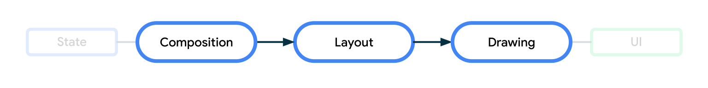
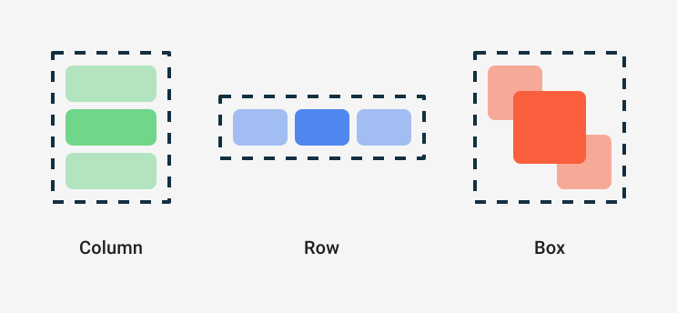
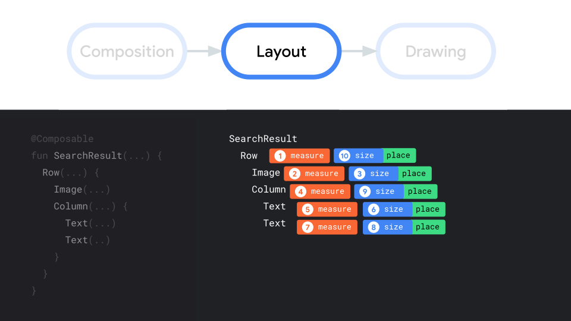
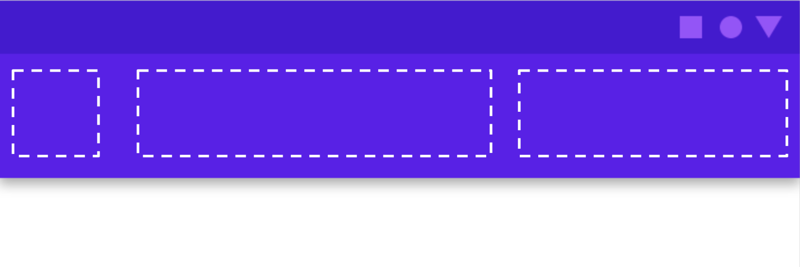

# Layout 
## Definition

Compose transforms state into UI elements, via these [phases](../UIArchitecture/3_Phases.md):




**This document focuses on the layout of elements**, explaining some of the building blocks Compose provides to help you lay out your UI elements.

## Goals of layouts in Compose

The Jetpack Compose implementation of the layout system has two main goals:

- High performance
- Ability to easily write custom layouts

> [!Note]
> With the Android View system, you could face some performance issues when nesting certain Views such as `RelativeLayout`. Since Compose avoids multiple measurements, you can nest as deeply as you want without affecting performance.

## Basics of composable functions

Composable functions are the basic building block of Compose. A composable function is a function emitting Unit that describes some part of your UI. The function takes some input and generates what's shown on the screen. For more information about composables, take a look at the Compose mental model documentation.

## Standard layout components

Compose provides a collection of ready-to-use layouts to help you arrange your UI elements

- Use `Column` to place items vertically on the screen.
- Use `Row` to place items horizontally on the screen
- Use `Box` to put elements on top of another. 




> [!NOTE]
> - Both `Column` and `Row` support configuring the alignment of the elements they contain.
> - Compose handles nested layouts efficiently, making them a great way to design a complicated UI. This is an improvement from Android Views, where you need to avoid nested layouts for performance reasons.

## The Layout model

In the layout model, the UI tree is laid out in a single pass. Each node is first asked to measure itself, then measure any children recursively, passing size constraints down the tree to children. Then, leaf nodes are sized and placed, with the resolved sizes and placement instructions passed back up the tree.

**Briefly, parents measure before their children, but are sized and placed after their children.**

During the Layout phase, the tree is traversed using the following 3 step algorithm:

1. Measure children: A node measures its children, if any.
2. Decide own size: Based on those measurements, a node decides on its own size.
3. Place children: Each child node is placed relative to a node’s own position.


<details>
  <summary style="color: orange;">
  <b>
  Quick Example
  </b>
  </summary>
  
  <p>
  
```kotlin
@Composable
fun SearchResult() {
    Row {
        Image(
            // ...
        )
        Column {
            Text(
                // ...
            )
            Text(
                // ...
            )
        }
    }
}

```

This function yields the following UI tree.

```
SearchResult
  Row
    Image
    Column
      Text
      Text
```

In the SearchResult example, the UI tree layout follows this order:

1. The root node Row is asked to measure.
2. The root node Row asks its first child, Image, to measure.
3. Image is a leaf node (that is, it has no children), so it reports a size and returns placement instructions.
4. The root node Row asks its second child, Column, to measure.
5. The Column node asks its first Text child to measure.
6. The first Text node is a leaf node, so it reports a size and returns placement instructions.
7. The Column node asks its second Text child to measure.
8. The second Text node is a leaf node, so it reports a size and returns placement instructions.
9. Now that the Column node has measured, sized, and, placed its children, it can determine its own size and placement.
10. Now that the root node Row has measured, sized, and placed its children, it can determine its own size and placement



  </p>
</details>

See more on [CommonComposeable](https://github.com/Meonix/CommonComposable/tree/master/app/src/main/java/com/mionix/commoncomposable/ui/screen/layoutExampleScreens/layoutBasics)

## Responsive layouts

A layout should be designed with consideration of different screen orientations and form factor sizes. Compose offers out of the box a few mechanisms to facilitate adapting your composable layouts to various screen configurations.

### Constraints

In order to know the constraints coming from the parent and design the layout accordingly, you can use a BoxWithConstraints. The measurement constraints can be found in the scope of the content lambda. You can use these measurement constraints to compose different layouts for different screen configurations:

```kotlin
@Composable
fun ResponsiveLayoutExample() {
    BoxWithConstraints {
        if (maxWidth < 600.dp) {
            // Nếu chiều rộng nhỏ hơn 600dp, bố trí theo hàng dọc
            Column {
                Text("Item 1")
                Text("Item 2")
                Text("Item 3")
            }
        } else {
            // Nếu chiều rộng lớn hơn hoặc bằng 600dp, bố trí theo hàng ngang
            Row {
                Text("Item 1")
                Text("Item 2")
                Text("Item 3")
            }
        }
    }
}
```
### Slot-based layouts

Compose provides a large variety of composables based on Material Design with the `androidx.compose.material:material` dependency (included when creating a Compose project in Android Studio) to make UI building easy. Elements like `Drawer`, `FloatingActionButton`, and `TopAppBar` are all provided.

Material components make heavy use of slot APIs, a pattern Compose introduces to bring in a layer of customization on top of composables. This approach makes components more flexible, as they accept a child element which can configure itself rather than having to expose every configuration parameter of the child. Slots leave an empty space in the UI for the developer to fill as they wish. For example, these are the slots that you can customize in a `TopAppBar`:

