# Constraints and modifier order

In Compose, you can chain multiple modifiers together to change the look and feel of a composable. These modifier chains can affect the constraints passed to composables, which define width and height bounds.

This page describes how chained modifiers affect constraints and, in turn, the measurement and placement of composables.

## Modifiers in the UI tree

To understand how modifiers influence each other, it's helpful to visualize how they appear in the UI tree, **which is generated during the composition phase.**

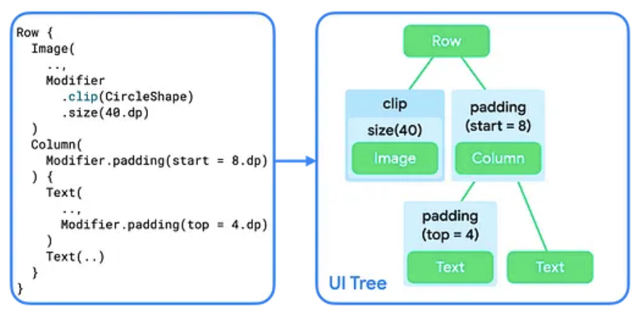

Adding more than one modifier to a composable creates a chain of modifiers. When you chain multiple modifiers, each modifier node wraps the rest of the chain and the layout node within. For example, when you chain a `clip` and a `size` modifier, the `clip` modifier node wraps the `size` modifier node, which then wraps the `Image` layout node.

In the layout phase, [the algorithm](../UIArchitecture/3_Phases.md#layout) that walks the tree stays the same, but each modifier node is visited as well. This way, a modifier can change the size requirements and placement of the modifier or layout node that it wraps.


<details>
  <summary style="color: orange;">
  <b>
  The other example
  </b>
  </summary>
  
  <p>
  
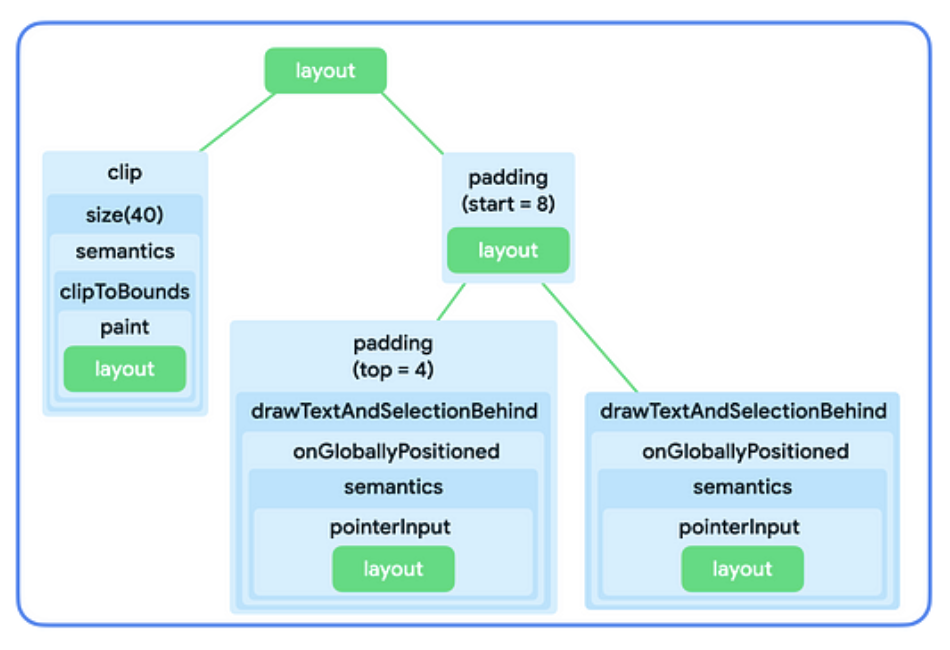
As shown in Figure 2, the implementation of the Image and Text composables themselves consist of a chain of modifiers wrapping a single layout node. The implementations of Row and Column are simply layout nodes that describe how to lay out their children.

  </p>
</details>

To summarize:
- Modifiers wrap a single modifier or layout node.
- Layout nodes can lay out multiple child nodes.


## Constraints in the layout phase

The layout phase follows a [three-step algorithm](../UIArchitecture/3_Phases.md#layout) to find each layout node's width, height, and x, y coordinate:

`Constraints` help find the right sizes for the nodes during the first two steps of the algorithm. `Constraints` define the minimum and maximum bounds for a node's width and height. When the node decides on its size, its measured size should fall within this size range.


### Types of constraints

A constraint can be one of the following:

- **Bounded**: The node has a maximum and minimum width and height.
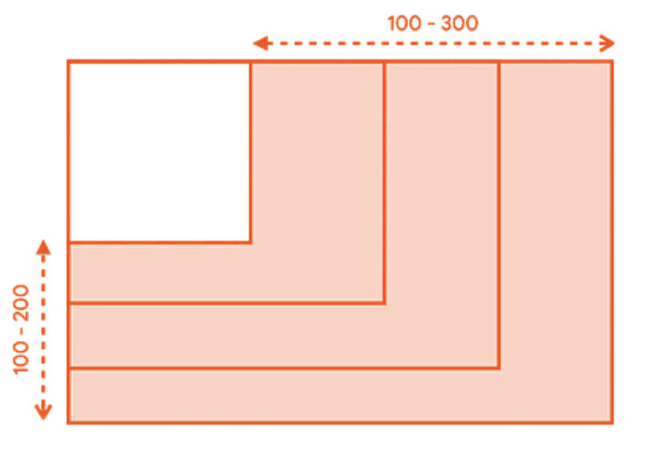
- **Unbounded**: The node is not constrained to any size. The maximum width and height bounds are set to infinity.
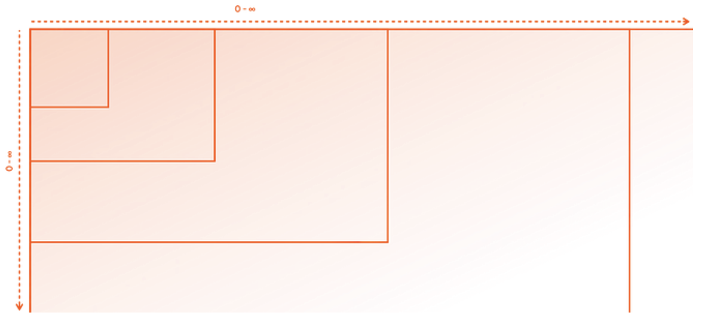
- **Exact**: The node is asked to follow an exact size requirement. The minimum and maximum bounds are set to the same value.
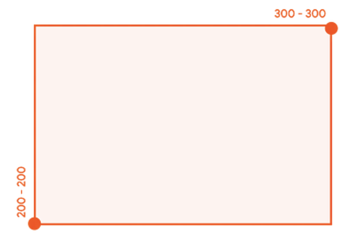
- **Combination**: The node follows a combination of the above constraint types. For example, a constraint could bound the width while allowing for an unbounded maximum height, or set an exact width but provide a bounded height.
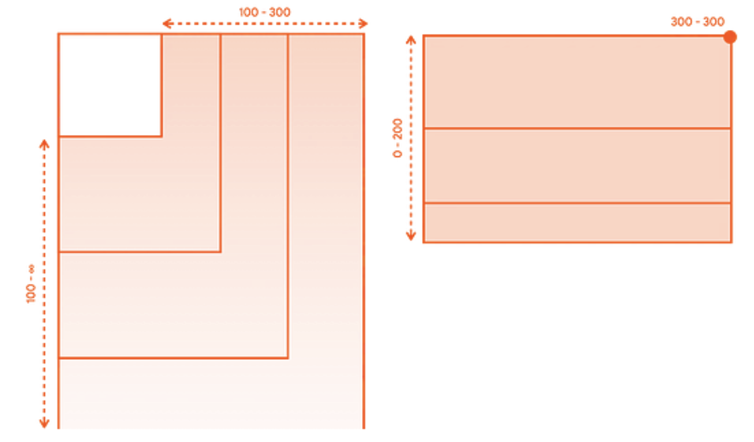

### How constraints are passed from parent to child

During the first step of the algorithm described in [Constraints in the layout phase](./2_ConstraintsAndModifierOrder.md#constraints-in-the-layout-phase), constraints are passed down from parent to child in the UI tree.

When a parent node measures its children, it provides these constraints to each child to let them know how big or small they're allowed to be. Then, when it decides its own size, it also adheres to the constraints that were passed in by its own parents.

the algorithm works in the following way:

1. To decide the size it actually wants to occupy, the root node in the UI tree measures its children and forwards the same constraints to its first child.
2. If the child is a modifier that does not impact measurement, it forwards the constraints to the next modifier. The constraints are passed down the modifier chain as-is unless a modifier that impacts measurement is reached. The constraints are then re-sized accordingly.
3. Once a node is reached that doesn't have any children (referred to as a "leaf node"), it decides its size based on the constraints that were passed in, and returns this resolved size to its parent.
4. The parent adapts its constraints based on this child's measurements, and calls its next child with these adjusted constraints.
5. Once all children of a parent are measured, the parent node decides on its own size and communicates that to its own parent.
6. This way, the whole tree is traversed depth-first. Eventually, all the nodes have decided on their sizes, and the measurement step is completed.

[Example Video](https://youtube.com/watch?v=OeC5jMV342A&t=204s)

### Modifiers that affect constraints
#### `size` modifier

<details>
  <summary style="color: orange;">
  <b>
The following sections describe specific modifiers that impact constraints.
  </b>
  </summary>
  
  <p>
  
For example, the following UI tree should be rendered in a container of `300dp` by `200dp`. The constraints are bounded, allowing widths between `100dp` and `300dp`, and heights between `100dp` and `200dp`:

<div style="display: flex; align-items: center;">
  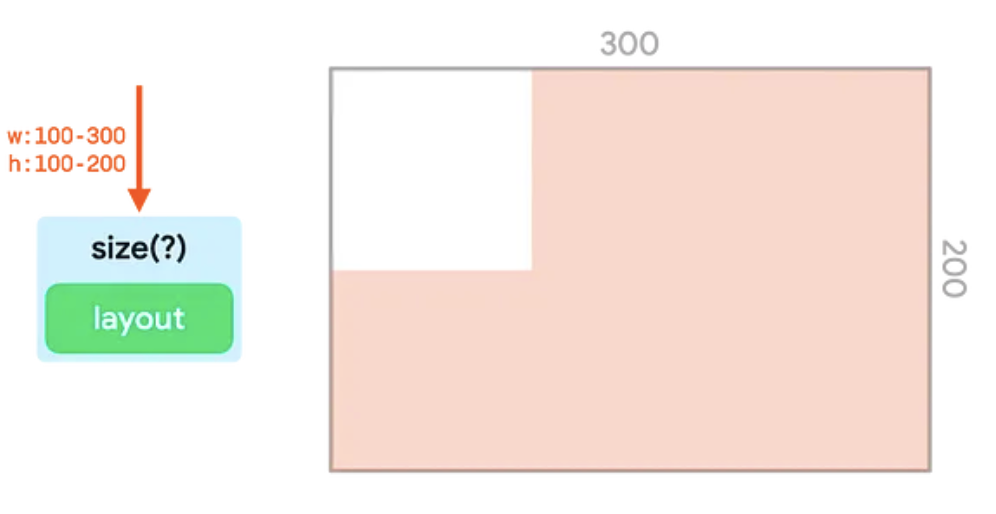
  <p>
  
  ```kotlin
@Composable
fun BoundedConstraintsExample() {
    Box(
        modifier = Modifier
            .size(300.dp, 200.dp)
            .background(Color.Red),
        contentAlignment = Alignment.TopStart
    ) {
        Box(
            modifier = Modifier
                .widthIn(min = 100.dp, max = 300.dp)
                .heightIn(min = 100.dp, max = 200.dp)
                .background(Color.White)
        ) {
            Text(
                text = "Bounded Box",
                color = Color.Black,
                modifier = Modifier.align(Alignment.Center)
            )
        }
    }
}
  ```

  </p>


</div>

The size modifier adapts incoming constraints to match the value passed to it. In this example, the value is 150dp:

<div style="display: flex; align-items: center;">
  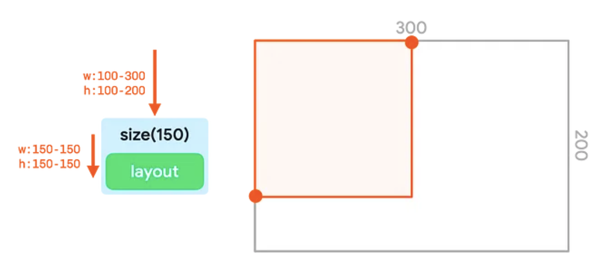
  <p>

```kotlin
@Composable
fun FixedSizeExample() {
    Box(
        modifier = Modifier
            .size(300.dp, 200.dp)
            .background(Color.Red)
    ) {
        Box(
            modifier = Modifier
                .size(150.dp)
                .background(Color.White)
        ) {
            Text(
                text = "150dp Box",
                color = Color.Black,
                modifier = Modifier.align(Alignment.Center)
            )
        }
    }
}
```
  </p>
</div>

If the width and height are smaller than the smallest constraint bound, or larger than the largest constraint bound, the modifier matches the passed constraints as closely as it can while still adhering to the constraints passed in:

- Smallest constraint bound
```kotlin
Box(
        modifier = Modifier
            .size(300.dp, 200.dp)
            .background(Color.Red)
    ) {
        Box(
            modifier = Modifier
                .widthIn(min = 100.dp, max = 300.dp)
                .heightIn(min = 100.dp, max = 200.dp)
                .size(50.dp)
                .background(Color.White)
        ) {
            Text(
                text = "Too Small",
                color = Color.Black,
            )
        }
    }
```
- Larger than the largest contraint bound
```kotlin
Box(
    modifier = Modifier
        .size(300.dp, 200.dp)
        .background(Color.Red)
) {
    Box(
        modifier = Modifier
            .widthIn(min = 100.dp, max = 300.dp)
            .heightIn(min = 100.dp, max = 200.dp)
            .size(400.dp)
            .background(Color.White)
    ) {
        Text(
            text = "Too Large",
            color = Color.Black,
        )
    }
}
```

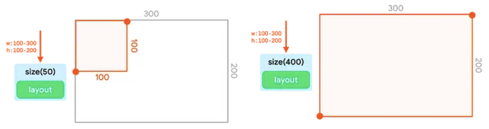


Note that chaining multiple size modifiers does not work. The first size modifier sets both the minimum and maximum constraints to a fixed value. Even if the second size modifier requests a smaller or larger size, it still needs to adhere to the exact bounds passed in, so it won't override those values:

<div style="display: flex; align-items: center;">
  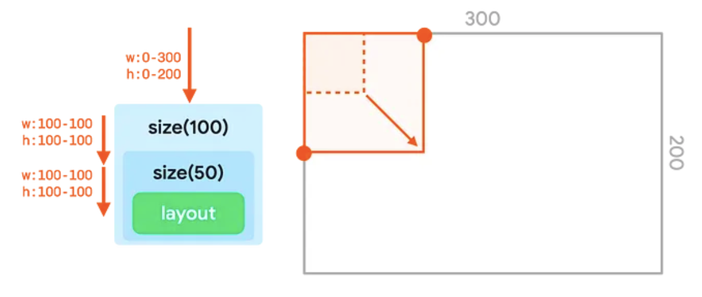
  <p>

```kotlin
@Composable
fun ChainedSizeModifiersExample() {
    Box(
        modifier = Modifier
            .size(300.dp, 200.dp)
            .background(Color.Red)
    ) {
        Box(
            modifier = Modifier
                .size(100.dp)
                .background(Color.White)
                .then(Modifier.size(50.dp))
        ) {
            Text(
                text = "Chained Size",
                color = Color.Black,
            )
        }
    }
}
```

  </p>
</div>

A chain of two size modifiers, in which the second value passed in (50dp) does not override the first value (100dp).

  </p>
</details>

#### `requiredSize` modifier

Use the requiredSize modifier instead of size if you need your node to override the incoming constraints. The requiredSize modifier replaces the incoming constraints and passes the size you specify as exact bounds.

<div style="display: flex; align-items: center;">
  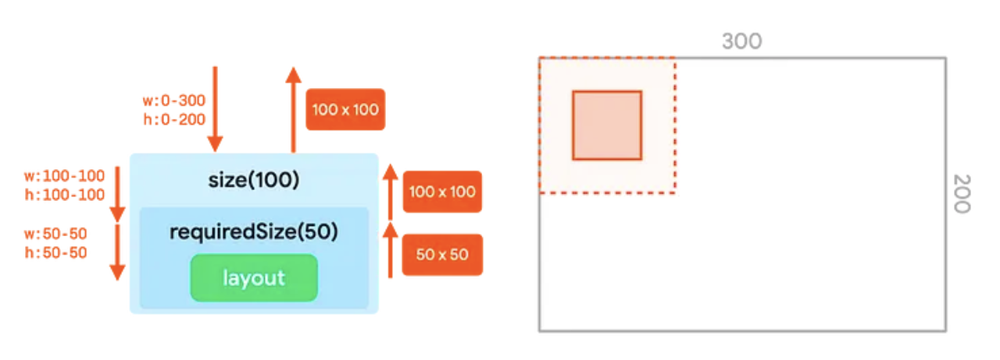
  <p>

```kotlin
@Composable
fun RequiredSizeModifierExample() {
    Box(
        modifier = Modifier
            .size(300.dp, 200.dp)
            .background(Color.Gray)
    ) {
        Box(
            modifier = Modifier
                .size(100.dp)
                .requiredSize(50.dp)
                .background(Color.Red)
        ) {
            Text(
                text = "Hello",
                modifier = Modifier.align(Alignment.Center)
            )
        }
    }
}
```

  </p>
</div>

#### `width` and `height` modifiers


The `size` modifier adapts both the `width` and `height` of the constraints. With the width `modifier`, you can set a fixed `width` but leave the `height` undecided. Similarly, with the `height` `modifier`, you can set a fixed `height`, but leave the `width` undecided:

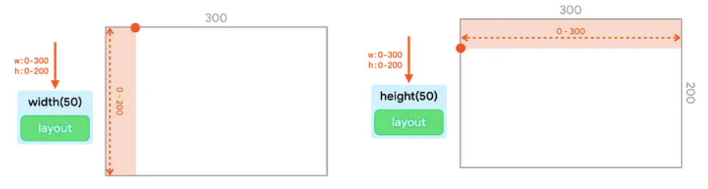


#### `sizeIn` modifier

The sizeIn modifier lets you set exact minimum and maximum constraints for width and height. Use the sizeIn modifier if you need fine-grained control over the constraints.

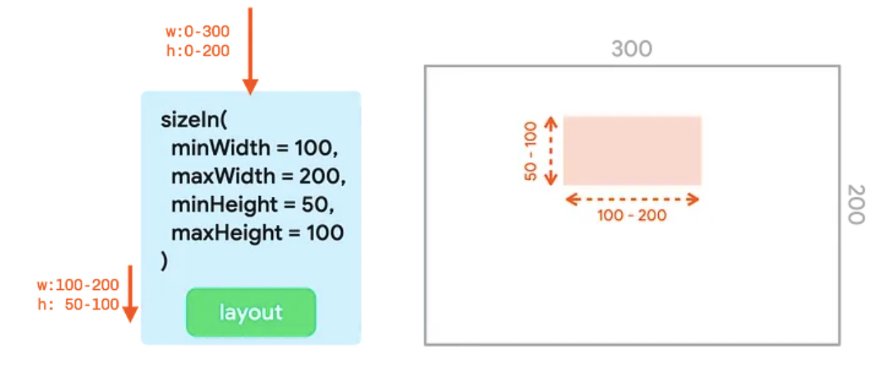