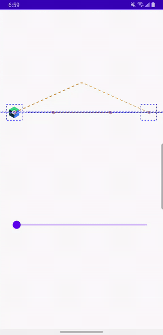

# Constraint Layout

`ConstraintLayout` is a layout that allows you to place composables relative to other composables on the screen. It is an alternative to using multiple nested `Row`, `Column`, `Box` and other custom layout elements. `ConstraintLayout` is useful when implementing larger layouts with more complicated alignment requirements.

**Consider using `ConstraintLayout` in the following scenarios:**

- To avoid nesting multiple Columns and Rows for positioning elements on screen to improve readability of code.
- To position composables relative to other composables or to position composables based on guidelines, barriers or chains.

**In the View system, ConstraintLayout was the recommended way to create large and complex layouts, as a flat view hierarchy was better for performance than nested views are. However, this is not a concern in Compose, which is able to efficiently handle deep layout hierarchies.**

[More info about Constraint Layout](https://developer.android.com/develop/ui/compose/layouts/constraintlayout)


## MotionLayout for Compose takes on

The constraint set can be defined in 2 ways:

1. MotionScenes Inside MotionLayout.
2. JSON5 approach.

Both approaches have their pros and cons.

### Depiction of a MotionScene’s procedure within the MotionLayout

The downside of employing this approach is that as the content grows, it may become baffling.


<details>
  <summary style="color: orange;">
  <b>
  Let's have a look at the example:
  </b>
  </summary>
  
```kotlin
@Composable
fun MyMotionLayout() {
    val motionScene = remember { MotionScene() }

    MotionLayout(
        modifier = Modifier.fillMaxSize(),
        motionScene = motionScene
    ) {
        Box(
            modifier = Modifier
                .constrainAs(box) {
                    start.linkTo(parent.start)
                    top.linkTo(parent.top)
                    end.linkTo(parent.end)
                    bottom.linkTo(parent.bottom)
                }
        ) {
            // Add your UI elements here
        }
    }

    // Define the start and end constraint sets
    motionScene.constraints(
        createConstraints(
            R.id.box,
            start = ConstraintSet {
                // Define your start constraints here
            },
            end = ConstraintSet {
                // Define your end constraints here
            }
        )
    )

    // Define the motion animations
    motionScene.transition(
        createTransition(
            R.id.box,
            fromState = R.id.start,
            toState = R.id.end
        ) {
            // Define your motion animations here
        }
    )
}
```


</details>


### JSON5 approach

The primary approach recommended 

<details>
  <summary style="color: orange;">
  <b>
    Integration example 
  </b>
  </summary>
  
  <p>
  
First off, Create a JSON5 file for the MotionScene at `res/raw/motion_scene.json5`

The structure of the file would be somewhat like this:

```kotlin
{
  ConstraintSets: {
    start: {
      ....
    },
    end: {
      ....
    }
  }
}
```

Here the start contains all the constraints for the initial state of motion, and the end includes constraints for the final state.

Now we have to incorporate JSON5 file content into the compose file.

Using openRawResource you can instantiate your JSON5 file which is residing in the raw folder.

Linking MotionScene objects with appropriate composable can be done this way.

```kotlin
val context = LocalContext.current
val motionScene = remember {
    context.resources
        .openRawResource(R.raw.motion_scene)
        .readBytes()
        .decodeToString()
}

MotionLayout(
    motionScene = MotionScene(content = motionScene),
) { ... }

```


  </p>
</details>

### Expose the MotionScene

MotionScene file consists of the following components:

1. **ConstraintSets**:
- ConstraintSets are the building blocks of a MotionScene. They define the layout and styling properties of the UI elements.
- A ConstraintSet contains a set of constraints, which specify the position, size, margin, padding, and other layout properties of each UI element.

2. **Transitions**:
- Transitions define the animation or transition between two ConstraintSets. They specify the duration, easing, and other animation properties.
- A Transition can contain multiple KeyFrame, which defines the intermediate states of the animation or transition.

3. **KeyFrames**:
- KeyFrames define the intermediate states of a Transition. They specify the properties of the UI elements at specific points in the animation or transition.
-A KeyFrame can contain a set of PropertySets, which specify the properties of the UI elements.

4. **PropertySets**:
- PropertySets specify the properties of the UI elements in a KeyFrame.
- They can contain properties such as position, size, margin, padding, background color, text color, and so on.


### Deep dig into the transformation process

Think of Transitions as a container containing an arbitrary amount of transitions as per necessity.

Each Transition is given a name. The name “default” is special and defines the initial transition.

An illustration of a transition is given below. Take a look at how and what attributes are being used within the Transitions block.


```kotlin
Transitions: {
    default: {
            from: 'start',
            to: 'end',
            pathMotionArc: 'startHorizontal',
            duration: 900
            staggered: 0.4,
            onSwipe: {
                    anchor: 'box1',
                    maxVelocity: 4.2,
                    maxAccel: 3,
                    direction: 'end',
                    side: 'start',
                    mode: 'velocity'
            }
            KeyFrames: {
            KeyPositions: [
                {
                target: ['a'],
                frames: [25, 50, 75],
                percentX: [0.4, 0.8, 0.1],
                percentY: [0.4, 0.8, 0.3]
                }
            ],
            KeyCycles: [
                {
                    target: ['a'],
                    frames: [0, 50, 100],
                    period: [0 , 2 , 0],
                    rotationX: [0, 45, 0],
                    rotationY: [0, 45, 0], 
                }
            ]
        }
    }
}
```

###  Transitions terms 🔎

**from** — id of the ConstraintSet indicating the starting point.
**to** — id of the ConstraintSet to end at.
**duration** — time taken by the transition to happen.
**pathMotionArc** — move in quarter ellipse arcs.
**staggered** — objects move in a staggered fashion. Either based on start position or stagger value.
**onSwipe** — enable drag gestures to control the transition.
**KeyFrames** — modify points between the transitions.

### Some commonly used Transition key attributes

1. **Alpha**:

You can apply alpha property frame-wise within “KeyAttributes” inside the JSON5 script.

```
alpha: [0.3, 0.5, 0.9, 0.5, 0.3]
```

2. **Visibility**:

You can apply this property to the children views which we define as an object within the start and end ConstraintSets.

3. **Scale**:

- To change the scale of the image as it moves? That’s where scaleX and scaleY properties come into the picture.
- ScaleX — To scale an object like an image, per se horizontally.
- ScaleY — To scale an object vertically.
- You can apply scaling properties in the following manner as shown below inside KeyAttributes:

```
scaleX: [1, 2, 2.5, 2, 1],
scaleY: [1, 2, 2.5, 2, 1]
```

4. **Elevation**:

It provides elevation which is self-explanatory, right!

5. **Rotation**:

- **rotationX** — To rotate/flip/twirl an object on X-axis.
- **rotationY** — To rotate/flip/twirl an object on Y-axis.

6. **Translation**:

It enables you to control the positioning of the View on a different axis.
- **translationX** — For horizontal positioning.
- **translationY** — For vertical positioning.
- **translationZ** — Transition value is added to its elevation.

7. **Custom properties**:

Compose offers a range of custom properties that can be used to achieve additional customization in your UI. However, it’s important to note that these properties need to be extracted and set manually.

Typical custom property set:

```
custom: {
    background: '#0000FF',
    textColor: '#FFFFFF',
    textSize: 12
}
```

### Debug animation paths

To ensure precise animation MotionLayout provides a debugging facility that would exhibit the animation paths of all the components involved.

To enable debugging we simply can do that with the “debug” parameter.

Note that by default the debug value is set to **EnumSet.of(MotionLayoutDebugFlags.NONE)**



Here you can see that the paths are denoted by a dotted line.

These dotted lines would come to the rescue especially when you are dealing with complex animation while seeking precision and consistency across devices with different sizes and resolutions.