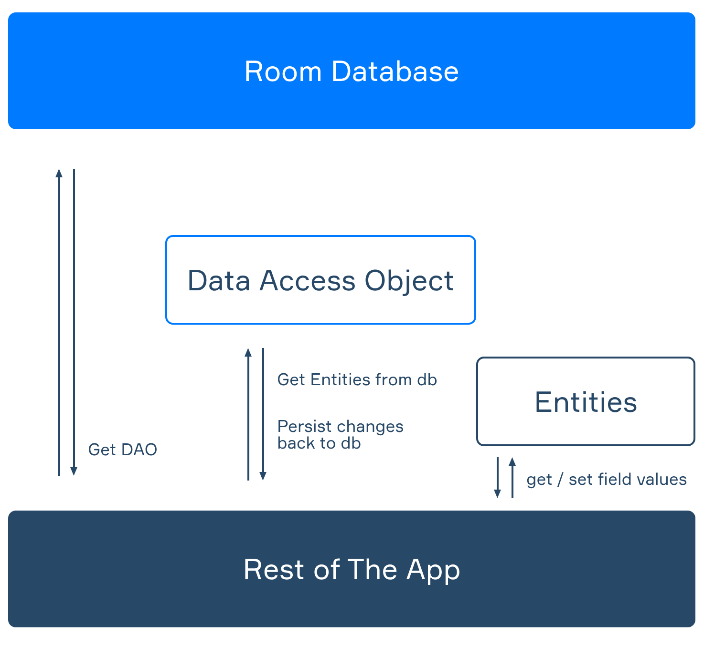

# Room

You have already seen how to work with **SQLite** in Android using the SQLiteOpenHelper. This is a universal approach that can be used in any situation, but it sometimes creates a lot of boilerplate code.

To address these kinds of issues, Google provides a set of special Jetpack libraries. They are designed to make life easier by helping developers follow best practices, avoid various bugs, and achieve the desired results with fewer lines of code.

**Room** is part of this framework. It's a high-level interface for low-level bindings to SQLite.

## Benefits

Room is an **ORM** (Object-relational mapping) library for Android.

> [!NOTE]
> ORM is a programming technique that makes it possible to convert data from an OOP language into the format used by a relational database and vice versa. So, ORM is the link between the database and the code. It allows us to insert objects created in the program into the database, get them, perform operations with them, and so on.

As mentioned, Room reduces the number of lines we need to write. It creates an abstraction over SQLite to make accessing the database easier, and its annotations help simplify the code.

Room performs SQL query checks at compile-time, too. This can help to pick up errors before an application is launched. For example, **without these checks, if you write the wrong column name in your query using the standard SQLite API, you will get an error at run-time instead of compile-time.**

## Room components



To use Room, we must implement the `Database`, `Dao`, and `Entity` components.

## Entity

The first step towards achieving our goal is implementing `Entity`.
This is simply a class that reflects a database table:

```kotlin
@Entity(tableName = "people")
data class Person(
        @ColumnInfo(name = "name") var name: String,
        @ColumnInfo(name = "age") var age: Int,
        @PrimaryKey(autoGenerate = true) var id: Int = 0
)
```
We tag the `Person` class with the Room library's `@Entity` annotation. 
In the annotation's parameters, we specify the name of the table `people`. We want to make the `id` property the table's **primary key** and use the `@PrimaryKey` annotation with `autoGenerate = true` in the parameters to make it autoincrement.
Otherwise, we won't have an automatically incremented `PRIMARY KEY` property in the database, and we know that it must be unique.
The `@ColumnInfo(name = "name")` annotation is used to specify the column name if we want it to be different from the property name. In our case, the names are the same, meaning that we could remove this line. The `@Ignore` annotation can be utilized to indicate a constructor or property that should not be used when working with the database.

## Database

Next, we create an abstract class based on `RoomDatabase`. In the annotation parameters, we specify the version of our database and entity classes:

```kotlin
@Database(entities = [Person::class], version = 1)
abstract class AppDatabase : RoomDatabase() {
    abstract fun getPersonDao(): PersonDao
}
```
If we wanted to use multiple classes to store data, we would pass them separated by commas in square brackets.

`RoomDatabase` objects are very expensive, so we implement access to them via the `Application` class.
This is known as a singleton design pattern.

To refer to the application object that is responsible for the application as a whole, we must specify this class in the manifest:

```xml
<application
        android:name=".YourApplication"
```


In `Room.databaseBuilder` we pass the application context (`this` because our class inherits from the `Application`), our abstract class itself, and the name of the SQLite database file to be created:

```kotlin
class SomeApplication : Application() {
    val database: AppDatabase by lazy {
        Room.databaseBuilder(
            this,
            AppDatabase::class.java,
            "database.db"
        ).build()
    }
}
```

> [!CAUTION]
> It's important to know that Room does not allow you to perform operations in the main thread! Attempting to do this will result in the following error: java.lang.IllegalStateException: Cannot access database on the main thread since it may potentially lock the UI for a long period of time.

for the testing situation you can use `.allowMainThreadQueries()` to without above warning.
Example:

```kotlin
        Room.databaseBuilder(
            this,
            AppDatabase::class.java,
            "database.db"
        ).allowMainThreadQueries().build()
```

Room will generate the required code for us if we follow the necessary instructions. We have already created the `getPersonDao` function that will return `PersonDao`.

## DAO

A **DAO** (data access object) is responsible for defining methods that allow you to interact with the database. This is an interface, and we label it `@Dao`.

Inside, we define various functions (CRUD and more).
We mark them with the corresponding annotations and Room does the rest.

Room doesn't provide built-in annotations for every use case.
When there isn't a specific annotation.
we can use `@Query` and pass it an SQL query.

For example, `deleteAll()` will delete all the data in the database, `getAllPeople()` will return every record, and `getPeopleWithAge(age: Int)` will return users of a certain age:

```kotlin
@Dao
interface PersonDao {
    @Insert
    fun insert(vararg people: Person)

    @Delete
    fun delete(person: Person)

    @Query("DELETE FROM people")
    fun deleteAll()

    @Query("SELECT * FROM people")
    fun getAllPeople(): List<Person>

    @Query("SELECT * FROM people WHERE age = :age")
    fun getPeopleWithAge(age: Int): List<Person>

    @Query("SELECT * FROM people WHERE name LIKE :prefix || '%'")
    fun getPeopleWhereNameStartsWith(prefix: String): List<Person>

    @Query("SELECT name FROM people")
    fun getNames(): List<String>

    @Query("SELECT name as first, age as second FROM people")
    fun getPairs(): List<StringIntPair>
}
```

`getPairs()` shows how to return the values of the custom class `StringIntPair`, whose field names match the aliases of the column names we picked with the `SELECT` operation:

```kotlin
data class StringIntPair(val first: String, var second: Int)
```
With our interface defined, all we have to do now is inject our database instance in Your Activity.


