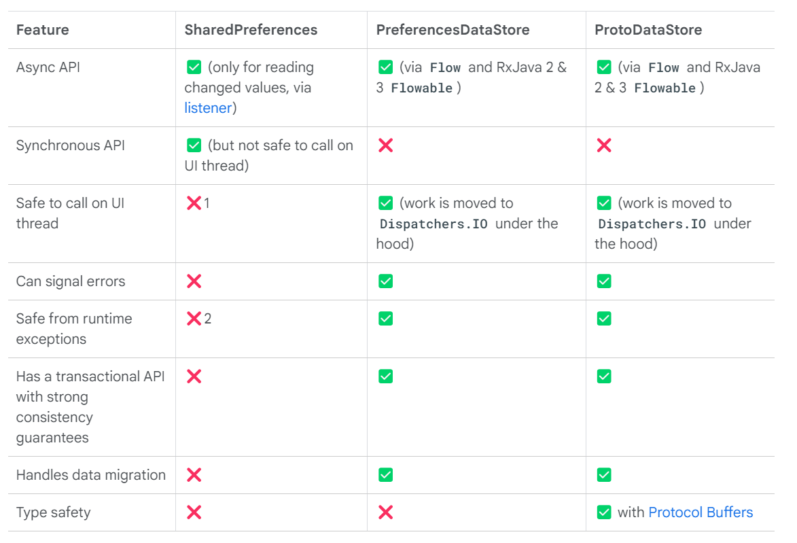

# DataStore

Jetpack `DataStore` is a data storage solution that allows you to **store key-value pairs or typed objects** with protocol buffers. 

> [!NOTE]
> Protocol Buffers are language-neutral (independent with language), platform-neutral extensible mechanisms for serializing structured data

`DataStore` uses Kotlin coroutines and `Flow` to store data asynchronously, consistently, and transactionally.

> [!TIP]
> If you're currently using `SharedPreferences` to store data, consider migrating to `DataStore` instead.
> If you need to support large or complex datasets, partial updates, or referential integrity, consider using `Room` instead of `DataStore`. 
> `DataStore` is ideal for small, simple datasets and does not support partial updates or referential integrity.

## Preferences DataStore and Proto DataStore

`DataStore` provides two different implementations:

- **Preferences DataStore** stores and accesses data using keys. 
This implementation does not require a predefined schema, and it does not provide type safety.

- **Proto DataStore** stores data as instances of a custom data type. 
This implementation requires you to define a schema using protocol buffers, but it provides type safety.

## Use DataStore in synchronous code

> [!CAUTION]
> Avoid blocking threads on `DataStore` data reads whenever possible. 
> Blocking the UI thread can cause ANRs or UI jank, and blocking other threads can result in deadlock.

One of the primary benefits of `DataStore` is the asynchronous API, 
but it may not always be feasible to change your surrounding code to be asynchronous.

If you really need the synchronous code to read the data:

- Restrict its scope to the closest lifecycle coroutine, if not manage it lifecycle manually.
- You can use `runBlocking()` to read data from DataStore synchronously (not recommend, Because performing synchronous I/O operations on the UI thread can cause ANRs or UI jank)

### The feature matrix

## Reference

- [Data store](https://developer.android.com/topic/libraries/architecture/datastore)
- [Codelab](https://developer.android.com/codelabs/android-preferences-datastore)

