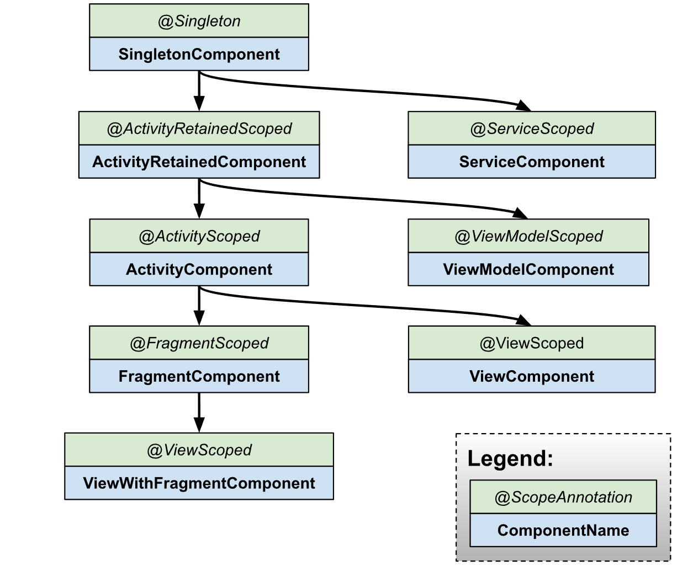

# Hilt

Hilt is a dependency injection library for Android that reduces the boilerplate of doing manual dependency injection in your project.

## Hilt application class

All apps that use Hilt must contain an Application class that is annotated with `@HiltAndroidApp`.

`@HiltAndroidApp` triggers Hilt's code generation, including a base class for your application that serves as the application-level dependency container.

This generated Hilt component is attached to the Application object's lifecycle and provides dependencies to it. Additionally, it is the parent component of the app, which means that other components can access the dependencies that it provides.

## Inject dependencies into Android classes

Once Hilt is set up in your `Application` class and an application-level component is available, Hilt can provide dependencies to other Android classes that have the `@AndroidEntryPoint` annotation:

```kotlin
@AndroidEntryPoint
class ExampleActivity : AppCompatActivity() { ... }
```

Hilt currently supports the following Android classes:

- Application (by using `@HiltAndroidApp`)
- ViewModel (by using `@HiltViewModel`)
- Activity
- Fragment
- View
- Service
- BroadcastReceiver


> [!NOTE]
> If you annotate an Android class with `@AndroidEntryPoint`, then you also must annotate Android classes that depend on it. For example, if you annotate a fragment, then you must also annotate any activities where you use that fragment.

> [!WARNING]
> The following exceptions apply to Hilt support for Android classes:
> Hilt only supports activities that extend `ComponentActivity`, such as `AppCompatActivity`.
> Hilt only supports fragments that extend `androidx.Fragment`.


`@AndroidEntryPoint` generates an individual Hilt component for each Android class in your project.

These components can receive dependencies from their respective parent classes as described in **Component hierarchy**.


To obtain dependencies from a component, use the `@Inject` annotation to perform field injection:

```kotlin
@AndroidEntryPoint
class ExampleActivity : AppCompatActivity() {

  @Inject lateinit var analytics: AnalyticsAdapter
  ...
}
```

> [!NOTE]
> Classes that Hilt injects can have other base classes that also use injection. Those classes don't need the `@AndroidEntryPoint` annotation if they're abstract class.


## Define Hilt bindings

A binding contains the information necessary to provide instances of a type as a dependency.

One way to provide binding information to Hilt is **constructor injection**. 
Use the `@Inject` annotation on the constructor of a class to tell Hilt how to provide instances of that class:

```kotlin
class AnalyticsAdapter @Inject constructor(
  private val service: AnalyticsService
) { ... }
```

The parameters of an annotated constructor of a class are the dependencies of that class. 
In the example, `AnalyticsAdapter` has `AnalyticsService` as a dependency. 
Therefore, Hilt must also know how to provide instances of `AnalyticsService`.

At build time, Hilt generates Dagger components for Android classes. 
Then, Dagger walks through your code and performs the following steps:

- Builds and validates dependency graphs, ensuring that there are no unsatisfied dependencies and no dependency cycles.
- Generates the classes that it uses at runtime to create the actual objects and their dependencies.

## Hilt modules

### 1. Usage reason

Sometimes a type cannot be constructor-injected. This can happen for multiple reasons. 

For example, you cannot constructor-inject an interface. You also cannot constructor-inject a type that you do not own, such as a class from an external library. 

In these cases, you can provide Hilt with binding information by using Hilt modules.

### 2. Integration

A Hilt module is a class that is annotated with `@Module`.
It informs Hilt how to provide instances of certain types.
you must annotate Hilt modules with `@InstallIn` to tell Hilt which Android class each module will be used or installed in.

### Inject interface instances with @Binds
 
Consider the `AnalyticsService` example. If `AnalyticsService` is an interface, then you cannot constructor-inject it. 
Instead, provide Hilt with the binding information by creating an abstract function annotated with `@Binds` inside a Hilt module.

The `@Binds` annotation tells Hilt which implementation to use when it needs to provide an instance of an interface.

```kotlin
interface AnalyticsService {
  fun analyticsMethods()
}

// Constructor-injected, because Hilt needs to know how to
// provide instances of AnalyticsServiceImpl, too.
class AnalyticsServiceImpl @Inject constructor(
  ...
) : AnalyticsService { ... }

@Module
@InstallIn(ActivityComponent::class)
abstract class AnalyticsModule {

  @Binds
  abstract fun bindAnalyticsService(
    analyticsServiceImpl: AnalyticsServiceImpl
  ): AnalyticsService
}
```

The annotated function provides the following information to Hilt:

- The function return type tells Hilt what interface the function provides instances of.
- The function parameter tells Hilt which implementation to provide.

The Hilt module AnalyticsModule is annotated with `@InstallIn(ActivityComponent.class)` because you want Hilt to inject that dependency into `ExampleActivity`. This annotation means that all of the dependencies in `AnalyticsModule` are available in all of the app's activities.

### Inject instances with @Provides

Constructor injection is also not possible if you don't own the class because it comes from an external library 
(classes like `Retrofit`, `OkHttpClient`, or `Room` databases), or if instances must be created with the builder pattern.

Consider the previous example. 
If you don't directly own the `AnalyticsService` class, 
you can tell Hilt how to provide instances of this type by creating a function inside a Hilt module and annotating that function with `@Provides`.

The annotated function supplies the following information to Hilt:

- The function return type tells Hilt what type the function provides instances of.
- The function parameters tell Hilt the dependencies of the corresponding type.
- The function body tells Hilt how to provide an instance of the corresponding type. Hilt executes the function body every time it needs to provide an instance of that type.

Example:
```kotlin
@Module
@InstallIn(ActivityComponent::class)
object AnalyticsModule {

  @Provides
  fun provideAnalyticsService(
    // Potential dependencies of this type
  ): AnalyticsService {
      return Retrofit.Builder()
               .baseUrl("https://example.com")
               .build()
               .create(AnalyticsService::class.java)
  }
}
```

### Provide multiple bindings for the same type

In cases where you need Hilt to provide different implementations of the same type as dependencies, you must provide Hilt with multiple bindings. 
You can define multiple bindings for the same type with   qualifiers.


A qualifier is an annotation that you use to identify a specific binding for a type when that type has multiple bindings defined.

```kotlin
@Qualifier
@Retention(AnnotationRetention.BINARY)
annotation class AuthInterceptorOkHttpClient

@Qualifier
@Retention(AnnotationRetention.BINARY)
annotation class OtherInterceptorOkHttpClient
```


Then, Hilt needs to know how to provide an instance of the type that corresponds with each qualifier. 
In this case, you could use a Hilt module with `@Provides`. 
Both methods have the same return type, but the qualifiers label them as two different bindings:


```kotlin
@Module
@InstallIn(SingletonComponent::class)
object NetworkModule {

  @AuthInterceptorOkHttpClient
  @Provides
  fun provideAuthInterceptorOkHttpClient(
    authInterceptor: AuthInterceptor
  ): OkHttpClient {
      return OkHttpClient.Builder()
               .addInterceptor(authInterceptor)
               .build()
  }

  @OtherInterceptorOkHttpClient
  @Provides
  fun provideOtherInterceptorOkHttpClient(
    otherInterceptor: OtherInterceptor
  ): OkHttpClient {
      return OkHttpClient.Builder()
               .addInterceptor(otherInterceptor)
               .build()
  }
}
```

You can inject the specific type that you need by annotating the field or parameter with the corresponding qualifier:

```kotlin
// As a dependency of another class.
@Module
@InstallIn(ActivityComponent::class)
object AnalyticsModule {

  @Provides
  fun provideAnalyticsService(
    @AuthInterceptorOkHttpClient okHttpClient: OkHttpClient
  ): AnalyticsService {
      ....
  }
}

// As a dependency of a constructor-injected class.
class ExampleServiceImpl @Inject constructor(
  @AuthInterceptorOkHttpClient private val okHttpClient: OkHttpClient
) : ...

// At field injection.
@AndroidEntryPoint
class ExampleActivity: AppCompatActivity() {

  @AuthInterceptorOkHttpClient
  @Inject lateinit var okHttpClient: OkHttpClient
}
```
### Predefined qualifiers in Hilt

Hilt provides some predefined qualifiers. 
For example, as you might need the Context class from either the application or the activity, Hilt provides the `@ApplicationContext` and `@ActivityContext` qualifiers.

## Generated components for Android classes

For each Android class in which you can perform field injection, there's an associated Hilt component that you can refer to in the `@InstallIn` annotation. 
Each Hilt component is responsible for injecting its bindings into the corresponding Android class.


| Hilt component                | Injector for                              |
|-------------------------------|--------------------------------------------|
| SingletonComponent            | Application                               |
| ActivityRetainedComponent     | N/A                                       |
| ViewModelComponent            | ViewModel                                 |
| ActivityComponent             | Activity                                  |
| FragmentComponent             | Fragment                                  |
| ViewComponent                 | View                                      |
| ViewWithFragmentComponent     | View annotated with @WithFragmentBindings  |
| ServiceComponent              | Service                                   |


> [!NOTE]
> Hilt doesn't generate a component for broadcast receivers because Hilt injects broadcast receivers directly from SingletonComponent.

### Component lifetimes

Hilt automatically creates and destroys instances of generated component classes following the lifecycle of the corresponding Android classes.


| Generated component           | Created at                  | Destroyed at           |
|------------------------------|-----------------------------|------------------------|
| SingletonComponent           | Application#onCreate()      | Application destroyed  |
| ActivityRetainedComponent    | Activity#onCreate()         | Activity#onDestroy()   |
| ViewModelComponent           | ViewModel created           | ViewModel destroyed    |
| ActivityComponent            | Activity#onCreate()         | Activity#onDestroy()   |
| FragmentComponent            | Fragment#onAttach()         | Fragment#onDestroy()   |
| ViewComponent                | View#super()                | View destroyed         |
| ViewWithFragmentComponent    | View#super()                | View destroyed         |
| ServiceComponent             | Service#onCreate()          | Service#onDestroy()    |

> [!NOTE]
> ActivityRetainedComponent lives across configuration changes, so it is created at the first `Activity#onCreate()` and destroyed at the last `Activity#onDestroy()`.

## Component scopes

By default, all bindings in Hilt are unscoped. 
This means that each time your app requests the binding, Hilt creates a new instance of the needed type.

However, Hilt also allows a binding to be scoped to a particular component. 

**Hilt only creates a scoped binding once per instance of the component that the binding is scoped to, and all requests for that binding share the same instance.**


| Android class                       | Generated component           | Scope                   |
|-------------------------------------|------------------------------|-------------------------|
| Application                        | SingletonComponent           | @Singleton              |
| Activity                           | ActivityRetainedComponent    | @ActivityRetainedScoped |
| ViewModel                          | ViewModelComponent           | @ViewModelScoped        |
| Activity                           | ActivityComponent            | @ActivityScoped         |
| Fragment                           | FragmentComponent            | @FragmentScoped         |
| View                               | ViewComponent                | @ViewScoped             |
| View annotated with @WithFragmentBindings | ViewWithFragmentComponent | @ViewScoped             |
| Service                            | ServiceComponent             | @ServiceScoped          |


> [!WARNING]
> Using a scope for a dependency (such as `@Singleton` or `@ActivityRetainedScoped`) can use up more memory, because the object will stay in memory until its component is destroyed. 
> You should avoid using scopes unless necessary.
> Only use scoped bindings when:
> - The object has internal state that needs to be reused within a certain scope.
> - The object needs to be shared and synchronized across different places.
> - The object is expensive or slow to create.

## Component hierarchy

Installing a module into a component allows its bindings to be accessed as a dependency of other bindings in that component or in any child component below it in the component hierarchy:



## Inject dependencies in classes not supported by Hilt

Hilt comes with support for the most common Android classes. 
However, you might need to perform field injection in classes that Hilt doesn't support.

For example, Hilt doesn't directly support content providers. 
If you want a content provider to use Hilt to get some dependencies, you need to define an interface that is annotated with `@EntryPoint` for each binding type that you want and include qualifiers.
Then add `@InstallIn` to specify the component in which to install the entry point as follows:


```kotlin
class ExampleContentProvider : ContentProvider() {

  @EntryPoint
  @InstallIn(SingletonComponent::class)
  interface ExampleContentProviderEntryPoint {
    fun analyticsService(): AnalyticsService
  }

  ...
}
```


To access an entry point, use the appropriate static method from `EntryPointAccessors`

```kotlin
class ExampleContentProvider: ContentProvider() {
    ...

  override fun query(...): Cursor {
    val appContext = context?.applicationContext ?: throw IllegalStateException()
    val hiltEntryPoint =
      EntryPointAccessors.fromApplication(appContext, ExampleContentProviderEntryPoint::class.java)

    val analyticsService = hiltEntryPoint.analyticsService()
    ...
  }
}
```

## Hilt and Dagger

Because the Android operating system instantiates many of its own framework classes, using Dagger in an Android app requires you to write a substantial amount of boilerplate.

Hilt reduces the boilerplate code that is involved in using Dagger in an Android application. 

Hilt automatically generates and provides the following:

- **Components for integrating Android framework classes** with Dagger that you would otherwise need to create by hand.
- **Scope annotations** to use with the components that Hilt generates automatically.
- **Predefined bindings** to represent Android classes such as `Application` or `Activity`.
- **Predefined qualifiers** to represent `@ApplicationContext` and `@ActivityContext`.


