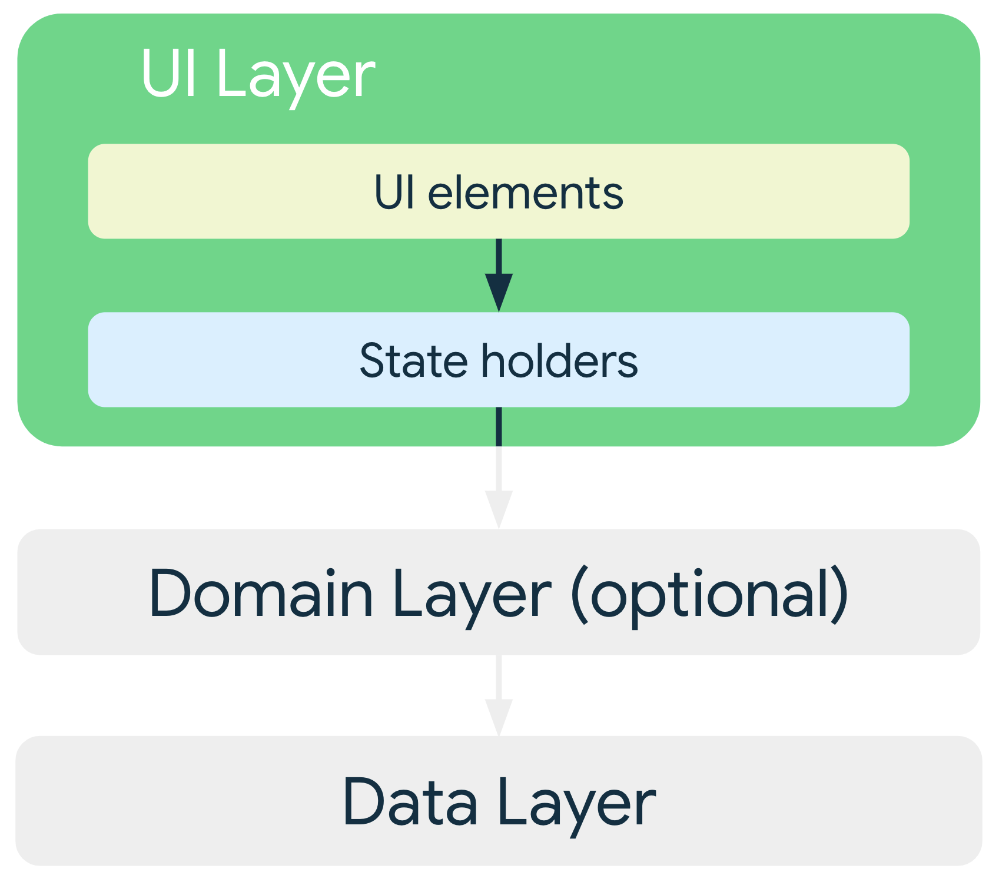
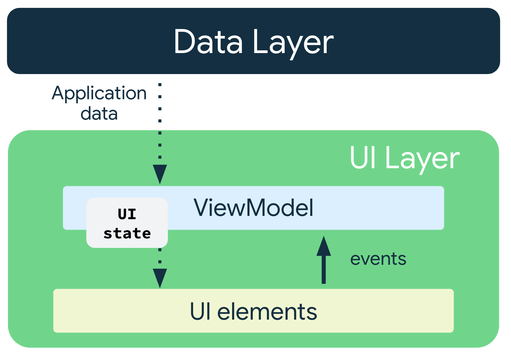

# UI layer

The role of the UI layer (or presentation layer) is to display the application data on the screen. The term UI refers to UI elements such as activities and fragments that display the data, independent of what APIs they use to do this (Views or Jetpack Compose).

Whenever the data changes, either due to user interaction (such as pressing a button) or external input (such as a network response), the UI should update to reflect the changes.

The UI layer is made up of two things:
- UI elements that render the data on the screen. You build these elements using Views or Jetpack Compose functions.
- State holders (such as `ViewModel` classes) that hold data, expose it to the UI, and handle logic.



The UI layer must perform the following steps:
- Consume app data and transform it into data the UI can easily render.
- Consume UI-renderable data and transform it into UI elements for presentation to the user.
- Consume user input events from those assembled UI elements and reflect their effects in the UI data as needed.
- Repeat steps 1 through 3 for as long as necessary.

## Define UI state

The UI is what the user sees, the UI state is what the app says they should see


Consider the case study; in order to fulfill the News app's requirements,
the information required to fully render the UI can be encapsulated in a `NewsUiState` data class defined as follows:

```kotlin
data class NewsUiState(
    val isSignedIn: Boolean = false,
    val isPremium: Boolean = false,
    val newsItems: List<NewsItemUiState> = listOf(),
    val userMessages: List<Message> = listOf()
)

data class NewsItemUiState(
    val title: String,
    val body: String,
    val bookmarked: Boolean = false,
    ...
)
```

## Immutability

Immutable UI state ensures consistency by providing a single source of truth at any moment. 
The UI should only read and display state, not modify it unless it is the sole data source. 
Modifying state directly in the UI can cause inconsistencies and bugs.
Using immutable data classes helps prevent such issues by avoiding multiple sources of truth.

> [!TIP]
> Only sources or owners of data should be responsible for updating the data they expose.

### Naming conventions in this guide

The convention is as follows:

`functionality + UiState`.

For example, the state of a screen displaying news might be called `NewsUiState`,
and the state of a news item in a list of news items might be a `NewsItemUiState`.

## Manage state with Unidirectional Data Flow

Instead of handling these changes directly in the UI, a mediator should process interactions, apply logic, and update the data sources accordingly.

This is where Unidirectional Data Flow (UDF) comes in—an architectural pattern that enforces a structured approach to managing state changes while keeping the UI focused on its core responsibility.

### State holders

The classes that are responsible for the production of UI state and contain the necessary logic for that task are called state holders.

the typical implementation is an instance of a `ViewModel`,
It provides access to the data layer, handles UI events, and produces updated states.
Additionally, it survives configuration changes, ensuring data persistence across events like screen rotations.

The interaction between the UI and its `ViewModel` class can largely be understood as **event input** and its ensuing **state output**, the relationship can be represented as shown in the following diagram:



The pattern where the state flows down and the events flow up is called a unidirectional data flow (UDF). 
The implications of this pattern for app architecture are as follows:

- The `ViewModel` holds and exposes the state to be consumed by the `UI`. The `UI` state is application data transformed by the `ViewModel`.
- The `UI` notifies the `ViewModel` of user events.
- The `ViewModel` handles the user actions and updates the state.
- The updated state is fed back to the `UI` to render.
- The above is repeated for any event that causes a mutation of state.

## Expose UI state

Because you're using UDF to manage the production of state, you can consider the produced state to be a stream.
As a result, you should expose the UI state in an observable data holder like LiveData or StateFlow.
The reason for this is so that the UI can react to any changes made in the state without having to manually pull data directly from the `ViewModel`.

```kotlin
class NewsViewModel(
    private val repository: NewsRepository,
    ...
) : ViewModel() {

    private val _uiState = MutableStateFlow(NewsUiState())
    val uiState: StateFlow<NewsUiState> = _uiState.asStateFlow()

    private var fetchJob: Job? = null

    fun fetchArticles(category: String) {
        fetchJob?.cancel()
        fetchJob = viewModelScope.launch {
            try {
                val newsItems = repository.newsItemsForCategory(category)
                _uiState.update {
                    it.copy(newsItems = newsItems)
                }
            } catch (ioe: IOException) {
                // Handle the error and notify the UI when appropriate.
                _uiState.update {
                    val messages = getMessagesFromThrowable(ioe)
                    it.copy(userMessages = messages)
                 }
            }
        }
    }
}
```
### Additional considerations

In addition to the previous guidance, consider the following when exposing UI state:
- A UI state object should handle states that are related to each other. some business logic may require a combination of sources.

```kotlin
data class NewsUiState(
    val isSignedIn: Boolean = false,
    val isPremium: Boolean = false,
    val newsItems: List<NewsItemUiState> = listOf()
)

val NewsUiState.canBookmarkNews: Boolean get() = isSignedIn && isPremium
```
In this declaration, the visibility of the bookmark button is a derived property of two other properties.
- The decision to expose UI state as a single stream or multiple streams depends on the relationship between the emitted data items.
  - Single Stream, Ensures data consistency and convenience by providing the latest UI state at any instant. Consumers always receive a complete and updated state.
  - Multiple Streams
    - **Unrelated Data Types**, If some UI states are completely independent, bundling them together may be inefficient.
    - **UI State Diffing**, The more fields there are in a `UiState` object, the more likely it is that the stream will emit as a result of one of its fields being updated. Because views don't have a diffing mechanism to understand whether consecutive emissions are different or the same, every emission causes an update to the view. This means that mitigation using the Flow APIs or methods like `distinctUntilChanged()` on the `LiveData` might be necessary.

## Consume UI state

When consuming observable data holders in the UI, make sure you take the lifecycle of the UI into consideration.
This is important because the UI shouldn’t be observing the UI state when the view isn’t being displayed to the user

When using `LiveData`, the `LifecycleOwner` implicitly takes care of lifecycle concerns. When using flows, it's best to handle this with the appropriate coroutine scope and the `repeatOnLifecycle` API:

```kotlin
class NewsActivity : AppCompatActivity() {

    private val viewModel: NewsViewModel by viewModels()

    override fun onCreate(savedInstanceState: Bundle?) {
        ...

        lifecycleScope.launch {
            repeatOnLifecycle(Lifecycle.State.STARTED) {
                viewModel.uiState.collect {
                    // Update UI elements
                }
            }
        }
    }
}
```
### Show in-progress operations

```kotlin
data class NewsUiState(
    val isFetchingArticles: Boolean = false,
    ...
)
```

```kotlin
class NewsActivity : AppCompatActivity() {

    private val viewModel: NewsViewModel by viewModels()

    override fun onCreate(savedInstanceState: Bundle?) {
        ...

        lifecycleScope.launch {
            repeatOnLifecycle(Lifecycle.State.STARTED) {
                // Bind the visibility of the progressBar to the state
                // of isFetchingArticles.
                viewModel.uiState
                    .map { it.isFetchingArticles }
                    .distinctUntilChanged()
                    .collect { progressBar.isVisible = it }
            }
        }
    }
}
```


