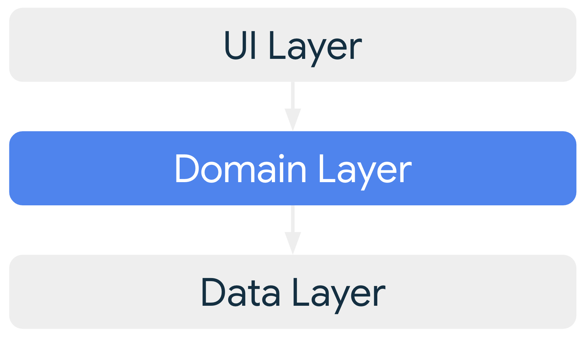
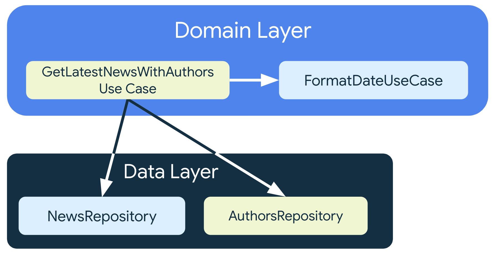

# Domain layer

The domain layer is responsible for encapsulating complex business logic, or simple business logic that is reused by multiple `ViewModels`.
This layer is optional because not all apps will have these requirements.
You should use it only when needed



Classes in this layer are commonly called **use cases** or **interactors**. **Each use case should have responsibility over a single functionality**.


A domain layer provides the following benefits:

- It avoids code duplication.
- It improves readability in classes that use domain layer classes.
- It improves the testability of the app.
- It avoids large classes by allowing you to split responsibilities.

## Naming conventions in this guide

The convention is as follows:

`verb in present tense + noun/what (optional) + UseCase`

## Dependencies

In a typical app architecture, use case classes fit between `ViewModels` from the `UI` layer and `Repositories` from the `Data` layer.
This means that use case classes usually depend on `Repository` classes, and they communicate with the `UI` layer the same way `Repositories` do

```kotlin
class GetLatestNewsWithAuthorsUseCase(
  private val newsRepository: NewsRepository,
  private val authorsRepository: AuthorsRepository
) { /* ... */ }
```

Because use cases contain reusable logic, they can also be used by other use cases. It's normal to have multiple levels of use cases in the domain layer. 

```kotlin
class GetLatestNewsWithAuthorsUseCase(
  private val newsRepository: NewsRepository,
  private val authorsRepository: AuthorsRepository,
  private val formatDateUseCase: FormatDateUseCase
) { /* ... */ }
```



## Call use cases in Kotlin

In Kotlin, you can make use case class instances callable as functions by defining the `invoke()` function with the `operator` modifier. See the following example:

```kotlin
class FormatDateUseCase(userRepository: UserRepository) {

    private val formatter = SimpleDateFormat(
        userRepository.getPreferredDateFormat(),
        userRepository.getPreferredLocale()
    )

    operator fun invoke(date: Date): String {
        return formatter.format(date)
    }
}
```

You can also overload `invoke()` with different signatures in your class. You'd call the use case from the example above as follows:

```kotlin
class MyViewModel(formatDateUseCase: FormatDateUseCase) : ViewModel() {
    init {
        val today = Calendar.getInstance()
        val todaysDate = formatDateUseCase(today)
        /* ... */
    }
}
```

## Lifecycle

Use cases don't have their own lifecycle. Instead, they're scoped to the class that uses them.
This means that you can call use cases from classes in the UI layer, from services, or from the Application class itself.
Because use cases shouldn't contain mutable data, you should create a new instance of a use case class every time you pass it as a dependency.

## Threading

Use cases from the domain layer must be safe to call from the main thread.
If use case classes perform long-running blocking operations, they are responsible for moving that logic to the appropriate thread.

The following example shows a use case that performs its work on a background thread:

```kotlin
class GetLatestNewsWithAuthorsUseCase(
  private val newsRepository: NewsRepository,
  private val authorsRepository: AuthorsRepository,
  private val defaultDispatcher: CoroutineDispatcher = Dispatchers.Default
) {
    suspend operator fun invoke(): List<ArticleWithAuthor> =
        withContext(defaultDispatcher) {
            val news = newsRepository.fetchLatestNews()
            val result: MutableList<ArticleWithAuthor> = mutableListOf()
            // This is not parallelized, the use case is linearly slow.
            for (article in news) {
                // The repository exposes suspend functions
                val author = authorsRepository.getAuthor(article.authorId)
                result.add(ArticleWithAuthor(article, author))
            }
            result
        }
}
```

## Common tasks

- **Reusable simple business logic**, You should encapsulate repeatable business logic present in the UI layer in a use case class. This makes it easier to apply any changes everywhere the logic is used. It also allows you to test the logic in isolation.

- **Combine repositories**
- **Other consumers**, Apart from the UI layer, the domain layer can be reused by other classes such as `Services` and the `Application` class. Furthermore, if other platforms such as TV or Wear share codebase with the mobile app, their UI layer can also reuse use cases to get all the aforementioned benefits of the domain layer.
- **Data layer access restriction**, An advantage of making this restriction is that it stops your UI from bypassing domain layer logic


