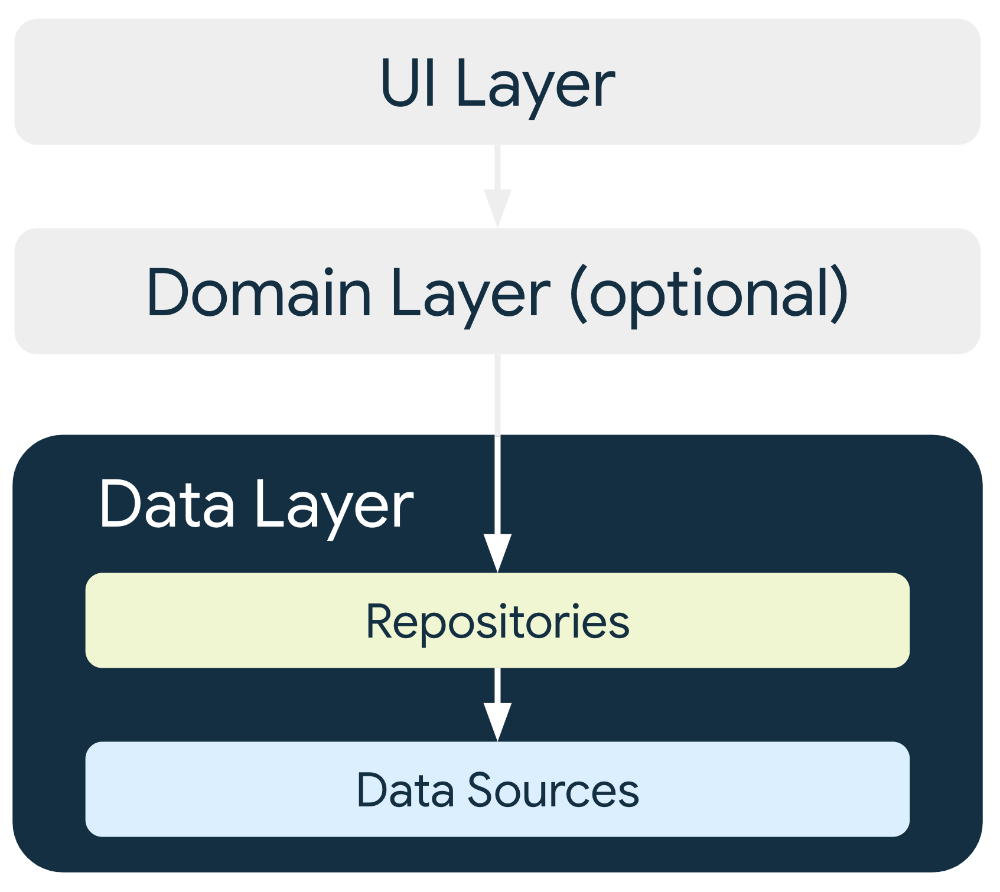
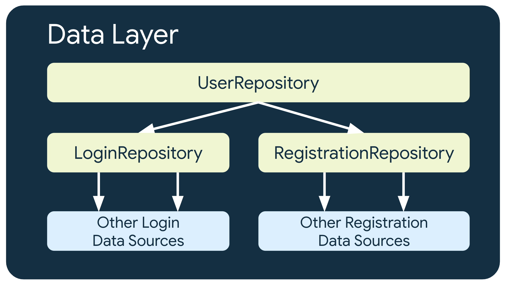

# Data layer

The data layer of an app contains the business logic.
The business logic is what gives value to your app—it's made of rules that determine how your app creates, stores, and changes data.

The data layer is made of repositories that each can contain zero to many data sources. 
You should create a repository class for each different type of data you handle in your app.
For example, you might create a MoviesRepository class for data related to movies, or a PaymentsRepository class for data related to payments.



Repository classes are responsible for the following tasks:

- Exposing data to the rest of the app.
- Centralizing changes to the data.
- Abstracting sources of data from the rest of the app.
- Containing business logic.


Each data source class should have the responsibility of working with only one source of data, which can be a file, a network source, or a local database.
Data source classes are the bridge between the application and the system for data operations.

**The data exposed by this layer should be immutable** so that it cannot be tampered with by other classes, which would risk putting its values in an inconsistent state. 

## Expose APIs

Classes in the data layer generally expose functions to perform one-shot Create, Read, Update and Delete (CRUD) calls or to be notified of data changes over time. The data layer should expose the following for each of these cases:

- **One-shot operations**: The data layer should expose suspend functions in Kotlin; and for the Java programming language, the data layer should expose functions that provide a callback to notify the result of the operation, or RxJava Single, Maybe, or Completable types.

- **To be notified of data changes over time**: The data layer should expose flows in Kotlin; and for the Java programming language, the data layer should expose a callback that emits the new data, or the RxJava Observable or Flowable type.

```kotlin
class ExampleRepository(
    private val exampleRemoteDataSource: ExampleRemoteDataSource, // network
    private val exampleLocalDataSource: ExampleLocalDataSource // database
) {

    val data: Flow<Example> = ...

    suspend fun modifyData(example: Example) { ... }
}
```
Example data source

```kotlin
class ExampleRemoteDataSource(
    private val exampleApi: ExampleApi,
    private val ioDispatcher: CoroutineDispatcher
) {
    /**
     * Fetches example data from the network.
     */
    suspend fun fetchExampleData(): List<Example> =
        withContext(ioDispatcher) {
            exampleApi.fetchExampleData()
        }
}

// Makes example-related network synchronous requests.
interface ExampleApi {
    fun fetchExampleData(): List<Example>
}
```

> [!TIP]
> Relying on interfaces makes API implementations swappable in your app.

## Naming conventions in this guide

The convention is as follows:

`type of data + Repository`

Data source classes are named after the data they're responsible for and the source they use. The convention is as follows:

`type of data + type of source + DataSource`

> [!TIP]
> Don't name the data source based on an implementation detail. for example, UserSharedPreferencesDataSource—because repositories that use that data source shouldn't know how the data is saved.
> If you follow this rule, you can change the implementation of the data source (for example, migrating from SharedPreferences to DataStore) without affecting the layer that calls that source.

## Multiple levels of repositories


In some cases involving more complex business requirements, a repository might need to depend on other repositories.
This could be because the data involved is an aggregation from multiple data sources, or because the responsibility needs to be encapsulated in another repository class.

For example, a repository that handles user authentication data, `UserRepository`, could depend on other repositories such as `LoginRepository` and `RegistrationRepository` to fulfill its requirements.



## Source of truth

In fact, the data exposed from the repository should always be the data coming directly from the source of truth.

## Threading

Calling data sources and repositories should be safe to call from the main thread

## Lifecycle

If the class's responsibility is crucial for the whole application, you can scope an instance of that class to the `Application` class.
This makes it so the instance follows the application's lifecycle.

Alternatively, if you only need to reuse the same instance in a particular flow in your app
For example, the registration or login flow—then you should scope the instance to the class that owns the lifecycle of that flow.
For example, you could scope a `RegistrationRepository` that contains in-memory data to the `RegistrationActivity` or the navigation graph of the registration flow.

## Represent business models

The data models that you want to expose from the data layer might be a subset of the information that you get from the different data sources.
Ideally, the different data sources—both network and local—should return only the information your application needs

For example:

```kotlin
data class ArticleApiModel(
    val id: Long,
    val title: String,
    val content: String,
    val publicationDate: Date,
    val modifications: Array<ArticleApiModel>,
    val comments: Array<CommentApiModel>,
    val lastModificationDate: Date,
    val authorId: Long,
    val authorName: String,
    val authorDateOfBirth: Date,
    val readTimeMin: Int
)
```

It's a good practice to separate model classes and have your repositories expose only the data that the other layers of the hierarchy require

here is how you might trim down the `ArticleApiModel` from the network in order to expose an `Article` model class to the domain and UI layers:

```kotlin
data class Article(
    val id: Long,
    val title: String,
    val content: String,
    val publicationDate: Date,
    val authorName: String,
    val readTimeMin: Int
)
```

Separating model classes is beneficial in the following ways:
- It saves app memory by reducing the data to only what's needed.
- It adapts external data types to data types used by your app, for example, your app might use a different data type to represent dates.
- It provides better separation of concerns—for example, members of a large team could work individually on the network and UI layers of a feature if the model class is defined beforehand.

At minimum, it's recommended that you create new models in any case where a data source receives data that doesn't match with what the rest of your app expects.

## Types of data operations

The data layer can deal with types of operations that vary based on how critical they are

### UI-oriented operations

UI-oriented operations are only relevant when the user is on a specific screen, and they're canceled when the user moves away from that screen.
An example is displaying some data obtained from the database.

UI-oriented operations are typically triggered by the UI layer and follow the caller's lifecycle
For example, the lifecycle of the `ViewModel`.

### App-oriented operations

App-oriented operations are relevant as long as the app is open.
If the app is closed or the process is killed, these operations are canceled.
An example is caching the result of a network request so that it can be used later if needed.

### Business-oriented operations

Business-oriented operations cannot be canceled. They should survive process death.
An example is finishing the upload of a photo that the user wants to post to their profile.

The recommendation for business-oriented operations is to use `WorkManager`.

## Expose errors

Interactions with repositories and sources of data can either succeed or throw an exception when a failure occurs.
For coroutines, you should use Kotlin's [built-in error-handling mechanism](https://kotlinlang.org/docs/exception-handling.html), in flows, use the `catch` operator.

For errors that could be triggered by suspend functions, use `try/catch` blocks when appropriate

## Common tasks

1. **Make a network request**
2. **Implement in-memory data caching**
3. **Save and retrieve data from disk**, If the data you’re working with needs to survive process death, then you need to store it on disk in one of the following ways:
   1. For large datasets that need to be queried, need referential integrity, or need partial updates, save the data in a Room database.
   2. For small datasets that only need to be retrieved and set (not queries or updated partially), use `DataStore`.
   3. For chunks of data like a JSON object, use a file.
4. **Schedule tasks using WorkManager**, Suppose another new requirement is introduced for the News app: the app must give the user the option to fetch the latest news regularly and automatically as long as the device is charging and connected to an unmetered network.
`WorkManager` makes it easy to schedule asynchronous and reliable work and can take care of constraint management. It's the recommended library for persistent work. 
5. 


