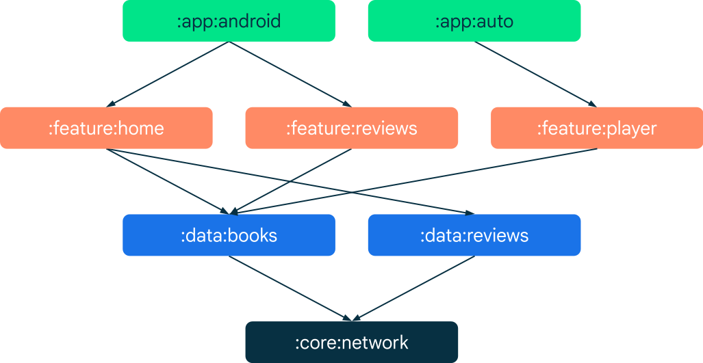

# Guide to Android app modularization

A project with multiple Gradle modules is known as a multi-module project. 

## The growing codebase problem

In an ever-growing codebase, scalability, readability, and overall code quality often decrease through time. 
This comes as a result of the codebase increasing in size without its maintainers taking active measures to enforce a structure that is easily maintainable. **Modularization** is a means of structuring your codebase in a way that improves maintainability and helps avoid these problems.

## What is modularization ?

Modularization is a practice of organizing a codebase into **loosely coupled and self contained parts**. 
Each part is a module. **Each module is independent and serves a clear purpose**. 
By dividing a problem into smaller and easier to solve subproblems, you reduce the complexity of designing and maintaining a large system.

## Benefits of modularization

- **Reusability**: Modularization enables opportunities for code sharing and building multiple apps from the same foundation. 
Modules are effectively building blocks. 
Apps should be a sum of their features where the features are organized as separate modules. 
The functionality that a certain module provides may or may not be enabled in a particular app. For example, a `:feature:news` can be a part of the full version flavor and wear app but not part of the demo version flavor.

- **Strict visibility control**: Modules enable you to easily control what you expose to other parts of your codebase. You can mark everything but your public interface as internal or private to prevent it from being used outside the module.

- **Customizable delivery**: *Play Feature Delivery* uses the advanced capabilities of app bundles, allowing you to deliver certain features of your app conditionally or on demand.

## Common pitfalls

The granularity of your codebase is the extent to which it is composed of modules. 
A more granular codebase has more, smaller modules. **When designing a modularized codebase, you should decide on a level of granularity**. 
**To do so, take into account the size of your codebase and its relative complexity**. 
Going too fine-grained will make the overhead a burden, and going too coarse will lessen the benefits of modularization.

Some common pitfalls are as follows:

- **Too fine-grained**: Every module brings a certain amount of overhead in the form of increased build complexity and boilerplate code. 
A complex build configuration makes it difficult to keep configurations consistent across modules. 
**Too much boilerplate code results in a cumbersome codebase that is difficult to maintain. If overhead counteracts scalability improvements, you should consider consolidating some modules**.

- **Too coarse-grained**: Conversely, if your modules are growing too large you might end up with yet another monolith and miss the benefits that modularity has to offer. For example, in a small project it’s ok to put the data layer inside a single module. But as it grows, it might be necessary to separate repositories and data sources into standalone modules.

- **Too complex**: It doesn't always make sense to modularize your project. A dominating factor is the size of the codebase. **If you don't expect your project to grow beyond a certain threshold, the scalability and build time gains won't apply.**

## Is modularization the right technique for me?

**If you need the benefits of reusability**, strict visibility control or to use the `Play Feature Delivery`, then modularization is a necessity for you. 
If you don't, but still want to benefit from improved scalability, ownership, encapsulation, or build times, then modularization is something worth considering.

