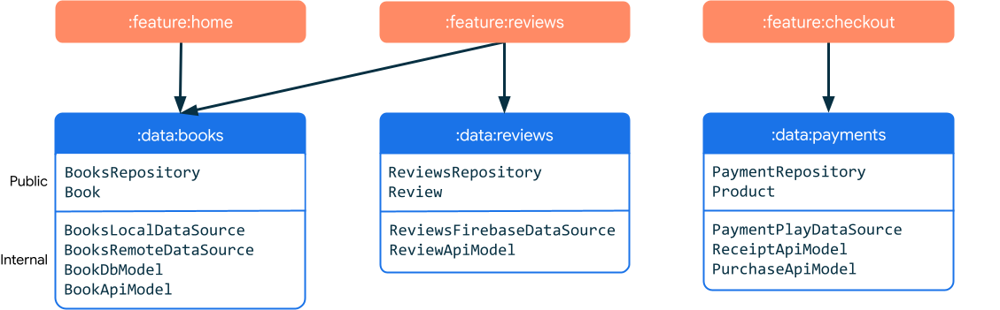
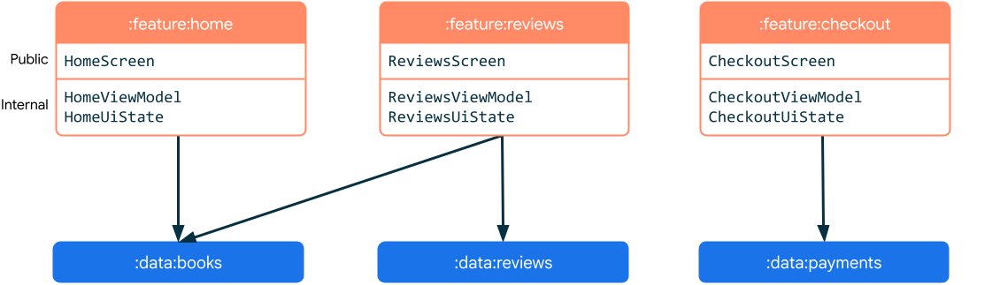
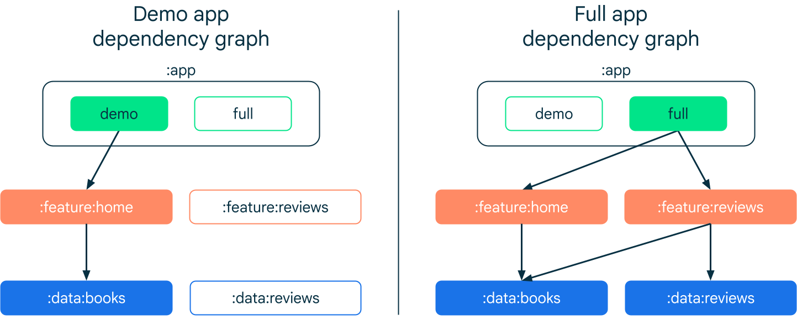
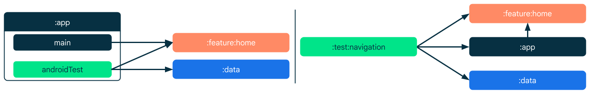
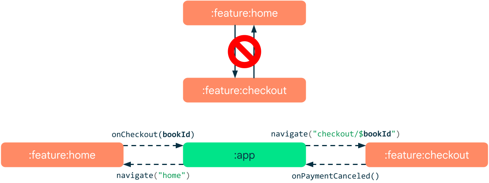
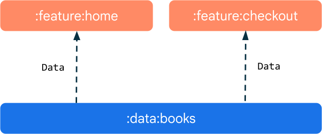
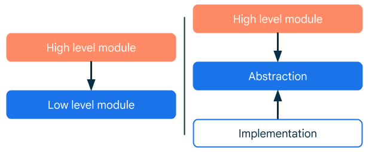

# Common modularization patterns

There is no single modularization strategy that fits all projects. Due to the flexible nature of Gradle there are few constraints as to how you can organize a project. 

This page gives an overview of some general rules and common patterns that you can employ when developing multi module Android apps.

## High cohesion and low coupling principle

As a [general rule](/ComputerScience/00_Fundamentals/00_Essentials/02_SoftwareConstruction/04_DesignPrinciple/01_SOLIDPrinciple/00_CouplingAndCohesion.md), you should strive for low coupling and high cohesion:

- **Low coupling** means that modules should be as independent as possible from one another, so that changes to one module have zero or minimal impact on other modules. **Modules shouldn't have knowledge of the inner workings of other modules.**

- **High cohesion** means that modules should comprise a collection of code that acts as a system. They should have clearly defined responsibilities and stay within boundaries of certain domain knowledge. Consider a sample ebook application. It might be inappropriate to mix book and payment related code together in the same module as they are two different functional domains

> [!TIP]
> If two modules heavily rely on knowledge of each other, it may be a good sign that they should actually act as one system. Conversely, if two parts of a module don’t interact with each other often, they should probably be separate modules.

## Types of modules

The way you organize your modules mainly depends on your **app architecture**. 

### Data modules

A data module usually contains a repository, data sources and model classes. The three primary responsibilities of a data module are:

1. **Encapsulate all data and business logic of a certain domain**: Each data module should be responsible for handling data that represents a certain domain. It can handle many types of data as long as they are related.
2. **Expose the repository as an external API**: The public API of a data module should be a repository as they are responsible for exposing the data to the rest of the app.
3. **Hide all implementation details and data sources from the outside**: Data sources should only be accessible by repositories from the same module. They remain hidden to the outside. You can enforce this by using Kotlin’s private or internal visibility keyword.

### Feature modules

A `feature` is an isolated part of an app's functionality that usually corresponds to a screen or series of closely related screens, like a sign up or checkout flow. 
If your app has a bottom bar navigation, it’s likely that each destination is a `feature`.

`Features` are associated with screens or destinations in your app. 
Therefore, they're likely to have an associated UI and `ViewModel` to handle their logic and state. 
A single `feature` doesn't have to be limited to a single view or navigation destination. **Feature modules depend on data modules**.

### App modules

App modules are an entry point to the application. They depend on feature modules and usually provide root navigation. 

A single app module can be compiled to a number of different binaries thanks to build variants.

If your app targets multiple device types, such as Android Auto, Wear or TV, define an app module for each one. 
This helps separate platform-specific dependencies.

### Common modules

Common modules, also known as core modules, contain code that other modules frequently use. 
They reduce redundancy and don't represent any specific layer in an app's architecture. The following are examples of common modules:

- **UI module**: If you use custom UI elements or elaborate branding in your app, you should consider encapsulating your widget collection into a module for all the features to reuse. This could help make your UI consistent across different features. For example, if your theming is centralized, you can avoid a painful refactor when a rebrand happens.
- **Analytics module**: Tracking is often dictated by business requirements with little consideration to the software architecture. Analytics trackers are often used in many unrelated components. If that's the case for you, it might be a good idea to have a dedicated analytics module.
- **Network module**: When many modules require a network connection, you might consider having a module dedicated to providing a http client. It is especially useful when your client requires custom configuration.
- **Utility module**: Utilities, also known as helpers, are usually small pieces of code that are reused across the application. Examples of utilities include testing helpers, a currency formatting function, email validator or a custom operator.

### Test modules

Test modules are Android modules that are used for testing purposes only.
The modules contain test code, test resources, and test dependencies that are only required for running tests and are not needed during the application's runtime.
Test modules are created to separate test-specific code from the main application, making the module code easier to manage and maintain.

#### Use cases for test modules

- **Shared test code**: If you have multiple modules in your project and some of the test code is applicable to more than one module, you can create a test module to share the code. This can help reduce duplication and make your test code easier to maintain. Shared test code can include utility classes or functions, such as custom assertions or matchers, as well as test data, such as simulated JSON responses.

- **Cleaner Build Configurations**: Test modules allow you to have cleaner build configurations, as they can have their own `build.gradle` file. You don't have to clutter your app module's `build.gradle` file with configurations that are only relevant for tests.

- **Integration Tests**: Test modules can be used to store integration tests that are used to test interactions between different parts of your app, including user interface, business logic, network requests, and database queries.

- **Large-scale applications**: Test modules are particularly useful for large-scale applications with complex codebases and multiple modules. In such cases, test modules can help improve code organization and maintainability.

## Module to module communication

Modules rarely exist in total separation and often rely on other modules and communicate with them. 
It’s important to keep the coupling low even when modules work together and exchange information frequently. 
Sometimes direct communication between two modules is either not desirable as in the case of architecture constraints. 
It may also be impossible, such as with cyclic dependencies.

To overcome this problem you can have a third module mediating between two other modules. 
The mediator module can listen for messages from both of the modules and forward them as needed. 
In this case, the mediator is the module that owns the navigation graph (usually an app module). 
In the example, we use navigation to pass the data from the home feature to the checkout feature using the Navigation component.

**You shouldn't pass objects as navigation arguments. Instead, use simple ids that features can use to access and load desired resources from the data layer**. This way, you keep the coupling low and don't violate the single source of truth principle.

## Dependency inversion

Dependency inversion is when you organize your code such that the abstraction is separate from a concrete implementation.

- **Abstraction**: A contract that defines how components or modules in your application interact with each other. Abstraction modules define the API of your system and contain interfaces and models.

- **Concrete implementation**: Modules that depend on the abstraction module and implement the behavior of an abstraction.

Modules that rely on the behavior defined in the abstraction module should only depend on the abstraction itself, rather than the specific implementations.

