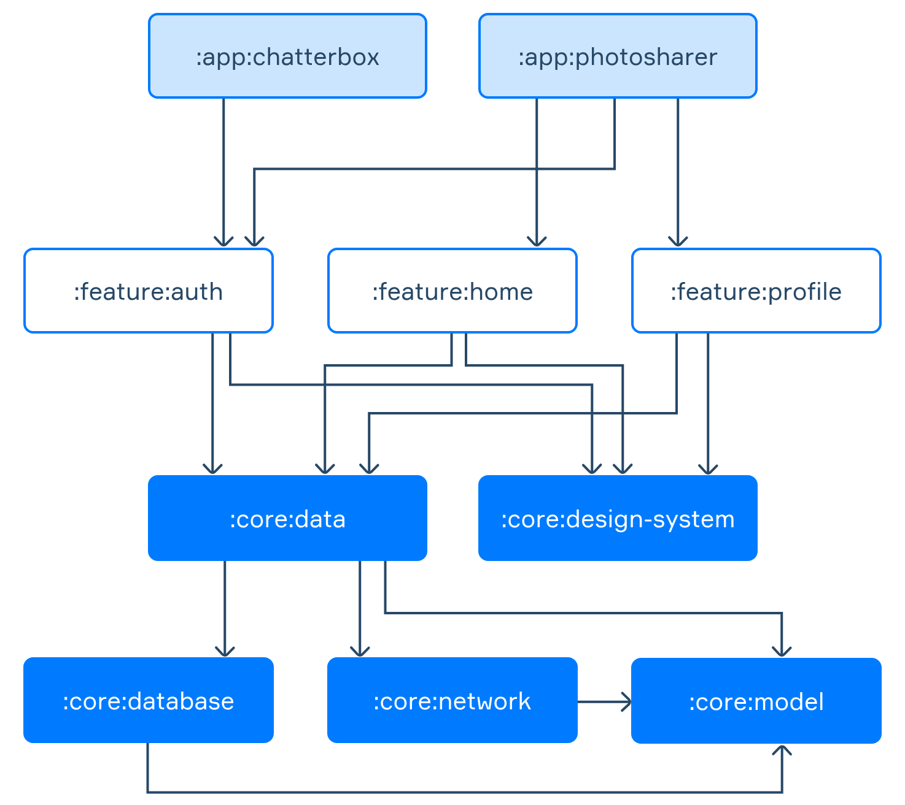
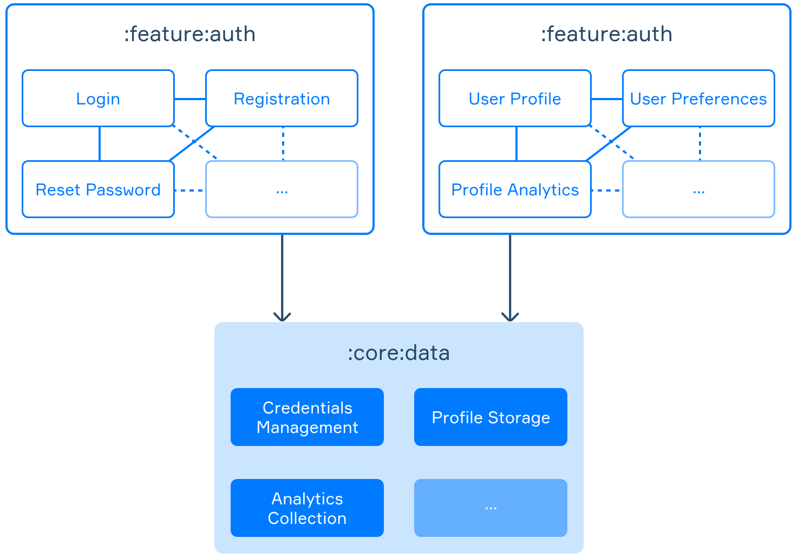
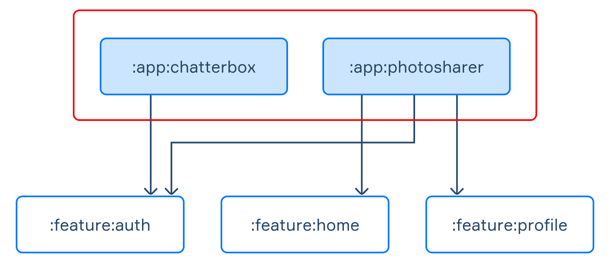
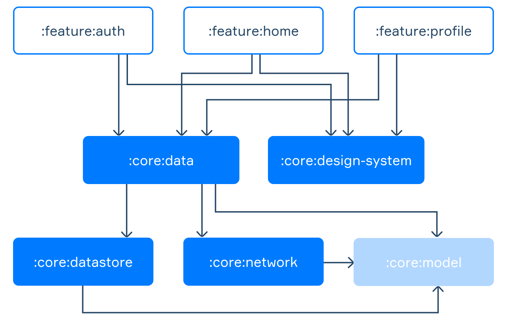
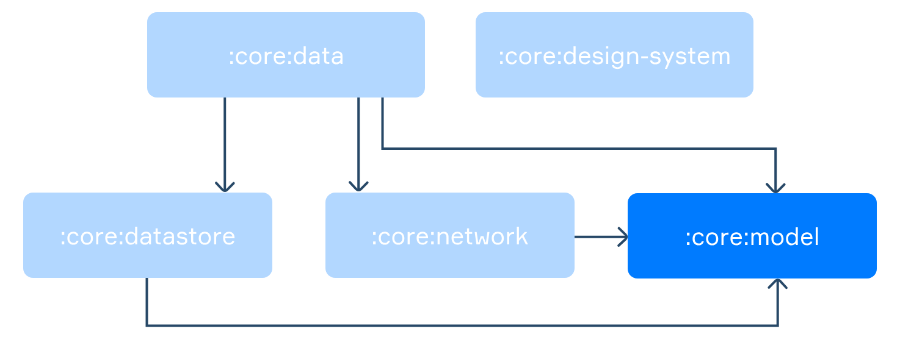
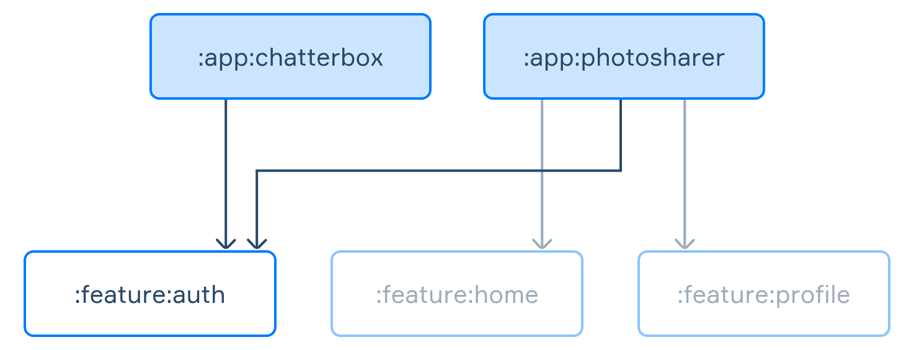
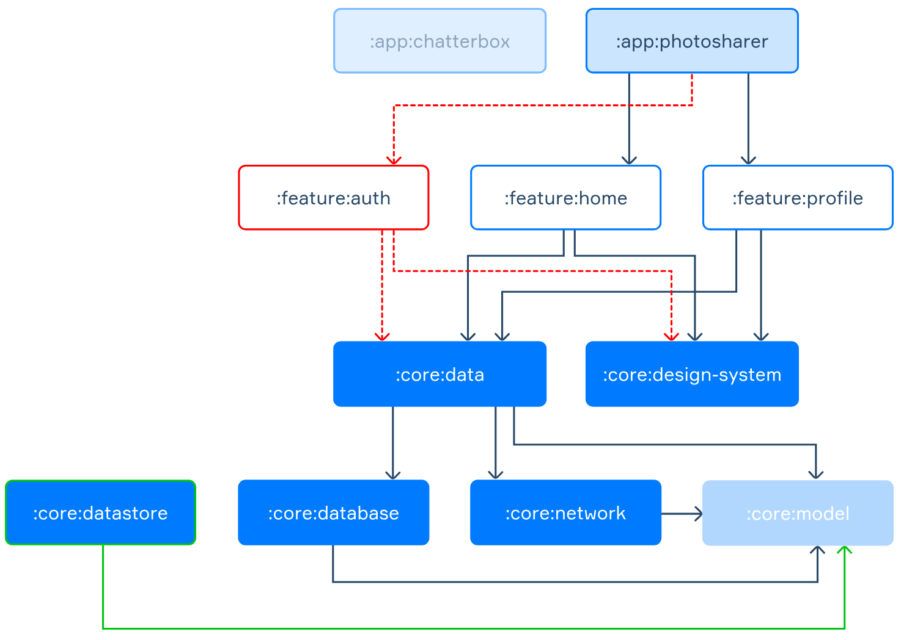

# Modules

When developing applications, the codebase tends to grow as the features of the application increase. This often results in code complexity, difficult maintenance, and decreased build speed. One way to manage this growth is through modularization.

Modularization involves splitting your app code into multiple modules, which can be maintained and developed separately.

## What are modules?

**Modules** are individual containers that hold specific parts of your codebase. They are separate entities within a project and can be compiled independently.

In this diagram, we have different groups of modules, such as `:app`, `:feature`, and `:core`, and each of these modules does a specific job. Modules handle bookkeeping of what's going on behind the scenes of our features, managing everything from individual sections of the application to specialized features and crucial background tasks like data processing, design, and networking. Together, these modules organize the codebase into distinct and functional units.

## Low coupling and high cohesion

Look at this diagram:

**Low coupling** means that each module depends as little as possible on the others. The modules `:feature:auth`, `:feature:profile`, and `:core:data` are designed to work together but remain primarily independent. 

This design choice enhances the flexibility of the system, allowing for changes or additions to one module without requiring changes in others. It promotes a more organized codebase, where each module focuses on a specific function, and interaction between modules is kept to the necessary minimum.

**High cohesion** means that everything inside a module is closely related to its specific purpose.

- `:feature:auth` is responsible for user authentication. It contains functionalities related to login, registration, and password reset. This module might use `:core:data` for credentials management and storage, but it doesn't need to know anything about other features like `:feature:profile`. 
The cohesion within this module ensures that all authentication-related tasks are closely knit, providing a unified and manageable set of functionalities.

- `:feature:profile` manages the user's profile, user preferences, and profile analytics. 
It might interact with `:core:data` for data storage and analytics collection. 
However, it doesn't need to know anything about other features like `:feature:auth`, maintaining a clear boundary and low coupling with other modules.

- `:core:data` takes care of all data-related operations, including credentials management, storage, and analytics collection. It can be used by any feature module that requires data handling, like `:feature:auth` for authentication or `:feature:profile` for user profile management. But it doesn't need to know what exactly those feature modules are doing with the data.

## Types of modules

Here are the module types we're going to focus on:

- **The application module** is essentially your Android application. It consists of the code, resources, and configuration files necessary to build the app that runs on devices.

We have two application modules `:app:chatterbox` and `:app:photosharer`, or two different applications. These modules are responsible for defining the basic configuration and orchestrating feature modules.

- **Android library module** is tailored for Android and contains both code and Android-specific resources. It is used to create components specifically for Android applications.

- **Kotlin module** is more generic, containing only Kotlin code, and can be used in any environment that supports Kotlin, including but not limited to Android. If you need a module that contains only pure logic without any dependencies on the Android framework, you might want to create a Kotlin module.

## Benefits of modularization

- **Code isolation**. This practice separates different parts of the code base into different modules or components, reducing dependencies and interactions between them.
- **Reusability**. Consider the user authentication module.
Once this module is developed, it can be reused not only in this PhotoSharer application, but also in any other application that requires user authentication.
This saves development time and ensures application consistency.

- **Scalability** is the ability to modify, extend, or reconfigure app parts without negatively impacting other components. 
If we decide to remove the `:feature:auth` component from the application or add a new `Datastore` component, we can do so easily.

- **Fast Gradle builds**. In a modular app using Gradle, modules can be built in parallel, speeding up the entire build process, especially on multi-core processors.

- **Testability**. Each module in the app can be tested independently. 
For instance, the `:feature:auth` module can be tested separately from the `:feature:home` or `:feature:profile `modules.
This promotes effective testing and reduces the scope of potential integration issues.

## Architecture strategies in modularization

When designing the architecture of an application, modularization can be approached in different ways.
The two primary approaches are modularizing by feature and by layer.

- **Modularizing by feature** is typically more appropriate for applications where distinct features can be developed and maintained independently.
It enhances code isolation and scalability but may lead to some duplication.

- **Modularizing by layer** is often more suitable for applications that clearly separate different types of tasks,
such as UI rendering, business logic processing, and data management.It can promote reusability but may lead to tighter coupling between layers.
We can create separate modules for the presentation layer, domain layer, and data layer. Each layer can define its own APIs and dependencies.

 
Choosing between these approaches depends on the project's specific needs and architecture.
**Understanding both methods enables you to select or even combine them most effectively for your particular application.**

> [!NOTE]
> Note that in our example, we employ a hybrid approach to modularization, combining both feature-based and layer-based modules for a comprehensive and flexible architecture.

## The logical order of steps to introduce modularization into an existing app

1. Identify areas of high cohesion and low coupling
2. Decide on modularization approach (by feature or layer)
3. Split app based on features or layers
4. Refactor codebase to introduce the modules
5. Test individual modules
