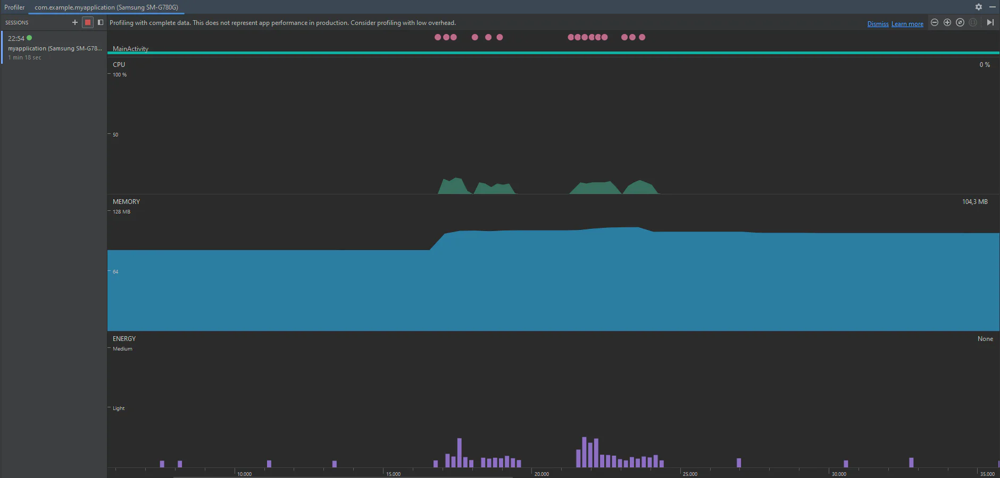
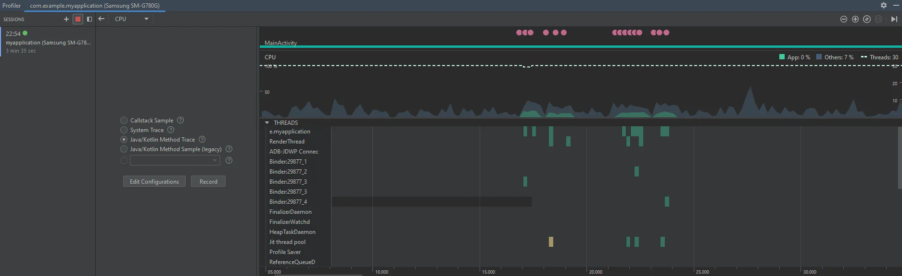
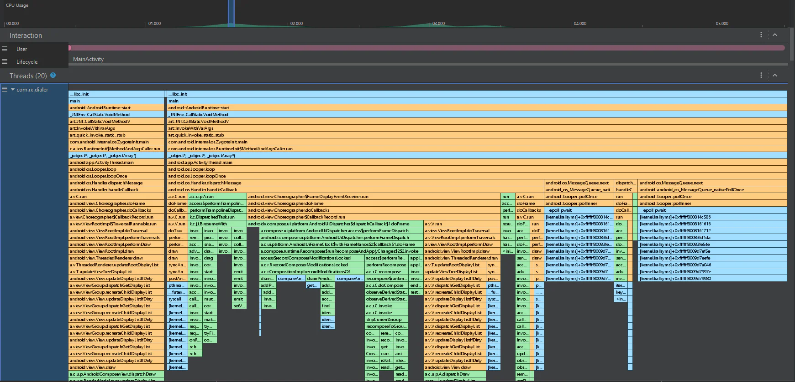
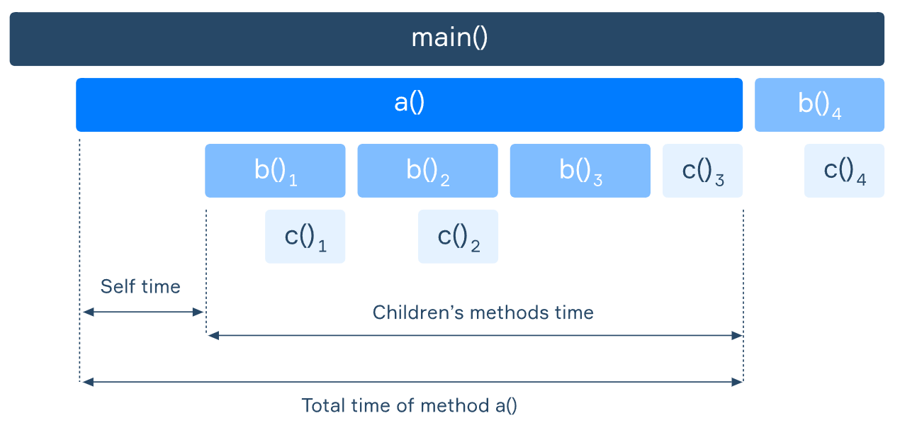
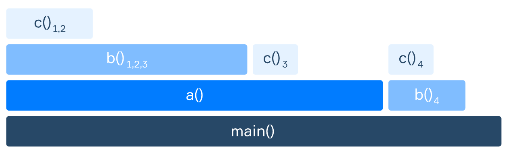

# CPU profiling


Unfortunately, it just so happens that we live in a world with a limited amount of resources.
This applies to both natural resources and resources of computer equipment, especially mobile devices.
For this reason, in most cases, software developers are forced to adapt to the hardware resources that most users' devices have when creating programs or games.

An application can be ideal in terms of writing code or building its architecture, but it can also be completely unusable and buggy due to improper and suboptimal use of system resources. Optimizing application resource usage is often critical for providing the best user experience. This is where profiling comes in handy.

## Profiling and Android Profiler

**Profiling** is a method of analyzing program execution.
It helps identify performance bottlenecks and inspect software consumption of system resources to optimize it and improve app performance.

**Android Profiler** is an Android Studio tool for real-time profiling of resources used by an application, such as CPU, memory, and energy.


To start profiling, you need to run Android Profiler by compiling the application on a physical Android device or in an emulator using the Profiler button on the top toolbar.

If you have already compiled the application, open the Profiler on the bottom toolbar or go to the main menu "View" → "Tool Windows" → "Profiler" (don't confuse it with "Profile"). After that, you will see a window with four timelines, as shown below:



- The topmost line displays the lifecycle of the current activity, as well as the actions performed by the user (touching the screen, flipping the device, pressing physical buttons, and so on).
- The next three, CPU, Memory, and Energy, show the usage of the respective resources at a particular point in time. Each metric has a separate profiling section with its tools and settings.
- You can save it as separate sessions to explore and compare resource consumption data in different scenarios

## CPU profiling

Your application's CPU usage data contains a wealth of information that can help you understand how optimally your application consumes the CPU resources,
what methods are using it and how much, how long it takes, and so on.

> [!NOTE]
> When using Android Profiler, the execution time of functions or methods may appear significantly longer than their actual runtime without the profiler. This happens because Android Profiler itself consumes system resources, which can slow down execution and affect the recorded times.
> Instead of relying on absolute time values, focus on the relative duration between different functions. For example:
> - If Function A appears to take longer than Function B in the profiler, it likely does in real execution as well.
> - However, the exact time (e.g., 200ms in the profiler might actually be 50ms) may not be accurate.


To start profiling the CPU, click on the CPU graph.
You will see a list of all threads used by your application. When there is any activity in the application, the timeline of threads will be highlighted with a certain color.
Each color corresponds to a specific state of that thread.



- **Green**: The thread is active and using the CPU.

- **Yellow**: The thread is active but is waiting for an I/O operation, after which it can complete its work.

- **Grey**: The thread is sleeping and not using the CPU.

## Record traces

A trace is a record of device activity over a specified period of time. 
For more detailed and in-depth CPU profiling, Android Profiler provides the ability to record all information about an application's execution and CPU usage.

Depending on the type of information you want to capture, you can choose one of the following trace recording configurations:

### 1. System Trace (Trace system calls or Systrace)

This configuration records detailed information with which you can see how the application interacts with system resources.
In addition, the records contain the exact timings and duration of the state of the application's threads.

Unlike other tools, Systrace provides target data such as CPU usage across all cores or other important information that Systrace automatically gathers, such as frame lifecycle.

It also tells us if a frame takes more than 16 milliseconds (1 s/60 fps = 16 ms per frame) and indicates what might be wrong and how we can fix it.

> [!WARNING]
> On the other hand, although this information is very useful, it doesn't appear in the context of the application's call stack. In other words, we cannot match it with the code we have written.
> However, there are various cases where Systrace can be useful, especially if you are tracking a specific piece of code. 
> In this case, you can add [custom trace events](https://developer.android.com/topic/performance/tracing/custom-events) — markers that indicate the given area that should be displayed in the call stack. As a result, you will be able to match the data that Systrace gives you with the code you have written.

### 2. Java/Kotlin Method Trace

The distinguishing feature of this configuration is that it traces each executed function,
collects and compares timestamps at the beginning and end of each method call to generate method tracing data, including information about time and CPU consumption.

So, all of these functions will be displayed in the call stack.
However, this approach, as you might have guessed, has a significant drawback.
Method Trace uses additional CPU resources that impact application performance, which in turn affects the profiling data, especially for methods with a short lifecycle.
If you're monitoring places with a high density of calls, there's a high chance you'll get distorted runtime performance data for your application.

### 3. Callstack Sample (Sample C/C++ Functions)

This setting collects callstack samples of native C/C++ functions at regular intervals while your app is running.

You can adjust the sampling interval to control how often data is collected.
- A longer interval reduces the profiler’s impact on performance but provides less detailed data, meaning you might miss important function calls.
- A shorter interval gives more detailed traces but can affect app performance, making the collected data less accurate.

### 4. Java/Kotlin Method Sample — legacy (Sample Java Methods)

With this configuration, the Profiler records the call stack at regular intervals while the app is running. After that, the Profiler compares the received data and shows information about timings and system resource usage by the application.

Note that the main problem with this approach is Short-lived methods (methods that execute quickly) may not be captured because they might finish before the next sampling interval. This means you could miss important details about their execution. To avoid this, use Method Trace or Systrace with custom events.

## Inspect traces

If you open the required record, on the top you will see the already familiar CPU usage graph, and just below the user's actions,
the lifecycle of the activity, as well as a list of the threads used by the application.
Each thread has its own Call Chart — a visual representation of methods and function traces of the application, the moments of their calls,
the duration of execution, including their child elements. To open the Call Chart, click on the triangle next to the name of the thread.



The color of each method or function corresponds to its type:

- **Orange** — belonging to system APIs;

- **Blue** — native methods and functions;

- **Green** — the call stack of your application's methods and functions (they are interested in the first place).

Let's take a look at the concept of method arrangement using this application as an example:

```kotlin
fun main() {
   a()
   b(true)
}

fun a() {
   b(true)
   b(true)
   b(false)
   c()
}

fun b(callC: Boolean) {
   if (callC) { c() }
}

fun c() { ... }
```

We have a `main()` function that contains and executes several sub-functions.
The length of each of these functions corresponds to its relative execution time.
The duration of a function's execution is the total execution time of its execution, plus the total execution time of its sub-functions.



Detailed trace data is located in the right window of Android Profiler. Let's take a quick look at each of the tabs.

- The **Flame Chart** tab displays the Call Chart. However, it concatenates identical call stacks.

For example, the functions `b()1`, `b()2`, and `b()3` in the chart above have the same call sequence (main → a → b).

Accordingly, they will be combined on the Flame Chart, just like `c()1` and `c()2`.
However, `c()3` and `c()4` have different call sequences, so they won't be combined. In addition, the items will be arranged in decreasing order of CPU usage duration.
In addition, the items will be arranged in decreasing order of CPU usage duration.



This way of displaying traces is very useful in cases when you need to see the overall picture of the method execution duration,
especially those that have a short lifecycle but are run very often.

- The **Top Down** and **Bottom Up** tabs contain methods arranged in a tree-like manner.
They are combined similarly, as we discussed above. On the right is a table that contains CPU usage data for each method and its children.

- The last tab, **Events**, contains information about all calls in the selected thread. By sorting the list in the order you want, you can quickly find the function that interests you and proceed to inspect it.


